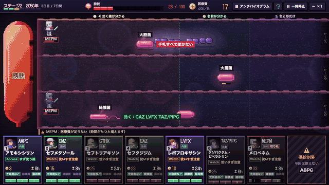

# センタクアツ（仮）― あなたの選択が、未来の敵をつくる

**抗菌薬の適正使用を、遊びながら体感して学ぶ教材です。** 抗菌薬（いわゆる抗生物質）は、薬ごとに効く細菌が違います。ほとんどの細菌に効く「切り札」ばかり使うと、薬が効かない細菌だけが残って増えます（選択圧）。このゲームでは、選んだ抗菌薬しだいで薬が効かない細菌が増え、ステージ2「2050年」で、自分が残した細菌と戦います。教える人は、地域の公開データと教えたいことを入れるだけで、Claude にステージを作らせられます。

作者：沢田 佳祐（薬剤師・博士（薬学）。病院で抗菌薬の使い方を支える AST（抗菌薬適正使用支援チーム）の薬剤師。感染制御専門薬剤師・抗菌化学療法認定薬剤師）。Built with Claude: Japan 2026 の応募作品（テーマ1「あなたにしかない深さを。」）

- **遊ぶ**（ブラウザだけ・ログイン不要。PC・タブレット・スマホ。スマホでは盤面を横向きで）：https://ph1125ks.github.io/Built-with-Claude-Japan-2026/
- **はじめての人へ**（医療を知らない人のための、抗菌薬と耐性菌のしくみ）：https://ph1125ks.github.io/Built-with-Claude-Japan-2026/intro.html
- **Claude がステージを作った記録を再生する**（API キー不要）：https://ph1125ks.github.io/Built-with-Claude-Japan-2026/replay.html



## なぜ作ったか

- 対策をとらなければ、2050年に薬剤耐性による死亡は年間1,000万人になり、がんを超えるという試算があります（The Review on Antimicrobial Resistance、2014年。AMR臨床リファレンスセンターも紹介）
- 耐性を防ぐ要は、抗菌薬の適正使用です。ところが、学生や新人がそれを実践的に学ぶ機会は少なく、教育の内容もまだ十分ではありません（ASP ガイダンス 2024 p.127）
- はじめは、どの細菌が原因か分かりません（検査の結果が出るまで数日かかる）。外して悪くなるのが怖いので、ほとんどの細菌に効く「切り札」（カルバペネム系など）が選ばれやすくなります。でも使うほど、薬が効かない細菌が選ばれて残ります
- 作者は病院の AST の薬剤師です。「切り札を使えば、いまは楽に勝てる。でも、そのつけは未来に回る」を、説明ではなく体験で伝えたくて作りました
- 医療を知らない人を含め、すべての人に伝わるように、立場の違う10人の評価役（中学生〜72歳、保護者、外国出身の人、審査員など）で確かめて直しました（[docs/eval/audience/](docs/eval/audience/README.md)、言い換えの決めごとは [docs/PLAIN-LANGUAGE.md](docs/PLAIN-LANGUAGE.md)）

## 何ができるか

### 学ぶ人（薬学生・新人の医療者）

1. **ステージ1「いま」**：国の公開データ（JANIS）の耐性率から始まります。細菌は、遠くでは顕微鏡で見た色と形（グラム染色）だけ、近づくと名前、さらに近づくと効かない薬が分かります（実際の検査の結果が、時間差で届くのと同じ）。手札の抗菌薬を兵士として呼び出して守ります。1ステージは7日間（ゲームの1日は24秒）で、細菌は1日に1群れ来ます。遊び方は絵の3枚で説明し、遊んでいる間の細かい説明は「？」パネルに、結果画面のいちばん上には「何を使ったから、どうなったか」の一文が出ます
2. **ステージ2「2050年」**：ステージ1の使い方が2050年まで続いたとみなした耐性率で始まります。切り札を乱用すると、自分が残した薬が効かない細菌に負けます
3. **振り返り**：結果画面は、膀胱の絵・呼び出した兵士・育った敵（薬が効かない細菌には盾の印）が主役です。系統別の使用割合、Access 薬の割合、系統の使い分け（AHI）、スペクトラムの広さ（DASC/DOT）、耐性率の変化は「くわしい数字」（教える人・専門家向け）に出ます。結果は「共有」ボタンで文にして送れ、その URL を開くと同じ条件でもう一度遊べます

自然耐性（腸球菌にセフェムは効かない）、内服薬の吸収率、投与間隔（＝召喚の待ち時間。カードの「6h」「8h」。ゲームの1時間＝1秒）、供給制限（遊ぶたびに手札の何枚かが使えなくなり、細菌の並びも変わる）、薬価も、公的な文書に沿って入れています。

### 教える人（薬剤師・教員）：教員モード

地域・対象・教えたいこと（例：「第3世代セフェムが効かない大腸菌に、カルバペネムを使わずに勝つ経験をさせたい」）を入れると、Claude がステージを設計します。

1. その地域の公開データと、使える薬・菌・見本のステージを読む
2. 案を作り、4つのボット（適正・乱用・ランダム・何もしない）で各60回シミュレーションする
3. 合格の目安（適正なら2050年も守れる、乱用すると2050年に負ける、など）に届かない・近すぎる点を直して、確かめ直す
4. 別の乱数の種で各100回確かめ直して提出する。教える人がプレビューで遊んで承認すると、学生用の URL と QR コードが出る

本番（動画のシーン6）では、Claude は1回目で目安をすべて満たしたのに、「乱用ボットの2050年の勝率 27% は上限 30% に近い」と自分で書き、敵の波を増やして 17% にしてから提出しました（約2分・約0.5ドル）。同じ入力でもう一度動かし、同じように 27% → 17% に直した回の記録を、[再生ページ](https://ph1125ks.github.io/Built-with-Claude-Japan-2026/replay.html)で記録した時間のとおりに見られます。**プログラムを書けない教員でも、自分の地域のデータで教材を作れる**ことが、この機能の目的です。

## Claude の使い方

| 場面 | 使ったもの | なぜ |
|---|---|---|
| ゲームの中：ステージの設計（教員モード） | `claude-opus-5-5`、Anthropic TypeScript SDK のツールランナー、5つのツール（`get_region_data`・`list_catalog`・`simulate_stage`・`validate_stage`・`submit_stage`）、adaptive thinking と経過の知らせ、指示のキャッシュ、サーバー側のモデル切り替え | 設計 → シミュレーション → 直す、を Claude 自身に回させるため。数値はツールが公開データから返すだけ |
| ステージ設計の知識 | スキル [`stage-design`](.claude/skills/stage-design/SKILL.md)（開発中の Claude Code と、教員モードの Claude が同じ本文を使う） | 良いステージの条件と直し方の定石を1か所にまとめるため。効果は下の「評価」 |
| 医学データの点検 | サブエージェント [`data-auditor`](.claude/agents/data-auditor.md)（読み取り専用） | 感受性・自然耐性・投与回数・吸収率・薬価を、公開データの元の表と照合する。データを変えるたびに使った |
| ゲームバランスの検証 | サブエージェント [`balance-tester`](.claude/agents/balance-tester.md) | 耐性モデルを2通り作り、ボットで比べて決めた |
| 試遊 | サブエージェント [`playtester`](.claude/agents/playtester.md)（アプリ内ブラウザで実際に操作） | 表示の崩れや分かりにくい言い回しを4回の試遊で直した |
| 公開データの取り込み | スキル [`janis-import`](.claude/skills/janis-import/SKILL.md) | JANIS と薬価基準の取り込み直しの手順 |
| 秘密を守る | フック（コミット前に API キーなどを探して止める。編集のたびにエンジンのテスト） | 公開リポジトリなので。実演で見つけたすり抜けも直した |
| デモ動画 | スクリプトで録画・字幕・声合わせ・BGM（すべてこのリポジトリのコード） | 3分の動画を、台本から作り直せるようにするため |

### Claude に任せないこと

- **感受性の数値**：公開データ（JANIS）のまま。Claude はツールで読むだけで、作ったり変えたりできない
- **薬の性質と薬価**：厚生労働省の手引き・薬価基準などの公的な文書から（下の表）
- **公開の判断**：Claude が作ったステージは下書き。専門家が確かめて承認するまで、学生には届かない
- **学生との会話**：作らない（このゲームの中の Claude は、ステージを作る役だけ）

### 評価：スキル `stage-design` あり・なし

本番と同じ入力（大阪府・病院実務実習の薬学生・「第3世代セフェムが効かない大腸菌に、カルバペネムを使わずに勝つ経験をさせたい」）で、教員モードの指示にスキルの本文を入れる・入れないの2条件を、各3回動かしました（2026-11-05、`claude-opus-5-5`。変えたのはスキルの有無だけ。`npx tsx scripts/eval-skill.ts --runs 3`）。

| | 提出できた | 1回目のシミュレーションで合格 | 規則の検査で止まった | シミュレーションの回数（平均） | 時間（平均） | 費用（平均） |
|---|---|---|---|---|---|---|
| スキルあり | 3／3 | 2／3 | 0／3 | 2.7 | 139秒 | 0.63ドル |
| スキルなし | 3／3 | 0／3 | 3／3 | 3.7 | 189秒 | 0.90ドル |

どちらも最後には合格のステージを出せました（ツールが誤りと目安を返すので、Claude はそれを見て直せます）。スキルなしでは、毎回「画面に並ぶ手札は8枚まで」の規則で止まり、系統の使い分け（AHI）の目安にも届かない案から始まりました。スキルありは規則の誤りがなく、時間と費用は約3割少なく済みました。件数が少ないので目安です。すべての回の作業の記録は [docs/eval/skill/](docs/eval/skill/) にあります（再生ページで `?log=` を指定すると見られるのは、公開した1回分だけ）。

## 信頼して使えるように

- このゲームは教育用のシミュレーションです。**実際の診療の判断には使えません**
- 感受性の数値は公開データ（JANIS）を加工したものです。耐性化の速さは、ゲーム用に誇張しています（上限は薬剤耐性ワンヘルス動向調査の実測の最速値）
- 医療費は、令和8年度の薬価基準をもとに段階化したものです（実際の金額ではありません）
- テスト 139 件（エンジン・ステージの検査・供給制限・ボットの基準・デモの展開・ドット絵・再生ページ・はじめての人へのページ）。`npm run data:verify` で、データを元の表と照らし合わせられます

| データ | 出典 | 利用条件 |
|---|---|---|
| 感受性率・尿から分離される菌の割合 | 厚生労働省 院内感染対策サーベイランス（JANIS）検査部門 公開情報 2025年1月〜12月 年報【入院検体・CLSI 2012 版】。政府統計の総合窓口（e-Stat）掲載のファイルを加工して作成 | 政府標準利用規約 第2.0版 |
| 薬価 | 厚生労働省「薬価基準収載品目リスト及び後発医薬品に関する情報について（令和8年11月1日適用）」を加工して作成 | 公共データ利用規約 第1.0版 |
| 用法・AWaRe 分類・吸収率・耐性の連動 | 厚生労働省「抗微生物薬適正使用の手引き 第四版」ほか（文書名とページを出典として記載。本文は写していません） | — |
| 自然耐性・代用ルール | EUCAST「Expected Resistant Phenotypes v1.2」「Expert Rules v3.2 on Enterococcus spp.」「Breakpoint tables v16.1」（判定を参照しただけで、文書は写していません） | — |
| 2050年までの耐性化の速さの上限 | 厚生労働省「薬剤耐性ワンヘルス動向調査年次報告書 2024」（数値だけを使用） | — |
| 動画の冒頭の試算（年間1,000万人） | The Review on Antimicrobial Resistance（議長 Jim O'Neill）「Antimicrobial Resistance: Tackling a crisis for the health and wealth of nations」2014年12月 p.5（数値だけを使い、図はこのリポジトリのコードで描き直した） | — |

文書ごとのページ、加工の内容、変換ルールは [data/README.md](data/README.md) にあります。ゲームの中の「出典と注意」の画面にも同じ内容を出しています。

## 審査の観点との対応

| 観点 | このリポジトリで見てほしいところ |
|---|---|
| インパクト | 作者の現場（AST）から出た課題。学ぶ人と教える人の両方。教員モードで、地域ごとの教材を作り続けられる |
| デモ | ブラウザだけで遊べる公開サイト（PC・タブレット・スマホ）。乱用すると2050年に負け、適正に使うと守り切れる |
| Claude の活用 | 教員モード（Claude が設計し、自分でシミュレーションして直す）、スキル・サブエージェント・フックの使い分け、スキルの評価 |
| 深さと実行力 | 公的な文書に沿ったデータと出典、耐性モデルを2通り作って比べた跡、試遊とデータ監査での直し、すべての人に伝わるかの評価（10人の評価役）と直し、テスト。経緯は [docs/DEVLOG.md](docs/DEVLOG.md) に日付つきで残した |

## 動かす（開発する人向け）

```bash
npm install
npm run dev        # 手元で遊ぶ（http://localhost:5173）
npm test           # エンジンの単体テストとボットの基準テスト
npm run build      # 公開用のビルド（dist/）
npm run sim -- --runs 200 --model A   # ボットでシミュレーション
```

URL で選べるもの：`?stage=`（ステージ。既定は「尿路（全国）」）、`?model=A`／`?model=B`（耐性の進み方。既定は A）、`?seed=`（乱数の種。省くと開くたびに変わり、結果の「くわしい数字」に出る）、`?region=`（全国と近畿の7府県）。

**教員モード**（手元でだけ動かす。API キーが要る）：

1. `ANTHROPIC_API_KEY=…` と書いた `.env` を置く（リポジトリ直下の `.env` はコミットされない。外に置くときは環境変数 `TEACHER_ENV_FILE` で指定）
2. `npm run teacher`（127.0.0.1:8787 だけで待ち受け）と `npm run dev` を動かし、http://localhost:5173/teacher.html を開く
3. 地域・対象・教えたいことを入れて「ステージを作る」→ プレビューで遊ぶ →「承認して公開する」で `public/stages/<id>.json` に書き出す

| フォルダ | 中身 |
|---|---|
| `src/engine/` | ゲームのロジック（描画なし。ブラウザなしで動く） |
| `src/game/` | 描画と操作（Phaser 3） |
| `src/teacher/`・`teacher.html` | 教員モードの画面（手元だけ） |
| `src/replay/`・`replay.html` | Claude の作業記録の再生ページ（公開） |
| `src/intro/`・`intro.html` | はじめての人へ（抗菌薬と耐性菌のしくみ。動画の「しくみ」の場面にも使う。公開） |
| `server/` | 教員モードのサーバーと、Claude のツール |
| `data/` | 菌・薬・薬価・感受性・ルール・ステージ、出典（`data/README.md`） |
| `scripts/` | データの取り込み、シミュレーション、スキルの評価、デモ動画づくり |
| `docs/` | 開発の記録（`DEVLOG.md`）、動画の台本（`DEMO.md`）、引き継ぎメモ（`HANDOFF.md`）、評価の記録（`eval/`） |

仕様は [SPEC.md](SPEC.md)。main に push すると、GitHub Actions がテストとビルドをして GitHub Pages に公開します。

## ライセンス

- コード：[MIT License](LICENSE)
- 公開データから作ったファイル（`data/generated/`）は、上の表のそれぞれの利用条件に従います（出典と「加工して作成」を明記して使えます）
- フォント：ドット絵の文字は [DotGothic16](https://github.com/fontworks-fonts/DotGothic16)（Fontworks、SIL Open Font License 1.1。npm の `@fontsource/dotgothic16` で同梱）
- 兵士・細菌・アイコン・膀胱などの絵と、動画の BGM は、すべてコードで作っています
