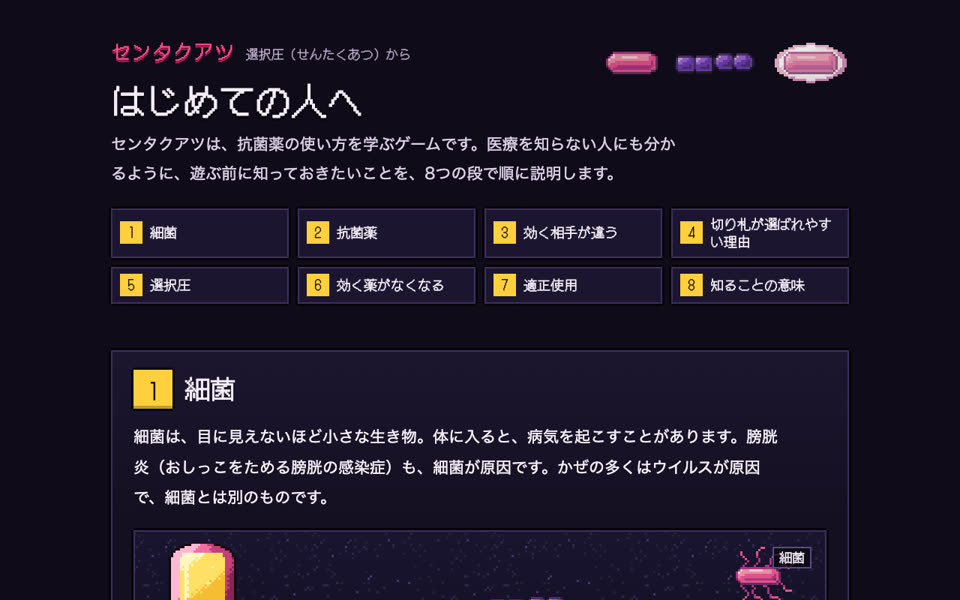
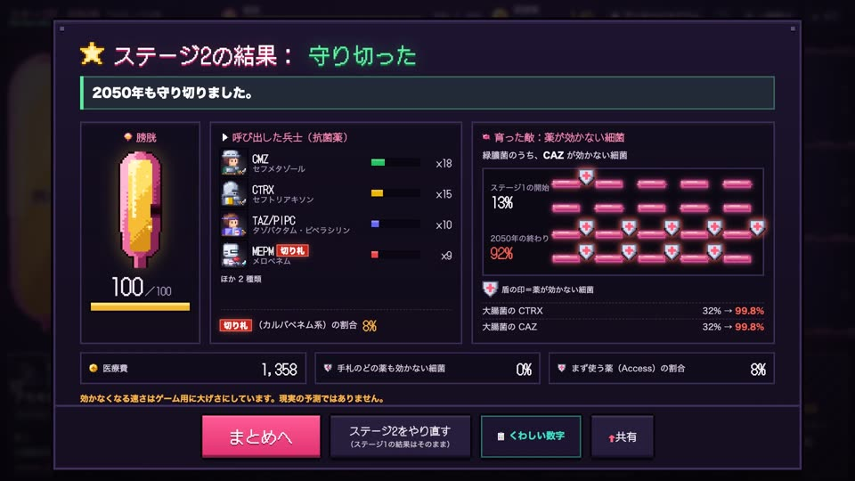
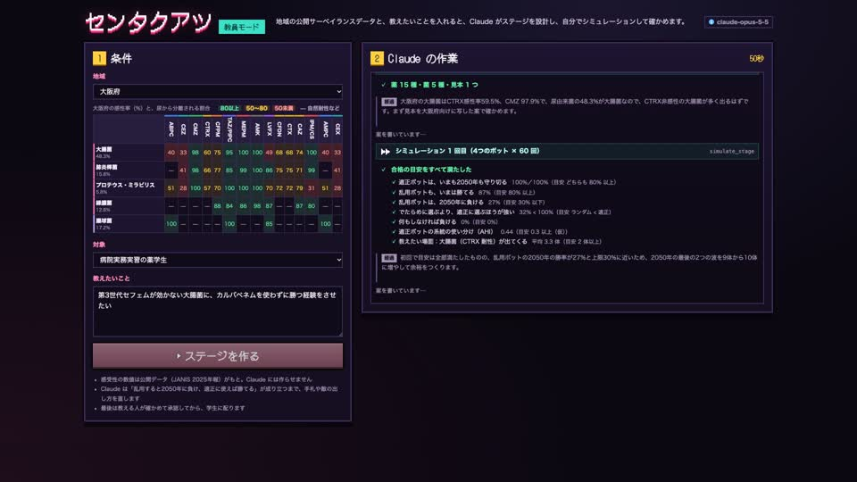

# センタクアツ ― あなたの選択が、未来の敵をつくる

**抗菌薬の使い方しだいで、未来に効く薬がなくなる。それを遊びながら体感する教材です。** 抗菌薬（いわゆる抗生物質）は、薬ごとに効く細菌が違います。ほとんどの細菌に効く「切り札」ばかり使うと、薬が効かない細菌だけが残って増えます（選択圧）。このゲームでは、選んだ抗菌薬しだいで薬が効かない細菌が増え、ステージ2「未来（2050年）」で、自分が残した細菌と戦います。教える人は、地域の公開データと教えたいことを入れるだけで、Claude にステージを作らせられます。

**教育用のシミュレーションで、実際の診療の判断には使えません。** 学生が遊ぶ画面に AI はいません。Claude は、教える人のためにステージを下書きする役だけで、教える人が確かめて承認するまで、学生には届きません（下の「Claude に任せないこと」）。

作者：沢田 佳祐（薬剤師・博士（薬学）。病院で抗菌薬の使い方を支える AST（抗菌薬適正使用支援チーム）の薬剤師。感染制御専門薬剤師・抗菌化学療法認定薬剤師。経歴は [researchmap](https://researchmap.jp/ph1125ks/) と [LinkedIn](https://www.linkedin.com/in/ph1125ks/)）。Built with Claude: Japan 2026 の応募作品（テーマ1「あなたにしかない深さを。」）。作者が個人として作った作品で、勤務先の病院や大学の公式のもの・公認を受けたものではありません

- **デモ動画（3分。日本語と英語の字幕を選べます）**：https://www.youtube.com/watch?v=kh1P8bZhaeI
- **遊ぶ**（ブラウザだけ・ログイン不要。PC・タブレット・スマホ。スマホでは盤面を横向きで）：https://ph1125ks.github.io/Built-with-Claude-Japan-2026/
- **はじめての人へ**（医療を知らない人のための、抗菌薬と耐性菌のしくみ）：https://ph1125ks.github.io/Built-with-Claude-Japan-2026/intro.html
- **Claude がステージを作った記録を再生する**（API キー不要）：https://ph1125ks.github.io/Built-with-Claude-Japan-2026/replay.html


**目次**：[なぜ作ったか](#なぜ作ったか) ／ [何ができるか](#何ができるか)（学ぶ人・教える人）／ [ハッカソンのあとも使う場面](#ハッカソンのあとも使う場面) ／ [作者の思い](#作者の思い) ／ [Claude の使い方](#claude-の使い方)（任せないこと・スキルの評価）／ [信頼して使えるように](#信頼して使えるように)（出典）／ [審査の観点との対応](#審査の観点との対応) ／ [期間中に作ったもの](#期間中に作ったもの期間前からあるもの) ／ [動かす](#動かす開発する人向け) ／ [ライセンス](#ライセンス) ／ [English summary](#english-summary)

**短い時間で見るなら**：①デモ動画（3分）→ ②[遊ぶ](https://ph1125ks.github.io/Built-with-Claude-Japan-2026/)（ステージ1で切り札 MEPM ばかり使うと、2050年で負けます。もう一度、系統を使い分けると守り切れます）→ ③[再生ページ](https://ph1125ks.github.io/Built-with-Claude-Japan-2026/replay.html)で Claude がステージを設計し、自分でシミュレーションして直す様子 → ④[審査の観点との対応](#審査の観点との対応)。開発の経緯は [docs/](docs/README.md) から。

## なぜ作ったか

- 対策をとらなければ、2050年に薬剤耐性による死亡は年間1,000万人になり、がんを超えるという試算があります（The Review on Antimicrobial Resistance、2014年。AMR臨床リファレンスセンターも紹介）
- 耐性を防ぐ要は、抗菌薬の適正使用です。ところが、学生や新人がそれを実践的に学ぶ機会は少なく、教育の内容もまだ十分ではありません（ASP ガイダンス 2024 p.127）
- はじめは、どの細菌が原因か分かりません（検査の結果が出るまで数日かかる）。外して悪くなるのが怖いので、ほとんどの細菌に効く「切り札」（カルバペネム系など）が選ばれやすくなります。でも使うほど、薬が効かない細菌が選ばれて残ります
- 作者は病院の AST の薬剤師です。「切り札を使えば、いまは楽に勝てる。でも、そのつけは未来に回る」を、説明ではなく体験で伝えたくて作りました
- 医療を知らない人を含め、すべての人に伝わるように、立場の違う10人の評価役（中学生〜72歳、保護者、外国出身の人、審査員など。Claude のサブエージェントに人物を演じさせたもので、実在の人ではありません）で確かめて直しました（[docs/eval/audience/](docs/eval/audience/README.md)、言い換えの決めごとは [docs/PLAIN-LANGUAGE.md](docs/PLAIN-LANGUAGE.md)）



## 何ができるか

### 学ぶ人（薬学生・新人の医療者）

1. **ステージ1「現在」**：国の公開データ（JANIS）の耐性率から始まります。細菌は、遠くでは顕微鏡で見た色と形（グラム染色）だけ、近づくと名前、さらに近づくと効く薬が分かります（実際の検査の結果が、時間差で届くのと同じ）。手札の抗菌薬を兵士として呼び出して守ります。1ステージは7日間（ゲームの1日は24秒）で、細菌は1日に1群れ来ます。遊び方は絵の3枚で説明し、遊んでいる間の細かい説明は「？」パネルに、結果画面のいちばん上には「何を使ったから、どうなったか」の一文が出ます
2. **ステージ2「未来（2050年）」**：ステージ1の使い方が2050年まで続いたとみなした耐性率で始まります。切り札を乱用すると、自分が残した薬が効かない細菌に負けます
3. **振り返り**：結果画面は、膀胱の絵・呼び出した兵士・育った敵（薬が効かない細菌には盾の印）が主役です。系統別の使用割合、Access 薬の割合、系統の使い分け（AHI）、スペクトラムの広さ（DASC/DOT）、耐性率の変化は「くわしい数字」（教える人・専門家向け）に出ます。結果は「共有」ボタンで文にして送れ、その URL を開くと同じ条件でもう一度遊べます



自然耐性（腸球菌にセフェムは効かない）、内服薬の吸収率、投与間隔（＝召喚の待ち時間。カードの「6h」「8h」。ゲームの1時間＝1秒）、供給制限（遊ぶたびに手札の何枚かが使えなくなり、細菌の並びも変わる）、薬価も、公的な文書に沿って入れています。

### 教える人（薬剤師・教員）：教員モード

地域・対象・教えたいこと（例：「第3世代セフェムが効かない大腸菌に、カルバペネムを使わずに勝つ経験をさせたい」）を入れると、Claude がステージを設計します。

1. その地域の公開データと、使える薬・菌・見本のステージを読む
2. 案を作り、4つのボット（適正・乱用・ランダム・何もしない）で各60回シミュレーションする
3. 合格の目安（適正なら2050年も守れる、乱用すると2050年に負ける、など）に届かない・近すぎる点を直して、確かめ直す
4. 別の乱数の種で各100回確かめ直して提出する。教える人がプレビューで遊んで承認すると、学生用の URL と QR コードが出る



本番（動画のシーン8。2026-11-08 の回）では、Claude は大阪府の値（大腸菌の CTRX 感性率 59.5%・CMZ 97.9%）を読んで、見本から1か所だけ（供給制限の候補から CMZ を外して、いつでも CMZ を選べるように）変えた案を作り、1回目のシミュレーションで目安をすべて満たし、「適正ボットのカルバペネム系の使用は 0.3%」を確かめてから提出しました（約1分・約0.3ドル）。別の回では、1回目で合格したのに「乱用ボットの2050年の勝率 27% は上限 30% に近い」と自分で書き、敵の波を増やして 17% にしてから提出しています。その回の記録を、[再生ページ](https://ph1125ks.github.io/Built-with-Claude-Japan-2026/replay.html)で記録した時間のとおりに見られます。**プログラムを書けない教員でも、自分の地域のデータで教材を作れる**ことが、この機能の目的です。

いま作ってあるのは膀胱炎（尿路）のステージだけです。ステージの波に出てくる菌は、その検体（いまは尿）から分離される菌の割合を公開データから読んで選ばれるので、肺炎など別の感染症も、その検体の公開データ（JANIS には喀痰や血液の年報もある）から菌と割合を選び直せば作れる形にしています（膀胱の絵と言い回しは尿路向けなので、そのままは使えない。今回の範囲は尿路だけ：[SPEC.md](SPEC.md) 11）。

## ハッカソンのあとも使う場面

- **院内の新人・若手の勉強会**：作者は病院の AST の薬剤師。切り札に手が伸びる場面を、説明ではなく体験で振り返る
- **病院の実務実習の薬学生**：実習の中で、ステージ1「現在」→ ステージ2「未来（2050年）」を1回遊び、結果の「共有」で振り返りを持ち寄る
- **大学の講義・実習**：教員モードで、その地域の公開データのステージを作って配る（学生用の URL と QR コード）
- 地域や対象が変わっても、教員モードで作り直せるので、使い続けられる。医療を知らない人には「はじめての人へ」のページから

## 作者の思い

- **数年来の構想を、ここで初めて試せた**：「抗菌薬の不適切な使用が耐性菌を増やし、未来の感染症の治療を難しくする」ことを疑似体験できるゲームを作りたい、という着想は数年前からあった。ただ、教育の目的で出したいので、特定の製薬企業などから開発費の支援を受けるのは教育上フェアでないかもしれないとためらい、学会にも「ゲームを作るための助成」という前例のない依頼は通りにくく、アイデアだけが固まっていく状況が続いていた。Built with Claude: Japan 2026 の機会に数日間試してみて、この構想は実現できるものだと分かった
- **これからも続ける**：この経験をもとに開発費を得て、細菌と抗菌薬の種類を増やし、肺炎など別の感染症に広げて学びの内容を深めれば、より多くの未来の医療従事者を育てられ、それは最終的に多くの人のためになると考えている。「抗菌薬の適正使用」は、医療従事者・研究者としての作者の生涯のミッションで、このプロジェクトもこの先も続けていく
- **作者の役割は、アイデアの提供とエビデンスの担保**：作者は期間中、作業時間をほとんど取れなかった。そこで開始の時点で自分の役割を「アイデアの提供と、医学的な根拠の担保」に絞り、それ以外は Claude Code に全面的に任せた。7日間の作業の中心は、Claude Code からの通知をスマートフォンで受け取り、AskUserQuestion（選択肢付きの質問）に答えることだった。専門的な知識や技術を持ちながら、ライフステージなどの事情でそれを発揮する時間を十分に取れない人は少なくない。そんな環境でも、限られた時間の中で自分の専門性を出し切り、世の中への貢献を続けられる可能性を感じた。どんな環境に置かれていても、自分の専門性を発揮することを諦める必要はない、ということを伝えていきたい

## Claude の使い方

Claude はゲームの作り方は知っていますが、抗菌薬の教え方の勘所（どの薬をどの順で、どこで失敗させるか）は知りません。そこは作者が言葉にしてスキルに書き、Claude に渡しました。作者の判断が要る所は、Claude Code が選択肢と推奨を付けて質問し（AskUserQuestion）、作者がスマートフォンから答えました。医学の数値と文は作者が公的な文書と照らし、それ以外の判断は Claude Code に任せています。道具の分担は、`CLAUDE.md` は守らせる約束だけ（公開リポジトリ・日本語・push しない）、スキルは作者だけが持つ知識と手順、サブエージェントはファイルを書き換えない点検役、フックは機械的に止める検査、です。

| 場面 | 使ったもの | なぜ |
|---|---|---|
| 企画（初日） | Claude Code が作者に質問して決めた [SPEC.md](SPEC.md)「インタビューで決めたこと」と [docs/DEMO.md](docs/DEMO.md) | 作者が当たり前と思っていること（自然耐性、内服薬の吸収率、切り札が選ばれやすい理由）を先に言葉にし、作らないこと（SPEC.md 11）と、できたと言える条件（SPEC.md 12）を決めてから作るため |
| ゲームの中：ステージの設計（教員モード） | `claude-opus-5-5`、Anthropic TypeScript SDK のツールランナー、5つのツール（`get_region_data`・`list_catalog`・`simulate_stage`・`validate_stage`・`submit_stage`）、adaptive thinking と経過の知らせ、指示のキャッシュ、サーバー側のモデル切り替え | 設計 → シミュレーション → 直す、を Claude 自身に回させるため。数値はツールが公開データから返すだけ。シミュレーションのエンジンとステージの JSON は手元にあり、API キーも手元にだけ置く方針なので、Claude に預ける仕組み（Managed Agents）ではなく、手元で動くツールランナーにした |
| ステージ設計の知識 | スキル [`stage-design`](.claude/skills/stage-design/SKILL.md)（開発中の Claude Code と、教員モードの Claude が同じ本文を使う） | 良いステージの条件と直し方の定石を1か所にまとめるため。効果は下の「評価」 |
| 医学データの点検 | サブエージェント [`data-auditor`](.claude/agents/data-auditor.md)（読み取り専用） | 感受性・自然耐性・投与回数・吸収率・薬価を、公開データの元の表と照合する。データを変えるたびに使った |
| ゲームバランスの検証 | サブエージェント [`balance-tester`](.claude/agents/balance-tester.md) | 耐性モデルを2通り作り、ボットで比べて決めた |
| 試遊 | サブエージェント [`playtester`](.claude/agents/playtester.md)（アプリ内ブラウザを MCP のツールで実際に操作） | 表示の崩れや分かりにくい言い回しを4回の試遊で直した（記録の例：[docs/eval/audience/11-game-playtest.md](docs/eval/audience/11-game-playtest.md)） |
| 公開データの取り込み | スキル [`janis-import`](.claude/skills/janis-import/SKILL.md) | JANIS と薬価基準の取り込み直しの手順 |
| 秘密を守る | フック（コミット前に API キーなどを探して止める。エンジンやデータを編集したときにエンジンのテスト） | 公開リポジトリなので。実演で見つけたすり抜けも直した |
| デモ動画 | スクリプトで録画・字幕・声合わせ・BGM（すべてこのリポジトリのコード） | 3分の動画を、台本から作り直せるようにするため |

### Claude に任せないこと

- **感受性の数値**：公開データ（JANIS）のまま。Claude はツールで読むだけで、作ったり変えたりできない
- **薬の性質と薬価**：厚生労働省の手引き・薬価基準などの公的な文書から（下の表）
- **公開の判断**：Claude が作ったステージは下書き。教える人（薬剤師・教員）が確かめて承認するまで、学生には届かない
- **学生に見せる文**：Claude が書くブリーフィングと振り返りの文も下書きの一部で、教える人が読んで承認してから学生に届く。使わないと決めた語・投与量の数値・「投与してください」のような診療の指示に読める文は、コードの検査（`src/engine/stagecheck.ts`）で止める
- **学生との会話**：作らない（このゲームの中の Claude は、ステージを作る役だけ）

最後に人が確かめること、数値の出どころを確かめられること（ツールが公開データの値と出典を返す）、責任を負う人がいること（承認した教える人）を、仕組みにしています。

### 評価：スキル `stage-design` あり・なし

本番と同じ入力（大阪府・病院実務実習の薬学生・「第3世代セフェムが効かない大腸菌に、カルバペネムを使わずに勝つ経験をさせたい」）で、教員モードの指示にスキルの本文を入れる・入れないの2条件を、各3回動かしました（2026-11-05、`claude-opus-5-5`。変えたのはスキルの有無だけ。`npx tsx scripts/eval-skill.ts --runs 3`）。

| | 提出できた | 1回目のシミュレーションで合格 | 規則の検査で止まった | シミュレーションの回数（平均） | 時間（平均） | 費用（平均） |
|---|---|---|---|---|---|---|
| スキルあり | 3／3 | 2／3 | 0／3 | 2.7 | 139秒 | 0.63ドル |
| スキルなし | 3／3 | 0／3 | 3／3 | 3.7 | 189秒 | 0.90ドル |

どちらも最後には合格のステージを出せました（ツールが誤りと目安を返すので、Claude はそれを見て直せます）。スキルなしでは、毎回「画面に並ぶ手札は8枚まで」の規則で止まり、系統の使い分け（AHI）の目安にも届かない案から始まりました。スキルありは規則の誤りがなく、時間と費用は約3割少なく済みました。件数が少ないので目安です。すべての回の作業の記録は [docs/eval/skill/](docs/eval/skill/) にあります（再生ページで `?log=` を指定すると見られるのは、公開した1回分だけ）。

## 信頼して使えるように

- このゲームは教育用のシミュレーションです。**実際の診療の判断には使えません**
- 自分や家族の抗菌薬を、自己判断でやめたり、量や回数を変えたりしないでください。気になることは、処方した医師や薬剤師に相談してください
- 感受性の数値は公開データ（JANIS）を加工したものです（厚生労働省や JANIS 事務局が作成・確認したものではありません）。耐性化の速さは、ゲーム用に誇張しています（上限は薬剤耐性ワンヘルス動向調査の実測の最速値）
- 医療機関の記録やデータは使っていません（使っているのは、国の公開データと、下の表の公開されている文書だけ）
- 医療費は、令和8年度の薬価基準をもとに段階化したものです（実際の金額ではありません）
- テスト 139 件（エンジン・ステージの検査・供給制限・ボットの基準・デモの展開・ドット絵・再生ページ・はじめての人へのページ）。`npm run data:verify` で、データを元の表と照らし合わせられます
- 作らないと決めたこと（学生と Claude の会話、投与量の計算、尿路以外の臓器など）は [SPEC.md](SPEC.md) の 11 に、できたと言える条件は 12 に書いています
- 提出前に、公開リポジトリの点検をしました：追跡しているファイルと git の履歴に API キーや個人情報がないこと、URL の値を画面に HTML として描いていた所（直した）、教員モードのサーバーが手元のブラウザ以外の要求を受けないこと（直した）。経緯は [docs/DEVLOG.md](docs/DEVLOG.md)

| データ | 出典 | 利用条件 |
|---|---|---|
| 感受性率・尿から分離される菌の割合 | 厚生労働省 院内感染対策サーベイランス（JANIS）検査部門 公開情報 2025年1月〜12月 年報【入院検体・CLSI 2012 版】。政府統計の総合窓口（e-Stat）掲載のファイルを加工して作成 | 政府標準利用規約 第2.0版 |
| 薬価 | 厚生労働省「薬価基準収載品目リスト及び後発医薬品に関する情報について（令和8年11月1日適用）」を加工して作成 | 公共データ利用規約 第1.0版 |
| 用法・AWaRe 分類・吸収率・耐性の連動 | 厚生労働省「抗微生物薬適正使用の手引き 第四版」ほか（文書名とページを出典として記載。本文は写していません） | — |
| 自然耐性・代用ルール | EUCAST「Expected Resistant Phenotypes v1.2」「Expert Rules v3.2 on Enterococcus spp.」「Breakpoint tables v16.1」（判定を参照しただけで、文書は写していません） | — |
| 2050年までの耐性化の速さの上限 | 厚生労働省「薬剤耐性ワンヘルス動向調査年次報告書 2024」（数値だけを使用） | — |
| 動画の冒頭の試算（年間1,000万人） | The Review on Antimicrobial Resistance（議長 Jim O'Neill）「Antimicrobial Resistance: Tackling a crisis for the health and wealth of nations」2014年12月 p.5（数値だけを使い、図はこのリポジトリのコードで描き直した） | — |

文書ごとのページ、加工の内容、変換ルールは [data/README.md](data/README.md) にあります。ゲームの中の「出典と注意」の画面にも同じ内容を出しています。

## 審査の観点との対応

| 観点 | このリポジトリで見てほしいところ |
|---|---|
| インパクト | 作者の現場（AST）から出た課題。学ぶ人と教える人の両方。ハッカソンのあとも使う場面と、数年来の構想をこの先も続けること（上の2つの節）。教員モードで、地域ごとの教材を作り続けられる |
| デモ | ブラウザだけで遊べる公開サイト（PC・タブレット・スマホ）。乱用すると2050年に負け、適正に使うと守り切れる |
| Claude の活用 | 教員モード（Claude が設計し、自分でシミュレーションして直す）、スキル・サブエージェント・フックの使い分け、スキルの評価 |
| 深さと実行力 | 公的な文書に沿ったデータと出典、耐性モデルを2通り作って比べた跡、試遊とデータ監査での直し、すべての人に伝わるかの評価（10人の評価役）と直し、テスト。リポジトリは 11/2 のキックオフのあとに作り始め、コミットはすべて期間中。初日に決めきれなかった点（耐性の進み方 A/B、医療費の方式、薬の用法の確認、召喚の待ち時間）を、ボットの比較・データ監査・試遊で決めていった経緯は [docs/DEVLOG.md](docs/DEVLOG.md) に日付つきで残した |

## 期間中に作ったもの・期間前からあるもの

- **期間中（2026-11-02 のキックオフのあと）に作ったもの**：このリポジトリのすべて。コード、データの取り込みと変換、ステージ、テスト、文書、`.claude/` のスキル2つ・サブエージェント3つ・フック（11/2〜11/4 に追加）。最初のコミットは 2026-11-02 18:45 で、仕様（SPEC.md）も初日に Claude Code の聞き取りで書いた
- **期間前からあるもの（この作品の成果ではない）**：作者の専門知識と経歴、手元の資料（論文・国の手引き・公開データの元のファイル。参照しただけで、リポジトリには入れていない）、作者個人の Claude Code の設定（返答の言語などの約束。リポジトリの外にあり、この作品のためのものではない）
- **作った人と AI**：作者が1人で作った（コミットの名義は作者の GitHub アカウントだけ）。開発の中心は Claude Code で、共同コミットの名義にある Claude Opus 5.5 と Claude Fable 5.1 は、どちらも Claude Code で使った Claude のモデル

## 動かす（開発する人向け）

使っている技術：Node.js 24（GitHub Actions と同じ）、Vite、TypeScript、Phaser 3、Vitest。教員モードは Anthropic TypeScript SDK（`claude-opus-5-5`）。外部のサービスは Claude API（教員モードだけ）のほかに使わず、公開サイトは静的なファイルだけで動く。動作を確かめたブラウザ：PC の Chrome、iPhone の Safari（Android の Chrome は未確認）。

```bash
npm install
npm run dev        # 手元で遊ぶ（http://localhost:5173）
npm test           # エンジンの単体テストとボットの基準テスト
npm run build      # 公開用のビルド（dist/）
npm run sim -- --runs 200 --model A   # ボットでシミュレーション
```

URL で選べるもの：`?stage=`（ステージ。既定は「尿路（全国）」）、`?model=A`／`?model=B`（耐性の進み方。既定は A）、`?seed=`（乱数の種。省くと開くたびに変わり、結果の「くわしい数字」に出る）、`?region=`（全国と近畿の7府県）。

**教員モード**（手元でだけ動かす。API キーが要る）：

1. `.env.example` を `.env` という名前でコピーして、`ANTHROPIC_API_KEY=…` を書く（リポジトリ直下の `.env` はコミットされない。外に置くときは環境変数 `TEACHER_ENV_FILE` で指定。キーはこのサーバーの中だけで使い、画面にも公開サイトにも送らない）
2. `npm run teacher`（127.0.0.1:8787 だけで待ち受け）と `npm run dev` を動かし、http://localhost:5173/teacher.html を開く
3. 地域・対象・教えたいことを入れて「ステージを作る」→ プレビューで遊ぶ →「承認して公開する」で `public/stages/<id>.json` に書き出す
4. 1回のステージ作成の上限は、シミュレーション 8 回（実測で2〜3分・約0.5〜0.9ドル。トークンと費用は作業の記録に残る）。サーバーは 127.0.0.1 だけで待ち受け、ログインの仕組みはないので、手元の PC 以外では動かさない

| フォルダ | 中身 |
|---|---|
| `src/engine/` | ゲームのロジック（描画なし。ブラウザなしで動く） |
| `src/game/` | 描画と操作（Phaser 3） |
| `src/teacher/`・`teacher.html` | 教員モードの画面（手元だけ） |
| `src/replay/`・`replay.html` | Claude の作業記録の再生ページ（公開） |
| `src/intro/`・`intro.html` | はじめての人へ（抗菌薬と耐性菌のしくみ。動画の「しくみ」の場面にも使う。公開） |
| `server/` | 教員モードのサーバーと、Claude のツール |
| `data/` | 菌・薬・薬価・感受性・ルール・ステージ、出典（`data/README.md`） |
| `scripts/` | データの取り込み、シミュレーション、スキルの評価、デモ動画づくり（一覧は [scripts/README.md](scripts/README.md)） |
| `docs/` | 開発の記録（`DEVLOG.md`）、動画の台本（`DEMO.md`）、引き継ぎメモ（`HANDOFF.md`）、評価の記録（`eval/`）。読む順は [docs/README.md](docs/README.md) |

仕様は [SPEC.md](SPEC.md)。main に push すると、GitHub Actions がテストとビルドをして GitHub Pages に公開します。

## ライセンス

- コード：[MIT License](LICENSE)
- 公開データから作ったファイル（`data/generated/`）は、上の表のそれぞれの利用条件に従います（出典と「加工して作成」を明記して使えます）
- フォント：ドット絵の文字は [DotGothic16](https://github.com/fontworks-fonts/DotGothic16)（Fontworks、SIL Open Font License 1.1。npm の `@fontsource/dotgothic16` で同梱）
- 兵士・細菌・アイコン・膀胱などの絵と、動画の BGM は、すべてこのリポジトリのコードで作っています（外部の画像や音源は使っていません。コードと同じ MIT License）
- デモ動画に出る作者の写真・映像・声は作者本人のもので、このリポジトリには入れていません（MIT License の対象外）

## English summary

**Sentakuatsu** ("selection pressure" in Japanese) is an educational tower-defense game about antimicrobial stewardship. The way you use antibiotics today decides which bacteria survive and multiply, and in stage 2, set in 2050, you fight the resistant bacteria you yourself left behind. It is a simulation for learning, not a tool for clinical decisions. There is no AI in the student's screen.

- **Play** (browser only, no login; PC, tablet, phone in landscape): https://ph1125ks.github.io/Built-with-Claude-Japan-2026/
- **Demo video** (3 min, Japanese narration with English subtitles available): https://www.youtube.com/watch?v=kh1P8bZhaeI
- **Replay of Claude designing a stage** (no API key needed): https://ph1125ks.github.io/Built-with-Claude-Japan-2026/replay.html

**For learners** (pharmacy students, new clinicians): Stage 1 "Now" starts from real national surveillance data (JANIS) on antibiotic susceptibility. Bacteria reveal themselves gradually as they approach, like lab results arriving over days: first Gram stain, then species, then susceptibility. You summon antibiotics as soldiers. Overusing broad-spectrum "trump cards" such as carbapenems wins stage 1 easily, but stage 2 "Future (2050)" starts from the resistance you created, and you lose. Intrinsic resistance, oral bioavailability, dosing intervals, drug shortages and drug prices follow public documents from the Ministry of Health, Labour and Welfare and EUCAST.

**For teachers** (pharmacists, faculty): In "teacher mode", you enter a region, an audience and a learning goal (for example, "let students beat third-generation-cephalosporin-resistant E. coli without carbapenems"). Claude (`claude-opus-5-5`, via the Anthropic TypeScript SDK tool runner) reads that region's public data, drafts a stage, runs it with four bots (appropriate, abusive, random, do-nothing) 60 times each, fixes what misses the pass criteria, re-verifies with other random seeds, and submits. The teacher plays the preview and approves it before students ever see it; approval produces a student URL and QR code. Claude cannot create or change susceptibility numbers; tools only return public data.

**How Claude Code was used**: the author, a hospital antimicrobial-stewardship pharmacist with a PhD, provided the ideas and verified the medical evidence; Claude Code did the rest, asking the author multiple-choice questions on a phone when a decision was needed. Domain knowledge the author alone has is written as a skill (`stage-design`) shared by the development-time Claude Code and the in-game teacher-mode Claude. Read-only subagents audit the medical data against the source tables, run bot simulations to compare balance, and play-test the game in a browser. Hooks block commits containing secrets and run engine tests after edits. A small A/B evaluation (3 runs each, same input) found that the skill removed rule violations and cut time and cost by about 30%. Everything in this repository was built between the kickoff on 2026-11-02 and the deadline on 2026-11-08; the dated development log is in [docs/DEVLOG.md](docs/DEVLOG.md) (Japanese).

Submitted to Built with Claude: Japan 2026 (Theme 1). The author built it as an individual; it is not an official product of their employer. Code is MIT licensed; data derived from public sources follows each source's terms (see the table above).
