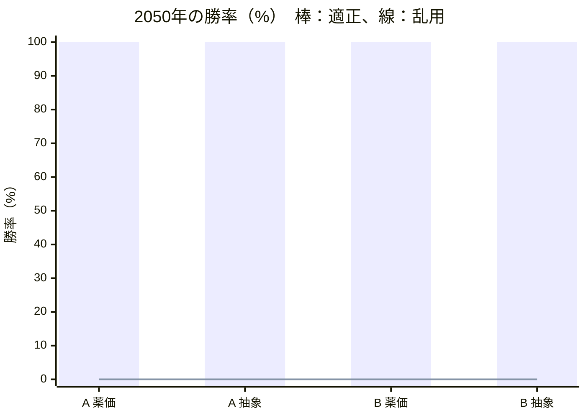
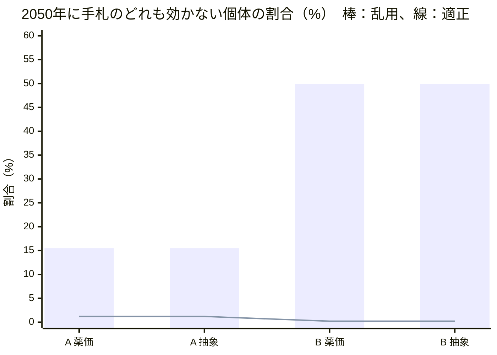
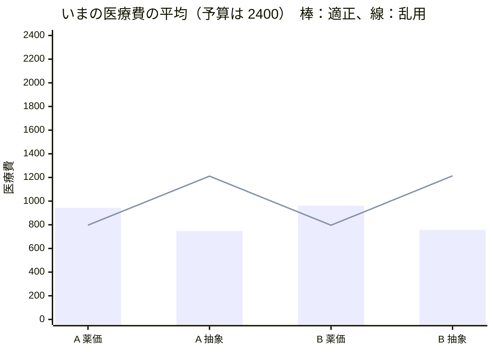

# 開発記録

試行錯誤と判断の跡を、日付つきで残す。動画のシーン7と、提出フォームの「Claude 利用」の欄に使う。

---

## 2026-11-02（月）

### 企画

- 作者へのインタビューで、ゲームの中の Claude の役割（教員モードでステージを作る）、使う場面、耐性化の仕組み、山場（未来ステージ）などを決め、[SPEC.md](../SPEC.md) と [docs/DEMO.md](DEMO.md) を書いた
- 下調べはサブエージェントに任せた（公開データの中身と利用条件）
  - JANIS のサイトが 2026-10-27 から停止中と分かった。同じ年報が e-Stat に Excel で載っているので、出典は e-Stat にした
  - 利用条件は、e-Stat が政府標準利用規約（第2.0版）、厚労省サイトが公共データ利用規約（第1.0版）。どちらも CC BY 4.0 互換で、出典と加工の明記で使える

### 実装（SPEC.md の 11/3 分を前倒し）

- **土台**：TypeScript・Vite・Vitest。描画は Phaser。
  - npm の最新は Phaser 4（2026-04 公開）だった。仕様どおり、使い慣れた情報の多い v3 の最終版 3.90.0 に固定した
- **公開データの取り込み**（`scripts/data/`）
  - Python に Excel を読むライブラリがなかったので、Node の exceljs に統一した。取り込みも検証もゲームと同じ TypeScript で書ける
  - 感受性は割合でなく株数で持ち、使うときに割合を計算する（丸めのずれを避ける）
  - 年報の値と一致することをテストで確かめた：全国の大腸菌の CTRX 感性率 68.1%、京都府 63.7%
  - 地域差：大阪府の大腸菌は CTRX 59.5%、LVFX 48.7%（全国は 68.1%、56.2%）。デモの「地域で変わる」場面に使える
  - 1日量の薬価（同じ規格の最小値 × 仮の1日量）：内服 LVFX 36.7 円 〜 MEPM 3,285 円
  - `npm run data:verify` を作った。元の Excel との一致、菌×薬の扱い（データ 33・代用 4・自然耐性 12・固定値 1・値なし 0）、監修待ち 17 項目の一覧を出す
- **エンジン**（`src/engine/`）：描画から切り離し、ブラウザなしで動く
  - 細菌は出現時に、薬ごとに感受性か耐性かが決まる（いまの耐性率に従う。自然耐性は必ず耐性）
  - 抗菌薬は「体内の薬の量」を HP として持ち、投与間隔の長さで 0 になる。内服は吸収率のぶん削れて出る。待ち時間＝投与間隔
  - 情報は距離で明らかになる（遠い：グラム染色、中ほど：菌名、近い：感受性）。プレイヤー（人・ボット）に渡す情報は、明らかになったものだけ
  - 乱数の種を固定でき、同じ種と操作なら同じ結果になる（録画とシミュレーションの再現のため）
  - 耐性モデル A・B は差し替えられる形にした（中身は 11/4）
- **シミュレーターとボット**：適正・乱用・偏り（LVFX だけ）・ランダム・何もしない
- **テスト**：25 件（公開データとの一致、自然耐性、代用、召喚と投与間隔、吸収率、情報の見え方、勝敗、再現性、ボットの強さの順序、速さ）

#### 最初のシミュレーション（耐性モデルなし。仮ステージ `data/stages/dev-uti.json`、全国、各 100 回、種 1〜100）

| ボット | いま勝率 | 未来勝率 | いま膀胱の残り | 医療費 | 主な系統 |
|---|---|---|---|---|---|
| 適正 | 100% | 100% | 99% | 719 | セファマイシン 38%、キノロン 35%、BL/BLI 20%、ペニシリン 7% |
| 乱用 | 100% | 100% | 99% | 1193 | カルバペネム 59%、BL/BLI 41% |
| 偏り（LVFX） | 20% | 11% | 3% | 183 | キノロン 100% |
| ランダム | 77% | 68% | 27% | 731 | ばらばら |
| 何もしない | 0% | 0% | 0% | 0 | — |

- シナリオ1本（いま＋未来）は約 8ms。教員モードで Claude が数百回回しても待たせない
- 耐性モデルがまだないので、未来はいまとほぼ同じ結果。乱用しても困らない状態で、これを 11/4 に変える
- 適正ボットは、グラム陰性桿菌しか見えない段階で CMZ を選んだ（全国データで、グラム陰性桿菌4種を尿の分離数で重み付けした効く見込みは CMZ 82.4%、CTRX 59.4%）。デモ台本の「まず CTRX」とは違う。録画は台本どおりの操作シナリオで行い、ボットの選び方が教える内容として妥当かは監修で確かめる
- 乱用ボットは腸球菌に MEPM を使っても倒せない（腸球菌の MEPM は、値がないため「効かない扱い」の仮の設定）。この扱いは監修待ち

### Claude Code の使い分け

| 目的 | 使ったもの | 結果 |
|---|---|---|
| 公開データと利用条件の下調べ | サブエージェント（汎用） | e-Stat への切り替え、利用条件、代表値の表 |
| 鍵と個人情報の流出防止 | フック（`.claude/hooks/check-secrets.sh`、コミット前） | API キーらしき文字列を置くと、場所だけを示してコミットを止めることを確かめた。手元だけの秘密は `.claude/secret-patterns.local`（コミットしない）に書く |
| 壊れていないかの確認 | フック（`.claude/hooks/test-engine.sh`、編集後） | エンジン・テスト・データを編集すると単体テストが走り、失敗すると結果が返る |
| データの照合 | サブエージェント `data-auditor`（定義：`.claude/agents/`） | 下の「データ監査」 |
| バランスの検証・試遊 | サブエージェント `balance-tester`・`playtester` | 定義だけ作った（11/4 から使う） |
| 取り込みの手順 | スキル `janis-import` | 年報や薬価が新しくなったときの手順 |

- フックは、このセッションで実際に発火することを目印のファイルで確かめた
- サブエージェントの定義はセッションの途中で作ったので、このセッションでは名前で呼べなかった。今回は汎用のサブエージェントに同じ定義ファイルを読ませて動かした

### データ監査（サブエージェント `data-auditor` の初回）

`npm run data:verify` とシミュレーションを再実行し、公開データ・カタログ・SPEC・台本を突き合わせた。照合は一般に知られている基準の内容によるもので、CLSI・EUCAST の原文との突き合わせはしていない。

- **元の Excel との一致**：JANIS・薬価とも一致。菌×薬の50組は、データ 33・代用 4・自然耐性 12・固定値 1・値なし 0
- **食い違い 4 件 → 直した**
  1. SPEC の腸球菌の自然耐性にアミノグリコシド系が抜けていた
  2. SPEC のカード表に CFPM と AMK がなかった（カタログには 10 枚ある）。教員モード用の追加カードとして SPEC に足した
  3. data/README.md に、自然耐性の根拠にする基準、投与回数・吸収率の出典、丸めの規則がなかった
  4. この記録の「CMZ 約 83%」は、計算し直すと 82.4%（CTRX は 59.4%）だった。自分でも計算して確かめてから直した
  - あわせて、台本シーン6の字幕を「公開データ（JANIS）がもと」に直した（50組のうち代用4・固定値1は JANIS の値そのものではないため）
- **作者の監修に回したもの（値は変えていない）**
  - 経口第3世代セフェムを CTX で代用すると、注射の CTRX より効く値になる（大腸菌 71.1% 対 68.1%）。教えたいことと逆向きなので、CTRX で代用するか、低いほうを使うかを決める
  - CMZ の順位（3）が CTRX（4）より狭いため、適正ボットは CTRX を一度も使わない。台本の「まず CTRX、耐性なら CMZ」と逆の動きになる
  - LVFX と CFPM、CTRX と CFDN が同じ順位で、同順位はコストで決まるため、安い内服が先に選ばれる
  - 腸球菌の MEPM（固定値 0）は自然耐性ではない。画面で「耐性」と出すと獲得耐性と誤解されるので、表示を分けるか決める
  - TAZ/PIPC・ABPC・CEZ・CMZ の投与回数、AMK の1日量、CFDN の吸収率 0.25 は、添付文書・IF の値の確認が要る
  - CEZ を「S のみ」で数えると、SorI（大腸菌 12.9% など）がすべて効かない扱いになる
- **バランスへの影響**：MEPM だけを連打すると勝率 86%、膀胱の残り 28%（種 1〜100）。台本の「連打して楽勝」と合わない。乱用ボット（MEPM＋TAZ/PIPC）なら勝率 100%。11/4 のバランス調整で扱う

### 公的な文書に沿った設定への切り替え

作者の方針：「できるだけ作者の感覚ではなく、公的な文書に沿った設定にする」。作者が用意した厚生労働省「抗微生物薬適正使用の手引き 第四版」の4冊（計293ページ）を読み、監修項目ごとに、手引きで決められるかを整理した。

- **用法**：作者が「手引きの表」を選んだ（国内の電子添文ではなく）。8剤を治療例の表に合わせた
  - 変わったもの：TAZ/PIPC 1日3回 → 6時間毎（1日4回）、CFPM 1日2回 → 8時間毎（1日3回）、ABPC 1回1g → 1回2g（6時間毎）、AMK 400mg → 15mg/kg（体重60kgで900mg。体重の仮定は残る）（→ 2回目の監査のあと、尿路感染症の記載に合わせて 10mg/kg 1日1回に変更）
  - 手引きの表は海外用量を含む。国内の電子添文との違い（例：ABPC は添文では1日1〜2回）は、薬ごとの sources に書いた
  - CEZ と経口第3世代セフェムは手引きに用法がないので「仮」のまま（→ 2回目の監査で訂正：CEZ は表1にあった）
- **狭い順**：独自の順位（spectrumRank）をやめ、WHO の AWaRe 分類（手引きの表）とカルバペネムの温存（手引き）で決めるようにした
  - 監査で指摘された「CMZ が CTRX より狭い」は、手引きでは裏付けがなかった（どちらも Watch）
  - 同じ順位どうしの決め方で一度つまずいた。「効く見込みが高いほう」を優先したら、適正ボットがグラム陰性桿菌の段階で TAZ/PIPC を選ぶようになった（広い薬を選んでいる）。「カバー率（尿から出る菌全体に効く見込み）が低いほう＝狭い」に直した。カバー率は公開データから計算でき、乱用ボットの「広い」と対になる
  - 全国のカバー率：ABPC 44%、CEZ 31%、CMZ 68%、CTRX 49%、CFPM 68%、TAZ/PIPC 95%、MEPM 80%、AMK 82%、LVFX 73%、CFDN 49%
- **耐性の連動（ESBL）**：腸内細菌目で CTRX に耐性の個体は、ABPC・CEZ・経口第3世代セフェムにも耐性にした。CMZ・MEPM は連動させない（手引き：ESBL はセファマイシン系とカルバペネム系を分解しない）
  - 薬ごとの全体の耐性率がデータのままになるよう、CTRX に感性の個体の耐性の確率を調整した。4000匹で確かめて、どの薬も表の値と ±3% 以内
  - 監査で指摘された「経口第3世代セフェムが CTRX より効く」逆転は、連動の下限で解消した（全国の大腸菌：28.9% → 31.9%）
- **結果画面**：AWaRe 別の使用割合を足した（WHO の目標は Access 60%以上、日本は2023年に23.2%）
- **医療費への影響**：手引きの用量で計算すると、ABPC（1日8g）は1日 3,272円で、MEPM（3,285円）と同じ最上位の段階になった。TAZ/PIPC（1日4回）も最上位。段階の区切りは 11/5 のバランス調整で見直す
- テスト：34件（用法の出典、AWaRe の順、連動の正しさと耐性率の保存、ボットの選び方を追加）
- 編集後フックが、途中の状態（使う側を先に書き、import を後から足した瞬間）でのテスト失敗を2回知らせた。どちらも次の編集で解消した

#### シミュレーション（耐性モデルなし。仮ステージ、全国、各 100 回、種 1〜100）

| ボット | いま勝率 | 未来勝率 | 医療費 | Access 割合 | 主な系統 |
|---|---|---|---|---|---|
| 適正 | 100% | 100% | 868 | 7% | セファマイシン 40%、キノロン 36%、BL/BLI 16%、ペニシリン 7% |
| 乱用 | 100% | 100% | 1451 | 0% | カルバペネム 69%、BL/BLI 31% |
| 偏り（LVFX） | 19% | 7% | 179 | 0% | キノロン 100% |
| ランダム | 62% | 52% | 841 | 17% | ばらばら |
| 何もしない | 0% | 0% | 0 | 0% | — |

- 適正ボットでも Access 割合は 7%（腸球菌への ABPC だけ）。全国の大腸菌は ABPC・CEZ の感性率が低く（46.8%、43.2%）、尿路では Access 薬だけで治療しにくいことが数字に出た。WHO の目標と日本の現状の差を説明する材料になる

### データ監査（2回目：`data-auditor` を名前で呼んで実行）

手引きの PDF とページを突き合わせてもらった。ページ番号は4冊とも印刷のページと一致。指摘はすべて手引きの本文で確かめてから直した。

- **誤り 6 件 → 直した**
  1. 「CEZ の用法は手引きに記載なし」は誤りだった。薬剤耐性菌感染症編 表1（p.6）に MSSA 菌血症で 1回2g・8時間毎がある（国内の添文の上限 5g/日、重症例の 1回2g・8時間毎は審査上認められる：p.61）。CEZ を 1回2g・8時間毎にした
  2. セフジニルの吸収率は手引きにあった（歯科編 表9 p.21：20〜25%）。0.25 は範囲の上限として「確認済み」にした
  3. ABPC の出典の要約が広すぎた。表2 は VRE による血流感染症の例で、血流感染症の用量であることを書き足した
  4. 台本シーン5の「狭い薬に切り替えます」が新しい順位と合わなかった（CMZ と CTRX は同じ Watch で、カバー率では CMZ のほうが広い）。「カルバペネムを温存できる薬に切り替えます」に直した。あわせて「投与回数も実際の薬どおり」を「国の手引きをもとにしています」に直し、出典の字幕を足した
  5. 「AWaRe で狭い順を決める」は言い過ぎだった。AWaRe は耐性化したときに困る度合いの分類で、使う順に当てはめるのはゲームとしての判断だと明記した
  6. 「60%以上」の記載は p.37（表9 は p.38）
- **手引きの記載に沿って変えたもの**
  - フルオロキノロン系を、カルバペネム系と並んで「後に回す」系統に加えた（医科・外来編 p.45：大腸菌の耐性率が約40%で腎盂腎炎の第一選択に適さず、できるだけ温存すべきとされる）
  - AMK を、尿路感染症に限った記載（医科・外来編 p.45 注16：10mg/kg 1日1回）に合わせた。体重60kgで600mg＝200mg 管3本になり、端数もなくなった。表4（15mg/kg）とどちらを採るかは作者の判断待ち
  - 用量の採り方を書き出した：表の範囲の中に国内の添文の上限に収まる値があればそれ（CFPM、LVFX）、なければ表の値（ABPC、CEZ、TAZ/PIPC）
  - 手引きの表は特定の場面の治療例で、尿路感染症の用量の表ではないことを data/README.md に書いた
  - Access 60% は国全体の消費量に対する目標で、1ステージの割合とは比べる対象が違うことを SPEC に書いた
- **作者の判断待ち**：CFPM を ESBL の連動に入れるか（手引きは ESBL なら選択肢にならないとし、JANIS の CLSI 2012 の感性率と食い違う）、AMK の用量、腸球菌×MEPM の固定値
- 監修待ちの一覧は 12 件 → 11 件

#### シミュレーション（直した後。仮ステージ、全国、各 100 回、種 1〜100）

| ボット | いま勝率 | 未来勝率 | いま膀胱の残り | 医療費 | Access 割合 | 主な系統 |
|---|---|---|---|---|---|---|
| 適正 | 100% | 100% | 99% | 949 | 9% | セファマイシン 45%、BL/BLI 25%、キノロン 21%、ペニシリン 9% |
| 乱用 | 97% | 96% | 45% | 782 | 0% | キノロン 66%、カルバペネム 34% |
| 偏り（LVFX） | 19% | 7% | 3% | 179 | 0% | キノロン 100% |
| ランダム | 62% | 52% | 16% | 881 | 17% | ばらばら |
| 何もしない | 0% | 0% | 0% | 0 | 0% | — |

- 乱用ボットは、MEPM が待ち時間のあいだ LVFX を使うようになった（どちらも「温存すべき」の最上位）。膀胱の残りが 45% まで落ちた。台本の「MEPM を連打して楽勝」は、録画用の操作シナリオで別に作る
- 適正ボットは、緑膿菌に LVFX ではなく TAZ/PIPC を選ぶようになった（キノロン 36% → 21%）

### 手引き以外の公的文書の取得と反映

作者の「取得して」を受け、手引きで決まらない項目に要る文書を公式サイトから取得した。

- **取得した文書**（作業用フォルダに保存。リポジトリには入れない）
  - EUCAST「Expected Resistant Phenotypes」v1.2（2023年1月、401.7KB）
  - EUCAST「Expert Rules v3.2 on Enterococcus spp.」（2020年2月、204.6KB）
  - EUCAST「Breakpoint tables」v16.1（2026-06-24 から有効、4.2MB）
  - クラビット錠 インタビューフォーム（第一三共、2025年7月改訂 第20版、2MB。PMDA 掲載）
  - セフゾンカプセル 電子添文（2026年10月改訂 第3版、417.5KB。PMDA 掲載）
- **取得のつまずき**
  - EUCAST のサイトは、スクリプトからの直接のダウンロードを 403 で拒否した。アクセス制限を回避する取得はしなかった
  - WebFetch では PDF の本文を読めなかったが、取得した PDF が手元に保存されたので、pdftotext と PDF のページ画像で読んだ
  - EUCAST の表は列が細かく、テキストでは列がずれたため、ページの画像で目視して確かめた
- **反映したもの**
  - 自然耐性：5菌とも EUCAST の表と一致した（肺炎桿菌の ABPC、緑膿菌の ABPC・CTX/CTRX と第1・第2世代セフェム、腸球菌のセフェム系とアミノグリコシド（低レベル耐性））。各菌に表・Rule 番号・ページを付けた
  - 腸球菌の MEPM：自然耐性ではないが、EUCAST のブレイクポイント表で「-」（治療に適さず、検査も使用も避ける）。仮の固定値に根拠が付いた
  - 腸球菌の TAZ/PIPC を ABPC で代用：EUCAST の推定ルールは「ABPC 耐性なら PIPC も耐性」の向きだけ。感性の向きはゲームとしての近似と明記した
  - 経口第3世代セフェムを CTX で代用：EUCAST では経口第3世代セフェムの感性の基準が CTX・CTRX と同じで、耐性の基準はより厳しい。CTRX を下限にする連動と矛盾しない
  - LVFX の吸収率：0.99 → 0.98。IF の「吸収」の項が参照先としている、500mg の経口と点滴静注の AUC（50.86 と 51.96 µg・hr/mL）の比
  - セフジニルの用法：電子添文の 1回100mg・1日3回で「確認済み」に
  - CFPM の連動：EUCAST v16.1 は ESBL の有無だけでは判定を変えず、測ったとおりに報告するとしている。判断材料として注記に足した（作者の判断待ちのまま）
- テストに吸収率の数値を直書きしていたので、編集後フックが値の変更で失敗を知らせた。カタログの値を読む形に直した
- 監修待ちの一覧は 11 件 → 5 件（AMK の用量と体重、経口第3世代セフェムの代表、変換ルール、尿中移行、医療費の段階）
- **データ監査（3回目）**：誤り4件・要確認6件。原文で確かめてから直した
  - 腸球菌の推定ルールの書き方が不正確だった（備考に「ABPC 感性からイミペネムは予測できない」とある）。直した
  - 電子添文のページの誤り（用法は p.1、排泄は p.3）。直した
  - CFPM の連動が監修待ちの一覧に出ていなかった（review を付け忘れていた）。付けた
  - SPEC 8.2 に古い未決の記述が残っていた。直した
  - 緑膿菌の CMZ・経口第3世代セフェムに、より直接の根拠があった（EUCAST v16.1 の緑膿菌の表で、同じ系統のセフォキシチンと経口第3世代セフェムが「-」）。「セファマイシン系を第2世代に含めた」という私の解釈をやめ、こちらに替えた
  - 腸球菌の AMK の「併用で相乗効果」は条件付き（AMK では保証されない）と書き直した
  - EUCAST の「測ったとおりに報告」は EUCAST 自身の基準が前提で、JANIS（CLSI 2012）の値を使う根拠にはならないと注記した
  - LVFX の 0.98 は、別々の被験者群の AUC の比から算出した値で、IF が吸収率として示した数値ではない。作者の了承待ちに戻した
  - 腸球菌の TAZ/PIPC は、EUCAST では野生株でも「I（増量投与で感性）」。S のみを「効く」とする変換との関係を作者の判断待ちにした
- 監修待ちの一覧は 5 件 → 7 件（LVFX の吸収率と CFPM の連動を、了承待ちとして一覧に出した）

### 残りの監修項目を作者に質問して決めた

選択肢つきの質問を2回（4問ずつ）行い、各選択肢に根拠の文書と、選んだときにゲームで変わることを書いた。

- **前半**
  - LVFX の吸収率：0.98（IF の AUC の比）を了承
  - 経口第3世代セフェムの代表：セフジニルのまま
  - 変換ルール：「S のみ」
  - AMK の用量：作者が「JAID/JSC 感染症治療ガイド2023 を参考に検討して」と、ガイドの PDF を追加した。尿路感染症の章を読むと、AMK の用量は場面ごとに違った（C-1 急性単純性腎盂腎炎 1回200〜400mg、C-4 複雑性腎盂腎炎 1回200mg、E カテーテル関連尿路感染症 1回15mg/kg）。投与間隔はどれも1日1回で、手引きとも一致した
  - このガイドは、カードの薬のうち8剤の尿路感染症の用法を載せていた（ABPC・CEZ の注射は章になし）。手引きの表との違いは TAZ/PIPC（ガイドは1日3回、手引きの表は6時間毎）
- **後半**
  - 用法：手引きの表のまま。AMK だけ JAID の Ⅺ-E（1回15mg/kg・1日1回。手引き 表4 の用量とも一致）
  - CFPM を ESBL の連動に入れる（手引き：ESBL なら選択肢にならない。JAID C-4 の ESBL の薬の一覧にも CFPM はない）。CFPM の耐性率は JANIS の値より高くなる（全国の大腸菌 20.4% → 31.9%）
  - 腸球菌の TAZ/PIPC は効く扱いのまま（JAID C-4 は腸球菌が多いとしたうえで TAZ/PIPC を第一選択に挙げている）
  - 尿中移行の係数は全薬 1.0（どのカードも尿路感染症に使う薬。仕組みは別の臓器用に残す）
- 医療費の段階と代表の薬価は、11/5 のバランス調整で決める
- 監修待ちの一覧は 7 件 → 1 件（医療費）。4回目の監査のあと 2 件（AMK の体重と電子添文の範囲、医療費）
- テスト：用法の出典の検査を「手引き・JAID・電子添文のどれか」に広げ、吸収率の出典の検査を足した。連動のテストに CFPM を加えた（34件）
- JAID の編者名を一度推測で書いてしまったので、奥付で確かめて直した
- **データ監査（4回目）**：JAID のページと内容は原文どおりだった。書きぶりの指摘を直した
  - drugs.json の冒頭の説明が、AMK の出典の変更に追いついていなかった。「AMK だけ JAID に合わせた例外」と書いた
  - 腸球菌の TAZ/PIPC の根拠に「JAID C-4 は原因菌に腸球菌が多いとしたうえで TAZ/PIPC を第一選択に挙げている」と書いたのは言い過ぎだった（同じ一覧の CTRX などは腸球菌に効かない）。より直接の記載（JAID Ⅺ-G 小児の尿路感染症 p.302：グラム陰性桿菌と腸球菌を一剤で治療する場合に TAZ/PIPC）に替え、小児の節であることを書き添えた
  - AMK の出典は、合う文書だけを挙げていた。手引き 表4 と一致するのは初回の1回量だけであること、JAID のほかの節は固定量（200〜400mg）であること、手引き 外来編は1日1回投与を適応外としていることを書き足した
  - AMK 15mg/kg・1日1回が国内の電子添文の範囲に収まるかは未確認（手引き p.66 にも記載なし）。体重60kg は質問で示しただけで明示の了承はまだ。この2点を監修待ちに戻した
  - 尿中移行の「どれも尿路感染症に使う薬として挙がっているので差をつけない」は、文書から出る結論ではなかった（JAID の成人の節に ABPC・CEZ の注射はない）。「ゲームとしての判断」と書き直した
  - AMK の 900mg を 200mg 管 4.5本として計算している点は、医療費の監修と一緒に決める
  - テストを足した：AMK の出典が JAID であること、15mg/kg × 60kg ÷ 200mg ＝ 4.5（36件）

### AMK の体重の了承と、電子添文の確認

- 体重 60kg で AMK の1日量（900mg）を計算することを、作者が了承した
- PMDA の電子添文（アミカシン硫酸塩注射液「日医工」、2026年3月改訂 第3版）を確かめた。点滴静注は成人1回100〜200mg・1日2回（適宜増減）で、JAID の 1回15mg/kg・1日1回は1日量・投与回数とも範囲の外。手引き 外来編も1日1回投与を適応外としている。作者の判断で JAID に合わせたことと、この事実を出典に並べて書いた
- 検索結果の要約を鵜呑みにせず、電子添文のページの本文で確かめた
- 監修待ちは 1 件（医療費。11/5 に決める）

### SPEC.md の 11/4 分（11/2 の夜に前倒し）

#### 耐性モデル A・B と未来ステージへの引き継ぎ

- **A（選択圧の再現）**：波が片付くたびに、その波の菌について、薬ごとに「さらされた割合」を出し、耐性のオッズの対数（logit）を上げる
  - SPEC の「上げ幅は、さらされた量と、生き残った耐性個体の割合で決まる」を、オッズで表した。耐性菌が少ないうちはゆっくり、増えると速く上がる（S 字）
  - 最初は「実際に生き残った個体」を数える案も考えた。1つの波には同じ菌が1〜3匹しかいないので値がぶれやすく、MEPM のように耐性率 0.1% の薬では耐性の個体がまず出てこず、乱用しても何も起きない。期待値（いまの耐性率）で計算する形にした
- **B（耐性ゲージ）**：系統ごとのゲージに、召喚のたびに「広さ（カバー率）÷ 1日の投与回数」をためる。1日4回の薬が召喚回数だけで不利にならないよう、効いている日数で数えた
  - 1段ごとに「まだ効いている菌の一定割合が耐性になる」。A と違い、もともとの耐性率によらず同じ割合で減る
- **未来ステージ**：「ステージ1と同じ使い方が数年続いた」とみなし、ステージ1での変化をモデルの伸び方のまま延ばした（A はオッズの対数、B はまだ効いている割合の対数）
  - 2つのモデルを同じ空間で延ばすと、B の小さな変化が A の延ばし方では極端に大きくなった（0.2% → 15% が 99.9% に）。モデルごとに延ばし方を分けた
- **耐性の連動のかけ直し**：どちらのモデルも、耐性率を変えたあとに連動の下限をかけ直す（かけないと「経口第3世代セフェムが CTRX より効く」逆転が戻る）
- **カルバペネム耐性（CRE）の扱い**：HANDOFF で 11/4 に決めることになっていた。手引き 薬剤耐性菌感染症編を読み、p.17（CRE はほかの β-ラクタム系にも多くが耐性で、治療が難しい）と p.19（フルオロキノロン系・尿路ならアミノグリコシド系は感性なら使える）をもとに、腸内細菌目で MEPM に耐性の個体を、ほかの β-ラクタム系すべてに耐性にした。LVFX と AMK は連動させない。作者の確認待ち（SPEC 8.3 の 15）
  - 連動が「MEPM → CTRX → ABPC」と2段になったので、連動を菌ごとの木にした。木の上から順に「親に耐性なら子も耐性、そうでなければ全体の耐性率が表の値になる確率」で決める。4000匹で、どの薬も表の値と ±3% 以内
  - 開始時の表では MEPM の耐性率が 1% 未満なので、ステージ1の値は変わらない。乱用で MEPM の耐性率が上がる未来ステージで、手札のほとんどの薬が効かなくなる。台本シーン4の「手札のどの薬も効きません」が、文書に沿った仕組みから出るようになった
- テスト：52 件（モデル A・B の上げ方、連動のかけ直し、引き継ぎの式、CRE の連動と耐性率の保存、「手札のどの薬も効かない個体」の数え方、ボットの基準）

#### 係数の決め方（仮ステージ、全国、各 50 回）

目標は SPEC 5.4 の目安：適正ボットはステージ1・2とも勝率 80% 以上、乱用ボットはステージ1で 80% 以上・ステージ2で 30% 以下。最初の係数（A：0.5、B：2 段ごと）では、乱用ボットがステージ1から 60% しか勝てず、台本の「楽勝」にならなかった。ステージの中での変化を弱め、未来への延ばし方を強めた。

| A の係数（logitPerWave／stagesPerYear） | 適正 いま／未来 | 乱用 いま／未来 | 乱用の未来で全部効かない菌 |
|---|---|---|---|
| 0.5／0.4（最初。100 回） | 100%／97% | 60%／0% | — |
| 0.2／0.6 | 100%／100% | 88%／0% | 13% |
| **0.25／0.8（採用）** | 100%／100% | 88%／0% | 46% |
| 0.35／1.4 | 100%／92% | 84%／0% | 65% |

| B の係数（gaugePerStep・risePerStep／stagesPerYear） | 適正 いま／未来 | 乱用 いま／未来 | 乱用の未来で全部効かない菌 |
|---|---|---|---|
| 2・0.1／0.4（最初。100 回） | 100%／98% | 61%／0% | — |
| 3・0.06／0.6 | 100%／100% | 86%／0% | 12% |
| **4・0.1**／1.0 | 100%／100% | 90%／0% | 30% |
| 5・0.06／0.6 | 100%／100% | 96%／8% | 8% |

- B は 4・0.1 を採用した。未来への延ばし方（stagesPerYear）は両モデル共通の 0.8 にした（5年後なら、ステージ1の4回分）。採用した値での結果は下の表

#### シミュレーション（採用した係数。仮ステージ、全国、各 100 回、種 1〜100）

| ボット | モデル | いま勝率 | 未来勝率 | いま膀胱 | 未来膀胱 | 医療費 | 未来で全部効かない菌 |
|---|---|---|---|---|---|---|---|
| 適正 | なし | 100% | 100% | 99% | 99% | 949 | 0% |
| 適正 | A | 100% | 100% | 98% | 84% | 974 | 3% |
| 適正 | B | 100% | 100% | 99% | 91% | 964 | 1% |
| 乱用 | なし | 98% | 90% | 46% | 36% | 785 | 0% |
| 乱用 | A | 85% | 0% | 29% | 0% | 792 | 44% |
| 乱用 | B | 91% | 0% | 32% | 0% | 794 | 23% |
| 偏り（LVFX） | A | 0% | 0% | 0% | 0% | 159 | 0% |
| ランダム | A | 52% | 1% | 12% | 0% | 889 | 2% |
| ランダム | B | 60% | 19% | 14% | 4% | 897 | 0% |

- どちらのモデルでも「乱用すると未来で負け、適正に使えば未来も守れる」が成り立った。A のほうが、乱用した未来で手札のどの薬も効かない菌が多い（44% と 23%）
- 乱用ボットは、ステージ1で MEPM と LVFX を交互に使う。A では、ステージ1の終わりに大腸菌の LVFX 耐性が 44% → 74% ほどになり、MEPM は 0.1% → 0.6% にとどまる。5年後には MEPM が 83% になり、CRE の連動で CMZ・TAZ/PIPC も 83% になる（種 3 の例。100回では平均 75%、中央値 81%、範囲 10〜88%。画面の既定の種では 67%）。「まれな耐性はしばらく目立たず、ある時点から一気に増える」という S 字の形が出た
- 適正ボットも、よく使う CMZ などの耐性率は上がる。未来でも MEPM を温存できているので勝てる
- 1シナリオ（いま＋未来）は 6〜9ms のまま

#### 描画と遊べる版（`src/game/`）

- 盤面は Phaser 3.90.0、文字とボタン（上の帯、カード、結果画面、出典）は DOM にした。Phaser の入力は使わず、レーンの選択も DOM で受ける。文字が多い画面を DOM にすると、拡大してもぼやけず、録画のスクリプトから文字でボタンを押せる
- 基準 1280×720 を画面に合わせて拡大・縮小する。盤面はカメラの拡大で高い解像度に描く（`?r=1.5` で 1920×1080 の録画でも鮮明）
- 細菌はすべてコードで描いた。陰性はピンク〜赤、陽性は紫。形（桿菌・細長い桿菌・4個の連鎖球菌）、大きさ、莢膜の白い縁でも見分けられる
  - べん毛はグラム染色では見えないので、菌名が分かってから描くことにした（プロテウスの速さは最初から見える）
- 近い位置の表示は「耐性：」（獲得耐性、赤）、「自然耐性：」（紫）、「効かない扱い：」（腸球菌の MEPM。紫）に分けた。腸球菌の MEPM は自然耐性ではないので、前の監査の指摘どおり「耐性」とも「自然耐性」とも出さない
- カードには用量（1回◯g）を出さず、投与間隔と待ち時間だけを出した（SPEC 7.1）
- 遊んでいる途中に「波が片付いた：選択圧で耐性率が上がった（大腸菌の LVFX 44% → 47%）」と知らせる。B ではカードに耐性ゲージを出す
- 結果画面：系統別の使用割合、Access 薬の割合（WHO の目標との比べ方の注記つき）、偏りの指標（仮）、手札のどの薬も効かない菌の割合、菌×薬の耐性率の変化の表。0.1% → 0.6% のように低い値が何倍にもなった変化にも矢印を付ける（未来で効いてくるため）
- 「数年後の同じ病棟」（のちに「2050年の同じ病棟」に変更）のブリーフィングに、ステージ1の開始時から大きく上がった耐性率を6つ出す
- URL：`?stage=`・`?model=A|B|none`・`?seed=`・`?region=`・`?auto=appropriate|broad|random`（ボットに遊ばせる）・`?r=`
- つまずき：アプリ内ブラウザの画面が隠れていると描画の時計がほぼ止まり、8秒待っても 0.5 秒しか進まなかった。確認用に `window.sentakuatsu.fastForward(秒)` を作り、ボットで最後まで一気に進めて全画面を確かめた。録画のスクリプトにも使える
- 開発サーバーの設定 `.claude/launch.json` を作った（サブエージェント `playtester` が使う）

#### データ監査（5回目：耐性モデル・CRE・画面の言い回し）

サブエージェント `data-auditor` に、新しく足した CRE の連動、耐性モデルの説明、画面の文字を点検させた。引用されたページ（p.17・19・20・23・26・69・74）は、手引きのテキストで自分でも確かめてから直した。

- **誤り 6 件 → 直した**
  1. p.19 の約90%は「フルオロキノロン系・ST 合剤・（尿路なら）アミノグリコシド系のいずれか」に感性の割合だった。ST 合剤を落として書いていた
  2. 出典画面の CRE の文に「腸内細菌目で」がなく、「ほかの β-ラクタム系すべて」は一般論として言い過ぎだった（新しい β-ラクタム系は CRE の治療の選択肢）。「このゲームのほかの β-ラクタム系の薬」に限って、単純化だと書いた
  3. 遊び方の「耐性の菌が生き残ると耐性率が上がる」は実装と違った（A は期待値で計算し、全部倒しても上がる）。「さらされた菌の中で耐性菌が選ばれて残る（選択圧）」に直した
  4. 「耐性率 0% の組は 0.1% から」は不正確で、実際は 0.1% 未満の組すべてを 0.1% として上げ始める（京都府の大腸菌の MEPM 0.03% など）。説明をコードに合わせた
  5. SPEC 8.1 の出典表に CRE がなかった
  6. SPEC と画面の食い違い（スペクトラムの目安は3つ、「効かない扱い」の表示、耐性率の表は菌×薬）。SPEC を画面に合わせた
- **書き足したもの**：緑膿菌を CRE の連動に入れない根拠（p.23・p.26 表7・付録 p.74。「根拠の文書は未確認」をやめた）、non-CP-CRE の耐性の仕組み（付録 p.69）、CRE の中での LVFX・AMK の感性率は文書に数値がないので全体の率と同じにしている（単純化。実際より効きやすく出る可能性）、Access 薬の割合の出典ページ、医療費の注意書きを方式で切り替える、出典画面の「誇張係数 1」を外す
- **作者に回したもの**：台本シーン3・4の言い回し（下の「試遊」も）、CRE 内の LVFX・AMK の扱い

#### 試遊（サブエージェント `playtester` の初回）

アプリ内ブラウザで、初めて遊ぶ薬学生の目で一通り遊ばせた（23項目の指摘）。画面が隠れていて時計が遅く、途中から表示状態で遊んだ。作者もその間に同じタブを操作していた。

- **直したもの**
  - 「5年後」の画面の数字が予測に見える → 「ゲーム用に大きく誇張。現実の病棟でこのとおりになるわけではない」を目立つ形で出した。まとめ画面にも注意書きを出した
  - なぜ負けたかが結果に出ない → 結果とまとめに「いちばん使った系統」と「大きく上がった耐性率 上位3つ」を出した。ステージ2の表はステージ1の開始時から数える（数年分の変化が見える）。開発メモのままの振り返り欄は、文がないときは出さない
  - 近い位置の札が重なる・手札の下に潜る → 札を菌の右に出し、赤（耐性）と紫（自然耐性・効かない扱い）の2行まで、1行4つまで（残りは「ほかN」）、背景を不透明にした。膀胱に近い菌の札を上に重ねる
  - 「効かない扱い」「AWaRe」「1時間＝1秒」「選択圧」の説明 → 遊び方と結果の表の注に足した
  - 「届く／届かない」が組織移行に見える → 「ゲーム内の目安：効く見込みあり」に言い換え、実際の薬の選び方の根拠にはならないと遊び方に書いた
  - 遊び方を飛ばせて、操作を知らずに負ける → 初めての「はじめる」で遊び方を必ず一度出す。盤面の下に「①カードを選ぶ → ②レーンをクリック」を出す
  - 知らせが盤面（レーン1の入口）に重なる → レーンの下に知らせの帯を作り、そこに出す（レーンを少し低くした）。波の数を「波 4 / 7（片付いた 3）」にした
  - モデル B でカードの下端がはみ出す → 行間を詰めた。レーンごとの待ち時間の棒に「レーン 1 2 3」を付けた
  - 結果の表の幅、右端で切れる浮かぶ文字、赤い全画面の点滅（やめた）、速さをステージをまたいで引き継ぐ、縦向きの画面で横向きを勧める、手札が変わった理由
- **残したもの**：数字キーが手札の順で、ステージ2で薬との対応が変わる。出典画面の専門用語（教える人向けとして残す）。偏りの指標は SPEC で出すことになっているので、仮の式だと書いて残す
- **作者の判断に回したもの**
  - 適正に使っても、よく使った薬の耐性率が5年後に大きく上がる（下の表）。A のほうが強い
  - WHO の Access 薬の目標：手引き第四版は 60%（医科・外来編 p.17）。2024年の国連の宣言で 2030年までに 70% になったとの指摘があったが、手元の文書では確かめていない

| 5年後の開始時の耐性率（中央値、各100回） | 大腸菌 CMZ | 大腸菌 TAZ/PIPC | 大腸菌 LVFX | 大腸菌 MEPM | 緑膿菌 MEPM |
|---|---|---|---|---|---|
| A・適正 | 98% | 69% | 79% | 0% | 12% |
| A・乱用 | 81% | 81% | 100% | 81% | 95% |
| B・適正 | 42% | 44% | 44% | 0% | 12% |
| B・乱用 | 41% | 41% | 80% | 41% | 48% |

- どちらのモデルでも、適正に使えば MEPM は温存される（だから未来も勝てる）。ただし A では、適正に使った CMZ が5年でほぼ効かなくなる。「使った薬は耐性化する。だから温存した薬が未来の切り札になる」と読めるが、狭い薬を使っても報われないようにも見える。11/5 に A/B と係数を決めるときの材料にする
- テスト：55 件（カードに用量が出ないこと、スペクトラムの目安、% の表示を足した）

#### デモ動画の撮影と提出ガイド（追加フォルダ）を読んだ

- DEMO.md の条件に関わる点を作者に報告した（録画の解像度、音声、通知、提出前の確認など）。本文はリポジトリに写していない

### ASP ガイダンス2024 で内容を深める

作者が「抗微生物薬適正使用支援プログラム実践のためのガイダンス 2024年度改訂版」（8学会合同、日本化学療法学会雑誌 73巻2号）を用意し、「参照して内容を深めて」と頼んだ。62ページを読み、ゲームに関わるところを洗い出した（本文はリポジトリに写していない）。

- **ゲームに取り入れたもの**
  - **アンチバイオグラム**：ガイダンスは、初期治療の薬を選ぶために施設のアンチバイオグラムを作って使うことを、推奨度 A・エビデンスレベル I で勧めている（p.130）。教育でのローカルデータの活用も A-I（p.125）。これまでプレイヤーは、菌名が分かる前に何を使うかを勘で選ぶしかなかった（ボットはアンチバイオグラムを知っていた）。ブリーフィングと遊んでいる途中（A キー。開いている間は一時停止）で、菌 × 手札の薬の感性率を見られるようにした。ステージ2では、ステージ1の結果から作った値になる
  - **使用日数（DOT にならった数え方）とスペクトラムの広さ（DASC/DOT）**：表4（p.119）の考え方にならって計算し、結果とまとめに出した。ASC スコアは表5（p.120）の値。ガイダンスの計算例（TAZ/PIPC 5日 → CEZ 5日で DASC 70、DASC/DOT 7）をテストで再現した
  - グラム染色の所見が原因菌の分かる前の薬の選びに使えること（p.130）を、SPEC の「情報の見え方」の根拠に足した
  - チェックリストの教育・啓発に学生教育があること（p.106）、能動的な教育とローカルデータ（p.105・p.125）、教育内容がまだ十分でないこと（p.127）を、SPEC の「課題の裏付け」に足した
- **できなかったこと**：ASC スコアは表5に10剤しかなく、CMZ・AMK・LVFX・CFDN がない。元の論文（Kakiuchi ら CID 2022）と、日本の承認薬に ASC を定めた論文（Maeda・Kakiuchi・Muraki、J Infect Chemother 2025）は PubMed で見つけたが、PMC に本文がなく値を確かめられなかった。推測では入れず、null にして監修待ちにした。開発用のステージは CMZ・LVFX を手札に持つので、いまは DASC/DOT がほとんど「—」になる
- **偏りの指標**：ガイダンスでは AHI の有用性は未解決（p.118 f）。AHI は系統のばらつきを測るので、SPEC の「系統に偏っていたか」に近い。DASC/DOT は平均の広さを測る別の指標として出す。どれを使うかは作者に聞く（SPEC 8.3 の 8）
- **データ監査（6回目）**：誤り7件を直した
  1. 使用日数を「表4の定義どおり」と書いていたが、内服薬が吸収率のぶん短く数えられていた（CFDN は投与した時間の約25%）。体内の量ではなく投与間隔で数えるようにエンジンを直した（テストを足した）。レーンごとに足すこと、在院日数で補正しないことは表4と違うので、「DOT にならった数え方」と書いた。系統別・AWaRe 別の使用割合も同じ数え方になる（これまでの DEVLOG の使用割合の表は、古い数え方の値）
  2. ガイダンスの文をほぼそのまま写していた箇所（コードのコメント、SPEC の4か所、DEVLOG）を、要旨とページと推奨度だけに書き直した
  3. DASC/DOT のカードの ASC の一覧に ABPC が抜けていた → データから作るようにした
  4. 「最も強く勧めている」は言い過ぎ（A-I はほかの項目にもある）→「推奨度 A・エビデンスレベル I」に
  5. 「受け身より能動的な教育」は p.105、p.125 は組み合わせ（B-II）とローカルデータ（A-I）と、ページを分けて書いた
  6. 出典の一覧の抜け（p.118・p.105〜106）、data/README の drugs.json の説明が古かった
  7. HANDOFF の監修待ちの件数（3 → 4）
  - あわせて直したもの：DASC の限界（推奨度 C・エビデンスレベル III、米国の状況で作られた ASC、標準化が不十分）を SPEC と出典画面に書いた。アンチバイオグラムの注記に、JANIS の地域の集計であること、色の区切りはゲーム用の目安であることを書いた。アンチバイオグラムを開いている間にスペースキーで再開してしまう動きを直した
- **取り入れなかったもの**：AUD（DDD を使うので用量の概念が要る。カードに用量を出さない方針と合わない）、TDM・PK/PD、真菌、外来の延期処方（尿路の膀胱ステージの外）
- PDF は追加フォルダの `04_医学資料/05_ASPガイダンス2024/` に、テキスト版とともに移した（索引は `00_README.md`。誌面のページ＝PDF のページ＋94）
- テスト：59 件（ASC スコア、DASC の計算例、ASC のない薬の扱い、内服薬の使用日数）

### 未来ステージを「2050年」にし、耐性化の速さを文献に合わせる

作者が AMR Review（2014年、O'Neill）と GBD 2021 AMR（Lancet 2024）を用意し、「耐性化のスピード感を調整して」「2050年問題として、次のステージを2050年にする案は？」「3〜4ステージに増やすのは？」と相談した。

- **文献から使えたもの**
  - AMR Review の2050年の推計は、RAND Europe の「15年で耐性率が100%（感染者数は一定）」と、KPMG の「耐性率が今より40%上昇（相対か絶対かは本文に書かれていない）、感染者数は2倍」の2つの前提を置き、どちらも確かな予測ではない大まかな見積もりとしている（p.6・p.8）。どちらが厳しいかの順位は本文にないが、耐性の仮定は RAND のほうが厳しい
  - GBD 2021 は死亡数の推計で、耐性率の年ごとの推移は本文にない。2021年に関連 471万人・直接 114万人、2050年に関連 822万人・直接 191万人。1990〜2021年に、グラム陰性菌ではカルバペネム耐性の負担がいちばん増えた（p.1199）。2014年の 1,000万人は自分たちの推計よりやや大きく、対象（HIV・マラリアを含む）も違う、と書いている（p.1219）
  - 「2050年問題」という言い方は、2つの文献には出てこない（作者が挙げた、よく使われる言い方）
- **いままでの速さは速すぎた**：「数年後（5年）」の設定（両モデル stagesPerYear 0.8）では、A は乱用ボットで大腸菌の MEPM の耐性率が 6年で 90% を超えた。RAND の前提（15年で100%）より速い（B は 0.8 のままだと2050年でも 89% で、こちらは遅すぎた）
- **調整**：RAND の前提を「速さの目安」にした。乱用ボットでも大腸菌の MEPM が 90% に届くまで RAND より長くかかり（中央値18年）、2050年にはほぼ100%になるように、モデルごとに stagesPerYear をそろえた（A 0.25、B 1.2。各60回で年ごとの推移を計算して決めた）
- **データ監査（7回目）**：「RAND の前提より遅い」は大腸菌の MEPM でしか成り立っていなかった（乱用での大腸菌の LVFX は A で4年、B で6年で 90%）。文の範囲を限るのではなく、上限（`carryOver.ceiling`）を足して、どの菌×薬でもステージ1の終わりから 90% に届くまで15年以上かかるようにした。B の延ばし方は値の向きが逆（まだ効いている割合の対数は減っていく）なので、上限は向きによらず大きさで比べるようにした。上限を入れたあと、すべての組で 15〜16年以上になったことを各100回で確かめた。勝率はほとんど変わらない（A：適正 99%・乱用 0%、B：適正 100%・乱用 0%）
  - ほかの指摘：「最も厳しい前提」は原文にない言い方だった（→「耐性の仮定が厳しいほう」）。1,000万人は細菌だけでなく HIV・結核・マラリアの薬剤耐性を含む。2050年の推移の表の下に「予測ではない」を足した。KPMG の 40% は相対か絶対かが本文にない、と書き添えた
  - 時間の目盛りの注意：ステージ1の中の変化そのものが、A では4年分、B では約10か月分に当たる（表ではこれも「2025年」に含めている）

| 乱用ボット・大腸菌の MEPM（中央値） | 2025 | 2030 | 2035 | 2040 | 2045 | 2050 | 90% に届く年 |
|---|---|---|---|---|---|---|---|
| A・いままで（0.8） | 0.1% | 81% | 100% | — | — | — | 6年後 |
| A・調整後（0.25） | 0.1% | 4% | 27% | 74% | 96% | 99% | 18年後 |
| B・調整後（1.2） | 0.1% | 52% | 75% | 87% | 93% | 96% | 18年後 |

- 「しばらくは目立たず、ある時点から一気に増える」S 字の形（A）が年ごとに見えるようになった。2050年問題の語り方と合う
- **2050年をステージ2にしたときの勝率**（各100回）：A は適正 99%・乱用 0%（手札のどの薬も効かない菌 60%）、B は適正 100%・乱用 0%（同 69%）。適正に使うとカルバペネム系が温存されていて、2050年にはそれに頼って守る（使用割合 32〜34%）
- **残る問題**：適正ボットでも、よく使った CMZ・TAZ/PIPC の耐性率は2050年に高くなる（A では CMZ が 99% 前後、LVFX も上がる。B では LVFX は 44% のまま）。適正ボットは1匹ずつは正しく選ぶが、病棟全体では CMZ に偏っている。「1人ずつ正しく選んでも、病棟全体で偏ると耐性化する」は作者の研究（偏りの指標）の考え方につながる。偏りを分散すると選択圧が弱まる仕組みを入れるかは作者に聞く
- **2050年の見せ方**：「2050年の同じ病棟」のブリーフィングに、2025 → 2030 → 2040 → 2050 年の推移の表と、「2050年問題」の注記（AMR Review と GBD の数字、ゲームの値はそこから出したものではないこと）を出した
- **ステージの数**：2つのまま（いま・2050年）にした。理由
  1. 動画は3分で、遊ぶ場面に使えるのは約1分（シーン3〜5）。ステージを増やしても動画には映せず、映そうとすると説明が増えて「前提知識なしで分かるか」（デモ 25%）が下がる
  2. 1ステージは3〜4分。4ステージだと1回で15分を超え、審査員が URL で試す時間や、授業の1コマに入れにくい
  3. 「いま」と「2050年」の2点の対比が、非専門家にいちばん伝わりやすい。段階的な変化は、遊ぶ時間を増やさずにブリーフィングの推移の表で見せられる
  4. 残りの日程（11/5 にモデルの決定、11/6 に教員モード、11/7 に録画）で、ステージを増やすと Claude がステージを作る仕組みと検証の負担も増える
  - エンジンは未来の年を自由に決められる（yearsLater）ので、ハッカソンのあとに 2035年などの中間のステージを足すことはできる
- PDF は追加フォルダの `04_医学資料/06_AMRの将来推計/` に、テキスト版とともに移した

---

## 2026-11-03（火）

### 作者の判断を反映した（耐性化の速さ・言い方・偏り）

作者の回答：(1) RAND の「15年で100%」は極端すぎる。臨床では感性率80%未満ならエンピリックに使いにくく、耐性率50%でも大問題。できれば公的資料から速さを採用したと言えるように。(2) 台本の「数年後」を「2050年」に。「患者・病棟」の語は倫理的に避ける。(3) 偏りを分散すると選択圧が弱まる仕組みを入れる。理想は、最適な薬を選んでいるとバランスがちょうどよくなるように菌が出てくること。

#### 速さ：公的な実測（NAOR 2024）を上限にした

- 厚生労働省「薬剤耐性ワンヘルス動向調査年次報告書 2024」（令和7年3月14日）に、JANIS の耐性率の推移（2014〜2023年、CLSI 2012）が載っている（表1 大腸菌 p.17、表2 肺炎桿菌 p.18、表5 緑膿菌 p.22、表11 腸球菌 p.28）。いまのデータと同じ JANIS が元なので、同じ物差しで「実際の上がり方」が分かる
- 組ごとに、10年分の耐性率のオッズの対数を直線にあてはめ（最小二乗）、年あたりの傾きを出した

| 組 | 2014 → 2023 | 傾き（年） |
|---|---|---|
| 肺炎桿菌 × CFPM | 3.5% → 9.7% | **+0.124**（オッズが約5.6年で2倍。ゲームの菌×薬で上がった組の最速） |
| 肺炎桿菌 × LVFX | 2.4% → 5.7% | +0.105 |
| 肺炎桿菌 × TAZ/PIPC | 2.0% → 4.1% | +0.089 |
| 大腸菌 × CTX | 23.3% → 27.0% | +0.019 |
| 大腸菌 × LVFX | 36.1% → 38.7% | +0.011 |
| 緑膿菌 × MEPM | 14.4% → 8.8% | −0.054 |
| 緑膿菌 × AMK | 1.9% → 0.6% | −0.128 |
| （参考）肺炎桿菌 × CAZ | 3.8% → 11.7% | +0.144（ゲームにない薬） |

- 「ゲームの菌×薬」は、このゲームに出てくる菌と薬の組み合わせ。CTRX は表に2023年しかないので CTX の値で見た（BP が同じで、経口第3世代セフェムの代用も CTX）。表全体では CAZ や、ゲームにない菌（E. faecium の TEIC・VCM）がさらに速い
- 表の値は「耐性（R）」の割合（ゲームは「S 以外」を効かないとする）。使ったのは上がる速さ（傾き）だけ

- 2050年までの1年あたりの上がり方を、オッズの対数で年 0.124（実測の最速）までにした（`carryOver.maxLogitPerYear`、誇張の倍率 1）。ステージ1の中の変化はゲーム用に誇張している。2050年までは、上がった組の多くがこの上限の速さで延びる（B ではほぼすべて）ので、多くの組では実測（大腸菌の LVFX 年 0.011 など）より速い。画面と資料では「上限」と言い、「実測の速さで延ばした」とは言わない
- 同じ報告書の表では、下がった組も多い（緑膿菌・腸球菌）。使わない薬の耐性率を下げる仕組みは入れていない（作者に相談）

#### 偏りの仕組みと、適正ボットの見直し

- **系統の偏りの倍率**（`resistance.balance`）：これまでの使用日数のうち、その系統の割合が 25% を超えると選択圧が強まり（最大2倍）、下回ると弱まる（最小0.5倍）。倍率 ＝（割合 ÷ 0.25）^ 0.5。A の上げ幅と B のゲージのたまり方の両方にかかる。使用日数の合計が1日分に届くまでは倍率をかけない（`minDays`。最初の波で1系統しか使っていないだけで倍率が上がらないように。点検の指摘で足した）
  - 考え方は AHI（抗菌薬選択圧指数）。ASP ガイダンス2024 p.120 に名前と文献11・12（Takesue ら 2010、Ueda ら 2023）があり、有用性は今後の検討課題とされている（p.118 f）。AHI の定義と「抗緑膿菌薬の4系統を均等に使うと各25%」は、文献の本文で確認待ち（手元にない）。式と係数はゲームの決めごと
  - 手札の系統が多いと、均等に使っても倍率は1未満になる（7系統なら各14%で 0.76）
- **適正ボット**を「最適な選択」に近づけた
  1. 菌名・感受性が分かって、効いている薬より狭い薬で足りるなら切り替える（デエスカレーション）
  2. 最適な薬がレーンに残っていて次を召喚できないあいだ（待ち時間・予算・満杯など）は、別の薬でつながずに待つ。これまでは TAZ/PIPC の切れ目を LVFX でつないでいて、キノロン系が2割になっていた（→ 6%）
- **菌を混ぜる波**（`species: { mix: ... }`）を足した。ステージを作る人（教員モードの Claude）が、教えたいことに合わせて菌の組み合わせを決められる
- **分かったこと**：全国のデータでは、腸内細菌目に 80% 以上効く狭い薬が CMZ しかない（ABPC・CEZ は5割弱、CTRX は大腸菌 68%・肺炎桿菌 79.9%）。そのため適正ボットは CMZ に6割偏り、偏りの倍率で CMZ の耐性が早く進む（大腸菌で2050年に 86%）。菌の出し方を緑膿菌・腸球菌多めにした試し（大腸菌 1.5・肺炎桿菌 1・プロテウス 0.5・緑膿菌 3・腸球菌 3、モデル A）では、CMZ の割合が 63% → 43%、2050年の CMZ の耐性率が 86% → 65% に下がったが、そろうところまでは届かない
  - 「最適な選択で自然にそろう」には、菌が近く（感受性が分かる位置）まで来てから ABPC・CEZ・CTRX に切り替えられる作りが要る。いまは薬が強く、遠い段階の CMZ だけで倒れてしまう。薬の強さや情報の距離を変える案として作者に相談する

#### 採用した値での結果（全国、JANIS の尿の割合、種 1〜100、未来＝2050年。耐性率は中央値、勝率と「全部効かない菌」は `npm run sim` と同じ平均）

| モデル | 適正 いま／2050 | 乱用 いま／2050 | 乱用の2050年：大腸菌 MEPM・LVFX | 適正の2050年：大腸菌 CMZ・LVFX | 乱用で全部効かない菌 |
|---|---|---|---|---|---|
| A | 100%／100% | 77%／0% | 16%・99% | 86%・44% | 16% |
| B | 100%／100% | 81%／0% | 71%・97% | 85%・44% | 51% |

- 乱用は2050年に勝てないが、MEPM の耐性率は A で 16%（以前の設定では 99%）。極端にはならず、「手札の薬が次々にはじかれる」程度になった
- 乱用ボットのステージ1の勝率が A で 77%、B で 81%（目安は 80%）。偏りの倍率で、キノロン系に偏った使い方の耐性が早く進むため

#### 言い方（患者・病棟を避ける）

- ステージ2の名前を「2050年の同じ病棟」から「2050年」にした。画面の「…病棟です」「この病棟の感性率」「この病棟では使えません」を、ステージや現実という語に替えた
- 台本：シーン4の見出し・画面・ナレーションを「2050年」に、シーン5の「今度は数年後も」を「今度は2050年も」にした。シーン4の「手札のどの薬も効きません」は、2050年で全部効かない菌が 16〜51% なので「手札の薬が、次々にはじかれます」に替えた（字数は同じ 96 字、合計 795 字）
- テスト：66 件（上限、偏りの倍率と minDays、菌を混ぜる波、デエスカレーション、つながないこと）

#### 点検（data-auditor）の指摘で直したこと

- 「いちばん速く上がった組」は、ゲームの菌×薬の中でのこと（CTRX は CTX で見た）と書き添えた。表全体では肺炎桿菌の CAZ（年 0.144）がさらに速い
- 「誇張しているのはステージ1の中の変化だけ」をやめた。2050年までも多くの組で実測より速いため
- 偏りの倍率の根拠を「ガイダンスにあるのは AHI の名前と文献だけ。25% は本文で確認待ち」に直した。遊び方の説明は「このゲームでは、」と断った
- 偏りの倍率に minDays を足した（使い始めの1系統だけで倍率が2倍にならないように）
- ブリーフィングの推移の表に「ステージ1の終わり」の列があることを、SPEC・台本・注記に書いた
- 資料の画面に、NAOR の値が「耐性（R）」の割合で、使ったのは傾きだけと書いた

### 次（11/5）

- サブエージェント `balance-tester` で、耐性モデル A/B × 医療費の方式を各ボット 200 回比べ、DEVLOG に表を残す（SPEC 9.1）
- 結果画面の仕上げ（試遊の指摘を反映）
- 作者：耐性モデルと医療費の方式を決める（21:00 まで）。CRE の連動の確認

### ボット比較：耐性モデル A/B × 医療費の方式（SPEC 9.1）

作者が 11/5 21:00 までに、耐性モデル（A/B）と医療費の方式（薬価の段階化／抽象コスト）を決めるための材料。実行日は 2026-11-03。数値はすべて `npm run sim` の実行結果（平均）。決めるのは作者で、ここでは勧めない。

#### 条件

- ステージ：`data/stages/dev-uti.json`（開発用の仮ステージ。いま／2050年。予算はどちらも 2400）。地域：全国
- 回数と種：各ボット 200 回、種 1〜200（`--seed 1 --runs 200`）。4つの組で同じ種を使った
- コード：コミット 5d3ba7c。`scripts/sim.ts`（`--cost`、未来医療費・予算切れの列を足したもの）は未コミットの作業ツリーのもの。`data/rules.json`、ステージ、`src/engine/` は変えていない（実行の前後で rules.json・ステージ・sim.ts のハッシュが同じ）
- コマンド（4つの組で `--model` と `--cost` を替える）

```
npm run sim -- --runs 200 --seed 1 --bot all --model A --cost yakka --json
npm run sim -- --runs 200 --seed 1 --bot all --model A --cost abstract --json
npm run sim -- --runs 200 --seed 1 --bot all --model B --cost yakka --json
npm run sim -- --runs 200 --seed 1 --bot all --model B --cost abstract --json
```

- 見方
  - 勝率：200 回のうち勝った割合の平均。標準誤差は √(p(1−p)/200)。p=50% で 3.5 ポイント、p=80% で 2.8 ポイント
  - 全部効かない：2050年のステージで、出てきた個体のうち、手札のどの薬にも耐性だったものの割合の平均。早く負けるボットは出てくる個体が少ない
  - 予算切れ：ステージの終わりに、予算の残りが手札でいちばん安い1回分に届かなかった回の割合
  - 医療費：そのステージで使った額の平均（予算 2400 に対する）
- 薬ごとの1回の召喚のコスト（`costPerDose` で確かめた値）

| 方式 | ABPC | CEZ | CMZ | CTRX | CFPM | TAZ/PIPC | MEPM | AMK | LVFX | CFDN |
|---|---|---|---|---|---|---|---|---|---|---|
| 薬価（段） | 25.0（5） | 15.0（3） | 15.0（3） | 25.0（2） | 15.0（3） | 25.0（5） | 33.3（5） | 45.0（3） | 10.0（1） | 8.3（2） |
| 抽象 | 7.5 | 10.0 | 13.3 | 40.0 | 20.0 | 20.0 | 33.3 | 50.0 | 40.0 | 10.0 |

#### 結果の表（種 1〜200、各 200 回）

| 組 | ボット | いま勝率 | 2050年勝率 | 2050年に全部効かない | いま医療費 | 2050年医療費 | 予算切れ（いま／2050年） |
|---|---|---|---|---|---|---|---|
| A・薬価 | 適正 | 100% | 100% | 1.2% | 943 | 1531 | 0%／0% |
| A・薬価 | 乱用 | 78% | 0% | 15.5% | 797 | 394 | 0%／0% |
| A・薬価 | 偏り（LVFX） | 0% | 0% | 0.4% | 149 | 78 | 0%／0% |
| A・薬価 | ランダム | 49.5% | 0% | 2.2% | 882 | 540 | 0%／0% |
| A・薬価 | 何もしない | 0% | 0% | 0.1% | 0 | 0 | 0%／0% |
| A・抽象 | 適正 | 100% | 100% | 1.2% | 748 | 1439 | 0%／0% |
| A・抽象 | 乱用 | 78% | 0% | 15.5% | 1211 | 611 | 0%／0% |
| A・抽象 | 偏り（LVFX） | 0% | 0% | 0.4% | 597 | 311 | 0%／0% |
| A・抽象 | ランダム | 49.5% | 0% | 2.2% | 974 | 624 | 0%／0% |
| A・抽象 | 何もしない | 0% | 0% | 0.1% | 0 | 0 | 0%／0% |
| B・薬価 | 適正 | 100% | 100% | 0.2% | 962 | 1586 | 0%／0% |
| B・薬価 | 乱用 | 83% | 0% | 49.9% | 796 | 323 | 0%／0% |
| B・薬価 | 偏り（LVFX） | 0% | 0% | 0.4% | 155 | 76 | 0%／0% |
| B・薬価 | ランダム | 58% | 11.5% | 0.2% | 891 | 680 | 0%／0% |
| B・薬価 | 何もしない | 0% | 0% | 0.1% | 0 | 0 | 0%／0% |
| B・抽象 | 適正 | 100% | 100% | 0.2% | 756 | 1277 | 0%／0% |
| B・抽象 | 乱用 | 83% | 0% | 49.9% | 1214 | 526 | 0%／0% |
| B・抽象 | 偏り（LVFX） | 0% | 0% | 0.4% | 619 | 302 | 0%／0% |
| B・抽象 | ランダム | 58% | 11.5% | 0.2% | 984 | 788 | 0%／0% |
| B・抽象 | 何もしない | 0% | 0% | 0.1% | 0 | 0 | 0%／0% |

適正・乱用の「いま」の使い方（系統別使用割合と Access 割合は、薬価と抽象で同じ値）と、終わりの膀胱の残り。

| モデル | ボット | 系統別使用割合（いま） | Access 割合 | 膀胱の残り（いま／2050年） |
|---|---|---|---|---|
| A | 適正 | セファマイシン系 63.1%、BL/BLI配合ペニシリン 16.8%、ペニシリン系 11.3%、キノロン系 5.9%、第1世代セフェム 1.5%、第3世代セフェム 1.0%、カルバペネム系 0.3% | 12.9% | 95.1%／90.6% |
| A | 乱用 | キノロン系 67.1%、カルバペネム系 32.9% | 0% | 19.8%／0% |
| B | 適正 | セファマイシン系 63.1%、BL/BLI配合ペニシリン 16.9%、ペニシリン系 11.2%、キノロン系 4.7%、第1世代セフェム 2.3%、第3世代セフェム 1.7%、カルバペネム系 0.2% | 13.5% | 93.1%／91.0% |
| B | 乱用 | キノロン系 67.3%、カルバペネム系 32.7% | 0% | 22.7%／0% |

#### 合格の目安（SPEC 5.4）に照らす

「乱用 いま」の列は、勝率が目安の 80% にかかるので、別の標本も並べた（同じコマンドで `--cost yakka`。勝敗は方式によらない）。

| 組 | 適正 いま・2050年 ≥80% | 乱用 いま ≥80%（200回／1000回／種201〜400） | 乱用 2050年 ≤30% | ランダム < 適正 | 何もしない 0% |
|---|---|---|---|---|---|
| A（薬価・抽象とも） | 満たす（100%・100%） | **満たさない**（78.0%／73.8%／70.5%） | 満たす（0%） | 満たす（49.5%・0% < 100%・100%） | 満たす |
| B（薬価・抽象とも） | 満たす（100%・100%） | 80% の前後（83.0%／79.4%／78.5%） | 満たす（0%） | 満たす（58%・11.5% < 100%・100%） | 満たす |

- 1000 回は `--runs 1000 --seed 1 --bot broad,appropriate`（標準誤差 A 1.4、B 1.3 ポイント）。種 201〜400 は `--runs 200 --seed 201 --bot all`。適正は 3 つの標本ですべて 100%・100%
- 適正ボットの系統が偏っている：セファマイシン系 63%（A・B とも）。SPEC 5.4 の偏りの基準は、値が未定のためまだ判定できない
- 適正ボットの Access 割合は A 12.9%、B 13.5%。results.ts に書かれている WHO の目標（Access 60% 以上）より低い。CMZ が Watch に分類されていて、使用の 6 割を占めるため

#### 予算が効いているか（追加の集計）

`runScenario` を種 1〜200 で呼ぶ一時のスクリプトで、使った医療費の最大を取った（スクリプトはリポジトリに入れていない。平均が `npm run sim` と同じになることを確かめた）。

| 組 | 適正の最大（いま／2050年） | 乱用の最大（いま／2050年） |
|---|---|---|
| A・薬価 | 1247／1932 | 907／587 |
| A・抽象 | 1074／1869 | 1380／947 |
| B・薬価 | 1203／1972 | 917／413 |
| B・抽象 | 1024／1866 | 1380／660 |

- 予算 2400 に対して、ランダム・偏りを含む全ボットの最大は 1972（B・薬価・適正・2050年。予算の 82%）。残りは最小でも 428 で、手札の1回分の最大（薬価 33.3、抽象 40.0）の 10 倍以上ある
- つまり、どの組でも予算は一度も足りなくならない。表の予算切れが 0% なのは、これと合っている

#### グラフ

棒は適正、線は乱用。組は左から A・薬価、A・抽象、B・薬価、B・抽象。種 1〜200、各 200 回の平均。







#### 所見

**合格の目安との差**

- 適正ボット：4つの組すべて、いま・2050年とも 100%。何もしないは 0%。ランダムは適正より低い（満たす）
- 乱用ボットの2050年は、4つの組すべて 0%（満たす）。ここは A と B、薬価と抽象のどれでも差がない
- ずれているのは、乱用ボットの「いま」の勝率だけ
  - A は 78.0%（200 回）だが、1000 回では 73.8%、種 201〜400 では 70.5%。目安 80% を下回る。200 回の値は高めに出ていた
  - B は 83.0%（200 回）、79.4%（1000 回）、78.5%（種 201〜400）。目安の 80% の前後で、満たすとも満たさないとも言い切れない
  - どちらも乱用ボットは「楽勝」にならない。終わりの膀胱の残りは A 19.8%、B 22.7%（適正は 95.1%、93.1%）
- B のランダムは2050年に 11.5% 勝つ（A は 0%）。種 201〜400 でも 14.5%。適正より低いので目安は満たす

**医療費の方式の違いは、勝敗に影響していない**

- 薬価と抽象で、費用の列（いま医療費・2050年医療費）以外はすべて同じ値だった。比べたのは、5つのボット × 2つのモデルの、勝率・膀胱の残り・系統別使用割合・Access 割合・全部効かない割合・予算切れ。200 回ごとの勝敗の並び（適正・乱用、いま・2050年）と、薬ごとの召喚回数の平均も同じ
- 「勝敗にほとんど影響しない」ではなく、このステージでは「まったく影響しない」
- 理由は 2 つ。予算が一度も足りなくならないこと（上の表）。ボットが費用を見ていないこと（適正ボットは、費用を並べ替えの最後の手がかりにしか使わない。`bots.ts`）
- 予算は効いていない。どの組・どのボットでも予算切れは 0%。乱用ボットも予算では止まらない
- 医療費の数値そのものは、方式で大きく変わる
  - いまの医療費（A）：適正 943 → 748、乱用 797 → 1211（薬価 → 抽象）。B も同じ向き（適正 962 → 756、乱用 796 → 1214）
  - 薬価では適正のほうが高い（乱用は適正の 0.85 倍。B は 0.83 倍）。抽象では乱用のほうが高い（適正の 1.62 倍。B は 1.61 倍）
  - 2050年の医療費は、どちらの方式でも適正のほうが高い（薬価・A：1531 対 394）。乱用が早く負けるため。経過時間は、乱用が A 79.0 秒・B 64.5 秒、適正が A 167.3 秒・B 171.8 秒（追加の集計）。2050年の医療費は、勝つまでの長さに左右される

**参考：予算を絞ったら（ステージのコピーで試した。リポジトリのステージは変えていない）**

`data/stages/dev-uti.json` を複製し、`present.budget` と `future.budget` を書き換えて、適正・乱用だけを動かした（`--scenario 複製したファイル --runs 200 --seed 1 --bot appropriate,broad`）。

| 予算 | 組 | 適正 いま／2050年 | 乱用 いま／2050年 | 適正の2050年：医療費・予算切れ | 乱用のいま：医療費・予算切れ |
|---|---|---|---|---|---|
| 1600 | A・薬価 | 100%／99.5% | 78%／0% | 1503・29% | 797・0% |
| 1600 | A・抽象 | 100%／99.5% | 78%／0% | 1428・9.5% | 1211・0% |
| 1600 | B・薬価 | 100%／98% | 83%／0% | 1542・41.5% | 796・0% |
| 1600 | B・抽象 | 100%／100% | 83%／0% | 1274・2.5% | 1214・0% |
| 1200 | A・薬価 | 100%／31.5% | 78%／0% | 1196・100% | 797・0% |
| 1200 | A・抽象 | 100%／52.5% | 70.5%／0% | 1196・95.5% | 1173・64% |
| 1200 | B・薬価 | 100%／24% | 83%／0% | 1196・100% | 796・0% |
| 1200 | B・抽象 | 100%／89.5% | 73%／0% | 1175・64.5% | 1174・64.5% |

- 予算 1600 では、4つの組とも適正の2050年が 98% 以上。乱用は変わらない。予算切れは適正の2050年に出る（2.5〜41.5%）
- 予算 1200 では、方式の違いが勝敗に出る
  - 薬価：乱用のいまは変わらない（78%、83%）。適正の2050年だけが下がる（A 31.5%、B 24%）
  - 抽象：乱用のいまが下がる（A 70.5%、B 73%。予算切れ 64〜64.5%）。適正の2050年も下がる（A 52.5%、B 89.5%）
- 適正が2050年に予算を使うのは、勝つまで長く続くため（2050年の平均 1277〜1586）。予算を絞ると、先に困るのは適正ボット
- 予算 1000 でも試した（表は省略）。適正の2050年は 0〜38%、抽象の乱用のいまは 6〜8%。薬価の乱用のいまは変わらない（78%、83%）

#### 作者が決めるための材料

**A と B の違い**

- 乱用の「いま」の勝率：A 78.0%（1000 回で 73.8%）、B 83.0%（1000 回で 79.4%）。A は目安 80% を下回り、B は 80% の前後
- 乱用の2050年に「全部効かない」個体：A 15.5%、B 49.9%（約 3.2 倍）。どちらも2050年の勝率は 0%。B のほうが「手札の薬が次々にはじかれる」場面が多い
- ランダムの勝率（いま／2050年）：A 49.5%／0%、B 58%／11.5%。B のほうが易しい
- 適正の2050年の勝ち方（召喚回数の平均、追加の集計）：A は 53.9 回のうち MEPM が 29.8 回、B は 64.6 回のうち TAZ/PIPC が 47.7 回（MEPM は 2.1 回）。主役の薬が違う
- 適正の「いま」の使い方はほぼ同じ（CMZ 63.1%、キノロン系 A 5.9%・B 4.7%）。適正の2050年の全部効かない個体は A 1.2%、B 0.2%

**薬価と抽象の違い**

- 勝敗とボットの動きは、すべて同じ（上記）。違うのは医療費の数値だけ
- いまの医療費（乱用／適正）：薬価は 797／943（A）、796／962（B）で、乱用のほうが安い。抽象は 1211／748（A）、1214／756（B）で、乱用のほうが高い
- 手札の薬の1回のコスト：薬価は 8.3（CFDN）〜33.3（MEPM）。ABPC・TAZ/PIPC・CTRX が同じ 25.0。抽象は 7.5（ABPC）〜40.0（CTRX、LVFX）で、LVFX と CTRX が MEPM 33.3 より高い。ABPC は薬価 25.0、抽象 7.5 で 3.3 倍違う
- 偏り（LVFX だけ）のいまの医療費：薬価 149（A）・155（B）、抽象 597（A）・619（B）。LVFX が 10.0 と 40.0 で 4 倍違う
- 予算 2400 は両方式とも尽きない（最大 1972）。絞ると上の参考の表のとおりで、薬価は適正を、抽象は乱用と適正の両方を止める

#### 提案（変えたほうがよいと思う点。変更はしていない）

1. **予算の扱いを決める**。いまの 2400 は、どの方式でも一度も効かない。予算で「止める」遊びにしたいなら、1600 前後から詰め直す。ただし、1200 まで絞ると適正の2050年が崩れる（薬価 24〜31.5%）。抽象は乱用を止めるが、いまの勝率が目安を割る（70.5〜73%）。予算を効かせないなら、医療費は結果画面の数字として見せるだけになる
2. **医療費で乱用と適正を比べて見せるなら、条件をそろえる**。薬価ではいま乱用が適正より安く、2050年は乱用が早く負けて安くなる（394 対 1531）。「乱用は高くつく」という見せ方は、抽象のいまでしか成り立たない。1回あたり、同じ時間あたりなどで比べる案がある
3. **薬価の段の区切り**（作者の確認待ち）を決めるときは、適正ボットが多く使う薬（CMZ、ABPC、TAZ/PIPC）の段を見る。ABPC と TAZ/PIPC が最上位の段5だと、ABPC は CMZ の 1.67 倍（25.0 対 15.0）になる。適正ボットは ABPC を、いまのステージで A 7.1 回、B 7.2 回使う
4. **A を選ぶなら、乱用の「いま」を 80% 以上にする調整が要る**。ステージ側（波や膀胱の体力など）で調整し、1000 回で確かめる。B は 80% の前後なので、同じ確かめを勧める
5. **sim の出力に、使った医療費の最大と薬ごとの召喚回数を足す**と、予算が効いているかを `npm run sim` だけで確かめられる（今回は一時のスクリプトで集めた）
6. 適正ボットの偏り（CMZ 63%）と Access 割合（13%）は、A・B、薬価・抽象のどれでも変わらない。モデルや医療費では解決しない。同じ日の節の「最適な選択で自然にそろう」の相談の続き

#### 限界

- 仮ステージ（`dev-uti.json`）、全国、ボット 5 種での結果。人の試遊ではない。SPEC 9.1 のとおり、作者の試遊の感想と合わせて決める
- 勝率の標準誤差は 200 回で最大 3.5 ポイント。目安の 80% に近い値は、200 回だけでは判定できない
- 1回（いま＋2050年）の実行時間は 2.5〜20.9 ms（8 つのジョブを同時に動かした中での値）。SPEC 6 の目安 50 ms 以内
- 医療費の薬価・段階・抽象の値はいずれも「仮」（`data/rules.json` の review）

### 作者の判断（2026-11-03 2回目）と「そろう作り」の試算

引き継ぎメモで「最初に聞く」としていた問いのうち4つに、作者が答えた。

| 問い | 作者の判断 |
|---|---|
| 「最適な選択で自然にそろう」ステージ | 情報の距離（①）と薬の強さ（②）の両案を試算して、表を見て決める |
| 系統の偏りの倍率の根拠 | 式はいまのまま。「考え方は AHI、式と係数はゲームの決めごと」と明記する |
| 使わない薬の耐性率を下げるか | 2050年への引き継ぎだけで下げる。NAOR 2024 の実測の下がり方を上限にする。ステージ1の中では下げない |
| 台本シーン0の字幕 | 「どの抗菌薬も、効かない。」→「抗菌薬が、効かなくなる。」 |

#### そろう作りの試算（仮ステージ、全国、種 1〜100、各 100 回。勝率・割合は平均、耐性率は中央値）

`data/rules.json` とステージは変えず、`loadGameData` の上書きで試した（一時のスクリプト。リポジトリには入れていない）。「種」「感」は、菌名・感受性が分かる位置（膀胱からの距離の割合。大きいほど遠くで分かる。いまは 0.67・0.33）。「強さ」は薬の攻撃力（`units.power`、いまは 30）。③は、すべての波の菌を「大腸菌 1.5・肺炎桿菌 1・プロテウス 0.5・緑膿菌 3・腸球菌 3」の重みで出す（いまは JANIS の尿の割合）。

| 案 | モデル | 適正 いま／2050 | 乱用 いま／2050 | 適正の CMZ の割合 | 均等度（仮） | Access | 適正の2050年 大腸菌 CMZ |
|---|---|---|---|---|---|---|---|
| いま | A | 100%／100% | 77%／0% | 63% | 0.54 | 13% | 86% |
| いま | B | 100%／100% | 81%／0% | 63% | 0.54 | 14% | 85% |
| ① 感受性を中ほどから（0.67・0.67） | A | 100%／100% | 77%／0% | 57% | 0.65 | 18% | 85% |
| ① 両方遠く（0.83・0.67） | A | 100%／100% | 77%／0% | 56% | 0.66 | 18% | 84% |
| ② 強さ 20 | A | 100%／100% | **0%**／0% | 62% | 0.55 | 17% | 86% |
| ② 強さ 15 | B | 91%／78% | **1%**／0% | 56% | 0.64 | 20% | 90% |
| ①＋②（0.83・0.67・強さ 20） | A | 100%／100% | **0%**／0% | 44% | 0.77 | 28% | 80% |
| ③ 菌の出し方 | A | 100%／97% | 86%／0% | 43% | 0.66 | 16% | 65% |
| ③ 菌の出し方 | B | 100%／100% | 87%／0% | 45% | 0.63 | 16% | 74% |
| ①＋③（0.83・0.67＋菌の出し方） | A | 100%／98% | 86%／0% | 38% | 0.76 | 19% | 64% |
| ①＋③（0.83・0.67＋菌の出し方） | B | 100%／100% | 87%／0% | 39% | 0.73 | 20% | 74% |

- ①（情報の距離）だけでは、CMZ の割合は 63% → 56〜57% にしか下がらない。感受性が早く分かっても、遠い段階で召喚した CMZ はその投与間隔のあいだ使用日数に数えられ続けるため
- ②（薬を弱める）は、乱用ボットが「いま」もほぼ全敗する（0〜1%）。「乱用でもいまは楽に勝てる、2050年に負ける」という教訓の前提が崩れるので、このままでは使えない
- ③（菌の出し方）は、CMZ の割合を 43〜45% に下げ、乱用ボットの「いま」の勝率も 86〜87% に上げる（ボット比較で足りなかった 80% を超える）。①と組み合わせると CMZ 38〜39%、均等度 0.73〜0.76
- どの案でも、ひとつの系統がいちばん多いことは変わらない（③でも CMZ が最大）。「自然にそろう」には届かないが、①＋③がいちばん近い
- ③は、尿から出る菌の割合を JANIS の値から変える。教員モードでステージを作る人（Claude）が、教えたいことに合わせて決める範囲（SPEC 5.2 の「敵の波」）

#### 使わなかった薬の下がり方（2050年への引き継ぎだけ）

- 作者の判断「NAOR の実測の下がり方を上限に下げる」を、**組ごとの実測の傾き**で実装した（`carryOver.declineWhenUnused`）。ステージ1で一度も使わなかった薬（使用日数 0）で、ステージ1の中で上がらなかった組を、NAOR 2024 で実際に下がっていた組に限って、その組の傾きで2050年まで下げる。全部の組を最速の傾きで下げる案もあったが、実測で上がっている組（大腸菌の CTX・LVFX など）まで下げることになるのでやめた
- NAOR 2024 の表1・2・5・11 から、ゲームの菌×薬の傾きを出し直した（10年分のオッズの対数の最小二乗）

| 菌 | 下がった組（年あたりの傾き） | 上がった組 |
|---|---|---|
| 大腸菌 | CMZ −0.032、MEPM −0.088、AMK −0.038 | ABPC +0.002、TAZ/PIPC +0.075、CEZ +0.015、CTX +0.019、CFPM +0.021、LVFX +0.011 |
| 肺炎桿菌 | CMZ −0.031、MEPM −0.063 | ABPC +0.020、TAZ/PIPC +0.089、CEZ +0.076、CTX +0.064、CFPM +0.124、LVFX +0.105（AMK ±0） |
| 緑膿菌 | TAZ/PIPC −0.015、CFPM −0.041、MEPM −0.054、**AMK −0.128**、LVFX −0.064 | なし |
| 腸球菌 | ABPC −0.039、LVFX −0.060（TAZ/PIPC は ABPC で代用） | なし |

- 上限は緑膿菌の AMK（1.9% → 0.6%、年 −0.128）。上がり方の上限（肺炎桿菌の CFPM、+0.124）とほぼ同じ大きさ
- 大腸菌・肺炎桿菌の CMZ・MEPM・AMK と腸球菌の ABPC は、耐性率が 1% 前後かそれ未満で、表の値が 0.1 刻みに丸められているため、傾きは不確か（ゲームへの影響は小さい）
- 実測は、薬が使われ続けた中での変化。使わなかったときの下がり方を測ったものではないので、当てはめはゲームの決めごとと書いた

**入れる前と後（仮ステージ、全国、種 1〜200、各 200 回。勝率と「全部効かない」は平均、耐性率は2050年の開始時の中央値）**

| | モデル | ボット | いま／2050 勝率 | 2050年に全部効かない | 緑膿菌 MEPM | 緑膿菌 TAZ/PIPC | 腸球菌 LVFX |
|---|---|---|---|---|---|---|---|
| 前 | A | 適正 | 100%／100% | 1% | 12% | 90% | 10% |
| 後 | A | 適正 | 100%／100% | 0.5% | **3%** | 90% | 10% |
| 前 | A | 乱用 | 78%／0% | 16% | 91% | 16% | 95% |
| 後 | A | 乱用 | 78%／0% | 15% | 91% | **11%** | 95% |
| 前 | B | 適正 | 100%／100% | 0.2% | 12% | 16% | 10% |
| 後 | B | 適正 | 100%／100% | 0.1% | **3%** | 16% | 10% |
| 前 | B | 乱用 | 83%／0% | 50% | 85% | 16% | 92% |
| 後 | B | 乱用 | 83%／0% | 50% | 85% | **11%** | 92% |

- 勝率は変わらない。いちばん大きい違いは、適正に使って MEPM を温存すると、2050年の緑膿菌の MEPM の耐性率が 12% → 3% に下がること（乱用は MEPM を使うので下がらない）。「温存した薬は、未来でよく効く」が数字で見える
- 2050年のブリーフィングに「下がったもの」の注記を、結果の耐性率の表に下がった組（緑）を足した

### 結果画面の仕上げ（SPEC 11/5 分）

#### 試遊の前に直したこと

- **数字キー**：ステージ1と2で、同じ薬に同じ数字を割り当てた（2つの手札を合わせた順。9種類を超えるときは手札の順）。ステージ2の手札は 1・3・4・6・7・8 のような飛び番になる。前回の試遊で残していた指摘
- **出典画面の専門用語**：いちばん下に「用語の説明」を足した（前回の試遊で「教える人向け」として残していた指摘）
- **比較の道具**：`npm run sim` に `--cost yakka|abstract`、2050年の医療費、予算切れの割合、医療費の最大、薬ごとの召喚回数（JSON）を足した。画面も `?cost=abstract` で切り替えられる

#### 用語の点検（`data-auditor`）

用語の説明14項目を点検させた。誤り1件（自然耐性の説明で、獲得耐性を「使い方で生まれる耐性」と書いていた。使うことは耐性菌を選ぶ側の働きで、獲得耐性は遺伝子の変化や受け渡しで身につくもの）、直すとよい9件（AWaRe の Access を「まず使う薬」と書くと AMK が最初の薬に見える、ESBL でどの薬が分解されないか、オッズの「ほぼ2倍」が当てはまる範囲、腸内細菌目に腸球菌・緑膿菌が入るように読める、EUCAST の表の名前、CRE の言い方、β-ラクタム系にセファマイシン系を入れる、DASC の説明、CLSI の言い方）。どれも案どおりに直した。足りない用語として CTX と β-ラクタマーゼ阻害薬を足した。遊び方の AWaRe の説明も同じ趣旨に直した

#### 試遊（サブエージェント `playtester` の2回目）

2050年・偏りの倍率・言い方の変更のあと、初めて遊ぶ薬学生の目で一通り遊ばせた（手動で MEPM 連打と狭い薬の切り替え、`?auto=appropriate`・`?auto=broad`、`?model=B`、`?cost=abstract`、768×1024）。「患者」「病棟」は画面に残っていなかった（`data/rules.json` の内部メモに1か所あったので直した）。

- **直したもの（上位10件はすべて）**
  1. 菌の札（菌名・耐性・自然耐性）が同じレーンで重なって読めない → 同じレーンで札が重なるときは、膀胱に近い菌の札だけを出す。遠い菌の札は、手前の菌が片付くか離れると出る
  2. 一時停止の帯がレーン2の真ん中で札を隠す → レーンの下の知らせの帯に移し、盤面に枠を付けた。停止中にレーンをクリックすると「予約：…再開すると召喚します」と出す
  3. 結果の「偏りの指標（仮）」に開発メモが出ていて、向きも分かりにくい → 「系統のばらつき（仮の指標）」とし、「0〜1。1 に近いほど、いろいろな系統に分けて使った（0 は1つの系統だけ）」と書いた。作者の指標の式が決まったら差し替える
  4. 1280×720 で2050年のブリーフィングの「開始」が見えない（遊び方・まとめもボタンが切れる） → 画面のボタンを下に固定した。画面の外までスクロールしないようにした
  5. 推移の表が予測の時系列に見える → 見出しを「ゲーム内の耐性率の推移（予測ではありません）」に、年の見出しに「ゲーム内」を添え、注記を表の上に出した。まとめ画面にも「現実の予測ではありません」を出す
  6. 表の注記の「超えないようにしている／実測より速い」が矛盾して見える → 「観測された最速の上がり方を、どの組にも上限として当てはめて延ばしている。このため多くの組では実測より速い」に直した
  7. 使っていない薬の耐性が上がる理由が分からない → 波の知らせで、まだ使っていない薬に ※ を付け、「使った薬に耐性の菌は、この薬にも効きにくい＝耐性の連動」と添えた。モデル B のゲージの知らせでは「同じ系統の薬と、耐性の連動で上がる」
  8. タイトル・HUD・結果に開発用の表示（ステージ名「開発用」、耐性モデルの名前） → `?model=` か `?debug` のときだけ出す。Access の出典に手引きの正式名称を書いた。出典画面からファイル名（data/rules.json）を外した
  9. まとめ画面の DASC/DOT の「—」の理由がない → 表の下に「ASC スコアを確かめていない薬（…）を使ったため、まだ出せません」
  10. 数字キーの飛び番が分かりにくい → 手元のヒントに「カード右上の数字キー。数字は2つのステージで同じ薬に同じ」と書いた
  - ほか：最初のステージ（1回目）は止めた状態で始める（「準備ができたら、スペースか『再開』で始まります」）。負けたときは「やり直す」を先に出し、ステージ2もやり直せるようにした（ステージ1の結果はそのまま）。ステージ2の耐性率の表の見出しを「ステージ1の開始 → ステージ2の終わり」に。遊び方のデエスカレーションの説明を「まず効きそうな薬で始め、菌名や感受性が分かったら狭い薬に切り替えるか」に（「待ってから狭い薬」は治療を待つ意味に読めるとの指摘）。「大腸菌など」が何を指すかを遊び方に書いた。用語の説明に「効かない扱い」「デエスカレーション」「グラム染色・薬剤感受性試験」「手引き」を足した
- **残したもの**：768 幅での小さい文字（スマートフォン・タブレット縦はスコープ外。横向きを勧める帯は出ている）、浮き文字の切れ・重なり、レーン名の小ささ、カードの待ち時間の点の色の凡例、「×1」が速さだと分かりにくい、アンチバイオグラムを遊んでいる途中の値に切り替える、遊び方の3列目の詰まり、開始までのボタンの回数、2050年の「2050年問題」の段落の長さ、感性率（アンチバイオグラム）と耐性率（表）が同じ画面に並ぶこと
- **作者の判断に回すもの**：適正に使っても、2050年に大腸菌の CMZ（2% → 85%）や緑膿菌の TAZ/PIPC（16% → 91%）が高くなる。「どう使っても耐性が進む」と受け取られると狙いが弱まる（同じ日の「そろう作り」の試算の続き）。カードの「腸球菌に効く見込みあり」が LVFX と TAZ/PIPC（ABPC で代用）に付くこと
- テスト：70 件

### 次（11/6）

- 作者：耐性モデル A/B と医療費の方式（11/5 21:00 まで）、既定ステージを「そろう作り」の①＋③にするか、使わなかった薬の下がり方（組ごとの傾き）の確認
- 教員モード（SPEC 5 章）。既定ステージを教員モードで作る

#### 点検（`data-auditor`、今日の追加分）

今日足した仕組みと文言を点検させた。傾きは表1・2・5・11 から計算し直して13個すべて一致した。

- **誤り 2 件 → 直した**：出典画面の「使ったのは上がる速さだけ」（下がる速さにも使っている）と「緑膿菌・腸球菌のすべての組」（腸球菌の TAZ/PIPC は表にない）。下げる条件のうち「ステージ1の中で上がらなかった組」（連動で上がった組は下げない）が、SPEC・README・画面の説明から抜けていた
- **丸めで言い切れない組を外した**：表の値は 0.1 刻み。丸めの幅（±0.05）で動かすと、大腸菌の MEPM（0.2% → 0.1%）・AMK（0.2% → 0.1%）と腸球菌の ABPC（0.3% → 0.2%）は傾きが正にもなる。作者の方針（言い切れない内容は書かない）に合わせて下げる対象から外し、ABPC で代用している腸球菌の TAZ/PIPC も外した。下げる組は9組（緑膿菌5、腸球菌の LVFX、大腸菌の CMZ、肺炎桿菌の CMZ・MEPM）
- **言い方**：「上がった組の多くが上限の速さで延びる」は、モデル A の適正な使い方では約4割なので「使い方によっては」を足した。推移の表の注記、ブリーフィングの「下がったもの」（報告書の値は使わなければ下がると示したものではない）、用語の「効かない扱い」「デエスカレーション」（狭域化。ASP ガイダンス2024 p.136）、ESBL と CFPM、AWaRe の Access（「第一・第二選択薬の多くを含む群」。外来編 p.17）、グラム染色の色、AHI の説明、HUD の ※ の説明（このステージでまだ使っていない薬、連動では必ず耐性）を直した。結果画面の指標の名前は「系統の使い分け（仮の指標）」にした（「ばらつき」は偏りの意味に読まれやすい）
- **作者に回すもの**：腸球菌の ABPC → TAZ/PIPC に連動がない。代用の根拠（EUCAST Expert Rules Rule 1、Breakpoint Tables 注2）からは TAZ/PIPC の耐性率は ABPC 以上になるはずだが、モデル A の適正ボット20回のうち18回で、2050年の腸球菌の ABPC が TAZ/PIPC より高かった（最大 11.8 ポイント差）。`linkedResistance` に足すか


### 作者の質問への回答と、医療費が時間で増える仕組み（2026-11-03 3回目）

作者の質問と希望：(1) A と B の違いを、実際の画面で見たい。数値だけ見ると B（乱用で2050年に全部効かない菌 50%、いまの勝率 83%）は現実的に見える。(2) 医療費は余りすぎる。最初から上限が決まっているのではなく、時間で増える仕様にして、ゲーム性を上げる要素にしたい。(3)「情報の距離と菌の出し方」の案を詳しく。グラム染色 → 菌名 → 感受性の順に分かる、現実に即した設定は気に入っている。(4) 使わない薬の下げ方は、実際のプレイでどの程度下がるかを見て判断したい。

#### A と B を同じ展開で並べた

- 乱用ボット・種 20261108（A・B とも「いまは勝ち、2050年で負ける」展開。2050年に全部効かない菌が A 16%・B 50% で、200回の平均に近い）を `?model=A` と `?model=B` で動かし、5つの場面（ステージ1の途中、ステージ1の結果、2050年のブリーフィング、ステージ2の途中、ステージ2の結果）を撮って左右に並べた（画像は作者に送った。リポジトリには入れていない）
- 違いがはっきり出るのはステージ1の結果の耐性率の表：A は使った薬（LVFX・MEPM）が、その薬にさらされた菌だけで上がる（大腸菌の MEPM 0.1% → 0.9%）。B は系統のゲージが1段たまるごとに、すべての菌で一斉に上がる（大腸菌・肺炎桿菌・プロテウスの MEPM がそろって 10%）。CRE の連動で CMZ なども一緒に上がる
- 遊んでいる途中の見た目の違いは、B のカードの下の「耐性ゲージ」と、知らせが「波が片付いた」か「耐性ゲージが1段上がった」か

**録画シーン3（MEPM だけを連打）への影響**（仮ステージ、全国、種 1〜200、各 200 回）

| ボット | A いま／2050 | B いま／2050 |
|---|---|---|
| 適正 | 100%／100% | 100%／100% |
| 乱用（MEPM、待ち時間中は LVFX） | 78%／0% | 83%／0% |
| MEPM だけ | **74%**／0% | **6%**／0% |
| ランダム | 50%／0% | 58%／12% |

- B では MEPM だけを使うと、カルバペネム系のゲージが速くたまり（偏りの倍率で最大2倍）、ステージ1の中で MEPM がすべての菌に効かなくなっていく。台本の「MEPM を連打して楽勝」は B では成り立たない。B にするなら、シーン3は乱用ボットと同じ「MEPM と LVFX を交互」の操作にするか、言い方を変える

#### 使わない薬は、プレイでどれだけ下がるか（2050年の開始時の中央値。「下げる仕組みなし → あり」。種 1〜200、各 200 回）

この仮ステージの手札にない CFPM・AMK は省いた（どのボットでも下がるが、遊びには関係しない）。

| モデル | ボット | 緑膿菌 MEPM | 緑膿菌 TAZ/PIPC | 緑膿菌 LVFX | 腸球菌 LVFX | 肺炎桿菌 MEPM | 大腸菌・肺炎桿菌 CMZ |
|---|---|---|---|---|---|---|---|
| A | 適正 | **12% → 3%**（85% の回） | 90%（使う） | 25%（使う回が多い） | 10%（同） | 0.4% → 0.1% | 86%・72%（使う） |
| A | 乱用 | 91%（使う） | **16% → 11%** | 92%（使う） | 95%（使う） | 23%（使う） | 16%・23%（連動で上がる） |
| A | MEPM だけ | 96%（使う） | **16% → 11%** | **12% → 3%** | **10% → 3%** | 41%（使う） | 46%・41%（連動で上がる） |
| B | 適正 | **12% → 3%**（90% の回） | 16% | 12% | 10% | 0.4% → 0.1% | 85%・85%（使う） |
| B | 乱用 | 85%（使う） | **16% → 11%** | 93%（使う） | 92%（使う） | 72%（使う） | 71%・72%（連動で上がる） |
| B | MEPM だけ | 95%（使う） | **16% → 11%** | **12% → 3%** | **10% → 3%** | 94%（使う） | 94%・94%（連動で上がる） |

- 下がる幅がいちばん大きいのは、適正に使って MEPM を温存したときの緑膿菌の MEPM（12% → 3%）。乱用では MEPM を使うので下がらず、代わりに使わなかった TAZ/PIPC が 16% → 11% に下がる
- 連動で上がった組（乱用の CMZ など）は下げない。下がるのは「ステージ1で一度も使わず、上がりもしなかった組」だけ
- 下げなければ2050年の緑膿菌の MEPM は 12% のまま。下げると、温存した薬が2050年により効くようになる（勝率はどの組でも変わらない）

#### 医療費が時間とともに増える仕組み

- ステージに `budgetPerDay`（1日ごとに増える額）と `budgetMax`（ためられる上限、省略可）を足した。毎ティック少しずつ足す。省略すると、これまでどおり「はじめの額だけ」
- 結果に、時間で増えた額（`budgetIncome`）と、手札でいちばん安い1回分に届かずに待った秒数（`budgetShortSeconds`）を足した。`npm run sim` の「予算待ち秒」
- 画面：HUD は「医療費 使える額 178　1日ごとに +200」、ブリーフィングは「はじめ 100、1日（ゲーム内の24秒）ごとに +200」、結果は「使えた額（はじめ＋時間で増えた額）」と「足りずに待った秒数」。足りないときの知らせは「医療費が足りない（時間がたつと増えます）」
- URL：`?budget=はじめ,1日ごと[,上限]`（例：`?budget=100,150`）で両ステージを上書きして遊び比べられる
- テスト：72 件（時間で増える・上限・待てば召喚できる）

**試算**（仮ステージ、全国、種 1〜100、各 100 回。勝率は平均。両ステージに同じ設定。「予算待ち秒」は適正ボットの平均）

| 方式 | モデル | はじめ／1日ごと | 適正 いま／2050 | 乱用 いま／2050 | MEPM だけ いま | 適正の予算待ち秒（いま／2050） | 適正のキノロン系 |
|---|---|---|---|---|---|---|---|
| 薬価 | A | 2400（固定） | 100%／100% | 77%／0% | 69% | 0／0 | 6% |
| 薬価 | A | 100／+100 | 100%／**2%** | 67%／0% | 0% | 30／53 | **27%** |
| 薬価 | A | 100／+150 | 100%／67% | 77%／0% | 28% | 0／54 | 6% |
| 薬価 | A | 100／+200 | 100%／99% | 77%／0% | 66% | 0／14 | 6% |
| 薬価 | B | 100／+150 | 100%／94% | 81%／0% | 2% | 0／50 | 5% |
| 薬価 | B | 100／+200 | 100%／100% | 81%／0% | 7% | 0／12 | 5% |
| 抽象 | A | 100／+150 | 100%／26% | 92%／2% | 28% | 0／37 | 6% |
| 抽象 | A | 100／+200 | 100%／92% | 78%／0% | 66% | 0／9 | 6% |
| 抽象 | B | 100／+150 | 100%／84% | 90%／8% | 2% | 0／18 | 5% |
| 抽象 | B | 100／+200 | 100%／99% | 81%／0% | 7% | 0／1 | 5% |

- 足りなくなるのは、主に2050年の適正な使い方（耐性菌が増えて長く戦うので、医療費がかさむ）。SPEC 4.8 の「耐性菌が増えると、高い薬に頼る回数が増えて予算が苦しくなる」が、時間で増える仕組みにして初めて数字に出た
- 絞りすぎると（1日 +100）、薬価方式では適正ボットまで LVFX に流れる（キノロン系 6% → 27%）。薬価では、狭い注射薬の ABPC（1日100）や CMZ（1日45）より、広い内服薬の LVFX（1日10）のほうがずっと安いため。抽象方式では広い薬ほど高いので、この流れは起きない
- ボットは1レーンに1つずつしか置かないので、いまの「ステージ1」ではほとんど待たない。人が遊ぶと、同じレーンに重ねて置くので、もっと早く足りなくなる（作者の試遊で確かめる）
- 仮ステージは「はじめ 100、1日ごとに +200」にした（仮）。どの方式・どのモデルでも、適正は2050年まで勝ち（92〜100%）、乱用はいま勝って2050年に負ける。決めるのは作者


### 供給制限（遊ぶたびに手札の何枚かが使えない）

作者の希望：カードがゲームのたびに変わらないので「何回もやろう」と思えない。薬を何種類か増やし、毎回、何種類か使えないもの（実臨床の供給制限）がある仕様にしたい。A/B はまだ決めない。

#### 仕組み

- ステージに `shortage: { count, candidates?, keepSusceptible? }` を足した（`src/engine/shortage.ts`）。遊ぶたびに、種から候補の中で `count` 枚を選び、その回は手札から外す。同じ種なら同じ薬（録画とシミュレーションの再現）。「やり直す」と種が変わるので、別の薬が使えなくなる
- 外したあとも、出てくる菌それぞれに、公開データ（ステージの地域の JANIS）で感性率 80% 以上の薬が1枚は残るように選ぶ。満たせなければ枚数を減らす。80% は作者の判断（臨床では感性率 80% 未満ならエンピリックに使いにくい）
- 画面に並ぶのは8枚まで（1280px に 150px のカード）。検査で「手札 − 使えない枚数 ≤ 8」を確かめる
- 画面：ブリーフィングの手札に取り消し線と「供給制限：◯◯は今回は使えません。どの薬が使えないかは、遊ぶたびに変わります」。遊んでいる途中はカードの右端に「供給制限」の札。結果とまとめに使えなかった薬。数字キーは候補の並びで決めるので、使えない薬があっても番号は変わらない。用語の説明に「供給制限」
- `runScenario` の戻り値に `shortage`（ステージごとに使えなかった薬）。テスト：79 件（種で決まる・候補から選ぶ・80% の薬が残る・枚数を減らす・検査・召喚されない）

#### 設定の比べ方（仮ステージ、全国、種 1〜200、各 200 回。勝率は平均）

| 設定 | モデル | 適正 いま／2050 | 乱用 いま／2050 | ランダム いま／2050 | 適正の CMZ の割合 |
|---|---|---|---|---|---|
| 供給制限なし（いまの8枚） | A | 100%／100% | 78%／0% | 50%／0% | 63% |
| 供給制限なし（いまの8枚） | B | 100%／100% | 83%／0% | 58%／12% | 63% |
| 9枚から2枚（全部が候補） | A | 100%／94% | 71%／6% | 51%／2% | 47% |
| 9枚から2枚（全部が候補） | B | 100%／94% | 74%／5% | 60%／16% | 47% |
| **9枚から2枚（MEPM は候補外）** | A | 100%／96% | **83%**／2% | 57%／2% | 46% |
| **9枚から2枚（MEPM は候補外）** | B | 100%／94% | **86%**／0% | 65%／19% | 46% |
| 9枚から1枚（全部が候補） | A | 100%／98% | 75%／3% | 48%／2% | 57% |
| 9枚から2枚・2050年は制限なし | A | 100%／98% | 71%／1% | 51%／2% | 47% |

- 9枚＝いまの8枚＋CFPM。2050年はどれも「6枚から1枚」（最後の行だけ制限なし）
- 供給制限を入れると、適正ボットの CMZ の割合が 63% → 46〜47% に下がる（CMZ が使えない回は、ほかの薬に散らばる）。「そろう作り」の相談にも効く
- MEPM を候補に入れると、乱用ボットが MEPM を使えない回に負け、いまの勝率が 71〜74% に下がる。MEPM を候補から外すと 83〜86% で、ボット比較で足りなかった目安 80% を初めて超えた。乱用の誘惑（MEPM 連打で楽勝）と録画シーン3を残すため、仮ステージは「9枚から2枚、MEPM は候補外」にした
- **AMK を候補に入れると**（10枚から2枚）、適正ボットが AMK を使用日数の 66〜75% で使った。AMK は AWaRe で Access なので、ボットの優先順（Access → Watch → Reserve）でいちばん先に来るため。教えたい形ではないので、仮ステージの候補には入れていない。入れるなら、ボットの選び方（アミノグリコシド系を単独の経験的治療に使うか）を作者に決めてもらう

#### 薬を増やす候補（作者が選ぶ）

取り込み済みの JANIS 2025 年報（全国、入院検体）には、いまのカードにない薬の値もある。感性率（S の割合）は次のとおり。カードにするには、用法（手引き・JAID の表）、薬価、AWaRe（手引きの表）、自然耐性（EUCAST）、内服なら吸収率を、出典つきで決める必要がある。

| 候補 | 大腸菌 | 肺炎桿菌 | プロテウス | 緑膿菌 | 腸球菌 | ゲームでの役割 |
|---|---|---|---|---|---|---|
| CAZ（セフタジジム） | 80% | 84% | 95% | 87% | 自然耐性 | 緑膿菌にも効く第3世代セフェム。MEPM・TAZ/PIPC より狭い選択肢 |
| IPM/CS（イミペネム/シラスタチン） | 100% | 99% | **55%** | 82% | 値なし | MEPM が使えない回の代わり。プロテウスに効きにくいことを学べる |
| PIPC（ピペラシリン） | 50% | 53% | 63% | 81% | 値なし | β-ラクタマーゼ阻害薬を含まない抗緑膿菌ペニシリン |
| CTX（セフォタキシム） | 71% | 83% | 81% | 自然耐性 | 自然耐性 | CTRX と同じ系統で投与回数が多い。CTRX が使えない回の代わり |
| AZT（アズトレオナム） | 76% | 85% | 91% | 76% | 自然耐性 | モノバクタム系 |
| VCM（バンコマイシン） | 自然耐性 | 自然耐性 | 自然耐性 | 自然耐性 | 100% | 腸球菌だけに効く |
| 経口：AMPC（アモキシシリン） | ABPC で代用 | | | | | 内服の Access 薬。代用ルールの監修が要る |
| 経口：CEX（セファレキシン） | CEZ で代用 | | | | | 内服の Access 薬。代用ルールの監修が要る |

- GM（ゲンタマイシン）は緑膿菌の値（90%）しかなく、腸内細菌目は「値がない＝効かない扱い」になるので勧めない
- 自然耐性の欄は、いまの自然耐性の考え方（EUCAST Expected Resistant Phenotypes v1.2）から見込んだもので、カードにするときに表で確かめる

### 薬を5種類足す（CAZ・IPM/CS・CTX・内服 AMPC・内服 CEX）

作者の選択（2026-11-03）：供給制限の候補の表から「注射の CAZ・IPM/CS・CTX に加えて、内服の AMPC・CEX も」。

#### 出典（`data/catalog/drugs.json` の sources。5剤とも review は「仮」）

| カード | 系統・AWaRe | 用法 | 用法の出典 | 吸収率 | 感受性 |
|---|---|---|---|---|---|
| CTX | 第3世代セフェム・Watch | 1回1g・8時間毎 | 手引きに表がなく、JAID/JSC 2023 の尿路感染症の章にも成人の用量がない。同ガイド Ⅶ A-1 市中肺炎（印刷 p.106）の 1回1〜2g・1日2〜3回（添付文書最大4g/日）から | — | JANIS の CTX |
| CAZ | 第3世代セフェム・Watch | 1回2g・8時間毎 | 手引き 薬剤耐性菌感染症編 表7（p.26）。電子添文の上限 1日4g（付録 p.76）を超えるが、表に上限に収まる値がないので表の値（CEZ と同じ扱い） | — | JANIS の CAZ |
| IPM/CS | カルバペネム系・Watch | 1回0.5g・8時間毎 | 手引きに単剤の表がない。JAID/JSC 2023 Ⅺ C-4 複雑性腎盂腎炎の第二選択（p.292）の 1回0.5〜1g・1日2〜3回（添付文書最大2g/日）から、MEPM と同じ間隔 | — | JANIS の IPM/CS。腸球菌は効かない扱い |
| AMPC（内服） | ペニシリン系・Access | 1回250mg・1日3回 | 手引き 歯科編 表11（p.24）の範囲と、歯科編 表2（p.8）の電子添文（1回250mg・1日3〜4回）。回数は JAID Ⅺ D（p.295）に合わせた | 0.92（歯科編 表9 p.21：74〜92% の上限） | ABPC で代用 |
| CEX（内服） | 第1世代セフェム・Access | 1回250mg・6時間毎 | 手引き 歯科編 表11（p.24）の 1回250〜500mg・1日4回のうち、電子添文の通常量 | 0.9（歯科編 表9 p.21） | CEZ で代用 |

- ASC スコアは5剤とも ASP ガイダンス2024 表5 にない（null。`ascPending` に足した）
- 薬価（最小値の1日量）：CTX 1,491円、CAZ 2,370円、IPM/CS 2,559円、AMPC 32円、CEX 126円
- 自然耐性（EUCAST Expected Resistant Phenotypes v1.2）：肺炎桿菌の AMPC（Rule 1.7）、緑膿菌の AMPC・CTX（Rule 2.7）と CEX（表の見出しの第1世代）、腸球菌の CEX・CTX・CAZ（Rule 4.7。CAZ は列が明記）

#### 判断したこと（どれも監修待ち）

- **代用**：内服 AMPC は ABPC、内服 CEX は CEZ（JANIS に値がない）。AMPC は EUCAST v16.1 で単純性尿路感染症に限り ABPC と同じ基準で、ABPC から推定する（腎盂腎炎など尿路由来のほかの感染症では I の扱い）。CEX は JAID Ⅺ D（p.295）に「CEX を使う施設は CEZ などの感性を参考にしてよい」趣旨の記載があるが、EUCAST にあるのは逆の向き（CEX から CEZ を推定）だけ
- **腸球菌の IPM/CS は効かない扱い**：JANIS に値がない。EUCAST v16.1 の E. faecalis のイミペネムは S≤0.001（野生株を S と報告しない）。Expert Rules v3.2 Rule 1 で「ABPC に感性でもイミペネムは予測できない」とあるので、TAZ/PIPC のように ABPC では代用しなかった（ほかの案：ABPC で代用して効く扱い）
- **プロテウスの IPM/CS は JANIS の値のまま**（全国 S 55.2%、I が多い）。EUCAST はプロテウスなど Morganellaceae にはイミペネムの活性がもともと低いとしている（印刷 p.17 注2）。「MEPM が使えない回に IPM/CS で代えると、プロテウスに効きにくい」を学べる
- **ESBL の連動**に CTX・CAZ・AMPC・CEX を入れた（手引き p.9：ESBL はペニシリン系と第1〜3世代セファロスポリン系を分解する）。このため CTX・CAZ の耐性率は JANIS より高くなる。いちばん大きいのはプロテウスの CAZ（4.8% → 29.1%）。CFPM と同じ種類の変化
- **IPM/CS は CRE の連動に入れない**：国内の CPE に多い IMP-6 型はほぼ全例がイミペネムに感性で、MEPM とイミペネムの結果は一方向に決まらない（手引き p.16）
- **使わなかった薬の下がり方**：緑膿菌の IPM/CS（年 −0.042）を足した。大腸菌・肺炎桿菌の IPM は丸めの範囲で言い切れないので外した。緑膿菌の CAZ（−0.004）は丸めの範囲でも負だが、下がったのは 2014 → 2015 の1年だけ（2015〜2023年は +0.0025）なので、点検の指摘で外した
- **2050年までの上限**：ゲームの組の最速が肺炎桿菌の CAZ（年 0.144）になったが、0.124（肺炎桿菌の CFPM）のままにした。採用した仮ステージで 0.144 にすると、2050年の勝率はほぼ変わらず（適正 A 99% → 99%・B 98% → 99%、乱用 A 4% → 3%・B 0% → 0%）、乱用ボットの2050年に手札のどれも効かない菌が A 16% → 21%、B 43% → 48% に増える（data-auditor の再計算）

#### 手札と供給制限の組み方（仮ステージ、全国、種 1〜200、各 200 回。勝率は平均）

画面に並ぶのは8枚まで（`MAX_CARDS`）なので、候補を増やすと使えない枚数も増える。

| 設定 | モデル | 適正 いま／2050 | 乱用 いま／2050 | ランダム いま／2050 | 乱用の2050年の全耐性 |
|---|---|---|---|---|---|
| いままで（9枚から2枚・2050年は6枚から1枚） | A | 100%／95% | 78%／3% | 56%／7% | 16% |
| 〃 | B | 100%／95% | 82%／0% | 64%／20% | 45% |
| 14枚（5剤すべて）から6枚、MEPM は候補外 | A | 100%／92% | 87%／3% | 57%／11% | 17% |
| 〃 | B | 100%／**76%** | **73%**／0% | 66%／22% | 40% |
| 13枚（IPM/CS なし）から5枚、MEPM は候補外 | A | 100%／86% | 81%／4% | 49%／7% | 16% |
| 〃 | B | 100%／83% | 82%／0% | 55%／23% | 43% |
| 13枚から5枚、MEPM 候補外・2050年に IPM/CS を足す（7枚から1枚） | A | 100%／99% | 81%／**39%** | 49%／14% | 3% |
| 〃 | B | 100%／86% | 82%／0% | 55%／30% | 36% |
| **13枚から5枚、MEPM・TAZ/PIPC は候補外**（採用） | A | 100%／**99%** | **83%**／4% | 56%／8% | 16% |
| 〃 | B | 100%／**98%** | **89%**／0% | 64%／23% | 43% |
| 14枚から6枚、MEPM・TAZ/PIPC は候補外 | A | 100%／98% | 87%／3% | 64%／7% | 17% |
| 〃 | B | 100%／98% | 75%／0% | 71%／22% | 40% |

- **TAZ/PIPC が使えない回は、適正ボットがカルバペネム系でつなぐ**。グラム染色だけの段階で、陰性桿菌に感性率 80% 以上が見込める薬が TAZ/PIPC とカルバペネム系しかないため。その分 2050年に MEPM が効かなくなり、適正でも負ける。TAZ/PIPC を候補から外すと、適正の2050年が 86% → 99%（A）、83% → 98%（B）に戻る。代わりに、適正ボットの TAZ/PIPC の割合は 25% → 約37% に増え、CMZ は 33〜35%（いままでは CMZ 45%）
- 表の値はこの比べ方のスクリプトのもの。採用の行を `npm run sim` で回すと、適正・乱用は同じで、ランダムは A 58%／8%、B 62%／21%（ランダムボットの種の付け方が違うため）
- **IPM/CS をいまの手札に入れると**、TAZ/PIPC のない回の「つなぎ」に IPM/CS を使い（使用日数の 8%）、乱用ボットは MEPM と IPM/CS を交互に使う（21%）。モデル B では両方がカルバペネム系のゲージをためるので、乱用の「いま」が 73% に下がり、適正の2050年も 76% に下がる
- **IPM/CS を2050年の手札に入れると**、モデル A では乱用ボットが2050年に 39% 勝つ。A は耐性を薬ごとに数えるので、ステージ1で使わなかった2つめのカルバペネムは、2050年でも開始時の耐性率のまま残るため。B は系統ごとのゲージなので抜け道にならない（0%）。**A/B を決める材料**：A では「同じ系統の別の薬」に耐性が及ばない（連動を足していない組み合わせでは）
- このため、仮ステージは「13枚から5枚、MEPM・TAZ/PIPC は候補外、2050年は6枚から1枚」にし、IPM/CS はカタログに置くだけにした（教員モードで使える）。使える組み合わせは C(11,5) = 462 通り
- 適正ボットの Access の割合は 14〜15%（いままで 11〜12%）。腸球菌には内服 AMPC を選ぶ（ABPC と同じ順位・同じカバー率で、安いほう）
- **A/B を決める材料（点検の指摘）**：モデル A では、同じ系統のカードどうしで耐性がつながらない。AMPC と ABPC、CEX と CEZ、CTX と CTRX（連動は CTRX → CTX の向きだけ）、IPM/CS と MEPM。ステージ1で AMPC・CTX を使っても、2050年の手札の ABPC・CTRX は上がらない。B は系統ごとのゲージなのでつながる

#### 点検（data-auditor）

- sources のページ・表・数値、薬価、NAOR の傾き、ESBL の連動の数値は、元の文書とエンジンの計算に一致
- 直したもの：SPEC・data/README に残っていた「最速は CFPM の 0.124」、SPEC の「緑膿菌の5組」、0.144 にしたときの数値（いまの仮ステージの値に）、画面の IMP-6 型の書き方（出典は CPE の話で「感性を示す」まで）、腸球菌の IPM/CS の「感性と判定されることもない」（EUCAST では野生株は I）、緑膿菌の CAZ を下げる組から外した、JAID の表の † は保険適用外の印であることを sources に、府県では AMPC の値が連動で変わること、台本の「16〜51%」→「16〜43%」
- 作者に確かめること（監修待ちに入れた）：IPM/CS を CRE の連動から外すこと（MEPM 耐性で届け出られる CRE の約2/3は CPE で、IMP 型で最も多いのは IMP-1 型。外すと MEPM 耐性の腸内細菌目にも IPM/CS は約99%効く）、腸球菌の TAZ/PIPC（効く）と IPM/CS（効かない）で扱いが分かれていること（EUCAST では同じ S≤0.001）、CEX を CEZ で代用すること（CLSI 2012 の全身投与の基準なので控えめに出る可能性）、内服 AMPC の強さ（吸収率しか見ないので注射の ABPC の 92%）、CAZ の用法（JAID の尿路感染症の用量にすると医療費の段階が4 → 3）

#### 画面

- 8枚並ぶときは、カードの幅を 150 → 138px にして、右端に細い「供給制限」の札（使えない薬の略号を縦に並べる）を入れた。ブリーフィングは13枚のうち5枚に取り消し線、結果画面に「供給制限で使えなかった薬」
- 用語の説明：「CTX」（手札にない、の記述を削除）、「ESBL」「耐性の連動」「CRE」「効かない扱い」を新しい薬に合わせ、「代用」を足した。出典画面の「加工していること」も同じ

### 作者の判断（5剤の監修、2026-11-03）

| 項目 | 作者の判断 | 反映 |
|---|---|---|
| 腸球菌の IPM/CS（効かない）と TAZ/PIPC（ABPC で代用して効く） | この対応で正しい | `rules.json` の代用の review を確認済みに |
| MEPM に耐性の腸内細菌目の IPM/CS | MEPM 耐性なら IPM/CS も耐性になるのが臨床的に妥当 | CRE の連動（MEPM が親）に IPM/CS を足した。開始時の表は、IPM/CS の耐性率が MEPM を下回る府県の一部でわずかに上がる（滋賀県の肺炎桿菌 0.3% → 0.9% など）。IMP-6 型がイミペネムに感性を示すこと（手引き p.16）は表さない |
| 2050年までの上がり方の上限 | 根拠にもとづく設定（個人の意見でなく、現実にある正しい数値）として妥当なものを選ぶ | 定義（ゲームの菌×薬の中で、NAOR 2024 で実測でいちばん速く上がった組）どおり、肺炎桿菌の CAZ の **0.144**（3.8% → 11.7%。丸めの範囲で 0.142〜0.147。オッズが約4.8年で2倍）にした。CAZ を足す前の CFPM の 0.124 は、定義を満たさなくなったので使わない |
| 内服 AMPC の強さ（注射の ABPC の 92%）と、腸球菌に内服 AMPC を選ぶこと | 腸球菌なら AMPC も使えるので正しい | review の check から外した |

- 連動を足したので、IPM/CS を2050年の手札に入れても、モデル A の乱用ボットの抜け道にならなくなった（2050年の勝率 39% → 3%）。MEPM の耐性が上がると、IPM/CS の耐性率も MEPM を下回らなくなるため
- IPM/CS の置き場所を比べた（各 200 回、上限 0.144・IPM/CS の連動あり）

| 設定 | モデル | 適正 いま／2050 | 乱用 いま／2050 | ランダム いま／2050 | 乱用の2050年の全耐性 |
|---|---|---|---|---|---|
| IPM/CS なし（2050年は6枚から1枚） | A | 100%／99% | 83%／3% | 56%／8% | 21% |
| 〃 | B | 100%／99% | 89%／0% | 64%／23% | 48% |
| 2050年に IPM/CS（7枚から1枚） | A | 100%／100% | 83%／2% | 56%／14% | 20% |
| 〃 | B | 100%／100% | 89%／0% | 64%／28% | 48% |
| **2050年は9枚（ABPC・AMPC・CMZ・CTRX・CAZ・LVFX・TAZ/PIPC・MEPM・IPM/CS）から2枚**（採用） | A | 100%／100% | 83%／3% | 56%／12% | 20% |
| 〃 | B | 100%／100% | 89%／0% | 64%／31% | 48% |
| ステージ1にも IPM/CS（14枚から6枚） | A | 100%／98% | 86%／2% | 64%／6% | 22% |
| 〃 | B | 100%／99% | **48%**／0% | 71%／22% | 42% |

- 採用：ステージ1は13枚から5枚（MEPM・TAZ/PIPC は候補外）、2050年は IPM/CS を足した9枚から2枚（MEPM も候補。MEPM が使えない回は IPM/CS が代わりになり、プロテウスには効きにくい）。ステージ1に IPM/CS を入れると、モデル B では乱用ボットが MEPM と IPM/CS を交互に使ってカルバペネム系のゲージが早くたまり、「いま」の勝率が 48% に下がるので入れない
- `npm run sim`（採用の設定）：A は適正 100%／100%、乱用 83%／3%（全耐性 20%）、ランダム 58%／14%。B は適正 100%／100%、乱用 89%／0%（全耐性 48%）、ランダム 62%／33%
- 2050年は7枚並ぶので、ふつうの幅の「供給制限」の札が出る（画面で確かめた）
- 気になる点：適正ボットは TAZ/PIPC を多く使う（使用日数の約37%）ので、2050年の TAZ/PIPC の耐性率が高くなる（種 3 で大腸菌 4% → 96%）。2050年は TAZ/PIPC が効かない菌に IPM/CS・MEPM を使って勝つ。「適正でも2050年に上がる組」の論点（HANDOFF 4章）

### 作者の判断（CAZ と用量の方針、2026-11-03）

- **CAZ は ESBL には効かない**：ESBL の連動（CTRX が親）に CAZ を入れたまま、確認済みにした（プロテウスの CAZ の耐性率は 4.8% → 29.1%）。CTX・内服 AMPC・内服 CEX は、作者が確認した範囲（ペニシリン系・第1〜3世代セファロスポリン系：手引き p.9）に入るので、連動全体を確認済みにした
- **用量は手引きの表を優先する**（学会ではなく、国が出している資料のほうが説得力があるため）：CAZ は手引き 表7 の1回2g 8時間毎（1日6g。電子添文の上限を超えるが、CEZ と同じく表の値）のまま確認済み。JAID/JSC の尿路感染症の用量（1回1g 8時間毎）にはしない
  - この方針を `drugs.json` の _comment、SPEC 4.3、data/README、HANDOFF に書いた。手引きに表がない薬（IPM/CS・CTX）だけ JAID/JSC を使う（AMK は作者の判断による例外）
  - 内服 AMPC の回数（1日3回）の根拠を、JAID Ⅺ D（p.295）から手引き 歯科編 p.15（時間依存型のアモキシシリンの十分な血中濃度が維持できる量として 1回250mg・1日3回。PDF で確かめた）に替えた。値は変わらない。手引きの表（歯科編 表11）の範囲と電子添文に収まる値を、手引きの本文で決めたので、用法の監修待ちから外した
- 値は変わっていないので、シミュレーションの結果も変わらない

### 監修待ちの確認（2026-11-03、質問形式で12問）

| # | 項目 | 作者の回答 | 反映 |
|---|---|---|---|
| 1 | CRE の連動の範囲（MEPM 耐性の腸内細菌目を、ほかの β-ラクタム系すべてに耐性） | このままでよい | 確認済み |
| 2 | 内服 AMPC の感受性を ABPC で代用 | ABPC で代用 | 確認済み |
| 3 | 内服 CEX の感受性を CEZ で代用 | CEZ で代用 | 確認済み |
| 4 | 内服 CEX の用量 | 1回250mg（電子添文の通常量） | 確認済み |
| 5 | CTX の用量 | 1回1g・8時間毎 | 確認済み |
| 6 | IPM/CS の用量 | 1回0.5g・8時間毎 | 確認済み |
| 7 | ASC スコア（9剤） | 論文の値を確かめる | 監修待ちのまま（作者が論文の値を確かめる） |
| 8 | 使わなかった薬の下がり方（組ごとの実測の傾き） | このままでよい | 確認済み |
| 9 | 耐性モデル A/B | 試遊してから決めるのが基本。スタート画面で選べるようにする案も。ゲームとしての質は B、現実の耐性菌の発生に即しているのは A で、どちらも捨てがたい | 監修待ちのまま |
| 10 | 医療費の方式 | 現実の薬価基準でよい（広くて安い薬が選びやすいのは不適正使用につながる現実の特徴。高くても ABPC を選ぶべき場面もある） | 薬価方式・いまの区切りで確認済み |
| 11 | 代表の薬価 | 最小値 | 確認済み |
| 12 | AMK の薬価の数え方 | 200mg × 4 ＋ 100mg × 1（実際の管の組み合わせ） | `price.plus` を足し、取り込み（`scripts/data/extract.ts`）で規格ごとの最小値を足すようにした。1日 1,607円 → 1,775円（段階は3のまま） |

- 監修待ちは 2 件（ASC スコア、耐性モデル A/B と係数）になった

### 耐性の進み方をタイトル画面で選べるようにし、モデル A で代用の組をつなぐ（2026-11-03）

作者の考え：A/B は試遊してから決めるのが基本。ゲームとしての質は B、現実の耐性菌の発生に即しているのは A で、どちらも捨てがたい。スタート画面で選べるようにする案。質問への回答：「作る（学生にも見せる）」「代用の3組をつなぐ」「教員モードは後回し」。

- **タイトル画面の選択**：「耐性の進み方」A（薬ごと：使った薬にさらされた菌の中で、その薬に耐性の菌が残って増える）と B（系統ごと：同じ系統の薬を使うほど、その系統の薬がまとめて効かなくなる）。選ぶとデータとモデルを作り直す。選んだものは localStorage に覚える（読めない環境でも動く）。URL の `?model=` が優先。遊んでいる途中の左上に「耐性 A（薬ごと）」などを出す（いままでは `?model=`・`?debug` のときだけ）。画面で、B を選ぶ → 再読み込みでも B → ステージ1の表示が「耐性 B（系統ごと）」になることを確かめた
- **モデル A の代用の組**：A は使った薬にさらされた菌だけを上げるので、公開データで同じ値を使っている組（内服 AMPC と ABPC、内服 CEX と CEZ、経口第3世代セフェムと CTX）でも片方だけが上がっていた。`resistance.A.sharedSelection` に組と菌（代用している菌だけ。AMPC は大腸菌・プロテウス・腸球菌）を書き、組のどちらにさらされても同じ薬にさらされたとみなして、組の薬を同じだけ上げるようにした。連動（`linkedResistance`）は菌ごとの木（親は1つ）で、AMPC・CEX・CTX はすでに CTRX の子なので、連動では表せない。組が `susceptibility.proxies` の代用と一致しないと読み込みで止まる（テスト2件）
- 前回の説明の訂正：CTX と CTRX は JANIS に別々の値がある（大腸菌の感性率 71.1% と 68.1%）。同じ値を使っている組は AMPC と ABPC、CEX と CEZ、経口第3世代セフェム（CFDN）と CTX
- 仮ステージ（A、各 200 回）：適正 100%／100%、乱用 83%／3%（2050年の全耐性 20%）、ランダム 57%／14%。つなぐ前とほぼ同じ（組の薬はあまり使われないため）。B は変わらない
- 腸球菌の TAZ/PIPC（ABPC で代用）は、作者が選んだ3組に入っていないのでつないでいない（前からの「腸球菌の ABPC → TAZ/PIPC の連動」の論点。A でつなぐか、両方のモデルで連動にするか）

### 公開の準備（GitHub Pages・README・公開用の既定ステージ、2026-11-03）

作者の判断（質問への回答）：GitHub Pages ですぐ公開してよい。公開する既定のステージは、調整済みの仮ステージをもとに作る。耐性の進み方の既定は B（系統ごと）。

- **既定の耐性モデルを B に**：`rules.json` の `resistance.model`。タイトル画面で最初に選ばれているのが B になる（前に選んだものはブラウザが覚えている。URL の `?model=` が優先）。シミュレーターの既定も B
- **公開用の既定ステージ** `data/stages/uti-zenkoku.json`「尿路（全国）」：手札・医療費・供給制限・波は dev-uti と同じ。対象・学ぶこと・ステージ1のブリーフィング（134字）・振り返り（230字）を足した。文は Claude の案で、作者の確認待ち。URL でステージを指定しないときはこれを開く（開発用は `?stage=dev-uti`）
- **同梱ステージの検査**（`tests/stages.test.ts`）：すべての同梱ステージが検査を通り、id がファイル名と同じ。ブリーフィングは200字以内、振り返りは400字以内で、「患者・症例・病棟」と投与量の数値を含まない
- **README**：遊ぶ URL、URL で選べるもの、注意書き（SPEC 7.3）、データの出典と利用条件（政府標準利用規約・公共データ利用規約）、開発のコマンド、フォルダの構成。応募フォームにしかない情報は書いていない
- **公開の手順** `.github/workflows/pages.yml`：main への push で、`npm ci` → `npm test` → `npm run build` → GitHub Pages に公開。公開データの元ファイル（`data/raw/`）はリポジトリにないので、`data:fetch`・`data:build`・`data:verify` は動かさない。作者がリポジトリの Settings → Pages で Source を「GitHub Actions」にする必要がある
- **確かめたこと**：`data/raw/` を含まない作業ツリーの複製で、`npm ci`・`npm test`（87件）・`npm run build` が通った。ビルドした版をサブパス（`/Built-with-Claude-Japan-2026/`）で開き（`.claude/launch.json` の `pages-preview`）、画面・既定の B・既定ステージのブリーフィングが出て、コンソールにエラーがないことを確かめた
- 作者の確認（2026-11-03）：公開用ステージのブリーフィングと振り返りの文は「このままでよい」。コードのライセンスは作者が Claude に任せたので、MIT にした（教育用の公開作品でよく使われ、出典の表示を残せば誰でも再利用でき、無保証の条項がある）。`LICENSE` の著作権者は GitHub のアカウント名。公開データ由来のファイルは、それぞれの利用規約のまま（README に分けて書いた）
- 文の残り：A/B を「11/5 に一つに決める」としていた箇所（`resistance.ts` の冒頭、SPEC 4.7、data/README）を、両方を選べて既定は B、に直した

### 既定の耐性モデルを A に戻し、ASC スコア9剤を論文の表で入れる（2026-11-03）

- **既定は A**（作者の判断）：B では MEPM だけを連打する乱用が「いま」も通用しなくなり、録画シーン3の教訓（いまは楽勝、2050年に負ける）が成り立たないため。タイトル画面では A/B の両方を選べるまま。`rules.json`・README・SPEC・data/README・HANDOFF を直した
- **ASC スコア**：作者が論文を用意した（Kakiuchi ら CID 2022、Maeda・Kakiuchi・Muraki JIC 2025）。Kakiuchi らの Table 1 は横向き、Maeda らの Table 1 は画像なので、PDF のページで値を確かめた
  - Kakiuchi ら Table 1：AMK 8（p.570）、IPM/CS 12（p.570）、CEX 3（p.570）、CFDN 4（p.570）、CTX 6（p.570）、CAZ 6（p.571）、LVFX 12（p.571）、AMPC 5（p.572）
  - Maeda ら Table 1：CMZ（cefmetazole）7（p.4。行の16区分の合計とも一致）。Maeda らは、Kakiuchi らの表にない日本の承認薬に同じ方法で ASC を定めた論文なので、2つの論文の値を合わせて使っても方法はそろっている。内服と注射は同じ値（p.2）
  - ASP ガイダンス2024 表5 の6剤（ABPC 5・CEZ 3・CTRX 6・CFPM 8・TAZ/PIPC 11・MEPM 12）も原著の値と同じ。HANDOFF にあった「版をそろえる」の心配はなくなった
  - 全15剤に ASC が入ったので、結果画面とまとめ画面に DASC/DOT が出るようになった。仮ステージの公開版（uti-zenkoku、各 100 回）のステージ1の DASC/DOT：適正 8.2、乱用 11.6、ランダム 7.7（モデル A。B もほぼ同じ）。ランダムが低いのは、効かない狭い薬も多く選ぶため（広さだけでは適正さは測れない：ASP ガイダンス p.121 の限界と同じ）
  - 論文は Cowork の `04_医学資料/08_ASCスコア/` に移し（日付つきの名前・テキスト版）、`00_README.md` に足した
- 監修待ちは1件（耐性モデルの係数）になった
- 公開の手順（コミット 9061c55・149bf3e）は、まだ GitHub に push されていなかった（ローカルの main が2つ先）。作者が開いた Actions の「new」の画面は、GitHub がワークフローをまだ知らないときに出る画面。push は自動なので、届けば Pages の公開が動く

### GitHub Pages で公開（2026-11-03）

- push は作者が自分で行っていると分かったので（CLAUDE.md の「自動で行われる」を直した）、作者が4つのコミットを push した。GitHub Actions の「Pages」が自動で動き、build（npm ci・テスト87件・ビルド）と deploy がどちらも成功
- 公開先 https://ph1125ks.github.io/Built-with-Claude-Japan-2026/ を開き、タイトル画面（耐性の進み方は A が選ばれている）、既定ステージ「尿路（全国）」のブリーフィングと供給制限の知らせが出ること、コンソールにエラーがないことを確かめた
