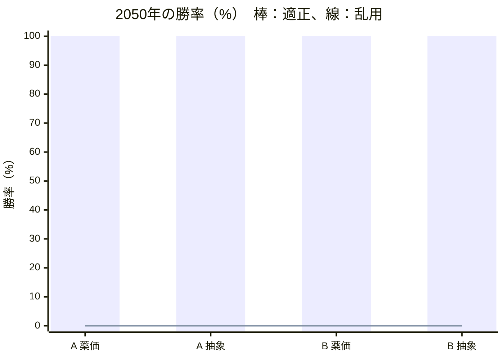
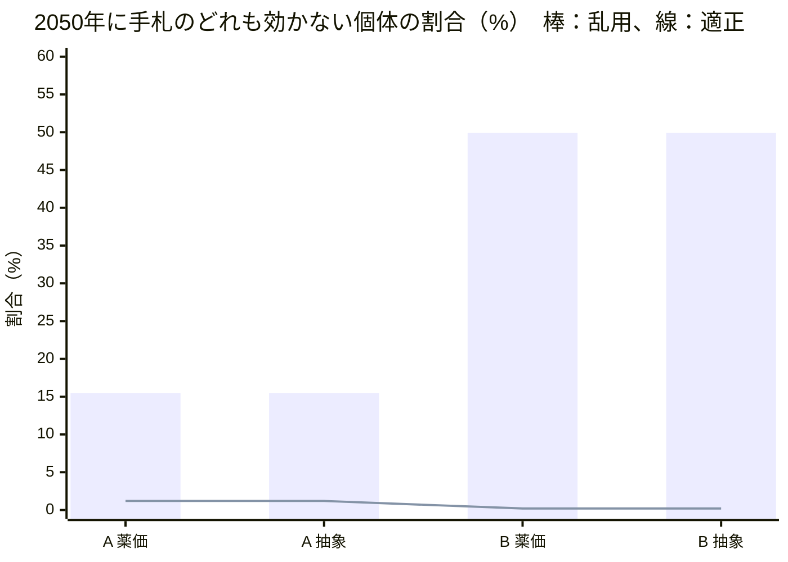
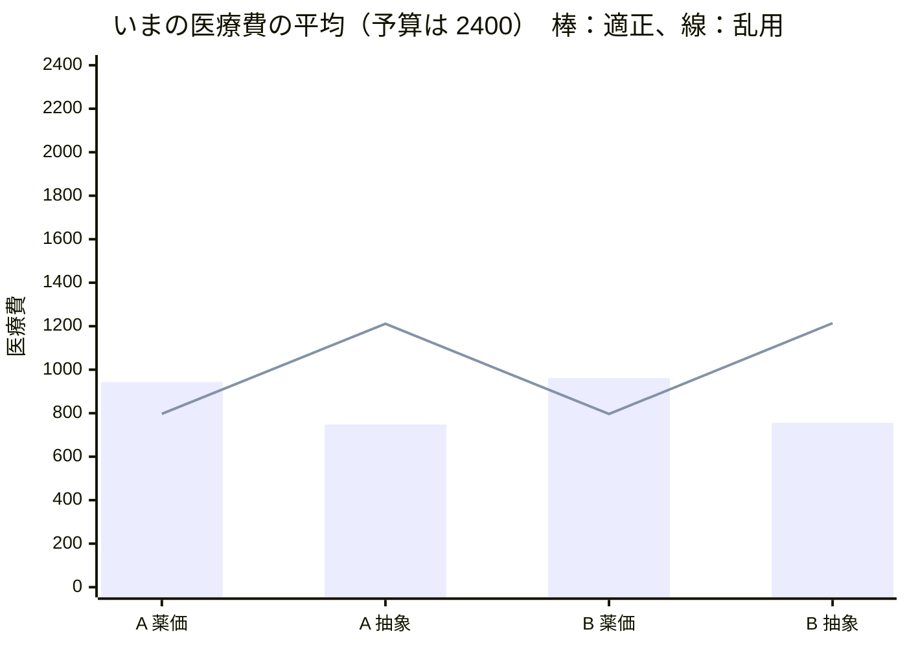

# 開発記録

試行錯誤と判断の跡を、日付つきで残す。動画のシーン7と、提出フォームの「Claude 利用」の欄に使う。

---

## 2026-11-02（月）

### 企画

- 作者へのインタビューで、ゲームの中の Claude の役割（教員モードでステージを作る）、使う場面、耐性化の仕組み、山場（未来ステージ）などを決め、[SPEC.md](../SPEC.md) と [docs/DEMO.md](DEMO.md) を書いた
- 下調べはサブエージェントに任せた（公開データの中身と利用条件）
  - JANIS のサイトが 2026-10-27 から停止中と分かった。同じ年報が e-Stat に Excel で載っているので、出典は e-Stat にした
  - 利用条件は、e-Stat が政府標準利用規約（第2.0版）、厚労省サイトが公共データ利用規約（第1.0版）。どちらも CC BY 4.0 互換で、出典と加工の明記で使える

### 実装（SPEC.md の 11/3 分を前倒し）

- **土台**：TypeScript・Vite・Vitest。描画は Phaser。
  - npm の最新は Phaser 4（2026-04 公開）だった。仕様どおり、使い慣れた情報の多い v3 の最終版 3.90.0 に固定した
- **公開データの取り込み**（`scripts/data/`）
  - Python に Excel を読むライブラリがなかったので、Node の exceljs に統一した。取り込みも検証もゲームと同じ TypeScript で書ける
  - 感受性は割合でなく株数で持ち、使うときに割合を計算する（丸めのずれを避ける）
  - 年報の値と一致することをテストで確かめた：全国の大腸菌の CTRX 感性率 68.1%、京都府 63.7%
  - 地域差：大阪府の大腸菌は CTRX 59.5%、LVFX 48.7%（全国は 68.1%、56.2%）。デモの「地域で変わる」場面に使える
  - 1日量の薬価（同じ規格の最小値 × 仮の1日量）：内服 LVFX 36.7 円 〜 MEPM 3,285 円
  - `npm run data:verify` を作った。元の Excel との一致、菌×薬の扱い（データ 33・代用 4・自然耐性 12・固定値 1・値なし 0）、監修待ち 17 項目の一覧を出す
- **エンジン**（`src/engine/`）：描画から切り離し、ブラウザなしで動く
  - 細菌は出現時に、薬ごとに感受性か耐性かが決まる（いまの耐性率に従う。自然耐性は必ず耐性）
  - 抗菌薬は「体内の薬の量」を HP として持ち、投与間隔の長さで 0 になる。内服は吸収率のぶん削れて出る。待ち時間＝投与間隔
  - 情報は距離で明らかになる（遠い：グラム染色、中ほど：菌名、近い：感受性）。プレイヤー（人・ボット）に渡す情報は、明らかになったものだけ
  - 乱数の種を固定でき、同じ種と操作なら同じ結果になる（録画とシミュレーションの再現のため）
  - 耐性モデル A・B は差し替えられる形にした（中身は 11/4）
- **シミュレーターとボット**：適正・乱用・偏り（LVFX だけ）・ランダム・何もしない
- **テスト**：25 件（公開データとの一致、自然耐性、代用、召喚と投与間隔、吸収率、情報の見え方、勝敗、再現性、ボットの強さの順序、速さ）

#### 最初のシミュレーション（耐性モデルなし。仮ステージ `data/stages/dev-uti.json`、全国、各 100 回、種 1〜100）

| ボット | いま勝率 | 未来勝率 | いま膀胱の残り | 医療費 | 主な系統 |
|---|---|---|---|---|---|
| 適正 | 100% | 100% | 99% | 719 | セファマイシン 38%、キノロン 35%、BL/BLI 20%、ペニシリン 7% |
| 乱用 | 100% | 100% | 99% | 1193 | カルバペネム 59%、BL/BLI 41% |
| 偏り（LVFX） | 20% | 11% | 3% | 183 | キノロン 100% |
| ランダム | 77% | 68% | 27% | 731 | ばらばら |
| 何もしない | 0% | 0% | 0% | 0 | — |

- シナリオ1本（いま＋未来）は約 8ms。教員モードで Claude が数百回回しても待たせない
- 耐性モデルがまだないので、未来はいまとほぼ同じ結果。乱用しても困らない状態で、これを 11/4 に変える
- 適正ボットは、グラム陰性桿菌しか見えない段階で CMZ を選んだ（全国データで、グラム陰性桿菌4種を尿の分離数で重み付けした効く見込みは CMZ 82.4%、CTRX 59.4%）。デモ台本の「まず CTRX」とは違う。録画は台本どおりの操作シナリオで行い、ボットの選び方が教える内容として妥当かは監修で確かめる
- 乱用ボットは腸球菌に MEPM を使っても倒せない（腸球菌の MEPM は、値がないため「効かない扱い」の仮の設定）。この扱いは監修待ち

### Claude Code の使い分け

| 目的 | 使ったもの | 結果 |
|---|---|---|
| 公開データと利用条件の下調べ | サブエージェント（汎用） | e-Stat への切り替え、利用条件、代表値の表 |
| 鍵と個人情報の流出防止 | フック（`.claude/hooks/check-secrets.sh`、コミット前） | API キーらしき文字列を置くと、場所だけを示してコミットを止めることを確かめた。手元だけの秘密は `.claude/secret-patterns.local`（コミットしない）に書く |
| 壊れていないかの確認 | フック（`.claude/hooks/test-engine.sh`、編集後） | エンジン・テスト・データを編集すると単体テストが走り、失敗すると結果が返る |
| データの照合 | サブエージェント `data-auditor`（定義：`.claude/agents/`） | 下の「データ監査」 |
| バランスの検証・試遊 | サブエージェント `balance-tester`・`playtester` | 定義だけ作った（11/4 から使う） |
| 取り込みの手順 | スキル `janis-import` | 年報や薬価が新しくなったときの手順 |

- フックは、このセッションで実際に発火することを目印のファイルで確かめた
- サブエージェントの定義はセッションの途中で作ったので、このセッションでは名前で呼べなかった。今回は汎用のサブエージェントに同じ定義ファイルを読ませて動かした

### データ監査（サブエージェント `data-auditor` の初回）

`npm run data:verify` とシミュレーションを再実行し、公開データ・カタログ・SPEC・台本を突き合わせた。照合は一般に知られている基準の内容によるもので、CLSI・EUCAST の原文との突き合わせはしていない。

- **元の Excel との一致**：JANIS・薬価とも一致。菌×薬の50組は、データ 33・代用 4・自然耐性 12・固定値 1・値なし 0
- **食い違い 4 件 → 直した**
  1. SPEC の腸球菌の自然耐性にアミノグリコシド系が抜けていた
  2. SPEC のカード表に CFPM と AMK がなかった（カタログには 10 枚ある）。教員モード用の追加カードとして SPEC に足した
  3. data/README.md に、自然耐性の根拠にする基準、投与回数・吸収率の出典、丸めの規則がなかった
  4. この記録の「CMZ 約 83%」は、計算し直すと 82.4%（CTRX は 59.4%）だった。自分でも計算して確かめてから直した
  - あわせて、台本シーン6の字幕を「公開データ（JANIS）がもと」に直した（50組のうち代用4・固定値1は JANIS の値そのものではないため）
- **作者の監修に回したもの（値は変えていない）**
  - 経口第3世代セフェムを CTX で代用すると、注射の CTRX より効く値になる（大腸菌 71.1% 対 68.1%）。教えたいことと逆向きなので、CTRX で代用するか、低いほうを使うかを決める
  - CMZ の順位（3）が CTRX（4）より狭いため、適正ボットは CTRX を一度も使わない。台本の「まず CTRX、耐性なら CMZ」と逆の動きになる
  - LVFX と CFPM、CTRX と CFDN が同じ順位で、同順位はコストで決まるため、安い内服が先に選ばれる
  - 腸球菌の MEPM（固定値 0）は自然耐性ではない。画面で「耐性」と出すと獲得耐性と誤解されるので、表示を分けるか決める
  - TAZ/PIPC・ABPC・CEZ・CMZ の投与回数、AMK の1日量、CFDN の吸収率 0.25 は、添付文書・IF の値の確認が要る
  - CEZ を「S のみ」で数えると、SorI（大腸菌 12.9% など）がすべて効かない扱いになる
- **バランスへの影響**：MEPM だけを連打すると勝率 86%、膀胱の残り 28%（種 1〜100）。台本の「連打して楽勝」と合わない。乱用ボット（MEPM＋TAZ/PIPC）なら勝率 100%。11/4 のバランス調整で扱う

### 公的な文書に沿った設定への切り替え

作者の方針：「できるだけ作者の感覚ではなく、公的な文書に沿った設定にする」。作者が用意した厚生労働省「抗微生物薬適正使用の手引き 第四版」の4冊（計293ページ）を読み、監修項目ごとに、手引きで決められるかを整理した。

- **用法**：作者が「手引きの表」を選んだ（国内の電子添文ではなく）。8剤を治療例の表に合わせた
  - 変わったもの：TAZ/PIPC 1日3回 → 6時間毎（1日4回）、CFPM 1日2回 → 8時間毎（1日3回）、ABPC 1回1g → 1回2g（6時間毎）、AMK 400mg → 15mg/kg（体重60kgで900mg。体重の仮定は残る）（→ 2回目の監査のあと、尿路感染症の記載に合わせて 10mg/kg 1日1回に変更）
  - 手引きの表は海外用量を含む。国内の電子添文との違い（例：ABPC は添文では1日1〜2回）は、薬ごとの sources に書いた
  - CEZ と経口第3世代セフェムは手引きに用法がないので「仮」のまま（→ 2回目の監査で訂正：CEZ は表1にあった）
- **狭い順**：独自の順位（spectrumRank）をやめ、WHO の AWaRe 分類（手引きの表）とカルバペネムの温存（手引き）で決めるようにした
  - 監査で指摘された「CMZ が CTRX より狭い」は、手引きでは裏付けがなかった（どちらも Watch）
  - 同じ順位どうしの決め方で一度つまずいた。「効く見込みが高いほう」を優先したら、適正ボットがグラム陰性桿菌の段階で TAZ/PIPC を選ぶようになった（広い薬を選んでいる）。「カバー率（尿から出る菌全体に効く見込み）が低いほう＝狭い」に直した。カバー率は公開データから計算でき、乱用ボットの「広い」と対になる
  - 全国のカバー率：ABPC 44%、CEZ 31%、CMZ 68%、CTRX 49%、CFPM 68%、TAZ/PIPC 95%、MEPM 80%、AMK 82%、LVFX 73%、CFDN 49%
- **耐性の連動（ESBL）**：腸内細菌目で CTRX に耐性の個体は、ABPC・CEZ・経口第3世代セフェムにも耐性にした。CMZ・MEPM は連動させない（手引き：ESBL はセファマイシン系とカルバペネム系を分解しない）
  - 薬ごとの全体の耐性率がデータのままになるよう、CTRX に感性の個体の耐性の確率を調整した。4000匹で確かめて、どの薬も表の値と ±3% 以内
  - 監査で指摘された「経口第3世代セフェムが CTRX より効く」逆転は、連動の下限で解消した（全国の大腸菌：28.9% → 31.9%）
- **結果画面**：AWaRe 別の使用割合を足した（WHO の目標は Access 60%以上、日本は2023年に23.2%）
- **医療費への影響**：手引きの用量で計算すると、ABPC（1日8g）は1日 3,272円で、MEPM（3,285円）と同じ最上位の段階になった。TAZ/PIPC（1日4回）も最上位。段階の区切りは 11/5 のバランス調整で見直す
- テスト：34件（用法の出典、AWaRe の順、連動の正しさと耐性率の保存、ボットの選び方を追加）
- 編集後フックが、途中の状態（使う側を先に書き、import を後から足した瞬間）でのテスト失敗を2回知らせた。どちらも次の編集で解消した

#### シミュレーション（耐性モデルなし。仮ステージ、全国、各 100 回、種 1〜100）

| ボット | いま勝率 | 未来勝率 | 医療費 | Access 割合 | 主な系統 |
|---|---|---|---|---|---|
| 適正 | 100% | 100% | 868 | 7% | セファマイシン 40%、キノロン 36%、BL/BLI 16%、ペニシリン 7% |
| 乱用 | 100% | 100% | 1451 | 0% | カルバペネム 69%、BL/BLI 31% |
| 偏り（LVFX） | 19% | 7% | 179 | 0% | キノロン 100% |
| ランダム | 62% | 52% | 841 | 17% | ばらばら |
| 何もしない | 0% | 0% | 0 | 0% | — |

- 適正ボットでも Access 割合は 7%（腸球菌への ABPC だけ）。全国の大腸菌は ABPC・CEZ の感性率が低く（46.8%、43.2%）、尿路では Access 薬だけで治療しにくいことが数字に出た。WHO の目標と日本の現状の差を説明する材料になる

### データ監査（2回目：`data-auditor` を名前で呼んで実行）

手引きの PDF とページを突き合わせてもらった。ページ番号は4冊とも印刷のページと一致。指摘はすべて手引きの本文で確かめてから直した。

- **誤り 6 件 → 直した**
  1. 「CEZ の用法は手引きに記載なし」は誤りだった。薬剤耐性菌感染症編 表1（p.6）に MSSA 菌血症で 1回2g・8時間毎がある（国内の添文の上限 5g/日、重症例の 1回2g・8時間毎は審査上認められる：p.61）。CEZ を 1回2g・8時間毎にした
  2. セフジニルの吸収率は手引きにあった（歯科編 表9 p.21：20〜25%）。0.25 は範囲の上限として「確認済み」にした
  3. ABPC の出典の要約が広すぎた。表2 は VRE による血流感染症の例で、血流感染症の用量であることを書き足した
  4. 台本シーン5の「狭い薬に切り替えます」が新しい順位と合わなかった（CMZ と CTRX は同じ Watch で、カバー率では CMZ のほうが広い）。「カルバペネムを温存できる薬に切り替えます」に直した。あわせて「投与回数も実際の薬どおり」を「国の手引きをもとにしています」に直し、出典の字幕を足した
  5. 「AWaRe で狭い順を決める」は言い過ぎだった。AWaRe は耐性化したときに困る度合いの分類で、使う順に当てはめるのはゲームとしての判断だと明記した
  6. 「60%以上」の記載は p.37（表9 は p.38）
- **手引きの記載に沿って変えたもの**
  - フルオロキノロン系を、カルバペネム系と並んで「後に回す」系統に加えた（医科・外来編 p.45：大腸菌の耐性率が約40%で腎盂腎炎の第一選択に適さず、できるだけ温存すべきとされる）
  - AMK を、尿路感染症に限った記載（医科・外来編 p.45 注16：10mg/kg 1日1回）に合わせた。体重60kgで600mg＝200mg 管3本になり、端数もなくなった。表4（15mg/kg）とどちらを採るかは作者の判断待ち
  - 用量の採り方を書き出した：表の範囲の中に国内の添文の上限に収まる値があればそれ（CFPM、LVFX）、なければ表の値（ABPC、CEZ、TAZ/PIPC）
  - 手引きの表は特定の場面の治療例で、尿路感染症の用量の表ではないことを data/README.md に書いた
  - Access 60% は国全体の消費量に対する目標で、1ステージの割合とは比べる対象が違うことを SPEC に書いた
- **作者の判断待ち**：CFPM を ESBL の連動に入れるか（手引きは ESBL なら選択肢にならないとし、JANIS の CLSI 2012 の感性率と食い違う）、AMK の用量、腸球菌×MEPM の固定値
- 監修待ちの一覧は 12 件 → 11 件

#### シミュレーション（直した後。仮ステージ、全国、各 100 回、種 1〜100）

| ボット | いま勝率 | 未来勝率 | いま膀胱の残り | 医療費 | Access 割合 | 主な系統 |
|---|---|---|---|---|---|---|
| 適正 | 100% | 100% | 99% | 949 | 9% | セファマイシン 45%、BL/BLI 25%、キノロン 21%、ペニシリン 9% |
| 乱用 | 97% | 96% | 45% | 782 | 0% | キノロン 66%、カルバペネム 34% |
| 偏り（LVFX） | 19% | 7% | 3% | 179 | 0% | キノロン 100% |
| ランダム | 62% | 52% | 16% | 881 | 17% | ばらばら |
| 何もしない | 0% | 0% | 0% | 0 | 0% | — |

- 乱用ボットは、MEPM が待ち時間のあいだ LVFX を使うようになった（どちらも「温存すべき」の最上位）。膀胱の残りが 45% まで落ちた。台本の「MEPM を連打して楽勝」は、録画用の操作シナリオで別に作る
- 適正ボットは、緑膿菌に LVFX ではなく TAZ/PIPC を選ぶようになった（キノロン 36% → 21%）

### 手引き以外の公的文書の取得と反映

作者の「取得して」を受け、手引きで決まらない項目に要る文書を公式サイトから取得した。

- **取得した文書**（作業用フォルダに保存。リポジトリには入れない）
  - EUCAST「Expected Resistant Phenotypes」v1.2（2023年1月、401.7KB）
  - EUCAST「Expert Rules v3.2 on Enterococcus spp.」（2020年2月、204.6KB）
  - EUCAST「Breakpoint tables」v16.1（2026-06-24 から有効、4.2MB）
  - クラビット錠 インタビューフォーム（第一三共、2025年7月改訂 第20版、2MB。PMDA 掲載）
  - セフゾンカプセル 電子添文（2026年10月改訂 第3版、417.5KB。PMDA 掲載）
- **取得のつまずき**
  - EUCAST のサイトは、スクリプトからの直接のダウンロードを 403 で拒否した。アクセス制限を回避する取得はしなかった
  - WebFetch では PDF の本文を読めなかったが、取得した PDF が手元に保存されたので、pdftotext と PDF のページ画像で読んだ
  - EUCAST の表は列が細かく、テキストでは列がずれたため、ページの画像で目視して確かめた
- **反映したもの**
  - 自然耐性：5菌とも EUCAST の表と一致した（肺炎桿菌の ABPC、緑膿菌の ABPC・CTX/CTRX と第1・第2世代セフェム、腸球菌のセフェム系とアミノグリコシド（低レベル耐性））。各菌に表・Rule 番号・ページを付けた
  - 腸球菌の MEPM：自然耐性ではないが、EUCAST のブレイクポイント表で「-」（治療に適さず、検査も使用も避ける）。仮の固定値に根拠が付いた
  - 腸球菌の TAZ/PIPC を ABPC で代用：EUCAST の推定ルールは「ABPC 耐性なら PIPC も耐性」の向きだけ。感性の向きはゲームとしての近似と明記した
  - 経口第3世代セフェムを CTX で代用：EUCAST では経口第3世代セフェムの感性の基準が CTX・CTRX と同じで、耐性の基準はより厳しい。CTRX を下限にする連動と矛盾しない
  - LVFX の吸収率：0.99 → 0.98。IF の「吸収」の項が参照先としている、500mg の経口と点滴静注の AUC（50.86 と 51.96 µg・hr/mL）の比
  - セフジニルの用法：電子添文の 1回100mg・1日3回で「確認済み」に
  - CFPM の連動：EUCAST v16.1 は ESBL の有無だけでは判定を変えず、測ったとおりに報告するとしている。判断材料として注記に足した（作者の判断待ちのまま）
- テストに吸収率の数値を直書きしていたので、編集後フックが値の変更で失敗を知らせた。カタログの値を読む形に直した
- 監修待ちの一覧は 11 件 → 5 件（AMK の用量と体重、経口第3世代セフェムの代表、変換ルール、尿中移行、医療費の段階）
- **データ監査（3回目）**：誤り4件・要確認6件。原文で確かめてから直した
  - 腸球菌の推定ルールの書き方が不正確だった（備考に「ABPC 感性からイミペネムは予測できない」とある）。直した
  - 電子添文のページの誤り（用法は p.1、排泄は p.3）。直した
  - CFPM の連動が監修待ちの一覧に出ていなかった（review を付け忘れていた）。付けた
  - SPEC 8.2 に古い未決の記述が残っていた。直した
  - 緑膿菌の CMZ・経口第3世代セフェムに、より直接の根拠があった（EUCAST v16.1 の緑膿菌の表で、同じ系統のセフォキシチンと経口第3世代セフェムが「-」）。「セファマイシン系を第2世代に含めた」という私の解釈をやめ、こちらに替えた
  - 腸球菌の AMK の「併用で相乗効果」は条件付き（AMK では保証されない）と書き直した
  - EUCAST の「測ったとおりに報告」は EUCAST 自身の基準が前提で、JANIS（CLSI 2012）の値を使う根拠にはならないと注記した
  - LVFX の 0.98 は、別々の被験者群の AUC の比から算出した値で、IF が吸収率として示した数値ではない。作者の了承待ちに戻した
  - 腸球菌の TAZ/PIPC は、EUCAST では野生株でも「I（増量投与で感性）」。S のみを「効く」とする変換との関係を作者の判断待ちにした
- 監修待ちの一覧は 5 件 → 7 件（LVFX の吸収率と CFPM の連動を、了承待ちとして一覧に出した）

### 残りの監修項目を作者に質問して決めた

選択肢つきの質問を2回（4問ずつ）行い、各選択肢に根拠の文書と、選んだときにゲームで変わることを書いた。

- **前半**
  - LVFX の吸収率：0.98（IF の AUC の比）を了承
  - 経口第3世代セフェムの代表：セフジニルのまま
  - 変換ルール：「S のみ」
  - AMK の用量：作者が「JAID/JSC 感染症治療ガイド2023 を参考に検討して」と、ガイドの PDF を追加した。尿路感染症の章を読むと、AMK の用量は場面ごとに違った（C-1 急性単純性腎盂腎炎 1回200〜400mg、C-4 複雑性腎盂腎炎 1回200mg、E カテーテル関連尿路感染症 1回15mg/kg）。投与間隔はどれも1日1回で、手引きとも一致した
  - このガイドは、カードの薬のうち8剤の尿路感染症の用法を載せていた（ABPC・CEZ の注射は章になし）。手引きの表との違いは TAZ/PIPC（ガイドは1日3回、手引きの表は6時間毎）
- **後半**
  - 用法：手引きの表のまま。AMK だけ JAID の Ⅺ-E（1回15mg/kg・1日1回。手引き 表4 の用量とも一致）
  - CFPM を ESBL の連動に入れる（手引き：ESBL なら選択肢にならない。JAID C-4 の ESBL の薬の一覧にも CFPM はない）。CFPM の耐性率は JANIS の値より高くなる（全国の大腸菌 20.4% → 31.9%）
  - 腸球菌の TAZ/PIPC は効く扱いのまま（JAID C-4 は腸球菌が多いとしたうえで TAZ/PIPC を第一選択に挙げている）
  - 尿中移行の係数は全薬 1.0（どのカードも尿路感染症に使う薬。仕組みは別の臓器用に残す）
- 医療費の段階と代表の薬価は、11/5 のバランス調整で決める
- 監修待ちの一覧は 7 件 → 1 件（医療費）。4回目の監査のあと 2 件（AMK の体重と電子添文の範囲、医療費）
- テスト：用法の出典の検査を「手引き・JAID・電子添文のどれか」に広げ、吸収率の出典の検査を足した。連動のテストに CFPM を加えた（34件）
- JAID の編者名を一度推測で書いてしまったので、奥付で確かめて直した
- **データ監査（4回目）**：JAID のページと内容は原文どおりだった。書きぶりの指摘を直した
  - drugs.json の冒頭の説明が、AMK の出典の変更に追いついていなかった。「AMK だけ JAID に合わせた例外」と書いた
  - 腸球菌の TAZ/PIPC の根拠に「JAID C-4 は原因菌に腸球菌が多いとしたうえで TAZ/PIPC を第一選択に挙げている」と書いたのは言い過ぎだった（同じ一覧の CTRX などは腸球菌に効かない）。より直接の記載（JAID Ⅺ-G 小児の尿路感染症 p.302：グラム陰性桿菌と腸球菌を一剤で治療する場合に TAZ/PIPC）に替え、小児の節であることを書き添えた
  - AMK の出典は、合う文書だけを挙げていた。手引き 表4 と一致するのは初回の1回量だけであること、JAID のほかの節は固定量（200〜400mg）であること、手引き 外来編は1日1回投与を適応外としていることを書き足した
  - AMK 15mg/kg・1日1回が国内の電子添文の範囲に収まるかは未確認（手引き p.66 にも記載なし）。体重60kg は質問で示しただけで明示の了承はまだ。この2点を監修待ちに戻した
  - 尿中移行の「どれも尿路感染症に使う薬として挙がっているので差をつけない」は、文書から出る結論ではなかった（JAID の成人の節に ABPC・CEZ の注射はない）。「ゲームとしての判断」と書き直した
  - AMK の 900mg を 200mg 管 4.5本として計算している点は、医療費の監修と一緒に決める
  - テストを足した：AMK の出典が JAID であること、15mg/kg × 60kg ÷ 200mg ＝ 4.5（36件）

### AMK の体重の了承と、電子添文の確認

- 体重 60kg で AMK の1日量（900mg）を計算することを、作者が了承した
- PMDA の電子添文（アミカシン硫酸塩注射液「日医工」、2026年3月改訂 第3版）を確かめた。点滴静注は成人1回100〜200mg・1日2回（適宜増減）で、JAID の 1回15mg/kg・1日1回は1日量・投与回数とも範囲の外。手引き 外来編も1日1回投与を適応外としている。作者の判断で JAID に合わせたことと、この事実を出典に並べて書いた
- 検索結果の要約を鵜呑みにせず、電子添文のページの本文で確かめた
- 監修待ちは 1 件（医療費。11/5 に決める）

### SPEC.md の 11/4 分（11/2 の夜に前倒し）

#### 耐性モデル A・B と未来ステージへの引き継ぎ

- **A（選択圧の再現）**：波が片付くたびに、その波の菌について、薬ごとに「さらされた割合」を出し、耐性のオッズの対数（logit）を上げる
  - SPEC の「上げ幅は、さらされた量と、生き残った耐性個体の割合で決まる」を、オッズで表した。耐性菌が少ないうちはゆっくり、増えると速く上がる（S 字）
  - 最初は「実際に生き残った個体」を数える案も考えた。1つの波には同じ菌が1〜3匹しかいないので値がぶれやすく、MEPM のように耐性率 0.1% の薬では耐性の個体がまず出てこず、乱用しても何も起きない。期待値（いまの耐性率）で計算する形にした
- **B（耐性ゲージ）**：系統ごとのゲージに、召喚のたびに「広さ（カバー率）÷ 1日の投与回数」をためる。1日4回の薬が召喚回数だけで不利にならないよう、効いている日数で数えた
  - 1段ごとに「まだ効いている菌の一定割合が耐性になる」。A と違い、もともとの耐性率によらず同じ割合で減る
- **未来ステージ**：「ステージ1と同じ使い方が数年続いた」とみなし、ステージ1での変化をモデルの伸び方のまま延ばした（A はオッズの対数、B はまだ効いている割合の対数）
  - 2つのモデルを同じ空間で延ばすと、B の小さな変化が A の延ばし方では極端に大きくなった（0.2% → 15% が 99.9% に）。モデルごとに延ばし方を分けた
- **耐性の連動のかけ直し**：どちらのモデルも、耐性率を変えたあとに連動の下限をかけ直す（かけないと「経口第3世代セフェムが CTRX より効く」逆転が戻る）
- **カルバペネム耐性（CRE）の扱い**：HANDOFF で 11/4 に決めることになっていた。手引き 薬剤耐性菌感染症編を読み、p.17（CRE はほかの β-ラクタム系にも多くが耐性で、治療が難しい）と p.19（フルオロキノロン系・尿路ならアミノグリコシド系は感性なら使える）をもとに、腸内細菌目で MEPM に耐性の個体を、ほかの β-ラクタム系すべてに耐性にした。LVFX と AMK は連動させない。作者の確認待ち（SPEC 8.3 の 15）
  - 連動が「MEPM → CTRX → ABPC」と2段になったので、連動を菌ごとの木にした。木の上から順に「親に耐性なら子も耐性、そうでなければ全体の耐性率が表の値になる確率」で決める。4000匹で、どの薬も表の値と ±3% 以内
  - 開始時の表では MEPM の耐性率が 1% 未満なので、ステージ1の値は変わらない。乱用で MEPM の耐性率が上がる未来ステージで、手札のほとんどの薬が効かなくなる。台本シーン4の「手札のどの薬も効きません」が、文書に沿った仕組みから出るようになった
- テスト：52 件（モデル A・B の上げ方、連動のかけ直し、引き継ぎの式、CRE の連動と耐性率の保存、「手札のどの薬も効かない個体」の数え方、ボットの基準）

#### 係数の決め方（仮ステージ、全国、各 50 回）

目標は SPEC 5.4 の目安：適正ボットはステージ1・2とも勝率 80% 以上、乱用ボットはステージ1で 80% 以上・ステージ2で 30% 以下。最初の係数（A：0.5、B：2 段ごと）では、乱用ボットがステージ1から 60% しか勝てず、台本の「楽勝」にならなかった。ステージの中での変化を弱め、未来への延ばし方を強めた。

| A の係数（logitPerWave／stagesPerYear） | 適正 いま／未来 | 乱用 いま／未来 | 乱用の未来で全部効かない菌 |
|---|---|---|---|
| 0.5／0.4（最初。100 回） | 100%／97% | 60%／0% | — |
| 0.2／0.6 | 100%／100% | 88%／0% | 13% |
| **0.25／0.8（採用）** | 100%／100% | 88%／0% | 46% |
| 0.35／1.4 | 100%／92% | 84%／0% | 65% |

| B の係数（gaugePerStep・risePerStep／stagesPerYear） | 適正 いま／未来 | 乱用 いま／未来 | 乱用の未来で全部効かない菌 |
|---|---|---|---|
| 2・0.1／0.4（最初。100 回） | 100%／98% | 61%／0% | — |
| 3・0.06／0.6 | 100%／100% | 86%／0% | 12% |
| **4・0.1**／1.0 | 100%／100% | 90%／0% | 30% |
| 5・0.06／0.6 | 100%／100% | 96%／8% | 8% |

- B は 4・0.1 を採用した。未来への延ばし方（stagesPerYear）は両モデル共通の 0.8 にした（5年後なら、ステージ1の4回分）。採用した値での結果は下の表

#### シミュレーション（採用した係数。仮ステージ、全国、各 100 回、種 1〜100）

| ボット | モデル | いま勝率 | 未来勝率 | いま膀胱 | 未来膀胱 | 医療費 | 未来で全部効かない菌 |
|---|---|---|---|---|---|---|---|
| 適正 | なし | 100% | 100% | 99% | 99% | 949 | 0% |
| 適正 | A | 100% | 100% | 98% | 84% | 974 | 3% |
| 適正 | B | 100% | 100% | 99% | 91% | 964 | 1% |
| 乱用 | なし | 98% | 90% | 46% | 36% | 785 | 0% |
| 乱用 | A | 85% | 0% | 29% | 0% | 792 | 44% |
| 乱用 | B | 91% | 0% | 32% | 0% | 794 | 23% |
| 偏り（LVFX） | A | 0% | 0% | 0% | 0% | 159 | 0% |
| ランダム | A | 52% | 1% | 12% | 0% | 889 | 2% |
| ランダム | B | 60% | 19% | 14% | 4% | 897 | 0% |

- どちらのモデルでも「乱用すると未来で負け、適正に使えば未来も守れる」が成り立った。A のほうが、乱用した未来で手札のどの薬も効かない菌が多い（44% と 23%）
- 乱用ボットは、ステージ1で MEPM と LVFX を交互に使う。A では、ステージ1の終わりに大腸菌の LVFX 耐性が 44% → 74% ほどになり、MEPM は 0.1% → 0.6% にとどまる。5年後には MEPM が 83% になり、CRE の連動で CMZ・TAZ/PIPC も 83% になる（種 3 の例。100回では平均 75%、中央値 81%、範囲 10〜88%。画面の既定の種では 67%）。「まれな耐性はしばらく目立たず、ある時点から一気に増える」という S 字の形が出た
- 適正ボットも、よく使う CMZ などの耐性率は上がる。未来でも MEPM を温存できているので勝てる
- 1シナリオ（いま＋未来）は 6〜9ms のまま

#### 描画と遊べる版（`src/game/`）

- 盤面は Phaser 3.90.0、文字とボタン（上の帯、カード、結果画面、出典）は DOM にした。Phaser の入力は使わず、レーンの選択も DOM で受ける。文字が多い画面を DOM にすると、拡大してもぼやけず、録画のスクリプトから文字でボタンを押せる
- 基準 1280×720 を画面に合わせて拡大・縮小する。盤面はカメラの拡大で高い解像度に描く（`?r=1.5` で 1920×1080 の録画でも鮮明）
- 細菌はすべてコードで描いた。陰性はピンク〜赤、陽性は紫。形（桿菌・細長い桿菌・4個の連鎖球菌）、大きさ、莢膜の白い縁でも見分けられる
  - べん毛はグラム染色では見えないので、菌名が分かってから描くことにした（プロテウスの速さは最初から見える）
- 近い位置の表示は「耐性：」（獲得耐性、赤）、「自然耐性：」（紫）、「効かない扱い：」（腸球菌の MEPM。紫）に分けた。腸球菌の MEPM は自然耐性ではないので、前の監査の指摘どおり「耐性」とも「自然耐性」とも出さない
- カードには用量（1回◯g）を出さず、投与間隔と待ち時間だけを出した（SPEC 7.1）
- 遊んでいる途中に「波が片付いた：選択圧で耐性率が上がった（大腸菌の LVFX 44% → 47%）」と知らせる。B ではカードに耐性ゲージを出す
- 結果画面：系統別の使用割合、Access 薬の割合（WHO の目標との比べ方の注記つき）、偏りの指標（仮）、手札のどの薬も効かない菌の割合、菌×薬の耐性率の変化の表。0.1% → 0.6% のように低い値が何倍にもなった変化にも矢印を付ける（未来で効いてくるため）
- 「数年後の同じ病棟」（のちに「2050年の同じ病棟」に変更）のブリーフィングに、ステージ1の開始時から大きく上がった耐性率を6つ出す
- URL：`?stage=`・`?model=A|B|none`・`?seed=`・`?region=`・`?auto=appropriate|broad|random`（ボットに遊ばせる）・`?r=`
- つまずき：アプリ内ブラウザの画面が隠れていると描画の時計がほぼ止まり、8秒待っても 0.5 秒しか進まなかった。確認用に `window.sentakuatsu.fastForward(秒)` を作り、ボットで最後まで一気に進めて全画面を確かめた。録画のスクリプトにも使える
- 開発サーバーの設定 `.claude/launch.json` を作った（サブエージェント `playtester` が使う）

#### データ監査（5回目：耐性モデル・CRE・画面の言い回し）

サブエージェント `data-auditor` に、新しく足した CRE の連動、耐性モデルの説明、画面の文字を点検させた。引用されたページ（p.17・19・20・23・26・69・74）は、手引きのテキストで自分でも確かめてから直した。

- **誤り 6 件 → 直した**
  1. p.19 の約90%は「フルオロキノロン系・ST 合剤・（尿路なら）アミノグリコシド系のいずれか」に感性の割合だった。ST 合剤を落として書いていた
  2. 出典画面の CRE の文に「腸内細菌目で」がなく、「ほかの β-ラクタム系すべて」は一般論として言い過ぎだった（新しい β-ラクタム系は CRE の治療の選択肢）。「このゲームのほかの β-ラクタム系の薬」に限って、単純化だと書いた
  3. 遊び方の「耐性の菌が生き残ると耐性率が上がる」は実装と違った（A は期待値で計算し、全部倒しても上がる）。「さらされた菌の中で耐性菌が選ばれて残る（選択圧）」に直した
  4. 「耐性率 0% の組は 0.1% から」は不正確で、実際は 0.1% 未満の組すべてを 0.1% として上げ始める（京都府の大腸菌の MEPM 0.03% など）。説明をコードに合わせた
  5. SPEC 8.1 の出典表に CRE がなかった
  6. SPEC と画面の食い違い（スペクトラムの目安は3つ、「効かない扱い」の表示、耐性率の表は菌×薬）。SPEC を画面に合わせた
- **書き足したもの**：緑膿菌を CRE の連動に入れない根拠（p.23・p.26 表7・付録 p.74。「根拠の文書は未確認」をやめた）、non-CP-CRE の耐性の仕組み（付録 p.69）、CRE の中での LVFX・AMK の感性率は文書に数値がないので全体の率と同じにしている（単純化。実際より効きやすく出る可能性）、Access 薬の割合の出典ページ、医療費の注意書きを方式で切り替える、出典画面の「誇張係数 1」を外す
- **作者に回したもの**：台本シーン3・4の言い回し（下の「試遊」も）、CRE 内の LVFX・AMK の扱い

#### 試遊（サブエージェント `playtester` の初回）

アプリ内ブラウザで、初めて遊ぶ薬学生の目で一通り遊ばせた（23項目の指摘）。画面が隠れていて時計が遅く、途中から表示状態で遊んだ。作者もその間に同じタブを操作していた。

- **直したもの**
  - 「5年後」の画面の数字が予測に見える → 「ゲーム用に大きく誇張。現実の病棟でこのとおりになるわけではない」を目立つ形で出した。まとめ画面にも注意書きを出した
  - なぜ負けたかが結果に出ない → 結果とまとめに「いちばん使った系統」と「大きく上がった耐性率 上位3つ」を出した。ステージ2の表はステージ1の開始時から数える（数年分の変化が見える）。開発メモのままの振り返り欄は、文がないときは出さない
  - 近い位置の札が重なる・手札の下に潜る → 札を菌の右に出し、赤（耐性）と紫（自然耐性・効かない扱い）の2行まで、1行4つまで（残りは「ほかN」）、背景を不透明にした。膀胱に近い菌の札を上に重ねる
  - 「効かない扱い」「AWaRe」「1時間＝1秒」「選択圧」の説明 → 遊び方と結果の表の注に足した
  - 「届く／届かない」が組織移行に見える → 「ゲーム内の目安：効く見込みあり」に言い換え、実際の薬の選び方の根拠にはならないと遊び方に書いた
  - 遊び方を飛ばせて、操作を知らずに負ける → 初めての「はじめる」で遊び方を必ず一度出す。盤面の下に「①カードを選ぶ → ②レーンをクリック」を出す
  - 知らせが盤面（レーン1の入口）に重なる → レーンの下に知らせの帯を作り、そこに出す（レーンを少し低くした）。波の数を「波 4 / 7（片付いた 3）」にした
  - モデル B でカードの下端がはみ出す → 行間を詰めた。レーンごとの待ち時間の棒に「レーン 1 2 3」を付けた
  - 結果の表の幅、右端で切れる浮かぶ文字、赤い全画面の点滅（やめた）、速さをステージをまたいで引き継ぐ、縦向きの画面で横向きを勧める、手札が変わった理由
- **残したもの**：数字キーが手札の順で、ステージ2で薬との対応が変わる。出典画面の専門用語（教える人向けとして残す）。偏りの指標は SPEC で出すことになっているので、仮の式だと書いて残す
- **作者の判断に回したもの**
  - 適正に使っても、よく使った薬の耐性率が5年後に大きく上がる（下の表）。A のほうが強い
  - WHO の Access 薬の目標：手引き第四版は 60%（医科・外来編 p.17）。2024年の国連の宣言で 2030年までに 70% になったとの指摘があったが、手元の文書では確かめていない

| 5年後の開始時の耐性率（中央値、各100回） | 大腸菌 CMZ | 大腸菌 TAZ/PIPC | 大腸菌 LVFX | 大腸菌 MEPM | 緑膿菌 MEPM |
|---|---|---|---|---|---|
| A・適正 | 98% | 69% | 79% | 0% | 12% |
| A・乱用 | 81% | 81% | 100% | 81% | 95% |
| B・適正 | 42% | 44% | 44% | 0% | 12% |
| B・乱用 | 41% | 41% | 80% | 41% | 48% |

- どちらのモデルでも、適正に使えば MEPM は温存される（だから未来も勝てる）。ただし A では、適正に使った CMZ が5年でほぼ効かなくなる。「使った薬は耐性化する。だから温存した薬が未来の切り札になる」と読めるが、狭い薬を使っても報われないようにも見える。11/5 に A/B と係数を決めるときの材料にする
- テスト：55 件（カードに用量が出ないこと、スペクトラムの目安、% の表示を足した）

#### デモ動画の撮影と提出ガイド（追加フォルダ）を読んだ

- DEMO.md の条件に関わる点を作者に報告した（録画の解像度、音声、通知、提出前の確認など）。本文はリポジトリに写していない

### ASP ガイダンス2024 で内容を深める

作者が「抗微生物薬適正使用支援プログラム実践のためのガイダンス 2024年度改訂版」（8学会合同、日本化学療法学会雑誌 73巻2号）を用意し、「参照して内容を深めて」と頼んだ。62ページを読み、ゲームに関わるところを洗い出した（本文はリポジトリに写していない）。

- **ゲームに取り入れたもの**
  - **アンチバイオグラム**：ガイダンスは、初期治療の薬を選ぶために施設のアンチバイオグラムを作って使うことを、推奨度 A・エビデンスレベル I で勧めている（p.130）。教育でのローカルデータの活用も A-I（p.125）。これまでプレイヤーは、菌名が分かる前に何を使うかを勘で選ぶしかなかった（ボットはアンチバイオグラムを知っていた）。ブリーフィングと遊んでいる途中（A キー。開いている間は一時停止）で、菌 × 手札の薬の感性率を見られるようにした。ステージ2では、ステージ1の結果から作った値になる
  - **使用日数（DOT にならった数え方）とスペクトラムの広さ（DASC/DOT）**：表4（p.119）の考え方にならって計算し、結果とまとめに出した。ASC スコアは表5（p.120）の値。ガイダンスの計算例（TAZ/PIPC 5日 → CEZ 5日で DASC 70、DASC/DOT 7）をテストで再現した
  - グラム染色の所見が原因菌の分かる前の薬の選びに使えること（p.130）を、SPEC の「情報の見え方」の根拠に足した
  - チェックリストの教育・啓発に学生教育があること（p.106）、能動的な教育とローカルデータ（p.105・p.125）、教育内容がまだ十分でないこと（p.127）を、SPEC の「課題の裏付け」に足した
- **できなかったこと**：ASC スコアは表5に10剤しかなく、CMZ・AMK・LVFX・CFDN がない。元の論文（Kakiuchi ら CID 2022）と、日本の承認薬に ASC を定めた論文（Maeda・Kakiuchi・Muraki、J Infect Chemother 2025）は PubMed で見つけたが、PMC に本文がなく値を確かめられなかった。推測では入れず、null にして監修待ちにした。開発用のステージは CMZ・LVFX を手札に持つので、いまは DASC/DOT がほとんど「—」になる
- **偏りの指標**：ガイダンスでは AHI の有用性は未解決（p.118 f）。AHI は系統のばらつきを測るので、SPEC の「系統に偏っていたか」に近い。DASC/DOT は平均の広さを測る別の指標として出す。どれを使うかは作者に聞く（SPEC 8.3 の 8）
- **データ監査（6回目）**：誤り7件を直した
  1. 使用日数を「表4の定義どおり」と書いていたが、内服薬が吸収率のぶん短く数えられていた（CFDN は投与した時間の約25%）。体内の量ではなく投与間隔で数えるようにエンジンを直した（テストを足した）。レーンごとに足すこと、在院日数で補正しないことは表4と違うので、「DOT にならった数え方」と書いた。系統別・AWaRe 別の使用割合も同じ数え方になる（これまでの DEVLOG の使用割合の表は、古い数え方の値）
  2. ガイダンスの文をほぼそのまま写していた箇所（コードのコメント、SPEC の4か所、DEVLOG）を、要旨とページと推奨度だけに書き直した
  3. DASC/DOT のカードの ASC の一覧に ABPC が抜けていた → データから作るようにした
  4. 「最も強く勧めている」は言い過ぎ（A-I はほかの項目にもある）→「推奨度 A・エビデンスレベル I」に
  5. 「受け身より能動的な教育」は p.105、p.125 は組み合わせ（B-II）とローカルデータ（A-I）と、ページを分けて書いた
  6. 出典の一覧の抜け（p.118・p.105〜106）、data/README の drugs.json の説明が古かった
  7. HANDOFF の監修待ちの件数（3 → 4）
  - あわせて直したもの：DASC の限界（推奨度 C・エビデンスレベル III、米国の状況で作られた ASC、標準化が不十分）を SPEC と出典画面に書いた。アンチバイオグラムの注記に、JANIS の地域の集計であること、色の区切りはゲーム用の目安であることを書いた。アンチバイオグラムを開いている間にスペースキーで再開してしまう動きを直した
- **取り入れなかったもの**：AUD（DDD を使うので用量の概念が要る。カードに用量を出さない方針と合わない）、TDM・PK/PD、真菌、外来の延期処方（尿路の膀胱ステージの外）
- PDF は追加フォルダの `04_医学資料/05_ASPガイダンス2024/` に、テキスト版とともに移した（索引は `00_README.md`。誌面のページ＝PDF のページ＋94）
- テスト：59 件（ASC スコア、DASC の計算例、ASC のない薬の扱い、内服薬の使用日数）

### 未来ステージを「2050年」にし、耐性化の速さを文献に合わせる

作者が AMR Review（2014年、O'Neill）と GBD 2021 AMR（Lancet 2024）を用意し、「耐性化のスピード感を調整して」「2050年問題として、次のステージを2050年にする案は？」「3〜4ステージに増やすのは？」と相談した。

- **文献から使えたもの**
  - AMR Review の2050年の推計は、RAND Europe の「15年で耐性率が100%（感染者数は一定）」と、KPMG の「耐性率が今より40%上昇（相対か絶対かは本文に書かれていない）、感染者数は2倍」の2つの前提を置き、どちらも確かな予測ではない大まかな見積もりとしている（p.6・p.8）。どちらが厳しいかの順位は本文にないが、耐性の仮定は RAND のほうが厳しい
  - GBD 2021 は死亡数の推計で、耐性率の年ごとの推移は本文にない。2021年に関連 471万人・直接 114万人、2050年に関連 822万人・直接 191万人。1990〜2021年に、グラム陰性菌ではカルバペネム耐性の負担がいちばん増えた（p.1199）。2014年の 1,000万人は自分たちの推計よりやや大きく、対象（HIV・マラリアを含む）も違う、と書いている（p.1219）
  - 「2050年問題」という言い方は、2つの文献には出てこない（作者が挙げた、よく使われる言い方）
- **いままでの速さは速すぎた**：「数年後（5年）」の設定（両モデル stagesPerYear 0.8）では、A は乱用ボットで大腸菌の MEPM の耐性率が 6年で 90% を超えた。RAND の前提（15年で100%）より速い（B は 0.8 のままだと2050年でも 89% で、こちらは遅すぎた）
- **調整**：RAND の前提を「速さの目安」にした。乱用ボットでも大腸菌の MEPM が 90% に届くまで RAND より長くかかり（中央値18年）、2050年にはほぼ100%になるように、モデルごとに stagesPerYear をそろえた（A 0.25、B 1.2。各60回で年ごとの推移を計算して決めた）
- **データ監査（7回目）**：「RAND の前提より遅い」は大腸菌の MEPM でしか成り立っていなかった（乱用での大腸菌の LVFX は A で4年、B で6年で 90%）。文の範囲を限るのではなく、上限（`carryOver.ceiling`）を足して、どの菌×薬でもステージ1の終わりから 90% に届くまで15年以上かかるようにした。B の延ばし方は値の向きが逆（まだ効いている割合の対数は減っていく）なので、上限は向きによらず大きさで比べるようにした。上限を入れたあと、すべての組で 15〜16年以上になったことを各100回で確かめた。勝率はほとんど変わらない（A：適正 99%・乱用 0%、B：適正 100%・乱用 0%）
  - ほかの指摘：「最も厳しい前提」は原文にない言い方だった（→「耐性の仮定が厳しいほう」）。1,000万人は細菌だけでなく HIV・結核・マラリアの薬剤耐性を含む。2050年の推移の表の下に「予測ではない」を足した。KPMG の 40% は相対か絶対かが本文にない、と書き添えた
  - 時間の目盛りの注意：ステージ1の中の変化そのものが、A では4年分、B では約10か月分に当たる（表ではこれも「2025年」に含めている）

| 乱用ボット・大腸菌の MEPM（中央値） | 2025 | 2030 | 2035 | 2040 | 2045 | 2050 | 90% に届く年 |
|---|---|---|---|---|---|---|---|
| A・いままで（0.8） | 0.1% | 81% | 100% | — | — | — | 6年後 |
| A・調整後（0.25） | 0.1% | 4% | 27% | 74% | 96% | 99% | 18年後 |
| B・調整後（1.2） | 0.1% | 52% | 75% | 87% | 93% | 96% | 18年後 |

- 「しばらくは目立たず、ある時点から一気に増える」S 字の形（A）が年ごとに見えるようになった。2050年問題の語り方と合う
- **2050年をステージ2にしたときの勝率**（各100回）：A は適正 99%・乱用 0%（手札のどの薬も効かない菌 60%）、B は適正 100%・乱用 0%（同 69%）。適正に使うとカルバペネム系が温存されていて、2050年にはそれに頼って守る（使用割合 32〜34%）
- **残る問題**：適正ボットでも、よく使った CMZ・TAZ/PIPC の耐性率は2050年に高くなる（A では CMZ が 99% 前後、LVFX も上がる。B では LVFX は 44% のまま）。適正ボットは1匹ずつは正しく選ぶが、病棟全体では CMZ に偏っている。「1人ずつ正しく選んでも、病棟全体で偏ると耐性化する」は作者の研究（偏りの指標）の考え方につながる。偏りを分散すると選択圧が弱まる仕組みを入れるかは作者に聞く
- **2050年の見せ方**：「2050年の同じ病棟」のブリーフィングに、2025 → 2030 → 2040 → 2050 年の推移の表と、「2050年問題」の注記（AMR Review と GBD の数字、ゲームの値はそこから出したものではないこと）を出した
- **ステージの数**：2つのまま（いま・2050年）にした。理由
  1. 動画は3分で、遊ぶ場面に使えるのは約1分（シーン3〜5）。ステージを増やしても動画には映せず、映そうとすると説明が増えて「前提知識なしで分かるか」（デモ 25%）が下がる
  2. 1ステージは3〜4分。4ステージだと1回で15分を超え、審査員が URL で試す時間や、授業の1コマに入れにくい
  3. 「いま」と「2050年」の2点の対比が、非専門家にいちばん伝わりやすい。段階的な変化は、遊ぶ時間を増やさずにブリーフィングの推移の表で見せられる
  4. 残りの日程（11/5 にモデルの決定、11/6 に教員モード、11/7 に録画）で、ステージを増やすと Claude がステージを作る仕組みと検証の負担も増える
  - エンジンは未来の年を自由に決められる（yearsLater）ので、ハッカソンのあとに 2035年などの中間のステージを足すことはできる
- PDF は追加フォルダの `04_医学資料/06_AMRの将来推計/` に、テキスト版とともに移した

---

## 2026-11-03（火）

### 作者の判断を反映した（耐性化の速さ・言い方・偏り）

作者の回答：(1) RAND の「15年で100%」は極端すぎる。臨床では感性率80%未満ならエンピリックに使いにくく、耐性率50%でも大問題。できれば公的資料から速さを採用したと言えるように。(2) 台本の「数年後」を「2050年」に。「患者・病棟」の語は倫理的に避ける。(3) 偏りを分散すると選択圧が弱まる仕組みを入れる。理想は、最適な薬を選んでいるとバランスがちょうどよくなるように菌が出てくること。

#### 速さ：公的な実測（NAOR 2024）を上限にした

- 厚生労働省「薬剤耐性ワンヘルス動向調査年次報告書 2024」（令和7年3月14日）に、JANIS の耐性率の推移（2014〜2023年、CLSI 2012）が載っている（表1 大腸菌 p.17、表2 肺炎桿菌 p.18、表5 緑膿菌 p.22、表11 腸球菌 p.28）。いまのデータと同じ JANIS が元なので、同じ物差しで「実際の上がり方」が分かる
- 組ごとに、10年分の耐性率のオッズの対数を直線にあてはめ（最小二乗）、年あたりの傾きを出した

| 組 | 2014 → 2023 | 傾き（年） |
|---|---|---|
| 肺炎桿菌 × CFPM | 3.5% → 9.7% | **+0.124**（オッズが約5.6年で2倍。ゲームの菌×薬で上がった組の最速） |
| 肺炎桿菌 × LVFX | 2.4% → 5.7% | +0.105 |
| 肺炎桿菌 × TAZ/PIPC | 2.0% → 4.1% | +0.089 |
| 大腸菌 × CTX | 23.3% → 27.0% | +0.019 |
| 大腸菌 × LVFX | 36.1% → 38.7% | +0.011 |
| 緑膿菌 × MEPM | 14.4% → 8.8% | −0.054 |
| 緑膿菌 × AMK | 1.9% → 0.6% | −0.128 |
| （参考）肺炎桿菌 × CAZ | 3.8% → 11.7% | +0.144（ゲームにない薬） |

- 「ゲームの菌×薬」は、このゲームに出てくる菌と薬の組み合わせ。CTRX は表に2023年しかないので CTX の値で見た（BP が同じで、経口第3世代セフェムの代用も CTX）。表全体では CAZ や、ゲームにない菌（E. faecium の TEIC・VCM）がさらに速い
- 表の値は「耐性（R）」の割合（ゲームは「S 以外」を効かないとする）。使ったのは上がる速さ（傾き）だけ

- 2050年までの1年あたりの上がり方を、オッズの対数で年 0.124（実測の最速）までにした（`carryOver.maxLogitPerYear`、誇張の倍率 1）。ステージ1の中の変化はゲーム用に誇張している。2050年までは、上がった組の多くがこの上限の速さで延びる（B ではほぼすべて）ので、多くの組では実測（大腸菌の LVFX 年 0.011 など）より速い。画面と資料では「上限」と言い、「実測の速さで延ばした」とは言わない
- 同じ報告書の表では、下がった組も多い（緑膿菌・腸球菌）。使わない薬の耐性率を下げる仕組みは入れていない（作者に相談）

#### 偏りの仕組みと、適正ボットの見直し

- **系統の偏りの倍率**（`resistance.balance`）：これまでの使用日数のうち、その系統の割合が 25% を超えると選択圧が強まり（最大2倍）、下回ると弱まる（最小0.5倍）。倍率 ＝（割合 ÷ 0.25）^ 0.5。A の上げ幅と B のゲージのたまり方の両方にかかる。使用日数の合計が1日分に届くまでは倍率をかけない（`minDays`。最初の波で1系統しか使っていないだけで倍率が上がらないように。点検の指摘で足した）
  - 考え方は AHI（抗菌薬選択圧指数）。ASP ガイダンス2024 p.120 に名前と文献11・12（Takesue ら 2010、Ueda ら 2023）があり、有用性は今後の検討課題とされている（p.118 f）。AHI の定義と「抗緑膿菌薬の4系統を均等に使うと各25%」は、文献の本文で確認待ち（手元にない）。式と係数はゲームの決めごと
  - 手札の系統が多いと、均等に使っても倍率は1未満になる（7系統なら各14%で 0.76）
- **適正ボット**を「最適な選択」に近づけた
  1. 菌名・感受性が分かって、効いている薬より狭い薬で足りるなら切り替える（デエスカレーション）
  2. 最適な薬がレーンに残っていて次を召喚できないあいだ（待ち時間・予算・満杯など）は、別の薬でつながずに待つ。これまでは TAZ/PIPC の切れ目を LVFX でつないでいて、キノロン系が2割になっていた（→ 6%）
- **菌を混ぜる波**（`species: { mix: ... }`）を足した。ステージを作る人（教員モードの Claude）が、教えたいことに合わせて菌の組み合わせを決められる
- **分かったこと**：全国のデータでは、腸内細菌目に 80% 以上効く狭い薬が CMZ しかない（ABPC・CEZ は5割弱、CTRX は大腸菌 68%・肺炎桿菌 79.9%）。そのため適正ボットは CMZ に6割偏り、偏りの倍率で CMZ の耐性が早く進む（大腸菌で2050年に 86%）。菌の出し方を緑膿菌・腸球菌多めにした試し（大腸菌 1.5・肺炎桿菌 1・プロテウス 0.5・緑膿菌 3・腸球菌 3、モデル A）では、CMZ の割合が 63% → 43%、2050年の CMZ の耐性率が 86% → 65% に下がったが、そろうところまでは届かない
  - 「最適な選択で自然にそろう」には、菌が近く（感受性が分かる位置）まで来てから ABPC・CEZ・CTRX に切り替えられる作りが要る。いまは薬が強く、遠い段階の CMZ だけで倒れてしまう。薬の強さや情報の距離を変える案として作者に相談する

#### 採用した値での結果（全国、JANIS の尿の割合、種 1〜100、未来＝2050年。耐性率は中央値、勝率と「全部効かない菌」は `npm run sim` と同じ平均）

| モデル | 適正 いま／2050 | 乱用 いま／2050 | 乱用の2050年：大腸菌 MEPM・LVFX | 適正の2050年：大腸菌 CMZ・LVFX | 乱用で全部効かない菌 |
|---|---|---|---|---|---|
| A | 100%／100% | 77%／0% | 16%・99% | 86%・44% | 16% |
| B | 100%／100% | 81%／0% | 71%・97% | 85%・44% | 51% |

- 乱用は2050年に勝てないが、MEPM の耐性率は A で 16%（以前の設定では 99%）。極端にはならず、「手札の薬が次々にはじかれる」程度になった
- 乱用ボットのステージ1の勝率が A で 77%、B で 81%（目安は 80%）。偏りの倍率で、キノロン系に偏った使い方の耐性が早く進むため

#### 言い方（患者・病棟を避ける）

- ステージ2の名前を「2050年の同じ病棟」から「2050年」にした。画面の「…病棟です」「この病棟の感性率」「この病棟では使えません」を、ステージや現実という語に替えた
- 台本：シーン4の見出し・画面・ナレーションを「2050年」に、シーン5の「今度は数年後も」を「今度は2050年も」にした。シーン4の「手札のどの薬も効きません」は、2050年で全部効かない菌が 16〜51% なので「手札の薬が、次々にはじかれます」に替えた（字数は同じ 96 字、合計 795 字）
- テスト：66 件（上限、偏りの倍率と minDays、菌を混ぜる波、デエスカレーション、つながないこと）

#### 点検（data-auditor）の指摘で直したこと

- 「いちばん速く上がった組」は、ゲームの菌×薬の中でのこと（CTRX は CTX で見た）と書き添えた。表全体では肺炎桿菌の CAZ（年 0.144）がさらに速い
- 「誇張しているのはステージ1の中の変化だけ」をやめた。2050年までも多くの組で実測より速いため
- 偏りの倍率の根拠を「ガイダンスにあるのは AHI の名前と文献だけ。25% は本文で確認待ち」に直した。遊び方の説明は「このゲームでは、」と断った
- 偏りの倍率に minDays を足した（使い始めの1系統だけで倍率が2倍にならないように）
- ブリーフィングの推移の表に「ステージ1の終わり」の列があることを、SPEC・台本・注記に書いた
- 資料の画面に、NAOR の値が「耐性（R）」の割合で、使ったのは傾きだけと書いた

### 次（11/5）

- サブエージェント `balance-tester` で、耐性モデル A/B × 医療費の方式を各ボット 200 回比べ、DEVLOG に表を残す（SPEC 9.1）
- 結果画面の仕上げ（試遊の指摘を反映）
- 作者：耐性モデルと医療費の方式を決める（21:00 まで）。CRE の連動の確認

### ボット比較：耐性モデル A/B × 医療費の方式（SPEC 9.1）

作者が 11/5 21:00 までに、耐性モデル（A/B）と医療費の方式（薬価の段階化／抽象コスト）を決めるための材料。実行日は 2026-11-03。数値はすべて `npm run sim` の実行結果（平均）。決めるのは作者で、ここでは勧めない。

#### 条件

- ステージ：`data/stages/dev-uti.json`（開発用の仮ステージ。いま／2050年。予算はどちらも 2400）。地域：全国
- 回数と種：各ボット 200 回、種 1〜200（`--seed 1 --runs 200`）。4つの組で同じ種を使った
- コード：コミット 5d3ba7c。`scripts/sim.ts`（`--cost`、未来医療費・予算切れの列を足したもの）は未コミットの作業ツリーのもの。`data/rules.json`、ステージ、`src/engine/` は変えていない（実行の前後で rules.json・ステージ・sim.ts のハッシュが同じ）
- コマンド（4つの組で `--model` と `--cost` を替える）

```
npm run sim -- --runs 200 --seed 1 --bot all --model A --cost yakka --json
npm run sim -- --runs 200 --seed 1 --bot all --model A --cost abstract --json
npm run sim -- --runs 200 --seed 1 --bot all --model B --cost yakka --json
npm run sim -- --runs 200 --seed 1 --bot all --model B --cost abstract --json
```

- 見方
  - 勝率：200 回のうち勝った割合の平均。標準誤差は √(p(1−p)/200)。p=50% で 3.5 ポイント、p=80% で 2.8 ポイント
  - 全部効かない：2050年のステージで、出てきた個体のうち、手札のどの薬にも耐性だったものの割合の平均。早く負けるボットは出てくる個体が少ない
  - 予算切れ：ステージの終わりに、予算の残りが手札でいちばん安い1回分に届かなかった回の割合
  - 医療費：そのステージで使った額の平均（予算 2400 に対する）
- 薬ごとの1回の召喚のコスト（`costPerDose` で確かめた値）

| 方式 | ABPC | CEZ | CMZ | CTRX | CFPM | TAZ/PIPC | MEPM | AMK | LVFX | CFDN |
|---|---|---|---|---|---|---|---|---|---|---|
| 薬価（段） | 25.0（5） | 15.0（3） | 15.0（3） | 25.0（2） | 15.0（3） | 25.0（5） | 33.3（5） | 45.0（3） | 10.0（1） | 8.3（2） |
| 抽象 | 7.5 | 10.0 | 13.3 | 40.0 | 20.0 | 20.0 | 33.3 | 50.0 | 40.0 | 10.0 |

#### 結果の表（種 1〜200、各 200 回）

| 組 | ボット | いま勝率 | 2050年勝率 | 2050年に全部効かない | いま医療費 | 2050年医療費 | 予算切れ（いま／2050年） |
|---|---|---|---|---|---|---|---|
| A・薬価 | 適正 | 100% | 100% | 1.2% | 943 | 1531 | 0%／0% |
| A・薬価 | 乱用 | 78% | 0% | 15.5% | 797 | 394 | 0%／0% |
| A・薬価 | 偏り（LVFX） | 0% | 0% | 0.4% | 149 | 78 | 0%／0% |
| A・薬価 | ランダム | 49.5% | 0% | 2.2% | 882 | 540 | 0%／0% |
| A・薬価 | 何もしない | 0% | 0% | 0.1% | 0 | 0 | 0%／0% |
| A・抽象 | 適正 | 100% | 100% | 1.2% | 748 | 1439 | 0%／0% |
| A・抽象 | 乱用 | 78% | 0% | 15.5% | 1211 | 611 | 0%／0% |
| A・抽象 | 偏り（LVFX） | 0% | 0% | 0.4% | 597 | 311 | 0%／0% |
| A・抽象 | ランダム | 49.5% | 0% | 2.2% | 974 | 624 | 0%／0% |
| A・抽象 | 何もしない | 0% | 0% | 0.1% | 0 | 0 | 0%／0% |
| B・薬価 | 適正 | 100% | 100% | 0.2% | 962 | 1586 | 0%／0% |
| B・薬価 | 乱用 | 83% | 0% | 49.9% | 796 | 323 | 0%／0% |
| B・薬価 | 偏り（LVFX） | 0% | 0% | 0.4% | 155 | 76 | 0%／0% |
| B・薬価 | ランダム | 58% | 11.5% | 0.2% | 891 | 680 | 0%／0% |
| B・薬価 | 何もしない | 0% | 0% | 0.1% | 0 | 0 | 0%／0% |
| B・抽象 | 適正 | 100% | 100% | 0.2% | 756 | 1277 | 0%／0% |
| B・抽象 | 乱用 | 83% | 0% | 49.9% | 1214 | 526 | 0%／0% |
| B・抽象 | 偏り（LVFX） | 0% | 0% | 0.4% | 619 | 302 | 0%／0% |
| B・抽象 | ランダム | 58% | 11.5% | 0.2% | 984 | 788 | 0%／0% |
| B・抽象 | 何もしない | 0% | 0% | 0.1% | 0 | 0 | 0%／0% |

適正・乱用の「いま」の使い方（系統別使用割合と Access 割合は、薬価と抽象で同じ値）と、終わりの膀胱の残り。

| モデル | ボット | 系統別使用割合（いま） | Access 割合 | 膀胱の残り（いま／2050年） |
|---|---|---|---|---|
| A | 適正 | セファマイシン系 63.1%、BL/BLI配合ペニシリン 16.8%、ペニシリン系 11.3%、キノロン系 5.9%、第1世代セフェム 1.5%、第3世代セフェム 1.0%、カルバペネム系 0.3% | 12.9% | 95.1%／90.6% |
| A | 乱用 | キノロン系 67.1%、カルバペネム系 32.9% | 0% | 19.8%／0% |
| B | 適正 | セファマイシン系 63.1%、BL/BLI配合ペニシリン 16.9%、ペニシリン系 11.2%、キノロン系 4.7%、第1世代セフェム 2.3%、第3世代セフェム 1.7%、カルバペネム系 0.2% | 13.5% | 93.1%／91.0% |
| B | 乱用 | キノロン系 67.3%、カルバペネム系 32.7% | 0% | 22.7%／0% |

#### 合格の目安（SPEC 5.4）に照らす

「乱用 いま」の列は、勝率が目安の 80% にかかるので、別の標本も並べた（同じコマンドで `--cost yakka`。勝敗は方式によらない）。

| 組 | 適正 いま・2050年 ≥80% | 乱用 いま ≥80%（200回／1000回／種201〜400） | 乱用 2050年 ≤30% | ランダム < 適正 | 何もしない 0% |
|---|---|---|---|---|---|
| A（薬価・抽象とも） | 満たす（100%・100%） | **満たさない**（78.0%／73.8%／70.5%） | 満たす（0%） | 満たす（49.5%・0% < 100%・100%） | 満たす |
| B（薬価・抽象とも） | 満たす（100%・100%） | 80% の前後（83.0%／79.4%／78.5%） | 満たす（0%） | 満たす（58%・11.5% < 100%・100%） | 満たす |

- 1000 回は `--runs 1000 --seed 1 --bot broad,appropriate`（標準誤差 A 1.4、B 1.3 ポイント）。種 201〜400 は `--runs 200 --seed 201 --bot all`。適正は 3 つの標本ですべて 100%・100%
- 適正ボットの系統が偏っている：セファマイシン系 63%（A・B とも）。SPEC 5.4 の偏りの基準は、値が未定のためまだ判定できない
- 適正ボットの Access 割合は A 12.9%、B 13.5%。results.ts に書かれている WHO の目標（Access 60% 以上）より低い。CMZ が Watch に分類されていて、使用の 6 割を占めるため

#### 予算が効いているか（追加の集計）

`runScenario` を種 1〜200 で呼ぶ一時のスクリプトで、使った医療費の最大を取った（スクリプトはリポジトリに入れていない。平均が `npm run sim` と同じになることを確かめた）。

| 組 | 適正の最大（いま／2050年） | 乱用の最大（いま／2050年） |
|---|---|---|
| A・薬価 | 1247／1932 | 907／587 |
| A・抽象 | 1074／1869 | 1380／947 |
| B・薬価 | 1203／1972 | 917／413 |
| B・抽象 | 1024／1866 | 1380／660 |

- 予算 2400 に対して、ランダム・偏りを含む全ボットの最大は 1972（B・薬価・適正・2050年。予算の 82%）。残りは最小でも 428 で、手札の1回分の最大（薬価 33.3、抽象 40.0）の 10 倍以上ある
- つまり、どの組でも予算は一度も足りなくならない。表の予算切れが 0% なのは、これと合っている

#### グラフ

棒は適正、線は乱用。組は左から A・薬価、A・抽象、B・薬価、B・抽象。種 1〜200、各 200 回の平均。







#### 所見

**合格の目安との差**

- 適正ボット：4つの組すべて、いま・2050年とも 100%。何もしないは 0%。ランダムは適正より低い（満たす）
- 乱用ボットの2050年は、4つの組すべて 0%（満たす）。ここは A と B、薬価と抽象のどれでも差がない
- ずれているのは、乱用ボットの「いま」の勝率だけ
  - A は 78.0%（200 回）だが、1000 回では 73.8%、種 201〜400 では 70.5%。目安 80% を下回る。200 回の値は高めに出ていた
  - B は 83.0%（200 回）、79.4%（1000 回）、78.5%（種 201〜400）。目安の 80% の前後で、満たすとも満たさないとも言い切れない
  - どちらも乱用ボットは「楽勝」にならない。終わりの膀胱の残りは A 19.8%、B 22.7%（適正は 95.1%、93.1%）
- B のランダムは2050年に 11.5% 勝つ（A は 0%）。種 201〜400 でも 14.5%。適正より低いので目安は満たす

**医療費の方式の違いは、勝敗に影響していない**

- 薬価と抽象で、費用の列（いま医療費・2050年医療費）以外はすべて同じ値だった。比べたのは、5つのボット × 2つのモデルの、勝率・膀胱の残り・系統別使用割合・Access 割合・全部効かない割合・予算切れ。200 回ごとの勝敗の並び（適正・乱用、いま・2050年）と、薬ごとの召喚回数の平均も同じ
- 「勝敗にほとんど影響しない」ではなく、このステージでは「まったく影響しない」
- 理由は 2 つ。予算が一度も足りなくならないこと（上の表）。ボットが費用を見ていないこと（適正ボットは、費用を並べ替えの最後の手がかりにしか使わない。`bots.ts`）
- 予算は効いていない。どの組・どのボットでも予算切れは 0%。乱用ボットも予算では止まらない
- 医療費の数値そのものは、方式で大きく変わる
  - いまの医療費（A）：適正 943 → 748、乱用 797 → 1211（薬価 → 抽象）。B も同じ向き（適正 962 → 756、乱用 796 → 1214）
  - 薬価では適正のほうが高い（乱用は適正の 0.85 倍。B は 0.83 倍）。抽象では乱用のほうが高い（適正の 1.62 倍。B は 1.61 倍）
  - 2050年の医療費は、どちらの方式でも適正のほうが高い（薬価・A：1531 対 394）。乱用が早く負けるため。経過時間は、乱用が A 79.0 秒・B 64.5 秒、適正が A 167.3 秒・B 171.8 秒（追加の集計）。2050年の医療費は、勝つまでの長さに左右される

**参考：予算を絞ったら（ステージのコピーで試した。リポジトリのステージは変えていない）**

`data/stages/dev-uti.json` を複製し、`present.budget` と `future.budget` を書き換えて、適正・乱用だけを動かした（`--scenario 複製したファイル --runs 200 --seed 1 --bot appropriate,broad`）。

| 予算 | 組 | 適正 いま／2050年 | 乱用 いま／2050年 | 適正の2050年：医療費・予算切れ | 乱用のいま：医療費・予算切れ |
|---|---|---|---|---|---|
| 1600 | A・薬価 | 100%／99.5% | 78%／0% | 1503・29% | 797・0% |
| 1600 | A・抽象 | 100%／99.5% | 78%／0% | 1428・9.5% | 1211・0% |
| 1600 | B・薬価 | 100%／98% | 83%／0% | 1542・41.5% | 796・0% |
| 1600 | B・抽象 | 100%／100% | 83%／0% | 1274・2.5% | 1214・0% |
| 1200 | A・薬価 | 100%／31.5% | 78%／0% | 1196・100% | 797・0% |
| 1200 | A・抽象 | 100%／52.5% | 70.5%／0% | 1196・95.5% | 1173・64% |
| 1200 | B・薬価 | 100%／24% | 83%／0% | 1196・100% | 796・0% |
| 1200 | B・抽象 | 100%／89.5% | 73%／0% | 1175・64.5% | 1174・64.5% |

- 予算 1600 では、4つの組とも適正の2050年が 98% 以上。乱用は変わらない。予算切れは適正の2050年に出る（2.5〜41.5%）
- 予算 1200 では、方式の違いが勝敗に出る
  - 薬価：乱用のいまは変わらない（78%、83%）。適正の2050年だけが下がる（A 31.5%、B 24%）
  - 抽象：乱用のいまが下がる（A 70.5%、B 73%。予算切れ 64〜64.5%）。適正の2050年も下がる（A 52.5%、B 89.5%）
- 適正が2050年に予算を使うのは、勝つまで長く続くため（2050年の平均 1277〜1586）。予算を絞ると、先に困るのは適正ボット
- 予算 1000 でも試した（表は省略）。適正の2050年は 0〜38%、抽象の乱用のいまは 6〜8%。薬価の乱用のいまは変わらない（78%、83%）

#### 作者が決めるための材料

**A と B の違い**

- 乱用の「いま」の勝率：A 78.0%（1000 回で 73.8%）、B 83.0%（1000 回で 79.4%）。A は目安 80% を下回り、B は 80% の前後
- 乱用の2050年に「全部効かない」個体：A 15.5%、B 49.9%（約 3.2 倍）。どちらも2050年の勝率は 0%。B のほうが「手札の薬が次々にはじかれる」場面が多い
- ランダムの勝率（いま／2050年）：A 49.5%／0%、B 58%／11.5%。B のほうが易しい
- 適正の2050年の勝ち方（召喚回数の平均、追加の集計）：A は 53.9 回のうち MEPM が 29.8 回、B は 64.6 回のうち TAZ/PIPC が 47.7 回（MEPM は 2.1 回）。主役の薬が違う
- 適正の「いま」の使い方はほぼ同じ（CMZ 63.1%、キノロン系 A 5.9%・B 4.7%）。適正の2050年の全部効かない個体は A 1.2%、B 0.2%

**薬価と抽象の違い**

- 勝敗とボットの動きは、すべて同じ（上記）。違うのは医療費の数値だけ
- いまの医療費（乱用／適正）：薬価は 797／943（A）、796／962（B）で、乱用のほうが安い。抽象は 1211／748（A）、1214／756（B）で、乱用のほうが高い
- 手札の薬の1回のコスト：薬価は 8.3（CFDN）〜33.3（MEPM）。ABPC・TAZ/PIPC・CTRX が同じ 25.0。抽象は 7.5（ABPC）〜40.0（CTRX、LVFX）で、LVFX と CTRX が MEPM 33.3 より高い。ABPC は薬価 25.0、抽象 7.5 で 3.3 倍違う
- 偏り（LVFX だけ）のいまの医療費：薬価 149（A）・155（B）、抽象 597（A）・619（B）。LVFX が 10.0 と 40.0 で 4 倍違う
- 予算 2400 は両方式とも尽きない（最大 1972）。絞ると上の参考の表のとおりで、薬価は適正を、抽象は乱用と適正の両方を止める

#### 提案（変えたほうがよいと思う点。変更はしていない）

1. **予算の扱いを決める**。いまの 2400 は、どの方式でも一度も効かない。予算で「止める」遊びにしたいなら、1600 前後から詰め直す。ただし、1200 まで絞ると適正の2050年が崩れる（薬価 24〜31.5%）。抽象は乱用を止めるが、いまの勝率が目安を割る（70.5〜73%）。予算を効かせないなら、医療費は結果画面の数字として見せるだけになる
2. **医療費で乱用と適正を比べて見せるなら、条件をそろえる**。薬価ではいま乱用が適正より安く、2050年は乱用が早く負けて安くなる（394 対 1531）。「乱用は高くつく」という見せ方は、抽象のいまでしか成り立たない。1回あたり、同じ時間あたりなどで比べる案がある
3. **薬価の段の区切り**（作者の確認待ち）を決めるときは、適正ボットが多く使う薬（CMZ、ABPC、TAZ/PIPC）の段を見る。ABPC と TAZ/PIPC が最上位の段5だと、ABPC は CMZ の 1.67 倍（25.0 対 15.0）になる。適正ボットは ABPC を、いまのステージで A 7.1 回、B 7.2 回使う
4. **A を選ぶなら、乱用の「いま」を 80% 以上にする調整が要る**。ステージ側（波や膀胱の体力など）で調整し、1000 回で確かめる。B は 80% の前後なので、同じ確かめを勧める
5. **sim の出力に、使った医療費の最大と薬ごとの召喚回数を足す**と、予算が効いているかを `npm run sim` だけで確かめられる（今回は一時のスクリプトで集めた）
6. 適正ボットの偏り（CMZ 63%）と Access 割合（13%）は、A・B、薬価・抽象のどれでも変わらない。モデルや医療費では解決しない。同じ日の節の「最適な選択で自然にそろう」の相談の続き

#### 限界

- 仮ステージ（`dev-uti.json`）、全国、ボット 5 種での結果。人の試遊ではない。SPEC 9.1 のとおり、作者の試遊の感想と合わせて決める
- 勝率の標準誤差は 200 回で最大 3.5 ポイント。目安の 80% に近い値は、200 回だけでは判定できない
- 1回（いま＋2050年）の実行時間は 2.5〜20.9 ms（8 つのジョブを同時に動かした中での値）。SPEC 6 の目安 50 ms 以内
- 医療費の薬価・段階・抽象の値はいずれも「仮」（`data/rules.json` の review）

### 作者の判断（2026-11-03 2回目）と「そろう作り」の試算

引き継ぎメモで「最初に聞く」としていた問いのうち4つに、作者が答えた。

| 問い | 作者の判断 |
|---|---|
| 「最適な選択で自然にそろう」ステージ | 情報の距離（①）と薬の強さ（②）の両案を試算して、表を見て決める |
| 系統の偏りの倍率の根拠 | 式はいまのまま。「考え方は AHI、式と係数はゲームの決めごと」と明記する |
| 使わない薬の耐性率を下げるか | 2050年への引き継ぎだけで下げる。NAOR 2024 の実測の下がり方を上限にする。ステージ1の中では下げない |
| 台本シーン0の字幕 | 「どの抗菌薬も、効かない。」→「抗菌薬が、効かなくなる。」 |

#### そろう作りの試算（仮ステージ、全国、種 1〜100、各 100 回。勝率・割合は平均、耐性率は中央値）

`data/rules.json` とステージは変えず、`loadGameData` の上書きで試した（一時のスクリプト。リポジトリには入れていない）。「種」「感」は、菌名・感受性が分かる位置（膀胱からの距離の割合。大きいほど遠くで分かる。いまは 0.67・0.33）。「強さ」は薬の攻撃力（`units.power`、いまは 30）。③は、すべての波の菌を「大腸菌 1.5・肺炎桿菌 1・プロテウス 0.5・緑膿菌 3・腸球菌 3」の重みで出す（いまは JANIS の尿の割合）。

| 案 | モデル | 適正 いま／2050 | 乱用 いま／2050 | 適正の CMZ の割合 | 均等度（仮） | Access | 適正の2050年 大腸菌 CMZ |
|---|---|---|---|---|---|---|---|
| いま | A | 100%／100% | 77%／0% | 63% | 0.54 | 13% | 86% |
| いま | B | 100%／100% | 81%／0% | 63% | 0.54 | 14% | 85% |
| ① 感受性を中ほどから（0.67・0.67） | A | 100%／100% | 77%／0% | 57% | 0.65 | 18% | 85% |
| ① 両方遠く（0.83・0.67） | A | 100%／100% | 77%／0% | 56% | 0.66 | 18% | 84% |
| ② 強さ 20 | A | 100%／100% | **0%**／0% | 62% | 0.55 | 17% | 86% |
| ② 強さ 15 | B | 91%／78% | **1%**／0% | 56% | 0.64 | 20% | 90% |
| ①＋②（0.83・0.67・強さ 20） | A | 100%／100% | **0%**／0% | 44% | 0.77 | 28% | 80% |
| ③ 菌の出し方 | A | 100%／97% | 86%／0% | 43% | 0.66 | 16% | 65% |
| ③ 菌の出し方 | B | 100%／100% | 87%／0% | 45% | 0.63 | 16% | 74% |
| ①＋③（0.83・0.67＋菌の出し方） | A | 100%／98% | 86%／0% | 38% | 0.76 | 19% | 64% |
| ①＋③（0.83・0.67＋菌の出し方） | B | 100%／100% | 87%／0% | 39% | 0.73 | 20% | 74% |

- ①（情報の距離）だけでは、CMZ の割合は 63% → 56〜57% にしか下がらない。感受性が早く分かっても、遠い段階で召喚した CMZ はその投与間隔のあいだ使用日数に数えられ続けるため
- ②（薬を弱める）は、乱用ボットが「いま」もほぼ全敗する（0〜1%）。「乱用でもいまは楽に勝てる、2050年に負ける」という教訓の前提が崩れるので、このままでは使えない
- ③（菌の出し方）は、CMZ の割合を 43〜45% に下げ、乱用ボットの「いま」の勝率も 86〜87% に上げる（ボット比較で足りなかった 80% を超える）。①と組み合わせると CMZ 38〜39%、均等度 0.73〜0.76
- どの案でも、ひとつの系統がいちばん多いことは変わらない（③でも CMZ が最大）。「自然にそろう」には届かないが、①＋③がいちばん近い
- ③は、尿から出る菌の割合を JANIS の値から変える。教員モードでステージを作る人（Claude）が、教えたいことに合わせて決める範囲（SPEC 5.2 の「敵の波」）

#### 使わなかった薬の下がり方（2050年への引き継ぎだけ）

- 作者の判断「NAOR の実測の下がり方を上限に下げる」を、**組ごとの実測の傾き**で実装した（`carryOver.declineWhenUnused`）。ステージ1で一度も使わなかった薬（使用日数 0）で、ステージ1の中で上がらなかった組を、NAOR 2024 で実際に下がっていた組に限って、その組の傾きで2050年まで下げる。全部の組を最速の傾きで下げる案もあったが、実測で上がっている組（大腸菌の CTX・LVFX など）まで下げることになるのでやめた
- NAOR 2024 の表1・2・5・11 から、ゲームの菌×薬の傾きを出し直した（10年分のオッズの対数の最小二乗）

| 菌 | 下がった組（年あたりの傾き） | 上がった組 |
|---|---|---|
| 大腸菌 | CMZ −0.032、MEPM −0.088、AMK −0.038 | ABPC +0.002、TAZ/PIPC +0.075、CEZ +0.015、CTX +0.019、CFPM +0.021、LVFX +0.011 |
| 肺炎桿菌 | CMZ −0.031、MEPM −0.063 | ABPC +0.020、TAZ/PIPC +0.089、CEZ +0.076、CTX +0.064、CFPM +0.124、LVFX +0.105（AMK ±0） |
| 緑膿菌 | TAZ/PIPC −0.015、CFPM −0.041、MEPM −0.054、**AMK −0.128**、LVFX −0.064 | なし |
| 腸球菌 | ABPC −0.039、LVFX −0.060（TAZ/PIPC は ABPC で代用） | なし |

- 上限は緑膿菌の AMK（1.9% → 0.6%、年 −0.128）。上がり方の上限（肺炎桿菌の CFPM、+0.124）とほぼ同じ大きさ
- 大腸菌・肺炎桿菌の CMZ・MEPM・AMK と腸球菌の ABPC は、耐性率が 1% 前後かそれ未満で、表の値が 0.1 刻みに丸められているため、傾きは不確か（ゲームへの影響は小さい）
- 実測は、薬が使われ続けた中での変化。使わなかったときの下がり方を測ったものではないので、当てはめはゲームの決めごとと書いた

**入れる前と後（仮ステージ、全国、種 1〜200、各 200 回。勝率と「全部効かない」は平均、耐性率は2050年の開始時の中央値）**

| | モデル | ボット | いま／2050 勝率 | 2050年に全部効かない | 緑膿菌 MEPM | 緑膿菌 TAZ/PIPC | 腸球菌 LVFX |
|---|---|---|---|---|---|---|---|
| 前 | A | 適正 | 100%／100% | 1% | 12% | 90% | 10% |
| 後 | A | 適正 | 100%／100% | 0.5% | **3%** | 90% | 10% |
| 前 | A | 乱用 | 78%／0% | 16% | 91% | 16% | 95% |
| 後 | A | 乱用 | 78%／0% | 15% | 91% | **11%** | 95% |
| 前 | B | 適正 | 100%／100% | 0.2% | 12% | 16% | 10% |
| 後 | B | 適正 | 100%／100% | 0.1% | **3%** | 16% | 10% |
| 前 | B | 乱用 | 83%／0% | 50% | 85% | 16% | 92% |
| 後 | B | 乱用 | 83%／0% | 50% | 85% | **11%** | 92% |

- 勝率は変わらない。いちばん大きい違いは、適正に使って MEPM を温存すると、2050年の緑膿菌の MEPM の耐性率が 12% → 3% に下がること（乱用は MEPM を使うので下がらない）。「温存した薬は、未来でよく効く」が数字で見える
- 2050年のブリーフィングに「下がったもの」の注記を、結果の耐性率の表に下がった組（緑）を足した

### 結果画面の仕上げ（SPEC 11/5 分）

#### 試遊の前に直したこと

- **数字キー**：ステージ1と2で、同じ薬に同じ数字を割り当てた（2つの手札を合わせた順。9種類を超えるときは手札の順）。ステージ2の手札は 1・3・4・6・7・8 のような飛び番になる。前回の試遊で残していた指摘
- **出典画面の専門用語**：いちばん下に「用語の説明」を足した（前回の試遊で「教える人向け」として残していた指摘）
- **比較の道具**：`npm run sim` に `--cost yakka|abstract`、2050年の医療費、予算切れの割合、医療費の最大、薬ごとの召喚回数（JSON）を足した。画面も `?cost=abstract` で切り替えられる

#### 用語の点検（`data-auditor`）

用語の説明14項目を点検させた。誤り1件（自然耐性の説明で、獲得耐性を「使い方で生まれる耐性」と書いていた。使うことは耐性菌を選ぶ側の働きで、獲得耐性は遺伝子の変化や受け渡しで身につくもの）、直すとよい9件（AWaRe の Access を「まず使う薬」と書くと AMK が最初の薬に見える、ESBL でどの薬が分解されないか、オッズの「ほぼ2倍」が当てはまる範囲、腸内細菌目に腸球菌・緑膿菌が入るように読める、EUCAST の表の名前、CRE の言い方、β-ラクタム系にセファマイシン系を入れる、DASC の説明、CLSI の言い方）。どれも案どおりに直した。足りない用語として CTX と β-ラクタマーゼ阻害薬を足した。遊び方の AWaRe の説明も同じ趣旨に直した

#### 試遊（サブエージェント `playtester` の2回目）

2050年・偏りの倍率・言い方の変更のあと、初めて遊ぶ薬学生の目で一通り遊ばせた（手動で MEPM 連打と狭い薬の切り替え、`?auto=appropriate`・`?auto=broad`、`?model=B`、`?cost=abstract`、768×1024）。「患者」「病棟」は画面に残っていなかった（`data/rules.json` の内部メモに1か所あったので直した）。

- **直したもの（上位10件はすべて）**
  1. 菌の札（菌名・耐性・自然耐性）が同じレーンで重なって読めない → 同じレーンで札が重なるときは、膀胱に近い菌の札だけを出す。遠い菌の札は、手前の菌が片付くか離れると出る
  2. 一時停止の帯がレーン2の真ん中で札を隠す → レーンの下の知らせの帯に移し、盤面に枠を付けた。停止中にレーンをクリックすると「予約：…再開すると召喚します」と出す
  3. 結果の「偏りの指標（仮）」に開発メモが出ていて、向きも分かりにくい → 「系統のばらつき（仮の指標）」とし、「0〜1。1 に近いほど、いろいろな系統に分けて使った（0 は1つの系統だけ）」と書いた。作者の指標の式が決まったら差し替える
  4. 1280×720 で2050年のブリーフィングの「開始」が見えない（遊び方・まとめもボタンが切れる） → 画面のボタンを下に固定した。画面の外までスクロールしないようにした
  5. 推移の表が予測の時系列に見える → 見出しを「ゲーム内の耐性率の推移（予測ではありません）」に、年の見出しに「ゲーム内」を添え、注記を表の上に出した。まとめ画面にも「現実の予測ではありません」を出す
  6. 表の注記の「超えないようにしている／実測より速い」が矛盾して見える → 「観測された最速の上がり方を、どの組にも上限として当てはめて延ばしている。このため多くの組では実測より速い」に直した
  7. 使っていない薬の耐性が上がる理由が分からない → 波の知らせで、まだ使っていない薬に ※ を付け、「使った薬に耐性の菌は、この薬にも効きにくい＝耐性の連動」と添えた。モデル B のゲージの知らせでは「同じ系統の薬と、耐性の連動で上がる」
  8. タイトル・HUD・結果に開発用の表示（ステージ名「開発用」、耐性モデルの名前） → `?model=` か `?debug` のときだけ出す。Access の出典に手引きの正式名称を書いた。出典画面からファイル名（data/rules.json）を外した
  9. まとめ画面の DASC/DOT の「—」の理由がない → 表の下に「ASC スコアを確かめていない薬（…）を使ったため、まだ出せません」
  10. 数字キーの飛び番が分かりにくい → 手元のヒントに「カード右上の数字キー。数字は2つのステージで同じ薬に同じ」と書いた
  - ほか：最初のステージ（1回目）は止めた状態で始める（「準備ができたら、スペースか『再開』で始まります」）。負けたときは「やり直す」を先に出し、ステージ2もやり直せるようにした（ステージ1の結果はそのまま）。ステージ2の耐性率の表の見出しを「ステージ1の開始 → ステージ2の終わり」に。遊び方のデエスカレーションの説明を「まず効きそうな薬で始め、菌名や感受性が分かったら狭い薬に切り替えるか」に（「待ってから狭い薬」は治療を待つ意味に読めるとの指摘）。「大腸菌など」が何を指すかを遊び方に書いた。用語の説明に「効かない扱い」「デエスカレーション」「グラム染色・薬剤感受性試験」「手引き」を足した
- **残したもの**：768 幅での小さい文字（スマートフォン・タブレット縦はスコープ外。横向きを勧める帯は出ている）、浮き文字の切れ・重なり、レーン名の小ささ、カードの待ち時間の点の色の凡例、「×1」が速さだと分かりにくい、アンチバイオグラムを遊んでいる途中の値に切り替える、遊び方の3列目の詰まり、開始までのボタンの回数、2050年の「2050年問題」の段落の長さ、感性率（アンチバイオグラム）と耐性率（表）が同じ画面に並ぶこと
- **作者の判断に回すもの**：適正に使っても、2050年に大腸菌の CMZ（2% → 85%）や緑膿菌の TAZ/PIPC（16% → 91%）が高くなる。「どう使っても耐性が進む」と受け取られると狙いが弱まる（同じ日の「そろう作り」の試算の続き）。カードの「腸球菌に効く見込みあり」が LVFX と TAZ/PIPC（ABPC で代用）に付くこと
- テスト：70 件

### 次（11/6）

- 作者：耐性モデル A/B と医療費の方式（11/5 21:00 まで）、既定ステージを「そろう作り」の①＋③にするか、使わなかった薬の下がり方（組ごとの傾き）の確認
- 教員モード（SPEC 5 章）。既定ステージを教員モードで作る

#### 点検（`data-auditor`、今日の追加分）

今日足した仕組みと文言を点検させた。傾きは表1・2・5・11 から計算し直して13個すべて一致した。

- **誤り 2 件 → 直した**：出典画面の「使ったのは上がる速さだけ」（下がる速さにも使っている）と「緑膿菌・腸球菌のすべての組」（腸球菌の TAZ/PIPC は表にない）。下げる条件のうち「ステージ1の中で上がらなかった組」（連動で上がった組は下げない）が、SPEC・README・画面の説明から抜けていた
- **丸めで言い切れない組を外した**：表の値は 0.1 刻み。丸めの幅（±0.05）で動かすと、大腸菌の MEPM（0.2% → 0.1%）・AMK（0.2% → 0.1%）と腸球菌の ABPC（0.3% → 0.2%）は傾きが正にもなる。作者の方針（言い切れない内容は書かない）に合わせて下げる対象から外し、ABPC で代用している腸球菌の TAZ/PIPC も外した。下げる組は9組（緑膿菌5、腸球菌の LVFX、大腸菌の CMZ、肺炎桿菌の CMZ・MEPM）
- **言い方**：「上がった組の多くが上限の速さで延びる」は、モデル A の適正な使い方では約4割なので「使い方によっては」を足した。推移の表の注記、ブリーフィングの「下がったもの」（報告書の値は使わなければ下がると示したものではない）、用語の「効かない扱い」「デエスカレーション」（狭域化。ASP ガイダンス2024 p.136）、ESBL と CFPM、AWaRe の Access（「第一・第二選択薬の多くを含む群」。外来編 p.17）、グラム染色の色、AHI の説明、HUD の ※ の説明（このステージでまだ使っていない薬、連動では必ず耐性）を直した。結果画面の指標の名前は「系統の使い分け（仮の指標）」にした（「ばらつき」は偏りの意味に読まれやすい）
- **作者に回すもの**：腸球菌の ABPC → TAZ/PIPC に連動がない。代用の根拠（EUCAST Expert Rules Rule 1、Breakpoint Tables 注2）からは TAZ/PIPC の耐性率は ABPC 以上になるはずだが、モデル A の適正ボット20回のうち18回で、2050年の腸球菌の ABPC が TAZ/PIPC より高かった（最大 11.8 ポイント差）。`linkedResistance` に足すか


### 作者の質問への回答と、医療費が時間で増える仕組み（2026-11-03 3回目）

作者の質問と希望：(1) A と B の違いを、実際の画面で見たい。数値だけ見ると B（乱用で2050年に全部効かない菌 50%、いまの勝率 83%）は現実的に見える。(2) 医療費は余りすぎる。最初から上限が決まっているのではなく、時間で増える仕様にして、ゲーム性を上げる要素にしたい。(3)「情報の距離と菌の出し方」の案を詳しく。グラム染色 → 菌名 → 感受性の順に分かる、現実に即した設定は気に入っている。(4) 使わない薬の下げ方は、実際のプレイでどの程度下がるかを見て判断したい。

#### A と B を同じ展開で並べた

- 乱用ボット・種 20261108（A・B とも「いまは勝ち、2050年で負ける」展開。2050年に全部効かない菌が A 16%・B 50% で、200回の平均に近い）を `?model=A` と `?model=B` で動かし、5つの場面（ステージ1の途中、ステージ1の結果、2050年のブリーフィング、ステージ2の途中、ステージ2の結果）を撮って左右に並べた（画像は作者に送った。リポジトリには入れていない）
- 違いがはっきり出るのはステージ1の結果の耐性率の表：A は使った薬（LVFX・MEPM）が、その薬にさらされた菌だけで上がる（大腸菌の MEPM 0.1% → 0.9%）。B は系統のゲージが1段たまるごとに、すべての菌で一斉に上がる（大腸菌・肺炎桿菌・プロテウスの MEPM がそろって 10%）。CRE の連動で CMZ なども一緒に上がる
- 遊んでいる途中の見た目の違いは、B のカードの下の「耐性ゲージ」と、知らせが「波が片付いた」か「耐性ゲージが1段上がった」か

**録画シーン3（MEPM だけを連打）への影響**（仮ステージ、全国、種 1〜200、各 200 回）

| ボット | A いま／2050 | B いま／2050 |
|---|---|---|
| 適正 | 100%／100% | 100%／100% |
| 乱用（MEPM、待ち時間中は LVFX） | 78%／0% | 83%／0% |
| MEPM だけ | **74%**／0% | **6%**／0% |
| ランダム | 50%／0% | 58%／12% |

- B では MEPM だけを使うと、カルバペネム系のゲージが速くたまり（偏りの倍率で最大2倍）、ステージ1の中で MEPM がすべての菌に効かなくなっていく。台本の「MEPM を連打して楽勝」は B では成り立たない。B にするなら、シーン3は乱用ボットと同じ「MEPM と LVFX を交互」の操作にするか、言い方を変える

#### 使わない薬は、プレイでどれだけ下がるか（2050年の開始時の中央値。「下げる仕組みなし → あり」。種 1〜200、各 200 回）

この仮ステージの手札にない CFPM・AMK は省いた（どのボットでも下がるが、遊びには関係しない）。

| モデル | ボット | 緑膿菌 MEPM | 緑膿菌 TAZ/PIPC | 緑膿菌 LVFX | 腸球菌 LVFX | 肺炎桿菌 MEPM | 大腸菌・肺炎桿菌 CMZ |
|---|---|---|---|---|---|---|---|
| A | 適正 | **12% → 3%**（85% の回） | 90%（使う） | 25%（使う回が多い） | 10%（同） | 0.4% → 0.1% | 86%・72%（使う） |
| A | 乱用 | 91%（使う） | **16% → 11%** | 92%（使う） | 95%（使う） | 23%（使う） | 16%・23%（連動で上がる） |
| A | MEPM だけ | 96%（使う） | **16% → 11%** | **12% → 3%** | **10% → 3%** | 41%（使う） | 46%・41%（連動で上がる） |
| B | 適正 | **12% → 3%**（90% の回） | 16% | 12% | 10% | 0.4% → 0.1% | 85%・85%（使う） |
| B | 乱用 | 85%（使う） | **16% → 11%** | 93%（使う） | 92%（使う） | 72%（使う） | 71%・72%（連動で上がる） |
| B | MEPM だけ | 95%（使う） | **16% → 11%** | **12% → 3%** | **10% → 3%** | 94%（使う） | 94%・94%（連動で上がる） |

- 下がる幅がいちばん大きいのは、適正に使って MEPM を温存したときの緑膿菌の MEPM（12% → 3%）。乱用では MEPM を使うので下がらず、代わりに使わなかった TAZ/PIPC が 16% → 11% に下がる
- 連動で上がった組（乱用の CMZ など）は下げない。下がるのは「ステージ1で一度も使わず、上がりもしなかった組」だけ
- 下げなければ2050年の緑膿菌の MEPM は 12% のまま。下げると、温存した薬が2050年により効くようになる（勝率はどの組でも変わらない）

#### 医療費が時間とともに増える仕組み

- ステージに `budgetPerDay`（1日ごとに増える額）と `budgetMax`（ためられる上限、省略可）を足した。毎ティック少しずつ足す。省略すると、これまでどおり「はじめの額だけ」
- 結果に、時間で増えた額（`budgetIncome`）と、手札でいちばん安い1回分に届かずに待った秒数（`budgetShortSeconds`）を足した。`npm run sim` の「予算待ち秒」
- 画面：HUD は「医療費 使える額 178　1日ごとに +200」、ブリーフィングは「はじめ 100、1日（ゲーム内の24秒）ごとに +200」、結果は「使えた額（はじめ＋時間で増えた額）」と「足りずに待った秒数」。足りないときの知らせは「医療費が足りない（時間がたつと増えます）」
- URL：`?budget=はじめ,1日ごと[,上限]`（例：`?budget=100,150`）で両ステージを上書きして遊び比べられる
- テスト：72 件（時間で増える・上限・待てば召喚できる）

**試算**（仮ステージ、全国、種 1〜100、各 100 回。勝率は平均。両ステージに同じ設定。「予算待ち秒」は適正ボットの平均）

| 方式 | モデル | はじめ／1日ごと | 適正 いま／2050 | 乱用 いま／2050 | MEPM だけ いま | 適正の予算待ち秒（いま／2050） | 適正のキノロン系 |
|---|---|---|---|---|---|---|---|
| 薬価 | A | 2400（固定） | 100%／100% | 77%／0% | 69% | 0／0 | 6% |
| 薬価 | A | 100／+100 | 100%／**2%** | 67%／0% | 0% | 30／53 | **27%** |
| 薬価 | A | 100／+150 | 100%／67% | 77%／0% | 28% | 0／54 | 6% |
| 薬価 | A | 100／+200 | 100%／99% | 77%／0% | 66% | 0／14 | 6% |
| 薬価 | B | 100／+150 | 100%／94% | 81%／0% | 2% | 0／50 | 5% |
| 薬価 | B | 100／+200 | 100%／100% | 81%／0% | 7% | 0／12 | 5% |
| 抽象 | A | 100／+150 | 100%／26% | 92%／2% | 28% | 0／37 | 6% |
| 抽象 | A | 100／+200 | 100%／92% | 78%／0% | 66% | 0／9 | 6% |
| 抽象 | B | 100／+150 | 100%／84% | 90%／8% | 2% | 0／18 | 5% |
| 抽象 | B | 100／+200 | 100%／99% | 81%／0% | 7% | 0／1 | 5% |

- 足りなくなるのは、主に2050年の適正な使い方（耐性菌が増えて長く戦うので、医療費がかさむ）。SPEC 4.8 の「耐性菌が増えると、高い薬に頼る回数が増えて予算が苦しくなる」が、時間で増える仕組みにして初めて数字に出た
- 絞りすぎると（1日 +100）、薬価方式では適正ボットまで LVFX に流れる（キノロン系 6% → 27%）。薬価では、狭い注射薬の ABPC（1日100）や CMZ（1日45）より、広い内服薬の LVFX（1日10）のほうがずっと安いため。抽象方式では広い薬ほど高いので、この流れは起きない
- ボットは1レーンに1つずつしか置かないので、いまの「ステージ1」ではほとんど待たない。人が遊ぶと、同じレーンに重ねて置くので、もっと早く足りなくなる（作者の試遊で確かめる）
- 仮ステージは「はじめ 100、1日ごとに +200」にした（仮）。どの方式・どのモデルでも、適正は2050年まで勝ち（92〜100%）、乱用はいま勝って2050年に負ける。決めるのは作者


### 供給制限（遊ぶたびに手札の何枚かが使えない）

作者の希望：カードがゲームのたびに変わらないので「何回もやろう」と思えない。薬を何種類か増やし、毎回、何種類か使えないもの（実臨床の供給制限）がある仕様にしたい。A/B はまだ決めない。

#### 仕組み

- ステージに `shortage: { count, candidates?, keepSusceptible? }` を足した（`src/engine/shortage.ts`）。遊ぶたびに、種から候補の中で `count` 枚を選び、その回は手札から外す。同じ種なら同じ薬（録画とシミュレーションの再現）。「やり直す」と種が変わるので、別の薬が使えなくなる
- 外したあとも、出てくる菌それぞれに、公開データ（ステージの地域の JANIS）で感性率 80% 以上の薬が1枚は残るように選ぶ。満たせなければ枚数を減らす。80% は作者の判断（臨床では感性率 80% 未満ならエンピリックに使いにくい）
- 画面に並ぶのは8枚まで（1280px に 150px のカード）。検査で「手札 − 使えない枚数 ≤ 8」を確かめる
- 画面：ブリーフィングの手札に取り消し線と「供給制限：◯◯は今回は使えません。どの薬が使えないかは、遊ぶたびに変わります」。遊んでいる途中はカードの右端に「供給制限」の札。結果とまとめに使えなかった薬。数字キーは候補の並びで決めるので、使えない薬があっても番号は変わらない。用語の説明に「供給制限」
- `runScenario` の戻り値に `shortage`（ステージごとに使えなかった薬）。テスト：79 件（種で決まる・候補から選ぶ・80% の薬が残る・枚数を減らす・検査・召喚されない）

#### 設定の比べ方（仮ステージ、全国、種 1〜200、各 200 回。勝率は平均）

| 設定 | モデル | 適正 いま／2050 | 乱用 いま／2050 | ランダム いま／2050 | 適正の CMZ の割合 |
|---|---|---|---|---|---|
| 供給制限なし（いまの8枚） | A | 100%／100% | 78%／0% | 50%／0% | 63% |
| 供給制限なし（いまの8枚） | B | 100%／100% | 83%／0% | 58%／12% | 63% |
| 9枚から2枚（全部が候補） | A | 100%／94% | 71%／6% | 51%／2% | 47% |
| 9枚から2枚（全部が候補） | B | 100%／94% | 74%／5% | 60%／16% | 47% |
| **9枚から2枚（MEPM は候補外）** | A | 100%／96% | **83%**／2% | 57%／2% | 46% |
| **9枚から2枚（MEPM は候補外）** | B | 100%／94% | **86%**／0% | 65%／19% | 46% |
| 9枚から1枚（全部が候補） | A | 100%／98% | 75%／3% | 48%／2% | 57% |
| 9枚から2枚・2050年は制限なし | A | 100%／98% | 71%／1% | 51%／2% | 47% |

- 9枚＝いまの8枚＋CFPM。2050年はどれも「6枚から1枚」（最後の行だけ制限なし）
- 供給制限を入れると、適正ボットの CMZ の割合が 63% → 46〜47% に下がる（CMZ が使えない回は、ほかの薬に散らばる）。「そろう作り」の相談にも効く
- MEPM を候補に入れると、乱用ボットが MEPM を使えない回に負け、いまの勝率が 71〜74% に下がる。MEPM を候補から外すと 83〜86% で、ボット比較で足りなかった目安 80% を初めて超えた。乱用の誘惑（MEPM 連打で楽勝）と録画シーン3を残すため、仮ステージは「9枚から2枚、MEPM は候補外」にした
- **AMK を候補に入れると**（10枚から2枚）、適正ボットが AMK を使用日数の 66〜75% で使った。AMK は AWaRe で Access なので、ボットの優先順（Access → Watch → Reserve）でいちばん先に来るため。教えたい形ではないので、仮ステージの候補には入れていない。入れるなら、ボットの選び方（アミノグリコシド系を単独の経験的治療に使うか）を作者に決めてもらう

#### 薬を増やす候補（作者が選ぶ）

取り込み済みの JANIS 2025 年報（全国、入院検体）には、いまのカードにない薬の値もある。感性率（S の割合）は次のとおり。カードにするには、用法（手引き・JAID の表）、薬価、AWaRe（手引きの表）、自然耐性（EUCAST）、内服なら吸収率を、出典つきで決める必要がある。

| 候補 | 大腸菌 | 肺炎桿菌 | プロテウス | 緑膿菌 | 腸球菌 | ゲームでの役割 |
|---|---|---|---|---|---|---|
| CAZ（セフタジジム） | 80% | 84% | 95% | 87% | 自然耐性 | 緑膿菌にも効く第3世代セフェム。MEPM・TAZ/PIPC より狭い選択肢 |
| IPM/CS（イミペネム/シラスタチン） | 100% | 99% | **55%** | 82% | 値なし | MEPM が使えない回の代わり。プロテウスに効きにくいことを学べる |
| PIPC（ピペラシリン） | 50% | 53% | 63% | 81% | 値なし | β-ラクタマーゼ阻害薬を含まない抗緑膿菌ペニシリン |
| CTX（セフォタキシム） | 71% | 83% | 81% | 自然耐性 | 自然耐性 | CTRX と同じ系統で投与回数が多い。CTRX が使えない回の代わり |
| AZT（アズトレオナム） | 76% | 85% | 91% | 76% | 自然耐性 | モノバクタム系 |
| VCM（バンコマイシン） | 自然耐性 | 自然耐性 | 自然耐性 | 自然耐性 | 100% | 腸球菌だけに効く |
| 経口：AMPC（アモキシシリン） | ABPC で代用 | | | | | 内服の Access 薬。代用ルールの監修が要る |
| 経口：CEX（セファレキシン） | CEZ で代用 | | | | | 内服の Access 薬。代用ルールの監修が要る |

- GM（ゲンタマイシン）は緑膿菌の値（90%）しかなく、腸内細菌目は「値がない＝効かない扱い」になるので勧めない
- 自然耐性の欄は、いまの自然耐性の考え方（EUCAST Expected Resistant Phenotypes v1.2）から見込んだもので、カードにするときに表で確かめる

### 薬を5種類足す（CAZ・IPM/CS・CTX・内服 AMPC・内服 CEX）

作者の選択（2026-11-03）：供給制限の候補の表から「注射の CAZ・IPM/CS・CTX に加えて、内服の AMPC・CEX も」。

#### 出典（`data/catalog/drugs.json` の sources。5剤とも review は「仮」）

| カード | 系統・AWaRe | 用法 | 用法の出典 | 吸収率 | 感受性 |
|---|---|---|---|---|---|
| CTX | 第3世代セフェム・Watch | 1回1g・8時間毎 | 手引きに表がなく、JAID/JSC 2023 の尿路感染症の章にも成人の用量がない。同ガイド Ⅶ A-1 市中肺炎（印刷 p.106）の 1回1〜2g・1日2〜3回（添付文書最大4g/日）から | — | JANIS の CTX |
| CAZ | 第3世代セフェム・Watch | 1回2g・8時間毎 | 手引き 薬剤耐性菌感染症編 表7（p.26）。電子添文の上限 1日4g（付録 p.76）を超えるが、表に上限に収まる値がないので表の値（CEZ と同じ扱い） | — | JANIS の CAZ |
| IPM/CS | カルバペネム系・Watch | 1回0.5g・8時間毎 | 手引きに単剤の表がない。JAID/JSC 2023 Ⅺ C-4 複雑性腎盂腎炎の第二選択（p.292）の 1回0.5〜1g・1日2〜3回（添付文書最大2g/日）から、MEPM と同じ間隔 | — | JANIS の IPM/CS。腸球菌は効かない扱い |
| AMPC（内服） | ペニシリン系・Access | 1回250mg・1日3回 | 手引き 歯科編 表11（p.24）の範囲と、歯科編 表2（p.8）の電子添文（1回250mg・1日3〜4回）。回数は JAID Ⅺ D（p.295）に合わせた | 0.92（歯科編 表9 p.21：74〜92% の上限） | ABPC で代用 |
| CEX（内服） | 第1世代セフェム・Access | 1回250mg・6時間毎 | 手引き 歯科編 表11（p.24）の 1回250〜500mg・1日4回のうち、電子添文の通常量 | 0.9（歯科編 表9 p.21） | CEZ で代用 |

- ASC スコアは5剤とも ASP ガイダンス2024 表5 にない（null。`ascPending` に足した）
- 薬価（最小値の1日量）：CTX 1,491円、CAZ 2,370円、IPM/CS 2,559円、AMPC 32円、CEX 126円
- 自然耐性（EUCAST Expected Resistant Phenotypes v1.2）：肺炎桿菌の AMPC（Rule 1.7）、緑膿菌の AMPC・CTX（Rule 2.7）と CEX（表の見出しの第1世代）、腸球菌の CEX・CTX・CAZ（Rule 4.7。CAZ は列が明記）

#### 判断したこと（どれも監修待ち）

- **代用**：内服 AMPC は ABPC、内服 CEX は CEZ（JANIS に値がない）。AMPC は EUCAST v16.1 で単純性尿路感染症に限り ABPC と同じ基準で、ABPC から推定する（腎盂腎炎など尿路由来のほかの感染症では I の扱い）。CEX は JAID Ⅺ D（p.295）に「CEX を使う施設は CEZ などの感性を参考にしてよい」趣旨の記載があるが、EUCAST にあるのは逆の向き（CEX から CEZ を推定）だけ
- **腸球菌の IPM/CS は効かない扱い**：JANIS に値がない。EUCAST v16.1 の E. faecalis のイミペネムは S≤0.001（野生株を S と報告しない）。Expert Rules v3.2 Rule 1 で「ABPC に感性でもイミペネムは予測できない」とあるので、TAZ/PIPC のように ABPC では代用しなかった（ほかの案：ABPC で代用して効く扱い）
- **プロテウスの IPM/CS は JANIS の値のまま**（全国 S 55.2%、I が多い）。EUCAST はプロテウスなど Morganellaceae にはイミペネムの活性がもともと低いとしている（印刷 p.17 注2）。「MEPM が使えない回に IPM/CS で代えると、プロテウスに効きにくい」を学べる
- **ESBL の連動**に CTX・CAZ・AMPC・CEX を入れた（手引き p.9：ESBL はペニシリン系と第1〜3世代セファロスポリン系を分解する）。このため CTX・CAZ の耐性率は JANIS より高くなる。いちばん大きいのはプロテウスの CAZ（4.8% → 29.1%）。CFPM と同じ種類の変化
- **IPM/CS は CRE の連動に入れない**：国内の CPE に多い IMP-6 型はほぼ全例がイミペネムに感性で、MEPM とイミペネムの結果は一方向に決まらない（手引き p.16）
- **使わなかった薬の下がり方**：緑膿菌の IPM/CS（年 −0.042）を足した。大腸菌・肺炎桿菌の IPM は丸めの範囲で言い切れないので外した。緑膿菌の CAZ（−0.004）は丸めの範囲でも負だが、下がったのは 2014 → 2015 の1年だけ（2015〜2023年は +0.0025）なので、点検の指摘で外した
- **2050年までの上限**：ゲームの組の最速が肺炎桿菌の CAZ（年 0.144）になったが、0.124（肺炎桿菌の CFPM）のままにした。採用した仮ステージで 0.144 にすると、2050年の勝率はほぼ変わらず（適正 A 99% → 99%・B 98% → 99%、乱用 A 4% → 3%・B 0% → 0%）、乱用ボットの2050年に手札のどれも効かない菌が A 16% → 21%、B 43% → 48% に増える（data-auditor の再計算）

#### 手札と供給制限の組み方（仮ステージ、全国、種 1〜200、各 200 回。勝率は平均）

画面に並ぶのは8枚まで（`MAX_CARDS`）なので、候補を増やすと使えない枚数も増える。

| 設定 | モデル | 適正 いま／2050 | 乱用 いま／2050 | ランダム いま／2050 | 乱用の2050年の全耐性 |
|---|---|---|---|---|---|
| いままで（9枚から2枚・2050年は6枚から1枚） | A | 100%／95% | 78%／3% | 56%／7% | 16% |
| 〃 | B | 100%／95% | 82%／0% | 64%／20% | 45% |
| 14枚（5剤すべて）から6枚、MEPM は候補外 | A | 100%／92% | 87%／3% | 57%／11% | 17% |
| 〃 | B | 100%／**76%** | **73%**／0% | 66%／22% | 40% |
| 13枚（IPM/CS なし）から5枚、MEPM は候補外 | A | 100%／86% | 81%／4% | 49%／7% | 16% |
| 〃 | B | 100%／83% | 82%／0% | 55%／23% | 43% |
| 13枚から5枚、MEPM 候補外・2050年に IPM/CS を足す（7枚から1枚） | A | 100%／99% | 81%／**39%** | 49%／14% | 3% |
| 〃 | B | 100%／86% | 82%／0% | 55%／30% | 36% |
| **13枚から5枚、MEPM・TAZ/PIPC は候補外**（採用） | A | 100%／**99%** | **83%**／4% | 56%／8% | 16% |
| 〃 | B | 100%／**98%** | **89%**／0% | 64%／23% | 43% |
| 14枚から6枚、MEPM・TAZ/PIPC は候補外 | A | 100%／98% | 87%／3% | 64%／7% | 17% |
| 〃 | B | 100%／98% | 75%／0% | 71%／22% | 40% |

- **TAZ/PIPC が使えない回は、適正ボットがカルバペネム系でつなぐ**。グラム染色だけの段階で、陰性桿菌に感性率 80% 以上が見込める薬が TAZ/PIPC とカルバペネム系しかないため。その分 2050年に MEPM が効かなくなり、適正でも負ける。TAZ/PIPC を候補から外すと、適正の2050年が 86% → 99%（A）、83% → 98%（B）に戻る。代わりに、適正ボットの TAZ/PIPC の割合は 25% → 約37% に増え、CMZ は 33〜35%（いままでは CMZ 45%）
- 表の値はこの比べ方のスクリプトのもの。採用の行を `npm run sim` で回すと、適正・乱用は同じで、ランダムは A 58%／8%、B 62%／21%（ランダムボットの種の付け方が違うため）
- **IPM/CS をいまの手札に入れると**、TAZ/PIPC のない回の「つなぎ」に IPM/CS を使い（使用日数の 8%）、乱用ボットは MEPM と IPM/CS を交互に使う（21%）。モデル B では両方がカルバペネム系のゲージをためるので、乱用の「いま」が 73% に下がり、適正の2050年も 76% に下がる
- **IPM/CS を2050年の手札に入れると**、モデル A では乱用ボットが2050年に 39% 勝つ。A は耐性を薬ごとに数えるので、ステージ1で使わなかった2つめのカルバペネムは、2050年でも開始時の耐性率のまま残るため。B は系統ごとのゲージなので抜け道にならない（0%）。**A/B を決める材料**：A では「同じ系統の別の薬」に耐性が及ばない（連動を足していない組み合わせでは）
- このため、仮ステージは「13枚から5枚、MEPM・TAZ/PIPC は候補外、2050年は6枚から1枚」にし、IPM/CS はカタログに置くだけにした（教員モードで使える）。使える組み合わせは C(11,5) = 462 通り
- 適正ボットの Access の割合は 14〜15%（いままで 11〜12%）。腸球菌には内服 AMPC を選ぶ（ABPC と同じ順位・同じカバー率で、安いほう）
- **A/B を決める材料（点検の指摘）**：モデル A では、同じ系統のカードどうしで耐性がつながらない。AMPC と ABPC、CEX と CEZ、CTX と CTRX（連動は CTRX → CTX の向きだけ）、IPM/CS と MEPM。ステージ1で AMPC・CTX を使っても、2050年の手札の ABPC・CTRX は上がらない。B は系統ごとのゲージなのでつながる

#### 点検（data-auditor）

- sources のページ・表・数値、薬価、NAOR の傾き、ESBL の連動の数値は、元の文書とエンジンの計算に一致
- 直したもの：SPEC・data/README に残っていた「最速は CFPM の 0.124」、SPEC の「緑膿菌の5組」、0.144 にしたときの数値（いまの仮ステージの値に）、画面の IMP-6 型の書き方（出典は CPE の話で「感性を示す」まで）、腸球菌の IPM/CS の「感性と判定されることもない」（EUCAST では野生株は I）、緑膿菌の CAZ を下げる組から外した、JAID の表の † は保険適用外の印であることを sources に、府県では AMPC の値が連動で変わること、台本の「16〜51%」→「16〜43%」
- 作者に確かめること（監修待ちに入れた）：IPM/CS を CRE の連動から外すこと（MEPM 耐性で届け出られる CRE の約2/3は CPE で、IMP 型で最も多いのは IMP-1 型。外すと MEPM 耐性の腸内細菌目にも IPM/CS は約99%効く）、腸球菌の TAZ/PIPC（効く）と IPM/CS（効かない）で扱いが分かれていること（EUCAST では同じ S≤0.001）、CEX を CEZ で代用すること（CLSI 2012 の全身投与の基準なので控えめに出る可能性）、内服 AMPC の強さ（吸収率しか見ないので注射の ABPC の 92%）、CAZ の用法（JAID の尿路感染症の用量にすると医療費の段階が4 → 3）

#### 画面

- 8枚並ぶときは、カードの幅を 150 → 138px にして、右端に細い「供給制限」の札（使えない薬の略号を縦に並べる）を入れた。ブリーフィングは13枚のうち5枚に取り消し線、結果画面に「供給制限で使えなかった薬」
- 用語の説明：「CTX」（手札にない、の記述を削除）、「ESBL」「耐性の連動」「CRE」「効かない扱い」を新しい薬に合わせ、「代用」を足した。出典画面の「加工していること」も同じ

### 作者の判断（5剤の監修、2026-11-03）

| 項目 | 作者の判断 | 反映 |
|---|---|---|
| 腸球菌の IPM/CS（効かない）と TAZ/PIPC（ABPC で代用して効く） | この対応で正しい | `rules.json` の代用の review を確認済みに |
| MEPM に耐性の腸内細菌目の IPM/CS | MEPM 耐性なら IPM/CS も耐性になるのが臨床的に妥当 | CRE の連動（MEPM が親）に IPM/CS を足した。開始時の表は、IPM/CS の耐性率が MEPM を下回る府県の一部でわずかに上がる（滋賀県の肺炎桿菌 0.3% → 0.9% など）。IMP-6 型がイミペネムに感性を示すこと（手引き p.16）は表さない |
| 2050年までの上がり方の上限 | 根拠にもとづく設定（個人の意見でなく、現実にある正しい数値）として妥当なものを選ぶ | 定義（ゲームの菌×薬の中で、NAOR 2024 で実測でいちばん速く上がった組）どおり、肺炎桿菌の CAZ の **0.144**（3.8% → 11.7%。丸めの範囲で 0.142〜0.147。オッズが約4.8年で2倍）にした。CAZ を足す前の CFPM の 0.124 は、定義を満たさなくなったので使わない |
| 内服 AMPC の強さ（注射の ABPC の 92%）と、腸球菌に内服 AMPC を選ぶこと | 腸球菌なら AMPC も使えるので正しい | review の check から外した |

- 連動を足したので、IPM/CS を2050年の手札に入れても、モデル A の乱用ボットの抜け道にならなくなった（2050年の勝率 39% → 3%）。MEPM の耐性が上がると、IPM/CS の耐性率も MEPM を下回らなくなるため
- IPM/CS の置き場所を比べた（各 200 回、上限 0.144・IPM/CS の連動あり）

| 設定 | モデル | 適正 いま／2050 | 乱用 いま／2050 | ランダム いま／2050 | 乱用の2050年の全耐性 |
|---|---|---|---|---|---|
| IPM/CS なし（2050年は6枚から1枚） | A | 100%／99% | 83%／3% | 56%／8% | 21% |
| 〃 | B | 100%／99% | 89%／0% | 64%／23% | 48% |
| 2050年に IPM/CS（7枚から1枚） | A | 100%／100% | 83%／2% | 56%／14% | 20% |
| 〃 | B | 100%／100% | 89%／0% | 64%／28% | 48% |
| **2050年は9枚（ABPC・AMPC・CMZ・CTRX・CAZ・LVFX・TAZ/PIPC・MEPM・IPM/CS）から2枚**（採用） | A | 100%／100% | 83%／3% | 56%／12% | 20% |
| 〃 | B | 100%／100% | 89%／0% | 64%／31% | 48% |
| ステージ1にも IPM/CS（14枚から6枚） | A | 100%／98% | 86%／2% | 64%／6% | 22% |
| 〃 | B | 100%／99% | **48%**／0% | 71%／22% | 42% |

- 採用：ステージ1は13枚から5枚（MEPM・TAZ/PIPC は候補外）、2050年は IPM/CS を足した9枚から2枚（MEPM も候補。MEPM が使えない回は IPM/CS が代わりになり、プロテウスには効きにくい）。ステージ1に IPM/CS を入れると、モデル B では乱用ボットが MEPM と IPM/CS を交互に使ってカルバペネム系のゲージが早くたまり、「いま」の勝率が 48% に下がるので入れない
- `npm run sim`（採用の設定）：A は適正 100%／100%、乱用 83%／3%（全耐性 20%）、ランダム 58%／14%。B は適正 100%／100%、乱用 89%／0%（全耐性 48%）、ランダム 62%／33%
- 2050年は7枚並ぶので、ふつうの幅の「供給制限」の札が出る（画面で確かめた）
- 気になる点：適正ボットは TAZ/PIPC を多く使う（使用日数の約37%）ので、2050年の TAZ/PIPC の耐性率が高くなる（種 3 で大腸菌 4% → 96%）。2050年は TAZ/PIPC が効かない菌に IPM/CS・MEPM を使って勝つ。「適正でも2050年に上がる組」の論点（HANDOFF 4章）

### 作者の判断（CAZ と用量の方針、2026-11-03）

- **CAZ は ESBL には効かない**：ESBL の連動（CTRX が親）に CAZ を入れたまま、確認済みにした（プロテウスの CAZ の耐性率は 4.8% → 29.1%）。CTX・内服 AMPC・内服 CEX は、作者が確認した範囲（ペニシリン系・第1〜3世代セファロスポリン系：手引き p.9）に入るので、連動全体を確認済みにした
- **用量は手引きの表を優先する**（学会ではなく、国が出している資料のほうが説得力があるため）：CAZ は手引き 表7 の1回2g 8時間毎（1日6g。電子添文の上限を超えるが、CEZ と同じく表の値）のまま確認済み。JAID/JSC の尿路感染症の用量（1回1g 8時間毎）にはしない
  - この方針を `drugs.json` の _comment、SPEC 4.3、data/README、HANDOFF に書いた。手引きに表がない薬（IPM/CS・CTX）だけ JAID/JSC を使う（AMK は作者の判断による例外）
  - 内服 AMPC の回数（1日3回）の根拠を、JAID Ⅺ D（p.295）から手引き 歯科編 p.15（時間依存型のアモキシシリンの十分な血中濃度が維持できる量として 1回250mg・1日3回。PDF で確かめた）に替えた。値は変わらない。手引きの表（歯科編 表11）の範囲と電子添文に収まる値を、手引きの本文で決めたので、用法の監修待ちから外した
- 値は変わっていないので、シミュレーションの結果も変わらない

### 監修待ちの確認（2026-11-03、質問形式で12問）

| # | 項目 | 作者の回答 | 反映 |
|---|---|---|---|
| 1 | CRE の連動の範囲（MEPM 耐性の腸内細菌目を、ほかの β-ラクタム系すべてに耐性） | このままでよい | 確認済み |
| 2 | 内服 AMPC の感受性を ABPC で代用 | ABPC で代用 | 確認済み |
| 3 | 内服 CEX の感受性を CEZ で代用 | CEZ で代用 | 確認済み |
| 4 | 内服 CEX の用量 | 1回250mg（電子添文の通常量） | 確認済み |
| 5 | CTX の用量 | 1回1g・8時間毎 | 確認済み |
| 6 | IPM/CS の用量 | 1回0.5g・8時間毎 | 確認済み |
| 7 | ASC スコア（9剤） | 論文の値を確かめる | 監修待ちのまま（作者が論文の値を確かめる） |
| 8 | 使わなかった薬の下がり方（組ごとの実測の傾き） | このままでよい | 確認済み |
| 9 | 耐性モデル A/B | 試遊してから決めるのが基本。スタート画面で選べるようにする案も。ゲームとしての質は B、現実の耐性菌の発生に即しているのは A で、どちらも捨てがたい | 監修待ちのまま |
| 10 | 医療費の方式 | 現実の薬価基準でよい（広くて安い薬が選びやすいのは不適正使用につながる現実の特徴。高くても ABPC を選ぶべき場面もある） | 薬価方式・いまの区切りで確認済み |
| 11 | 代表の薬価 | 最小値 | 確認済み |
| 12 | AMK の薬価の数え方 | 200mg × 4 ＋ 100mg × 1（実際の管の組み合わせ） | `price.plus` を足し、取り込み（`scripts/data/extract.ts`）で規格ごとの最小値を足すようにした。1日 1,607円 → 1,775円（段階は3のまま） |

- 監修待ちは 2 件（ASC スコア、耐性モデル A/B と係数）になった

### 耐性の進み方をタイトル画面で選べるようにし、モデル A で代用の組をつなぐ（2026-11-03）

作者の考え：A/B は試遊してから決めるのが基本。ゲームとしての質は B、現実の耐性菌の発生に即しているのは A で、どちらも捨てがたい。スタート画面で選べるようにする案。質問への回答：「作る（学生にも見せる）」「代用の3組をつなぐ」「教員モードは後回し」。

- **タイトル画面の選択**：「耐性の進み方」A（薬ごと：使った薬にさらされた菌の中で、その薬に耐性の菌が残って増える）と B（系統ごと：同じ系統の薬を使うほど、その系統の薬がまとめて効かなくなる）。選ぶとデータとモデルを作り直す。選んだものは localStorage に覚える（読めない環境でも動く）。URL の `?model=` が優先。遊んでいる途中の左上に「耐性 A（薬ごと）」などを出す（いままでは `?model=`・`?debug` のときだけ）。画面で、B を選ぶ → 再読み込みでも B → ステージ1の表示が「耐性 B（系統ごと）」になることを確かめた
- **モデル A の代用の組**：A は使った薬にさらされた菌だけを上げるので、公開データで同じ値を使っている組（内服 AMPC と ABPC、内服 CEX と CEZ、経口第3世代セフェムと CTX）でも片方だけが上がっていた。`resistance.A.sharedSelection` に組と菌（代用している菌だけ。AMPC は大腸菌・プロテウス・腸球菌）を書き、組のどちらにさらされても同じ薬にさらされたとみなして、組の薬を同じだけ上げるようにした。連動（`linkedResistance`）は菌ごとの木（親は1つ）で、AMPC・CEX・CTX はすでに CTRX の子なので、連動では表せない。組が `susceptibility.proxies` の代用と一致しないと読み込みで止まる（テスト2件）
- 前回の説明の訂正：CTX と CTRX は JANIS に別々の値がある（大腸菌の感性率 71.1% と 68.1%）。同じ値を使っている組は AMPC と ABPC、CEX と CEZ、経口第3世代セフェム（CFDN）と CTX
- 仮ステージ（A、各 200 回）：適正 100%／100%、乱用 83%／3%（2050年の全耐性 20%）、ランダム 57%／14%。つなぐ前とほぼ同じ（組の薬はあまり使われないため）。B は変わらない
- 腸球菌の TAZ/PIPC（ABPC で代用）は、作者が選んだ3組に入っていないのでつないでいない（前からの「腸球菌の ABPC → TAZ/PIPC の連動」の論点。A でつなぐか、両方のモデルで連動にするか）

### 公開の準備（GitHub Pages・README・公開用の既定ステージ、2026-11-03）

作者の判断（質問への回答）：GitHub Pages ですぐ公開してよい。公開する既定のステージは、調整済みの仮ステージをもとに作る。耐性の進み方の既定は B（系統ごと）。

- **既定の耐性モデルを B に**：`rules.json` の `resistance.model`。タイトル画面で最初に選ばれているのが B になる（前に選んだものはブラウザが覚えている。URL の `?model=` が優先）。シミュレーターの既定も B
- **公開用の既定ステージ** `data/stages/uti-zenkoku.json`「尿路（全国）」：手札・医療費・供給制限・波は dev-uti と同じ。対象・学ぶこと・ステージ1のブリーフィング（134字）・振り返り（230字）を足した。文は Claude の案で、作者の確認待ち。URL でステージを指定しないときはこれを開く（開発用は `?stage=dev-uti`）
- **同梱ステージの検査**（`tests/stages.test.ts`）：すべての同梱ステージが検査を通り、id がファイル名と同じ。ブリーフィングは200字以内、振り返りは400字以内で、「患者・症例・病棟」と投与量の数値を含まない
- **README**：遊ぶ URL、URL で選べるもの、注意書き（SPEC 7.3）、データの出典と利用条件（政府標準利用規約・公共データ利用規約）、開発のコマンド、フォルダの構成。応募フォームにしかない情報は書いていない
- **公開の手順** `.github/workflows/pages.yml`：main への push で、`npm ci` → `npm test` → `npm run build` → GitHub Pages に公開。公開データの元ファイル（`data/raw/`）はリポジトリにないので、`data:fetch`・`data:build`・`data:verify` は動かさない。作者がリポジトリの Settings → Pages で Source を「GitHub Actions」にする必要がある
- **確かめたこと**：`data/raw/` を含まない作業ツリーの複製で、`npm ci`・`npm test`（87件）・`npm run build` が通った。ビルドした版をサブパス（`/Built-with-Claude-Japan-2026/`）で開き（`.claude/launch.json` の `pages-preview`）、画面・既定の B・既定ステージのブリーフィングが出て、コンソールにエラーがないことを確かめた
- 作者の確認（2026-11-03）：公開用ステージのブリーフィングと振り返りの文は「このままでよい」。コードのライセンスは作者が Claude に任せたので、MIT にした（教育用の公開作品でよく使われ、出典の表示を残せば誰でも再利用でき、無保証の条項がある）。`LICENSE` の著作権者は GitHub のアカウント名。公開データ由来のファイルは、それぞれの利用規約のまま（README に分けて書いた）
- 文の残り：A/B を「11/5 に一つに決める」としていた箇所（`resistance.ts` の冒頭、SPEC 4.7、data/README）を、両方を選べて既定は B、に直した

### 既定の耐性モデルを A に戻し、ASC スコア9剤を論文の表で入れる（2026-11-03）

- **既定は A**（作者の判断）：B では MEPM だけを連打する乱用が「いま」も通用しなくなり、録画シーン3の教訓（いまは楽勝、2050年に負ける）が成り立たないため。タイトル画面では A/B の両方を選べるまま。`rules.json`・README・SPEC・data/README・HANDOFF を直した
- **ASC スコア**：作者が論文を用意した（Kakiuchi ら CID 2022、Maeda・Kakiuchi・Muraki JIC 2025）。Kakiuchi らの Table 1 は横向き、Maeda らの Table 1 は画像なので、PDF のページで値を確かめた
  - Kakiuchi ら Table 1：AMK 8（p.570）、IPM/CS 12（p.570）、CEX 3（p.570）、CFDN 4（p.570）、CTX 6（p.570）、CAZ 6（p.571）、LVFX 12（p.571）、AMPC 5（p.572）
  - Maeda ら Table 1：CMZ（cefmetazole）7（p.4。行の16区分の合計とも一致）。Maeda らは、Kakiuchi らの表にない日本の承認薬に同じ方法で ASC を定めた論文なので、2つの論文の値を合わせて使っても方法はそろっている。内服と注射は同じ値（p.2）
  - ASP ガイダンス2024 表5 の6剤（ABPC 5・CEZ 3・CTRX 6・CFPM 8・TAZ/PIPC 11・MEPM 12）も原著の値と同じ。HANDOFF にあった「版をそろえる」の心配はなくなった
  - 全15剤に ASC が入ったので、結果画面とまとめ画面に DASC/DOT が出るようになった。仮ステージの公開版（uti-zenkoku、各 100 回）のステージ1の DASC/DOT：適正 8.2、乱用 11.6、ランダム 7.7（モデル A。B もほぼ同じ）。ランダムが低いのは、効かない狭い薬も多く選ぶため（広さだけでは適正さは測れない：ASP ガイダンス p.121 の限界と同じ）
  - 論文は Cowork の `04_医学資料/08_ASCスコア/` に移し（日付つきの名前・テキスト版）、`00_README.md` に足した
- 監修待ちは1件（耐性モデルの係数）になった
- 公開の手順（コミット 9061c55・149bf3e）は、まだ GitHub に push されていなかった（ローカルの main が2つ先）。作者が開いた Actions の「new」の画面は、GitHub がワークフローをまだ知らないときに出る画面。push は自動なので、届けば Pages の公開が動く

### GitHub Pages で公開（2026-11-03）

- push は作者が自分で行っていると分かったので（CLAUDE.md の「自動で行われる」を直した）、作者が4つのコミットを push した。GitHub Actions の「Pages」が自動で動き、build（npm ci・テスト87件・ビルド）と deploy がどちらも成功
- 公開先 https://ph1125ks.github.io/Built-with-Claude-Japan-2026/ を開き、タイトル画面（耐性の進み方は A が選ばれている）、既定ステージ「尿路（全国）」のブリーフィングと供給制限の知らせが出ること、コンソールにエラーがないことを確かめた

### 抗菌薬を系統ごとの兵士の姿で描く（見た目のブラッシュアップ、2026-11-03）

作者の希望：「ペニシリン系は剣だけ持った兵士（鎧なし）で、βラクタマーゼとの合剤は剣＋盾、セフェム系は世代が上がるにつれて鎧が豪華になって、カルバペネムはもはや機械兵みたいなイメージなど、非医療従事者にも伝わりやすいイメージに繋げたい」。

- **作者の判断**（見本の画像を見て、質問形式で4問。どれも Claude の推奨案）
  - CMZ（セファマイシン系）は第2世代の鎧（セファマイシン系を第2世代セフェムに入れる分け方は教科書でよく見るが、公的な文書での裏付けは未確認。手引きの用語集では世代を付けず「セファマイシン系」。「鎧＝セフェムの世代」で一貫させる。ASC は 7 で CTRX など（6）より大きいが、鎧は世代で決める）
  - AMK は槌、内服 LVFX は弓。どちらも鎧なし（β-ラクタム系はみな剣。効き方の違いを武器で分ける。鎧はセフェム系の世代だけに使い、意味を混ぜない）
  - 内服は足元をカプセルの台にし、絵の面積を吸収率に比例させる（ゲームの仕組み「内服は吸収率のぶん弱く出る」がそのまま見える。CFDN 25% は背丈が半分、AMPC 92%・CEX 90%・LVFX 98% はほぼ同じ）
  - 緑膿菌に効く薬すべてに、胸（TAZ/PIPC は盾）に緑膿菌の形の紋章（CAZ・CFPM・TAZ/PIPC・MEPM・IPM/CS・AMK・LVFX。第3世代の中では CAZ だけに付く）
- **姿の対応**（`src/game/soldiers.ts`）：ペニシリン系＝剣だけ（系統の色の鉢巻き）、合剤＝剣＋盾、第1世代＝革の胸当て、第2世代＝鉄の胸当て＋帽子形の兜、第3世代＝全身の鉄の鎧（顔の窓と鼻あてのある兜・肩当て・すね当て）、第4世代＝第3世代に金の縁取り・羽飾り・マント、カルバペネム系＝機械兵（箱形の頭・光る目・機械の剣）。色だけに頼らず、武器・盾・鎧・兜・体の形で見分けられる。服などに系統の色（`classes.json`）を使う
- **描き方**：すべてコードで書いた SVG（外部の素材は使わない）。既存のゲームのキャラクターには似せていない。カード（DOM）ではそのまま埋め込み、盤面（Phaser）では `preload` で SVG を盤面の解像度のテクスチャにする（`?r=1.5` の録画でもぼやけない）。系統→姿の表は `CLASS_LOOKS`、薬→姿は `lookOf`（緑膿菌の紋章は、緑膿菌の自然耐性の表に入っていない薬。内服の大きさは √吸収率）
- **カード**：左上に兵士の絵（36px）、その右に略号と AWaRe・注射／内服の札。数字キーは絵の左上に重ねた。8枚並ぶ細いカードでも札が切れないように、略号と札の字を少し小さくした（TAZ/PIPC・IPM/CS は 15px）。モデル B の耐性ゲージの行が入っても収まる（158/167px）。使えないカードの絵は薄くする
- **レーン**：白い札をやめ、兵士（60px）と名札（略号と体内の薬の量の帯）にした。兵士の絵は菌より下の層（膀胱の近くでも菌の名前と耐性の札を隠さない）、名札だけは菌の札より上の層（どの薬の兵士かが読める）。弾を撃つたびに少し前に出る。内服の「吸収率のぶん弱く出る」の知らせは3つめの兵士の右に出す
- **ブリーフィング**：手札の札に小さな兵士の絵を添えた（遊び方の4.は下にあって見落とされやすいため）
- **遊び方**：「4. 兵士の姿は、抗菌薬の系統」を足した（系統ごとの見本9体と短い説明、「鎧が豪華でも、強い薬・良い薬という意味ではない。範囲の広い薬を使いすぎると耐性菌が増える」の注意）。出典画面の用語の説明に「兵士の姿」を足した
- **言い回しの点検**（サブエージェント `data-auditor`）：重要2件を直した。①「鎧が豪華＝範囲が広い」のすぐあとに「範囲の広い薬は使いすぎると…」と続くと、「鎧なし＝狭い」と読める。実際は鎧のない弓の LVFX は ASC 12 で、いちばん広い薬の一つ（作者が不適正使用の題材として置いている薬）→ 注意文を「姿が立派でも、強い・良いという意味ではない。鎧はセフェム系の世代の印で、ほかの系統の広さは表さない（LVFX やカルバペネム系は範囲がとても広い）」に直した。②CMZ を「第2世代」とだけ書くと、ESBL の説明（第1〜3世代を分解、セファマイシン系は分解されない）と食い違って見える。全国の開始時の大腸菌の感性率は CMZ 98.2%、CTRX・CFPM 68.1% で、「上の世代ほどよく効く」とは逆 → 見本の系統名は「セファマイシン系」のまま、本文では「CMZ（第2世代の段）」と呼び、「得意・不得意があり、CMZ は ESBL に分解されないので第3・第4世代が効かない菌に効くことがある」を足した。直したほうがよい1件（盾＝「β-ラクタム系の薬を壊す酵素」の「多く」を抑える薬を配合した印）と、好みの範囲の一部（「菌が作る」、紋章は「ゲーム内の目安」、機械兵も剣＝β-ラクタム系）も入れた。用語の説明には「第3世代はグラム陽性菌への効き目が第1世代より弱い」も足した。紋章とカードの「緑膿菌」は全国と近畿7府県の8地域で15剤とも一致（基準は別物なので、緑膿菌の株数が0の地域を足すと食い違いうる。テストで全地域を確かめている）。画面に「患者・症例・病棟」の語はない
- **試遊**（サブエージェント `playtester`。タイトルからまとめまで、広域薬の連打と適正ボットの2通り、1280・1024 横・768 縦）。コンソールのエラーは0件、「患者・症例・病棟」の語は0件。直したもの：
  - 菌が兵士の列まで来ると、菌の札が兵士の名札を隠す（「LVF」と切れる）→ 名札だけを菌の札より上の層に分けた（菌の名前が名札の下に少し隠れることはある。耐性の札は見える）
  - 遊び方の4.が下にあって読まずに進める → ブリーフィングの手札に兵士の絵を添えた
  - 同じ系統・同じ世代は同じ絵（CTRX と CTX、MEPM と IPM/CS、CEZ と CEX は台だけ違う）→ 遊び方に「同じ系統・同じ世代の薬は同じ姿（見分けは名札の略号で）」を足した（作者の案は系統の姿なので、薬ごとの差は付けていない）
  - 兵士の服の色（LVFX の紫、MEPM の赤）が、菌のグラム染色の色と紛らわしい → 遊び方に「服の色は系統の色で、菌の色とは関係ない」を足した
  - 内服 CFDN（吸収率 25%）は絵が小さく、約2秒で消える（体内の薬の量＝吸収率で、減る速さは同じため。前からの仕組み）→ 遊び方に「吸収率が低いほど小さく、早く消える」を足した。大きさは作者の判断（面積＝吸収率）のまま
  - 遊び方に「第3世代はグラム陽性菌への効き目が第1世代より弱い」を足し、用語の説明とそろえた。遊び方の4.の文を箇条書きにした
  - 出典画面の「細菌の絵はすべてコードで描いています」→「細菌と兵士（抗菌薬）の絵」
  - 遊び方の見本で TAZ/PIPC の系統名が2行になり、下の「剣＋盾」の高さがずれる → 系統名の行の高さをそろえた
  - 細いカードで「腸球菌」の札が右端の余白にはみ出す（前から）→ 札の間と字間を詰めて収めた
- **描画の順の直し**：レーンの兵士の片付けを、新しい兵士を置くより先にした。画面が隠れて描画が止まっている間に兵士が入れ替わると、空いたはずの場所が埋まったままで、新しい兵士が4〜6番目の位置に出ていた
- **残したもの**（兵士の姿とは別の、前からのもの）：①2050年の結果画面の「菌ごとの耐性率の変化」の表が、薬が7列のとき右にはみ出す（1280 でも見切れる。左上の見出し「耐性率（ステージ1の開始 → ステージ2の終わり）」が長い）。②一時停止中に予約しても盤面に何も出ず、「予約：…」の知らせが一時停止の帯に隠れる。再開後も古い知らせが残る。③2050年の供給制限の札で「遊ぶたびに変わりま／す」と折り返す。④内服の知らせが、消えかけの前の知らせと重なる。⑤768 幅（タブレット縦）ではカードの小さい字が読みにくい。⑥AMK は公開ステージの手札に出ないので、槌の兵士は遊び方の見本でしか見られない
- **テスト**（`tests/soldiers.test.ts`、5件）：すべての系統に姿があり、系統どうしは形で見分けられる。作者の例どおりの対応。緑膿菌の紋章がカードの「緑膿菌」の目安と全地域で一致する。内服の面積が吸収率に比例する。SVG が外部の素材を読まない。テストは 92 件

### 兵士と細菌をドット絵にする（見た目のブラッシュアップの2回目、2026-11-04）

作者の言葉：「イラストがイマドキではなく、誤解を恐れずにいうとダサい」「ファミコン風のドット絵っぽくすれば、野暮ったくならずに済むでしょうか」。→ 最近のインディーゲームに多いドット絵で、思いつく限りのパターンを作る（時間とクレジットは気にしなくてよい）。製品のイメージカラーからの連想も一案。「面積＝吸収率」はやめてよい、別の方法で吸収率を伝える。

- **作り方**：ドット絵の仕組み（行の文字列 → ドット、系統の色から色相をずらした5段の色、輪郭、点描、切り抜き）を書き、5つの作風を作った（A 20ドット・色付きの輪郭、B 16ドット・くっきり、C 32ドット・ハイビット、D 1ビット＋差し色、E やわらかいパステル）。A は Claude、B〜E はサブエージェントが1つずつ並行して描き、PNG に書き出して見直す → 直すを繰り返した。5つを実寸で並べた比較を見て、各作風に2巡目の直しを頼んだ（体の太さ、ペニシリン系と第1世代の差、紋章の大きさ、ざらつき、レーンとの差など）。すべてコードで書いたドット。既存のゲームのキャラクターには似せない（系統の装備の決まりだけから形を決める）
- **見本帳**（作者だけが開ける Artifact）：5作風の実寸の盤面（動く）・15剤の拡大・カード・細菌、「白黒で見る」の切り替え、配色の案5つ（系統の色／製品の色（服）／台だけ製品の色／4階調／固定24色）、吸収率の見せ方7案（点描で透ける／下から満ちる／カプセルのゲージ／しずくの数／粒が流れ込む／数字の札／大きさを段で）
- **製品の色の調べ**（サブエージェント）：電子添文・インタビューフォームの文章で色を確かめられたのは5剤だけ（AMPC＝褐色と白のカプセル、CEX＝帯灰緑と白、CFDN＝淡赤、LVFX＝うすいだいだい色の錠剤、IPM/CS＝キャップが青）。ほかの注射薬は箱やキャップの色が文章になく、中身はどれも白い粉
- **作者の判断**（質問形式）：①配色は系統の色のまま ②吸収率は「点描で透ける」＋呼び出したときだけ「粒が流れ込む」 ③作風は、5つを実際のゲーム画面に入れたスクリーンショット（全体・等倍の盤面・カード）を見比べて C（32ドット・ハイビット） ④点描は、体内の薬の量が6割を切ってから薄くする（Claude の提案。量に比例させると、薬は減り続けるので、遊んでいる間ほとんどの兵士がざらついて見えた）
- **ゲームの中身**（`src/game/pixel/`）：`engine.js`（仕組み）、`styles/c32.js`（作風 C）、`index.ts`（ゲームから使う入り口）。盤面は、薬×コマ（待機2・攻撃2）×濃さ8段と、菌×2コマ×べん毛の有無を等倍のテクスチャにし、ぼかさずに拡大する。兵士は撃つときに攻撃の2コマ（振りかぶり → 振り抜き）。カードは上半身の切り抜き（40px）、遊び方の見本とタイトルの絵は盤面と同じ大きさの PNG。前の SVG の絵と、細菌を Graphics で描くのはやめた（姿の決まり `CLASS_LOOKS`・`lookOf` は `soldiers.ts` に残した）
- **吸収率**：兵士の濃さ（点描）＝いま体内にある薬の量（`SOLID_AT`＝0.6）。CFDN（25%）は8段のうち4段目の濃さで出て、約2秒で尽きる。AMPC・CEX・LVFX は注射と同じ濃さで出る。呼び出したとき薬の粒が20個流れ込み（内服はカプセル、注射は丸い粒）、体に届かなかった粒は灰色になって落ちる。遊び方に「濃さの見本」（注射・AMPC 92%・CFDN 25%・薬が切れかけ）を足した
- **べん毛**：菌名が分かるまでべん毛を描かない決まりを守るため、作風 C にべん毛のない絵（`bare`）を足した（プロテウス・緑膿菌）。肺炎桿菌の莢膜は、前の絵と同じくグラム染色の段階から描く
- **言い回しの点検**（サブエージェント `data-auditor`）。直した3件：①召喚時の知らせ「吸収率 N% のぶん弱く出る」は「N% 弱くなる」とも読める → 「体に届くのは N%（吸収率）」 ②「内服は薄く出る」は 90%台の3剤で見た目と合わない → 「吸収率の低い薬は、はじめから薄く出る」「吸収率が6割以上の内服薬は、注射と同じ濃さで出る」。「濃さは薬の良し悪しや、菌に効くかどうかとは別」も足した ③粒が10個だと四捨五入で CFDN が3粒（30%）になり、出典（手引き 歯科編 表9 の 20〜25%）から外れる → 20個にして5粒。ほかに、「吸収されなかった粒」→「体に届かなかった粒」（初回通過効果なども含むため。「便に出る」とは書かない）、「早く消える」→「はじめの量が少ないぶん早く尽きる」（減る速さは吸収率で変わらない）、「吸収率」に「バイオアベイラビリティ」を添えた。エンジンと SPEC.md のコメントの言い方も直した。吸収率の値4つは出典と一致
- **試遊**（サブエージェント `playtester`。headless Chrome で等倍・2倍、1280・1024 横・768 縦、広域薬の連打と切り替えの2通り）：コンソールのエラーなし、「患者・症例・病棟」の語なし、ドット絵はにじまずに出る。直したもの：内服のカプセルの台が名札に隠れる → 名札を 4px 下げた。カードの数字キーの札が兵士の頭にかかる → 絵の左下へ。粒が小さく気づきにくい → 大きくし、灰色の粒はゆっくり落とす。遊び方の見本が注射ばかり → 濃さの見本を足した。タイトル画面の細菌がなめらかな絵のまま → ドット絵の兵士と細菌が向かい合う絵にした。favicon の 404 を消した
- **残したもの**：前からのもの ①結果画面の「菌ごとの耐性率の変化」の表が右にはみ出す（ステージ2 で約111px。MEPM・IPM/CS の列が切れる）②768 幅の縦長では全体が 0.6 倍になり、字が読めない ③再開しても「準備ができたら…」の帯が次の知らせまで残る ④選んだカードが持ち上がり、知らせの帯の字に重なる ⑤菌が近づくと、菌の札が兵士の名札の下に隠れる ⑥耐性の浮かぶ文字が重なる ⑦結果画面の数字のカードの下が空く ⑧遊び方2の「狭い薬に切り替えるか（デエスカレーション）…を判断します」に「このゲームでは」がなく、実際の治療の指示にも読める。ドット絵のもの ⑨CFDN が約2秒で消える理由は、盤面には出ない（遊び方の濃さの見本と文で説明）⑩腸球菌の鎖が四角い石に見える ⑪桃色の桿菌が内服のカプセルに少し似ている ⑫菌名が分かったときの拡大の瞬間だけ、ドットの大きさが少し不ぞろい
- **テスト**：`tests/pixel.test.ts` を新しく作った（8件：全部の薬のコマが描ける、紋章は紋章を付ける薬だけ、カプセルの台は内服だけ、同じ系統は同じ姿、濃さの段、点描でも輪郭が残る、菌名が分かるまでべん毛のない絵、外部の素材を読まない）。`tests/soldiers.test.ts` は SVG と面積のテストを外し、内服の印のテストに書き直した。テストは 99 件
- **控え**：ほかの4作風・見本帳の元ファイル・製品の色の調べは、リポジトリの外（作者の手元）に置いた

### 結果画面の耐性率の表を枠に収める（2026-11-04）

試遊で見つかった前からの崩れのうち、作者が「結果の表のはみ出し」を選んだ。

- **原因**：結果画面の2列（`.cols`）が `380px 1fr` で、右の列が表の幅に合わせて広がり、枠からはみ出していた（ステージ2 で約111px。MEPM・IPM/CS の列が切れる）。表を包む `overflow-x: auto` も、列が広がるので効いていなかった
- **直したこと**：右の列を `minmax(0, 1fr)` にして枠より広がらないようにした。変化した組は「前 →」を上の行に小さく、「後」を下の行に太く出し、列の幅を半分ほどにした。左上の見出しと菌名は折り返してよいことにした
- **確かめたこと**：1280×720 で、ステージ1・ステージ2の結果画面とも表の幅 640px が枠の中に収まり、横にずらす必要もない（広域薬のボット、seed=3）

### 一時停止中の予約を見せ、偏りの指標を AHI にする（2026-11-04）

作者の判断（質問形式）：①このセッションで進めるのは「一時停止の帯と予約」 ②遊び方2の切り替えの文に「このゲームでは」を付ける ③偏りの指標は AHI の式（下）にする ④TAZ/PIPC を供給制限の候補から外した Claude の判断は、そのままでよい。

- **一時停止中の予約**（試遊の指摘）：一時停止中にカードを選んでレーンを押すと、予約（再開した瞬間に召喚）になるが、盤面には何も出ず、「予約：…」の知らせは一時停止の帯に隠れ、再開しても案内の帯が残っていた。→ 予約を、召喚される場所に半透明の兵士と「予約」の札で出す（`BoardScene.syncReservations`。`PlaySession.pending` で待ち行列を読む）。帯には予約をまとめて出し（「一時停止中・予約：CTRX → レーン1、LVFX → レーン2。再開すると召喚します」）、予約があるあいだは一時停止の帯を隠す。再開したら、止めている間だけの案内（「準備ができたら…」「予約：…」）を消す。ブラウザで、予約2件 → 再開で2体が召喚され、予約の姿と帯が消えることを確かめた
- **遊び方2**：「このゲームでは、まず効く見込みの高い薬で始め、…狭い薬に切り替えるか（デエスカレーション）、広い薬を使い続けるかを判断します」（実際の治療の指示に読めないように）
- **偏りの指標**：作者の式 AHI ＝ 1 −｛n /［2 ×（n − 1）］｝× Σ｜ai − bi｜（n：比較する抗菌薬系統数、ai：均等に使った場合の比率、bi：実際の使用比率（%AUD または %DOT））。このゲームでは、n は手札にある系統の数（供給制限で使えない薬は手札から外れる）、ai は 1/n、bi は系統ごとの使用日数の割合（%DOT）。均等に使うと 1、1つの系統だけだと 0。それまでの仮の式（ピエルーの均等度）は差し替えた。結果画面の名前は「系統の使い分け（AHI）」。`ahi` を `src/engine/results.ts` の独立した関数にし、テスト5件（`tests/ahi.test.ts`）。式の上では 0〜1 だが、計算の誤差で −0.00 と出ないよう 0〜1 に収める
- **シミュレーションの AHI**（`npm run sim` に「いまのAHI」の列を足した。全国のステージ、モデル A、各30回の平均）：適正 0.38、乱用 0.24、LVFX だけ 0.00、ランダム 0.64。適正ボットは TAZ/PIPC と CMZ に寄るので、ランダムより低い。SPEC の「適正ボットの偏りの指標が基準以内」の基準の値は、作者が決める（既定ステージの作り直しの材料）
- **テスト**：104 件

### 録画の準備（録画用の操作シナリオと自動録画、2026-11-04）

作者の判断（質問形式）：①プレイ画面は自動で録画する ②シーン4（2050年で負ける）では、乱用した人はカルバペネム系を連打する ③シーン5（適正）の薬の選び方は台本どおり、緑膿菌には CAZ。

- **録画用の操作シナリオ**（`src/engine/demo.ts`。`?auto=demo-abuse`・`?auto=demo-proper`、シミュレーションでも `--bot demo-abuse,demo-proper`）。見えている情報だけで判断し、乱数を使わない
  - 乱用：菌のいるレーンに MEPM を使えるたびに召喚する。MEPM が待ち時間中なら IPM/CS
  - 適正：グラム染色の段階のピンクの桿菌には CTRX（効かなければ CMZ → TAZ/PIPC）。菌名が分かったら、大腸菌・肺炎桿菌・プロテウスは CTRX、感受性で CTRX が効かなければ CMZ。緑膿菌は CAZ、腸球菌は ABPC（なければ内服 AMPC）。紫の連鎖球菌は、同じレーンに兵士がいればその弾が当たるのを待つ（セフェム系なら「自然耐性」とはじかれる）。CTRX が働いている大腸菌のレーンに、内服 CFDN を1ステージに1回足す（薄く出ることを見せる）
- **種の選び方**（`scripts/demo-seeds.ts`）：乱用＝ステージ1で勝ち・2050年で負け（2050年にも MEPM が手札にある）、適正＝両方勝ち・ステージ1で CTRX・CMZ・ABPC・CFDN をすべて使う。種 1〜2000 で両方を満たす種のうち、乱用のステージ1の膀胱がいちばん多く残る **570** を選んだ（乱用：ステージ1 膀胱84%、2050年は手札のどれも効かない菌28%で負け／適正：ステージ1 膀胱80%、2050年 76%）。同じ種なので、やり直しの場面でも手札がそろう。`tests/demo.test.ts`（2件）がこの展開を確かめる
- **自動録画**（`scripts/record-demo.ts`）：画面なしの Chrome を DevTools Protocol で動かし、画面の流れ（screencast）を ffmpeg に流して 1920×1080・30fps の MP4 にする（`?r=1.5`）。届いた時刻をそのまま使うので、動画の長さは実時間と一致する（タイトルの試し撮りで、手順の 18 秒に対して 18.2 秒）。画面が切り替わった時刻は同じ名前の `.json` に残す（編集の目印）。書き出し先の `recordings/` は Git に入れない
- **撮ったもの**（×1 の速さ）：`title.mp4`（18秒：タイトル → 遊び方の兵士の姿）、`abuse-seed570.mp4`（5分16秒：ステージ1 は 10〜193秒、結果、2050年のブリーフィング、2050年は 213〜307秒で負け、結果）、`proper-seed570.mp4`（6分45秒：ステージ1 は 10〜193秒、2050年は 213〜388秒で守り切り、まとめ）。要所のコマで、乱用はステージ1が MEPM だけで膀胱 84/100、2050年の推移の表で緑膿菌の MEPM が 12% → 97%、2050年は「手札すべて効かない」の札が並んで膀胱が破られることを確かめた。適正は CTRX → CMZ・CAZ と切り替え、2050年も 76/100 で守り切る
- **気になる点（作者に聞く）**：適正の遊び方でも、結果の表で大きく上がった組が目立つ（ステージ1：大腸菌の CTRX 32% → 91%、まとめ：緑膿菌の CAZ 13% → 99%、肺炎桿菌の CTRX 20% → 99%）。CTRX を多く使う台本のため（第3世代セフェム 72%、AHI 0.31）。「適正に使えば未来も守れる」の語りと、表の赤い上がりが食い違って見えるおそれがある。耐性モデルの係数（11/5 に決める）とも関わる
- **テスト**：106 件

### 耐性モデル A の係数を決める（2026-11-04）

録画（適正）の結果の表で、適正な使い方でも耐性率が大きく上がって見えた（ステージ1：大腸菌の CTRX 32% → 91%、まとめ：緑膿菌の CAZ 13% → 99%）。作者の判断で、耐性モデルの係数を見直した。

- **しくみ**：A は、波が片付くたびに、さらされた薬の耐性のオッズの対数を「誇張係数（1）× logitPerWave × さらされた割合 × 系統の偏りの倍率（0.5〜2）」だけ上げる。台本の適正は CTRX が約7割なので偏りの倍率が約1.7倍かかり、1ステージで大きく上がっていた。2050年へは、ステージ1の変化を yearsLater × stagesPerYear 回分延ばし（0.25 なら約6回分）、上限（実測の最速、年 0.144）までに抑える。多く使った薬はたいてい上限に届く
- **案の比較**（各50回、全国、モデル A。「最大の上がり」は手札の薬で自然耐性でない組の上がり幅の最大の中央値）

| 案（logitPerWave／stagesPerYear.A） | 乱用（録画）いま／2050年 | 乱用ボット いま／2050年 | 適正（録画）いま／2050年 | 適正ボット いま／2050年 | 適正（録画）の最大の上がり：ステージ1末／2050年の初め | 適正ボットの同じ値 |
|---|---|---|---|---|---|---|
| いま 0.25／0.25 | 62%／0% | 84%／6% | 100%／62% | 100%／100% | 53%／83% | 33%／91% |
| **0.15／0.10（採用）** | 68%／0% | 92%／30% | 100%／90% | 100%／100% | 35%／71% | 14%／83% |
| 0.15／0.05 | 68%／2% | 92%／60% | 100%／96% | 100%／100% | 35%／62% | 14%／53% |
| 0.10／0.10 | 72%／6% | 94%／58% | 100%／96% | 100%／100% | 24%／63% | 8%／56% |
| 0.10／0.05 | 72%／34% | 94%／64% | 100%／100% | 100%／100% | 24%／49% | 8%／28% |

  logitPerWave だけを下げると、ステージ1の中の上がりは小さくなるが、2050年の初めは上限に届くので大きいまま（0.15 で 78%、0.10 で 75%）。stagesPerYear を小さくすると2050年も下がるが、乱用ボットも2050年に勝ちやすくなり、教訓が弱まる
- **作者の判断**：0.15／0.10（Claude の推奨）。乱用（録画）は2050年に必ず負け、乱用ボットの2050年の勝率は約3割、適正（録画）は約9割守り切る。上限（実測の最速）はそのまま
- **録画の種 570 での値**：乱用はステージ1 膀胱84%で勝ち、2050年は手札のどれも効かない菌12%で負け（前は28%）。適正は両方守り切る（2050年 膀胱64%）。ステージ1の終わりの大腸菌の CTRX は 32% → 75%（前は91%）。ただし2050年の初めは 99%（台本が CTRX を約7割使うため、上限に届く）
- **残った点と作者の判断**：新しい係数でも、適正（録画）の2050年の初めは大腸菌の CTRX が 32% → 99% になる。台本を「CTRX と CMZ のうち、使った回数の少ないほうを先に」に変えて試したが、種 570 の2050年の値も、50回の中央値（最大の上がり 71%）も変わらなかった（大腸菌の第3世代セフェム・ABPC・CEZ は ESBL の連動でまとめて上がり、実測の最速の上限まで届くため）。作者の判断で、このまま録画する（2050年の値は「同じ使い方を実測の最速で25年続けた場合」。動画では、適正は「守り切った」と使用割合を中心に映す）
- **撮り直し**（新しい係数、種 570）：`abuse-seed570.mp4`（5分30秒：ステージ1 は 10〜193秒で膀胱 84/100、2050年は 213〜321秒で負け。2050年の推移の表で緑膿菌の MEPM 12% → 84%）、`proper-seed570.mp4`（6分49秒：ステージ1 は 10〜193秒で大腸菌の CTRX 32% → 75%、2050年は 213〜392秒で 64/100 で守り切り、まとめ）
- **テスト**：上限のテストの組（大腸菌の LVFX）を 75% → 95% に上げた（延ばし方を小さくしたので、5年でも上限に届く大きさにした。上限で止まることを確かめる意図は同じ）。`tests/demo.test.ts` は通る（種 570 のまま）。テストは 106 件

### 仮の動画（2026-11-04）

作者の判断：次は仮の動画を作る。

- **作り方**（`scripts/make-draft-video.ts`）：台本（`docs/DEMO.md`）からシーンごとのナレーション・字幕・補足・作者紹介を読み、録画の目印（`recordings/*.json` の、画面が切り替わった時刻）を使って切り出す。ナレーションは句点と読点で区切り、シーンの長さに文字数の割合で割り振って字幕にする。字幕・補足・早送りの札・大きな文字・仮の画面は、画面なしの Chrome で透明な PNG に描き（手元の ffmpeg には文字を描く機能がない）、ffmpeg で重ねてつなぐ。Chrome を動かす部分は `scripts/lib/chrome.ts` に出し、録画のスクリプトと共通にした
- **シーンの割り振り**（3:00）：0 つかみ（4秒：2050年で膀胱が破られる直前、「抗菌薬が、効かなくなる。」）／1 タイトル（20秒。作者紹介のカードは 11〜18秒）／2 ステージ1の始まり（20秒、×4）／3 乱用で楽勝（22秒：早送り約×9 → 結果1）／4 2050年（22秒：推移の表 → 早送り約×11 → 敗北、最後に「あなたの選択が、未来の敵をつくる」）／5 やり直し（24秒：適正のステージ1 約×13、2050年 約×26、守り切った）／6 教える側（40秒、仮の画面）／7 作り方（15秒、仮の画面）／8 使い続ける場面（11秒）／9 エンドカード（2秒）
- **書き出し**：`recordings/draft-video.mp4`（1920×1080、30fps、ちょうど180秒、約17MB）と、ナレーションの字幕 `recordings/draft-video.srt`。どちらも Git には入れない。各シーンのコマで、字幕が1行に収まり、タイトル・作者紹介・補足が重ならないことを確かめた（字幕を left:50% で置くと半分の幅で折り返していたので、外側の箱で中央に寄せた。作者紹介のカードがタイトルの文字に重なっていたので、出す時刻を後ろにずらした）
- **残り**：シーン6（教員モードができたら本物の Claude を動かして撮る）、シーン7（データ監査・耐性モデルの比較・フックの画面）、作者の録音（シーンごとに入れる）

### 既定ステージを「そろう作り」の①＋③にするかの再試算（2026-11-04）

作者が、既定ステージ（`data/stages/uti-zenkoku.json`）を「そろう作り」の①＋③にするかを決めるための材料。2026-11-03 の試算（この DEVLOG の「作者の判断（2026-11-03 2回目）と『そろう作り』の試算」）は、供給制限・5剤の追加・耐性モデル A の係数変更（2026-11-04、logitPerWave 0.15・stagesPerYear.A 0.1）より前の値だったので、いまの設定で作り直した。数値はすべて実行結果。決めるのは作者。

#### 条件

- 比べた4案（①＝情報の距離、③＝菌の出し方）
  - いまのまま：`board.revealSpeciesBelow` 0.6667・`revealSusceptibilityBelow` 0.3333、波の `species` は `"auto"`（全国の尿の分離菌の割合：大腸菌 48.3%・肺炎桿菌 14.6%・プロテウス 6.0%・緑膿菌 13.2%・腸球菌 17.9%）
  - ①だけ：`board` を 0.8333・0.6667 に上書き（`loadGameData({ rules: { board: { ...base.rules.board, revealSpeciesBelow: 0.8333, revealSusceptibilityBelow: 0.6667 } } })`）
  - ③だけ：ステージ1と2050年のすべての波の `species` を `{ "mix": { "ecoli": 1.5, "kpneumoniae": 1, "pmirabilis": 0.5, "paeruginosa": 3, "efaecalis": 3 } }` に（大腸菌 16.7%・肺炎桿菌 11.1%・プロテウス 5.6%・緑膿菌 33.3%・腸球菌 33.3%）。ステージの JSON は `uti-zenkoku.json` から波の `species` だけを替えて作った（`_trial/uti-zenkoku-mix.json`。ほかは同じことを確かめた）
  - ①＋③：両方
- 耐性モデル A と B。ボットは appropriate（適正）・broad（乱用）・single（偏り：LVFX だけ）・random（ランダム）・idle（何もしない）。医療費は既定（薬価方式 yakka）。地域は全国
- 回数と種：各 200 回、種 1〜200（`--seed 1 --runs 200`）。追加の確かめで 1000 回（種 1〜1000）も使った。録画用の種の探し直しは種 1〜1000（と、1〜5000）
- コード：本体のリポジトリではなく、その写し（コミット 6394268 の時点の写し。git なし）で動かした。写しの `data/rules.json`・`data/stages/` の既存ファイル・`src/` は変えていない（実行の前後で `rules.json`、`dev-uti.json`、`uti-zenkoku.json` の md5 が同じ：4a2b2adf…、63fd3879…、5bb1bf64…）
- 一時のスクリプトは写しの `_trial/` に置いた（本体には入れていない）。集計は `_trial/trial.ts`（`npx tsx _trial/trial.ts --reveal 0|1 --stage <ステージ> --model A|B --runs 200 --seed 1 --out <JSON>`）。`npm run sim` と同じ関数（`runScenario`）で、同じ種の決め方。いまのまま（A・B）は `npm run sim -- --scenario data/stages/uti-zenkoku.json --runs 200 --seed 1 --bot appropriate,broad,single,random,idle --model A|B --region 全国` と、勝率・Access 割合・AHI・全耐性が一致することを確かめた
- 平均と中央値：勝率・全耐性・予算待ち秒・AHI・使用日数の割合は **200 回の平均**（使用日数の割合は、1回ごとの割合の平均。AHI は使わなかった回を除く平均。何もしないボットは使わないので「—」）。耐性率の表は**中央値**（2050年の開始時の耐性率は、ステージ1の使い方で決まる）
- 勝率の標準誤差は、200 回で p=24% なら 3.0 ポイント、p=35% なら 3.4 ポイント、p=50% なら 3.5 ポイント

#### 先にまとめ

- **SPEC 5.4 / 9.1 の目安は、いまのまま・①だけ なら A・B とも全部満たす。③を入れると、耐性モデル A（既定）で乱用ボットの2050年の勝率が 24.0% → 35.0%（200 回）、22.9% → 40.3%（1000 回）になり、目安の 30% 以下を満たさない**。B は 4.5%（200 回）、2.7%（1000 回）で満たす
- ①は、適正ボットの動きだけを変える（乱用・ランダム・偏り・何もしないの結果は①の有無で完全に同じ）。適正の AHI 0.34 → 0.43（A）、CMZ の割合 35.3% → 31.4%、TAZ/PIPC 38.5% → 33.9%
- ③は、適正ボットの CMZ の割合を 35% → 24%、AHI を 0.34 → 0.42 にする。①＋③は CMZ 21%、TAZ/PIPC 31%、AHI 0.48、Access 20%
- 前回（11/3）の試算では CMZ が最大の系統（63%）だったが、いまは**TAZ/PIPC が最大**（いまのまま 38.5%、①＋③でも 30.6%）。供給制限と5剤の追加で、CMZ は 35% まで下がっている
- 作者が気にしていた「適正に使っても2050年に上がる組」は、①でも③でもなくならない。適正ボットは、ステージ1で CMZ が供給制限で外れた回（95/200）は TAZ/PIPC が使用日数の 71.4%、CMZ が使える回（105/200）は CMZ が 67.2% を占める（いまのまま、A）。使った側が2050年に大きく上がる。①＋③でも同じ形だが、占める割合は 47.5%／40.7% に下がる。①＋③（A）では、CMZ が使える回の大腸菌の CMZ が 78% → 25% に下がるが、CMZ が外れた回の緑膿菌の TAZ/PIPC は 89% → 94%
- **録画用の種 570 は、①＋③でも `tests/demo.test.ts` の条件を満たす**。ただし乱用（MEPM 連打）のステージ1の勝ち方が変わる：膀胱が 84% 残る楽勝 → 12% 残る辛勝。種 1〜1000 で条件を満たす種は 570 の1つだけ（いまのままでは 24 個）
- 前回は、③が乱用ボットの「いま」を 80% 超に上げる役目があった（77% → 86%）。いまは③なしでも 93.5%（A）、89.0%（B）あるので、その役目は要らない。代わりに、**乱用の2050年**（A）と**録画の MEPM 連打**が問題になった

#### 表1　案×モデル×ボット（200 回、種 1〜200。すべて平均）

見方：「2050年に全部効かない菌」は2050年のステージで出てきた個体のうち手札のどの薬にも耐性だった個体の割合。「予算待ち秒」は医療費が手札でいちばん安い1回分に届かなかった秒数。「いまの AHI」は結果画面の「系統の使い分け」（`ahi`。1 に近いほど手札の系統を同じ日数ずつ使った）。①は適正ボット以外の結果を変えない（乱用・偏り・ランダム・何もしないの行は、いまのまま＝①だけ、③だけ＝①＋③）。

**耐性モデル A**

| 案 | ボット | いま勝率 | 2050年勝率 | 2050年に全部効かない菌 | 予算待ち秒 いま／2050 | いまの AHI |
|---|---|---|---|---|---|---|
| いまのまま | 適正 | 100.0% | 99.5% | 0.1% | 0.2／2.1 | 0.34 |
| いまのまま | 乱用 | 93.5% | 24.0% | 6.7% | 0.6／0.8 | 0.23 |
| いまのまま | 偏り(LVFX) | 1.0% | 0.0% | 0.1% | 0.0／0.0 | 0.00 |
| いまのまま | ランダム | 62.0% | 27.0% | 0.1% | 0.1／0.0 | 0.68 |
| いまのまま | 何もしない | 0.0% | 0.0% | 0.0% | 0.0／0.0 | — |
| ①だけ | 適正 | 100.0% | 100.0% | 0.1% | 0.1／1.9 | 0.43 |
| ①だけ | 乱用 | 93.5% | 24.0% | 6.7% | 0.6／0.8 | 0.23 |
| ①だけ | 偏り(LVFX) | 1.0% | 0.0% | 0.1% | 0.0／0.0 | 0.00 |
| ①だけ | ランダム | 62.0% | 27.0% | 0.1% | 0.1／0.0 | 0.68 |
| ①だけ | 何もしない | 0.0% | 0.0% | 0.0% | 0.0／0.0 | — |
| ③だけ | 適正 | 100.0% | 100.0% | 0.2% | 0.1／1.3 | 0.42 |
| ③だけ | 乱用 | 96.5% | 35.0% | 1.2% | 2.1／1.5 | 0.30 |
| ③だけ | 偏り(LVFX) | 13.5% | 21.5% | 0.1% | 0.0／0.0 | 0.00 |
| ③だけ | ランダム | 39.5% | 23.5% | 0.2% | 0.0／0.0 | 0.68 |
| ③だけ | 何もしない | 0.0% | 0.0% | 0.0% | 0.0／0.0 | — |
| ①＋③ | 適正 | 100.0% | 100.0% | 0.2% | 0.0／1.1 | 0.48 |
| ①＋③ | 乱用 | 96.5% | 35.0% | 1.2% | 2.1／1.5 | 0.30 |
| ①＋③ | 偏り(LVFX) | 13.5% | 21.5% | 0.1% | 0.0／0.0 | 0.00 |
| ①＋③ | ランダム | 39.5% | 23.5% | 0.2% | 0.0／0.0 | 0.68 |
| ①＋③ | 何もしない | 0.0% | 0.0% | 0.0% | 0.0／0.0 | — |

**耐性モデル B**

| 案 | ボット | いま勝率 | 2050年勝率 | 2050年に全部効かない菌 | 予算待ち秒 いま／2050 | いまの AHI |
|---|---|---|---|---|---|---|
| いまのまま | 適正 | 100.0% | 99.5% | 0.9% | 0.5／2.8 | 0.39 |
| いまのまま | 乱用 | 89.0% | 0.0% | 47.8% | 1.0／0.9 | 0.26 |
| いまのまま | 偏り(LVFX) | 0.0% | 0.0% | 0.1% | 0.0／0.0 | 0.00 |
| いまのまま | ランダム | 61.5% | 32.5% | 0.3% | 0.1／0.0 | 0.68 |
| いまのまま | 何もしない | 0.0% | 0.0% | 0.0% | 0.0／0.0 | — |
| ①だけ | 適正 | 100.0% | 99.5% | 0.8% | 0.1／2.0 | 0.46 |
| ①だけ | 乱用 | 89.0% | 0.0% | 47.8% | 1.0／0.9 | 0.26 |
| ①だけ | 偏り(LVFX) | 0.0% | 0.0% | 0.1% | 0.0／0.0 | 0.00 |
| ①だけ | ランダム | 61.5% | 32.5% | 0.3% | 0.1／0.0 | 0.68 |
| ①だけ | 何もしない | 0.0% | 0.0% | 0.0% | 0.0／0.0 | — |
| ③だけ | 適正 | 100.0% | 100.0% | 0.5% | 0.2／1.4 | 0.43 |
| ③だけ | 乱用 | 88.0% | 4.5% | 24.4% | 2.1／1.0 | 0.31 |
| ③だけ | 偏り(LVFX) | 0.0% | 1.0% | 0.1% | 0.0／0.0 | 0.00 |
| ③だけ | ランダム | 41.5% | 19.5% | 0.2% | 0.0／0.0 | 0.68 |
| ③だけ | 何もしない | 0.0% | 0.0% | 0.0% | 0.0／0.0 | — |
| ①＋③ | 適正 | 100.0% | 100.0% | 0.5% | 0.0／1.4 | 0.48 |
| ①＋③ | 乱用 | 88.0% | 4.5% | 24.4% | 2.1／1.0 | 0.31 |
| ①＋③ | 偏り(LVFX) | 0.0% | 1.0% | 0.1% | 0.0／0.0 | 0.00 |
| ①＋③ | ランダム | 41.5% | 19.5% | 0.2% | 0.0／0.0 | 0.68 |
| ①＋③ | 何もしない | 0.0% | 0.0% | 0.0% | 0.0／0.0 | — |

- 合格の目安（SPEC 5.4）：
  - 適正（いま・未来とも 80% 以上）：8通りすべて満たす（99.5〜100%）
  - 乱用（いま 80% 以上、未来 30% 以下）：A のいまのまま・①だけは 93.5%／24.0% で満たす。**A の③だけ・①＋③は 96.5%／35.0% で、未来が目安を超える**。B は4案とも満たす（いま 88.0〜89.0%、未来 0.0〜4.5%）
  - ランダム < 適正：すべて満たす。③でランダムのいまの勝率が下がる（A 62.0% → 39.5%、B 61.5% → 41.5%）ので、適正との差は広がる
  - 何もしない 0%：すべて満たす
- 偏り（LVFX だけ）：いまのまま 1.0%（A）・0.0%（B）。③だと A で 13.5%／21.5%、B で 0.0%／1.0%（目安にはない項目）
- 乱用の2050年に「全部効かない菌」は、③で A 6.7% → 1.2%、B 47.8% → 24.4% に減る。ゲームが見せたい「倒せない耐性菌」が、③では出にくくなる
- 予算待ち秒はどのボットも 2.8 秒以下。医療費の制限はほぼ効いていない

**乱用の2050年の勝率を 1000 回（種 1〜1000）で確かめ直した値**（「①＋③」の行は①＋③で動かした。①は乱用・ランダムの結果を変えないので、③だけと同じ）

| モデル | 案 | 適正 いま／2050 | 乱用 いま／2050 | 乱用の全耐性 | ランダム いま／2050 | 適正の AHI |
|---|---|---|---|---|---|---|
| A | いまのまま | 100.0%／99.8% | 93.4%／**22.9%** | 6.9% | 59.3%／31.4% | 0.34 |
| A | ①＋③ | 100.0%／100.0% | 95.8%／**40.3%** | 1.3% | 39.6%／22.8% | 0.48 |
| B | いまのまま | 99.9%／99.7% | 88.7%／0.0% | 47.5% | 61.3%／31.6% | 0.38 |
| B | ①＋③ | 100.0%／100.0% | 88.7%／2.7% | 25.0% | 41.0%／21.1% | 0.47 |

#### 表2　適正ボットの系統ごとの使用日数の割合（いま。1回ごとの割合の平均、200 回）

CMZ はセファマイシン系、TAZ/PIPC はβラクタマーゼ阻害薬配合ペニシリンの系統で、それぞれ薬1つだけ。ペニシリン系は ABPC と内服 AMPC。Access は WHO の AWaRe の Access 群の割合（WHO の目標は 60% 以上。どの案も届かない）。手札の系統は8つ（アミノグリコシド系は手札にない）。

| モデル | 案 | CMZ（セファマイシン系） | TAZ/PIPC | カルバペネム系 | キノロン系 | ペニシリン系 | 第3世代セフェム | 第1世代セフェム | 第4世代セフェム（CFPM） | Access | Watch |
|---|---|---|---|---|---|---|---|---|---|---|---|
| A | いまのまま | 35.3% | 38.5% | 0.7% | 1.9% | 11.4% | 6.2% | 2.1% | 3.9% | 13.5% | 86.5% |
| A | ①だけ | 31.4% | 33.9% | 0.7% | 1.9% | 11.5% | 10.4% | 5.3% | 4.9% | 16.8% | 83.2% |
| A | ③だけ | 24.3% | 37.0% | 0.7% | 2.9% | 17.2% | 9.9% | 0.8% | 7.3% | 18.0% | 82.0% |
| A | ①＋③ | 21.4% | 30.6% | 0.7% | 3.1% | 17.6% | 14.3% | 2.8% | 9.5% | 20.4% | 79.6% |
| B | いまのまま | 34.1% | 36.3% | 1.1% | 2.8% | 11.1% | 7.2% | 3.7% | 3.7% | 14.8% | 85.2% |
| B | ①だけ | 30.5% | 32.7% | 1.0% | 2.6% | 11.6% | 10.6% | 6.3% | 4.7% | 17.9% | 82.1% |
| B | ③だけ | 24.7% | 35.8% | 0.7% | 3.2% | 17.3% | 10.0% | 1.4% | 6.8% | 18.8% | 81.2% |
| B | ①＋③ | 21.7% | 29.9% | 0.7% | 3.0% | 17.9% | 14.3% | 3.2% | 9.2% | 21.2% | 78.8% |

- 最大の系統（A）：いまのまま TAZ/PIPC 38.5% → ①だけ 33.9% → ③だけ 37.0% → ①＋③ 30.6%。CMZ は 35.3% → 31.4% → 24.3% → 21.4%
- カルバペネム系は 0.7%（A）〜1.1%（B）、キノロン系は 1.9〜3.2%。どの案でも、広域薬は適正ボットにはほとんど使われない
- ③は、ペニシリン系（ABPC・AMPC）を 11% → 17〜18%、第4世代（CFPM）を 4% → 7〜10%、第3世代セフェムを 6% → 10%（③だけ）〜14%（①＋③）に増やす。①は、第1世代セフェムを 2.1% → 5.3%、第3世代セフェムを 6.2% → 10.4% に増やす

#### 表3　適正ボットの2050年の開始時の耐性率（中央値）

適正ボットが、ステージ1の開始 → 終わり → **2050年の開始**で、どの組の耐性率（%）がどう動くか。手札の薬のうち、問われた組と、関連する組を並べた。**中央値が半分の回で決まる組が多い**（括弧が 50% 前後）ので、括弧の割合も見る。

**耐性モデル A**（各セル：ステージ1の開始 → 終わり → 2050年の開始 の中央値。括弧は2050年の開始で50%以上の回の割合）

| 組 | いまのまま | ①だけ | ③だけ | ①＋③ |
|---|---|---|---|---|
| 大腸菌 CMZ | 2 → 6 → **67**（52%） | 2 → 6 → **62**（52%） | 2 → 3 → **12**（12%） | 2 → 3 → **10**（7%） |
| 緑膿菌 TAZ/PIPC | 16 → 22 → **44**（48%） | 16 → 22 → **44**（48%） | 16 → 35 → **89**（60%） | 16 → 33 → **85**（58%） |
| 肺炎桿菌 TAZ/PIPC | 8 → 9 → **12**（42%） | 8 → 9 → **12**（41%） | 8 → 9 → **15**（28%） | 8 → 9 → **14**（26%） |
| 大腸菌 TAZ/PIPC | 4 → 6 → **11**（48%） | 4 → 6 → **10**（48%） | 4 → 6 → **14**（38%） | 4 → 6 → **13**（28%） |
| 肺炎桿菌 CMZ | 2 → 3 → **10**（20%） | 2 → 3 → **10**（19%） | 2 → 3 → **4**（10%） | 2 → 3 → **4**（4%） |
| 緑膿菌 CAZ | 13 → 13 → **13**（9%） | 13 → 13 → **13**（14%） | 13 → 13 → **13**（26%） | 13 → 13 → **13**（45%） |
| 大腸菌 CTRX | 32 → 32 → **32**（0%） | 32 → 32 → **32**（4%） | 32 → 32 → **32**（0%） | 32 → 32 → **32**（0%） |

**耐性モデル B**（各セル：ステージ1の開始 → 終わり → 2050年の開始 の中央値。括弧は2050年の開始で50%以上の回の割合）

| 組 | いまのまま | ①だけ | ③だけ | ①＋③ |
|---|---|---|---|---|
| 大腸菌 CMZ | 2 → 20 → **90**（52%） | 2 → 12 → **83**（52%） | 2 → 12 → **83**（52%） | 2 → 12 → **83**（50%） |
| 緑膿菌 TAZ/PIPC | 16 → 16 → **16**（48%） | 16 → 16 → **16**（48%） | 16 → 24 → **92**（60%） | 16 → 24 → **92**（60%） |
| 肺炎桿菌 TAZ/PIPC | 8 → 8 → **8**（48%） | 8 → 8 → **8**（48%） | 8 → 17 → **88**（60%） | 8 → 17 → **88**（60%） |
| 大腸菌 TAZ/PIPC | 4 → 4 → **4**（48%） | 4 → 4 → **4**（48%） | 4 → 14 → **86**（60%） | 4 → 14 → **86**（60%） |
| 肺炎桿菌 CMZ | 2 → 21 → **91**（52%） | 2 → 12 → **83**（52%） | 2 → 12 → **83**（52%） | 2 → 12 → **83**（50%） |
| 緑膿菌 CAZ | 13 → 13 → **13**（0%） | 13 → 13 → **13**（0%） | 13 → 13 → **13**（0%） | 13 → 13 → **13**（4%） |
| 大腸菌 CTRX | 32 → 32 → **32**（0%） | 32 → 32 → **32**（0%） | 32 → 32 → **32**（0%） | 32 → 32 → **32**（4%） |

- **中央値が割れるわけ**：ステージ1で供給制限により CMZ が外れた回（200 回中 95 回）と、使える回（105 回）に分けると、適正ボットの使い方と2050年の開始時の耐性率（モデル A、種 1〜200）は次のとおり。使用日数の割合は平均、耐性率は中央値

| 案 | ステージ1で | 回数 | 使用日数の割合 CMZ／TAZ/PIPC | 2050年の開始 大腸菌 CMZ | 緑膿菌 TAZ/PIPC | 肺炎桿菌 TAZ/PIPC |
|---|---|---|---|---|---|---|
| いまのまま | CMZ が外れた | 95 | 0.0%／71.4% | 1% | 89% | 80% |
| いまのまま | CMZ が使える | 105 | 67.2%／8.8% | 78% | 19% | 8% |
| ①＋③ | CMZ が外れた | 95 | 0.0%／47.5% | 1% | 94% | 52% |
| ①＋③ | CMZ が使える | 105 | 40.7%／15.4% | 25% | 24% | 8% |

- 適正ボットの「2050年に、ステージ1の開始より 10 ポイント以上上がった組」（手札の薬、自然耐性を除く、中央値）：A のいまのまま・①だけは 2 組（大腸菌 CMZ 2→67、緑膿菌 TAZ/PIPC 16→44）、A の③だけ・①＋③は 1 組（緑膿菌 TAZ/PIPC 16→85〜89）。B は、いまのまま・①だけが 3 組（CMZ：大腸菌・肺炎桿菌・プロテウス）、③だけ・①＋③は 8 組（CMZ 3 組、TAZ/PIPC 5 組）
- 「ステージ1の開始より 20 ポイント以上上がった組」の数（手札の薬、自然耐性を除く、中央値）：適正は上の数と同じ（A で 1〜2 組、B で 3〜8 組）。乱用は A で 5 組（LVFX が大腸菌・肺炎桿菌・緑膿菌・腸球菌の 4 組と、緑膿菌の MEPM）、B で 29 組。ランダムは A で 0〜1 組、B で 0 組
- 肺炎桿菌の TAZ/PIPC は、A では中央値 12〜15%。ただし CMZ が外れた回に限ると、中央値は 80%（いまのまま）、52%（①＋③）。B の③では中央値 88%
- 緑膿菌の CAZ は、適正の2050年の開始で中央値 13% のまま。ただし A で 50% 以上になる回が、いまのまま 9%、①だけ 14%、③だけ 26%、①＋③ 45% と増える（適正のステージ1の CAZ の召喚は、平均 2.0 回 → 5.7 回）

#### 表4　録画用の種 570（モデル A）が、①＋③でも台本の条件を満たすか

条件は `tests/demo.test.ts`：乱用（demo-abuse）＝ステージ1で勝ち、2050年で負け、召喚はカルバペネム系だけ。適正（demo-proper）＝両方勝ち、ステージ1で CTRX・CMZ・ABPC・内服 CFDN を使い、CFDN は1回。`npm test` は動かしていない（写しの `rules.json` を変えられず、①で動かせない。いまのままでも、vitest が本体の node_modules を共有するため避けた）。代わりに、写しの `scripts/demo-seeds.ts` に①の上書きとステージの指定を足した `_trial/demo-seeds.ts` で、テストと同じ判定を行った（`--check 570`。いまのままで 570 が条件を満たすことは、本体の DEVLOG の記録と一致）。探し直しは `npx tsx _trial/demo-seeds.ts --reveal 1 --stage _trial/uti-zenkoku-mix.json --model A --from 1 --to 1000`。

| 案 | テストの条件 | 乱用 ステージ1の膀胱 | 乱用 2050年の全耐性（負けた秒） | 適正 ステージ1の膀胱 | 適正 2050年の膀胱 | 適正のステージ1の召喚 |
|---|---|---|---|---|---|---|
| いまのまま | 満たす | 84% | 12%（107秒） | 80% | 64% | CTRX 16・CMZ 14・CAZ 4・TAZ/PIPC 4・ABPC 2・MEPM 1・CFDN 1 |
| ①だけ | 満たす | 84% | 12%（107秒） | 100% | 88% | CTRX 15・CMZ 16・CAZ 4・TAZ/PIPC 5・ABPC 2・MEPM 2・CFDN 1 |
| ③だけ | 満たす | **12%** | 3%（107秒） | 52% | 40% | CTRX 15・CMZ 11・CAZ 8・TAZ/PIPC 8・ABPC 6・MEPM 4・CFDN 1 |
| ①＋③ | 満たす | **12%** | 3%（107秒） | 100% | 54% | CTRX 12・CMZ 11・CAZ 8・TAZ/PIPC 11・ABPC 5・MEPM 3・CFDN 1 |

- テストの条件は①＋③でも満たす。ただし、乱用のステージ1は膀胱が 12% しか残らない辛勝で、台本の「乱用で楽勝」にならない。2050年の全耐性も 12% → 3%。適正のステージ1の MEPM は 1 回 → 3 回
- **種の探し直し**（①の上書きを入れ、①＋③のステージで。`_trial/demo-seeds.ts`、モデル A）：

| 範囲 | 乱用の条件（うち2050年の手札に MEPM） | 適正の条件 | 両方（MEPM の条件も） |
|---|---|---|---|
| いまのまま、種 1〜1000 | 757（578） | 38 | 24（19） |
| ①＋③、種 1〜1000 | 18（13） | 34 | **1（1）**：570 だけ |
| ①＋③、種 1〜5000 | 63（45） | 193 | 4（4） |

- ①＋③で両方を満たす種は、種 1〜5000 で4つ。乱用のステージ1の膀胱が多い順（いまのまま 570 は 84% だった）：

| 順 | 種 | 乱用 ステージ1の膀胱 | 乱用 2050年の全耐性（負けた秒） | 2050年の供給制限 | 適正 ステージ1の膀胱／2050年の膀胱 | 適正のステージ1の召喚 |
|---|---|---|---|---|---|---|
| 1 | 2911 | 20% | 6%（108秒） | CMZ・TAZ/PIPC | 100%／40% | CTRX 14・CMZ 13・TAZ/PIPC 14・CAZ 10・ABPC 4・MEPM 4・CFDN 1 |
| 2 | 570 | 12% | 3%（107秒） | ABPC・TAZ/PIPC | 100%／54% | CTRX 12・CMZ 11・TAZ/PIPC 11・CAZ 8・ABPC 5・MEPM 3・CFDN 1 |
| 3 | 2544 | 4% | 10%（72秒） | CAZ・IPM/CS | 100%／28% | CTRX 16・TAZ/PIPC 17・CMZ 9・MEPM 10・AMPC 6・ABPC 5・CFDN 1 |
| 4 | 3671 | 4% | 3%（127秒） | CMZ・TAZ/PIPC | 100%／100% | CTRX 13・CAZ 16・TAZ/PIPC 11・CMZ 10・ABPC 7・MEPM 5・CFDN 1 |

  この4つの中に、乱用のステージ1の膀胱が半分以上残る種（台本の「楽勝」）はない
- **なぜ乱用（MEPM 連打）が勝ちにくくなるか**（計測した範囲）：
  - 録画用の乱用ボット（MEPM だけ。待ち時間中は IPM/CS）の「いま」の勝率（種 1〜1000、モデル A）は、いまのまま 75.7% → ③ 1.8%。適正（録画）の「両方勝ち」は 95.0%（いまのまま）、96.4%（①だけ）、71.8%（③だけ）、83.5%（①＋③）。B は、いまのままでも MEPM 連打は 5.5%
  - ステージ1に出てくる菌の数（何もしないボットで、全部の菌が出るまで動かした平均、種 1〜200、44 体）：いまのまま（auto）は 大腸菌 21.3・肺炎桿菌 6.3・プロテウス 2.5・緑膿菌 6.0・腸球菌 7.9、③（mix）は 大腸菌 7.3・肺炎桿菌 4.9・プロテウス 2.6・緑膿菌 14.4・腸球菌 14.8。ステージ1の開始時のゲームの耐性率の表で、腸球菌の MEPM（と IPM/CS）の耐性率は 100%（値の由来は確かめていない）
  - 同じ表から、**第3世代セフェム耐性の大腸菌**（教えたい場面）は1ステージに 6.79 体 → 2.27 体に減る（SPEC 5.4 の「一定数以上」の数は決まっていない）
  - 乱用（broad）ボットは MEPM 以外も使う（③のステージ1の召喚は平均で MEPM 21.5 回・LVFX 9.5 回・TAZ/PIPC 7.3 回）ので、③でも「いま」96.5% で勝つ

#### 前回（11/3）の試算からの変化

前回は `dev-uti.json`、種 1〜100、各 100 回、供給制限・5剤・A の係数変更の前。今回は `uti-zenkoku.json`、種 1〜200、各 200 回。「均等度（仮）」は別の式（ピエルーの均等度）だったので、AHI とは比べられない。

| 案 | モデル | 適正 いま／2050（前 → 今） | 乱用 いま／2050（前 → 今） | 適正の CMZ の割合（前 → 今） | Access（前 → 今） | 適正の2050年 大腸菌 CMZ（前 → 今） |
|---|---|---|---|---|---|---|
| いまのまま | A | 100%／100% → 100%／99.5% | 77%／0% → 93.5%／24.0% | 63% → 35% | 13% → 14% | 86% → 67% |
| ① | A | 100%／100% → 100%／100% | 77%／0% → 93.5%／24.0% | 56% → 31% | 18% → 17% | 84% → 62% |
| ③ | A | 100%／97% → 100%／100% | 86%／0% → 96.5%／**35.0%** | 43% → 24% | 16% → 18% | 65% → 12% |
| ①＋③ | A | 100%／98% → 100%／100% | 86%／0% → 96.5%／**35.0%** | 38% → 21% | 19% → 20% | 64% → 10% |
| いまのまま | B | 100%／100% → 100%／99.5% | 81%／0% → 89.0%／0.0% | 63% → 34% | 14% → 15% | 85% → 90% |
| ③ | B | 100%／100% → 100%／100% | 87%／0% → 88.0%／4.5% | 45% → 25% | 16% → 19% | 74% → 83% |
| ①＋③ | B | 100%／100% → 100%／100% | 87%／0% → 88.0%／4.5% | 39% → 22% | 20% → 21% | 74% → 83% |

（前回の ① は、感受性だけ 0.67 にした案と両方遠くした案があった。ここでは「両方遠く（0.83・0.67）」の行を ① に当てた。前回の B の①は試していない。前回の Access は 100 回の平均、今回は 200 回の平均）

- 乱用の「いま」が 77〜81% → 89〜94% に上がり、前回「足りない」としていた 80% を、③がなくても超えた（原因の切り分けはしていない。供給制限・5剤・係数の変更が重なっている）
- 乱用の2050年が A で 0% → 24%（いまのまま）。A の係数を弱めた（11/4）結果で、③が加わると 35%
- CMZ の割合は、案によらず 17〜29 ポイント下がっていた（供給制限と5剤の追加。DEVLOG の供給制限の節では、供給制限だけで 63% → 46〜47%）。③の効き方は 20 ポイント（前回）→ 11 ポイント（今回）に小さくなった。①の効き方は 7 → 4 ポイント。最大の系統は CMZ → TAZ/PIPC に変わった
- 大腸菌の CMZ（2050年の開始、中央値）に対する③の効き方は、A で 86% → 65%（前回）から 67% → 12%（今回）と大きくなった。B は 85% → 74%（前回）、90% → 83%（今回）で、あまり下がらない（B は、ゲージが1段を超えたかで、ステージ1の変化が0か最大に分かれる。コード：`gaugeModel.onSummon`）

#### 作者が選ぶための整理

| 案 | 利点（実行結果） | 気になる点（実行結果） |
|---|---|---|
| 1　いまのまま | SPEC 5.4 を A・B とも満たす。録画の種 570・撮影済みの動画がそのまま使える | 適正が TAZ/PIPC（38.5%）と CMZ（35.3%）に寄る（AHI 0.34）。適正でも、CMZ か TAZ/PIPC のどちらかが2050年に大きく上がる |
| 2　①だけ | SPEC 5.4 を A・B とも満たす。適正の AHI 0.34 → 0.43、CMZ 35.3% → 31.4%、TAZ/PIPC 38.5% → 33.9%、Access 13.5% → 16.8%。乱用ボット・録画の乱用は変わらない（種 570 の乱用はステージ1の膀胱 84%）。適正（録画）の種 570 は、ステージ1 膀胱 100%・2050年 88% と余裕が増える | 適正でも上がる組はほとんど変わらない（大腸菌 CMZ 2→62、緑膿菌 TAZ/PIPC 16→44）。録画の適正の展開が変わる（CTRX 16→15、CMZ 14→16 など）ので、適正の録画は撮り直しになる。①は人が遊んだときの感じを計れない（ボットでは適正だけに効く） |
| 3　①＋③（そのまま） | 適正の CMZ 21%・AHI 0.48・Access 20%。大腸菌の CMZ が2050年に上がらない（A：67% → 10%）。ランダムが弱くなり（A：62%/27% → 39.5%/23.5%）、適正との差が広がる | **A で乱用の2050年が 35%（200 回）／40%（1000 回）で、目安の 30% 以下を超える**。録画の乱用（MEPM 連打）がステージ1で勝ちにくい（1.8%）。種 570 は条件を満たすが膀胱 12% の辛勝で、撮影済みの動画（84%）と合わない。緑膿菌の TAZ/PIPC が 16→85 と上がる（50% 以上になる回 58%）。B では TAZ/PIPC が 5 菌種すべてで上がり、CMZ と合わせて 8 組になる。乱用の2050年の「全部効かない菌」が減る（A：6.7% → 1.2%）。第3世代セフェム耐性の大腸菌が 6.8 → 2.3 体/ステージ |
| 4　①＋③で、菌の重みを替える（参考の試しだけ。下の表） | 重みを穏やかにすると、MEPM 連打のステージ1の勝率が戻る（35〜57%） | 乱用の2050年は 32.5〜36.5% で、30% を下回る重みは見つからなかった（3つ試しただけ。調整はしていない） |

**案4の参考**（モデル A、①あり、適正・乱用・ランダムは種 1〜200 の平均。MEPM 連打と適正（録画）は種 1〜300。重みの順は 大腸菌・肺炎桿菌・プロテウス・緑膿菌・腸球菌）

| 菌の出し方 | 適正 いま／2050 | 適正の CMZ／TAZ/PIPC | 適正の AHI | 乱用 いま／2050 | ランダム いま／2050 | MEPM 連打 ステージ1の勝率 | 適正（録画）の両方勝ち |
|---|---|---|---|---|---|---|---|
| auto（①だけ） | 100%／100% | 31%／34% | 0.43 | 93.5%／24.0% | 62.0%／27.0% | 72.7% | 95.0% |
| 作者の案（1.5・1・0.5・3・3） | 100%／100% | 21%／31% | 0.48 | 96.5%／35.0% | 39.5%／23.5% | 2.0% | 81.3% |
| b（3・1.5・0.5・2・1.5） | 100%／100% | 28%／33% | 0.46 | 94.5%／32.5% | 50.5%／24.0% | 57.0% | 89.3% |
| c（2・1・0.5・2・1） | 100%／100% | 27%／32% | 0.44 | 97.0%／36.5% | 46.0%／23.5% | 54.7% | 80.7% |
| d（3・1.5・0.5・3・2） | 100%／100% | 26%／32% | 0.46 | 98.0%／34.0% | 43.5%／23.5% | 35.0% | 82.0% |

#### 提案（変えたほうがよいと思う点。変更はしていない）

1. **推奨：①だけを既定にし、③は入れない（案2）**。根拠：
   - SPEC 5.4 の目安を A・B の両方で満たす（③は A で乱用の2050年が目安を超える。1000 回でも 40.3%）
   - 乱用ボット・録画の乱用に影響しない。種 570 の乱用は、ステージ1の膀胱 84%・2050年の全耐性 12%・107秒で負け、のまま（展開は同じ。ただし情報が出る位置が変わるので、動画の見た目は変わる）
   - 適正の AHI は 0.34 → 0.43 に上がる（①＋③の 0.48 までの上がり幅の約6割）
   - 弱点：適正でも上がる組（大腸菌の CMZ、緑膿菌の TAZ/PIPC）は残る。①でも③でも解決しない（上の「中央値が割れるわけ」）。適正ボットが CMZ か TAZ/PIPC のどちらかに使用日数の多くを寄せる（いまのままで約7割、①＋③で4〜5割。上の計測）ことと、使った薬が上限の速さで延びる仕組みが重なっている。試していないが、見せ方（「適正でも、使った薬の耐性は上がる。だから使い方を分ける」）か、TAZ/PIPC を供給制限の候補に戻す（11/4 に作者が了承した「候補から外す」判断の見直しになる）・適正ボットの選び方を替える案が考えられる
2. **③を入れるなら、先に菌の重みを調整し、乱用ボットを 1000 回で確かめる**。そのうえで、録画の乱用（MEPM だけ）は腸球菌に効かないので、台本の乱用の定義（カルバペネム系だけ）を見直すか、腸球菌を減らす。撮影済みの動画は撮り直し
3. **①を入れるときに直すもの**（写しでの確認）：`data/rules.json` の `board` の2つの値のほか、`src/game/board.ts` の盤面の境目の点線が 1/3 と 2/3 に固定されている（「情報が明らかになる境目（距離の 1/3 と 2/3）」）ので、`rules.json` の値から引くように。`tests/game.test.ts` の「情報の見え方」（距離の 0.7・0.5・0.2 で gram・species・susceptibility を確かめている）は、①では 0.7 が species、0.5 が susceptibility になるので、値を直す。`docs/DEMO.md`、README、SPEC の距離の説明も確かめる。本体は書き換え中なので、これらは写しでの確認で、本体では未確認
4. **乱用の「いま」が 93.5%（A）と高い**ので、教訓の「いまは楽勝」は成り立つ。ただし録画の MEPM 連打は 75.7%（種 1〜1000）なので、種 570 のような「楽勝」の種は限られる。どの案でも、撮影用の種は `scripts/demo-seeds.ts` で選び直すのがよい

#### 限界

- 仮ステージの同等品（`uti-zenkoku.json`）、全国、ボット5種での結果。人の試遊ではない。①は人の見え方・判断を変える案で、ボットでは適正だけに効く。SPEC 9.1 のとおり、作者の試遊の感想と合わせて決める
- 勝率の標準誤差は 200 回で最大 3.5 ポイント。目安の 30% に近い値（A の乱用の2050年 24.0%）は、200 回だけでは判定しにくい。③の 35.0% は 1000 回で 40.3% と確かめた
- 2050年の開始時の耐性率の中央値は、半分の回で決まる組が多く、供給制限の引き（CMZ が外れるか）で2つに割れる。括弧の割合と合わせて読む。B の中央値は、ゲージが1段を超えたかで0か最大に分かれるため、特に不安定
- 案4の3つの重みは、調整せずに試しただけ。乱用の2050年が 30% を超える原因（菌の割合のどこが効くか）は切り分けていない
- 本体のリポジトリは別の作業（画面の作り直し）中だったので、コミット 6394268 の時点の写し（git なし）で動かした。その後に本体で変えたのは画面（`src/game/`）だけで、エンジンとデータ（シミュレーションに関わる部分）は同じ
- 集計の一時のスクリプトと生の結果（JSON）は、写しの `_trial/` と `_trial/results/` にある（本体には入れていない）

### 画面をインディーゲームらしく作り直す（2026-11-04 15回目）

作者の依頼：「ゲーム画面の質を、もっと最近のインディーゲームらしく、質を高めてほしい」（トークンや時間は気にせず）。ゲームのルール・数値・画面の文言（医学的な言い回し）は変えず、見た目と演出だけを変えた。

- **方針**：暗い盤面に、グラム染色の色の細菌と系統の色の兵士が光って見える作り。見出し・数字・ボタン・短い札はドット絵の日本語フォント（DotGothic16、SIL OFL 1.1。`@fontsource/dotgothic16` 5.3.1 を同梱）、長い説明の文は読みやすいゴシックのまま。枠は角の欠けたドット絵の枠（上下左右にずらした影）、ボタンは押し込める形
- **盤面**（`src/game/board.ts`）
  - レーンの床：上から下へ暗くなる色＋流れの中の粒の模様（右へゆっくり流れる。尿は膀胱から尿道へ流れ、細菌はそれに逆らって上ってくる）。奥にピントの外れた細胞、漂うちり
  - レーンの境目：粘膜のひだ（ドット絵の帯を横に繰り返す）
  - 分かることが増える3つの区間を色で塗り分け（遠い＝紫・中ほど＝青緑・近い＝金）、上の見出しに顕微鏡・シャーレ・薬剤感受性試験のアイコン。境目の位置は `rules.json` の `board.revealSusceptibilityBelow`・`revealSpeciesBelow` から引くようにした（前は 1/3・2/3 に固定。再試算の報告の指摘）
  - 膀胱：ドット絵（`pixel/icons.ts` の `bladderSprite`）。上が丸く下がすぼまる袋、筋肉の壁と中の尿、右の壁に3本のレーンの入口。耐久が減るほど壁が赤く腫れ、尿が濁る（20段）。後ろに温かい光、ゆっくり脈打つ
  - 細菌：影と、グラム染色の色の光。現れるときに膨らむ。札（菌名・耐性）は暗い地にドット絵の文字。分かったときに輪が広がる
  - 兵士：影と足元の光の輪。呼び出したときに光の柱と輪（吸収率の粒の演出はそのまま）。名札は暗い地に系統の色の縁
  - 弾（見た目だけ。効き目はエンジンの計算のまま）：系統の姿に合わせて、剣＝三日月の斬撃、弓＝矢、槌＝回る玉、機械兵＝光線。尾を引く。当たると系統の色の火花が出て、細菌が白く光って少し押される。弾かれると灰色の火花と盾の印
  - 倒したとき：グラム染色の色の粒と白い粒がはじけ、輪が広がる。膀胱に入られたとき：画面が揺れ、膀胱が白く光り、赤い光
  - 知らせの帯：ステージの始まり（「ステージ1　いま／細菌から膀胱を守る」「ステージ2　2050年／自分が育てた耐性菌と戦う」）、終わり（「守り切った！」「膀胱が破られた」）、波の始まり（「波　3 / 7」、最後は「最後の波」）
  - 画面の四隅を少し暗く（WebGL のときだけ）、盤面にうっすら走査線
- **上の帯と手札**（`src/game/hud.ts`）：波の目盛り（始まった波は点滅、片付いた波は緑）、10 区切りの耐久のバー（減ると揺れる）、医療費の硬貨（増えると跳ねる）、アイコン付きのボタン。カードは暗い地に系統の色の縁、かざすと持ち上がって光が通り、選ぶと白い縁で光る。ステージの始まりに1枚ずつ配る。医療費は硬貨、待ち時間は砂時計のアイコン。知らせの帯は種類ごとのアイコン（警告・耐性率が上がった・案内）
- **遊ぶ前後の画面**（`src/game/screens.ts`・`style.css`）：暗い枠。タイトルは左にロゴ（ドット絵の文字に段の影）とメニュー（縦並び）、右の盤面では適正ボットが自動で遊ぶ（デモ画面。学生の結果や耐性率には何も残さない。`app.ts` の `startAttract`）。結果の見出しに星／割れた盾、数値のタイルは順に浮かび上がり、使用割合の棒は伸びる。表は暗い地用の色（上がった組＝赤、下がった組＝緑、アンチバイオグラムの 80% 以上＝緑・50〜80%＝黄・50% 未満＝赤は前と同じ区切り）
- **アイコン**（`src/game/pixel/icons.ts`）：硬貨・膀胱・砂時計・顕微鏡・シャーレ・薬剤感受性試験・一時停止・再開・早送り・表・盾・警告・上向きの矢印・案内・星・細菌・割れた盾。12×12 で描いて輪郭を付ける（コードで描いた絵）
- **フォントの読み込み**（`main.ts`）：盤面（canvas）の文字はあとから差し替わらないので、盤面で使う文字（菌の名前・薬の略号・札の文）とタイトルの文字を先に読み込んでから盤面を作る（読めなくても 2.5 秒で先へ進み、端末のフォントで描く）
- **速さ**：録画と同じ設定（画面なしの Chrome、1920×1080、`?r=1.5`、`?auto=demo-proper`）で、作り直しの前も後も 60fps
- **出典画面と README**：フォントの表記を「端末に入っているもの」から、DotGothic16（SIL OFL 1.1）と端末のフォントに直した

### 医療費の増え方（はじめの額・1日ごとに増える額・上限）の比較（2026-11-04）

作者が決めるための材料。決めるのは作者。数値はすべて実行結果で、「目安」「解釈」と書いたものだけが Claude の置いたもの。全表（全18案の乱用の系統別、2050年の系統別、薬ごとの召喚回数、モデル B の表など）は、写しの `report-budget-full.md`（リポジトリには入れていない）。

#### 条件と数え方

- **場所**：本体ではなく、コミット 6394268 の時点の写し（`sim-copy2`。スクラッチパッドに置いた一時のもので、リポジトリには入れていない）。`data/rules.json`・既存ステージ・`src/`・`scripts/sim.ts`・`tests/demo.test.ts` は変えていない（実行の前後で SHA-256 が同じ、21 ファイル）。新しく作ったのは `_trial/` だけ
- **ステージと設定**：`uti-zenkoku.json`（全国）を写し、`budget`・`budgetPerDay`・`budgetMax` だけ変えた（両ステージ同じ値。表5だけ別）。薬価方式。耐性モデル A（主。logitPerWave 0.15・stagesPerYear.A 0.1）と B（参考）
- **回数と種**：各案・各ボット **200 回、種 1〜200**（`--seed 1 --runs 200`）。補足：種 201〜400、録画用の種 570、種 1〜2000 の走査
- **道具**：`_trial/harness.ts`（`runScenario` と同じ流れ＋中央値と「選び方」の集計）。`npm run sim --json` と、案 `b100-d180`（A）・`b100-d150`（B）の各 90 項目が一致（差 1e-9 未満）
- **誤差**：勝率の標準誤差は 200 回で約 3〜3.5 ポイント、400 回で約 2.3 ポイント。隣り合う案の 2〜3 ポイントの差は誤差の範囲
- **数え方**：勝率・割合は 200 回中の割合。予算待ち秒（手札でいちばん安い1回分に届かず待った秒数）は**平均（中央値）**、使った医療費は**平均（最大）**。予算切れ＝終わりに残りが手札でいちばん安い1回分に届かない回の割合。系統別の使用割合・AHI・Access 薬の割合は各回の値の**平均**。「別の薬だった召喚」＝その判断で医療費を無制限にした同じボットが選ぶ薬と実際の薬が違う召喚（件数の比）。見送った秒＝予算が理由で選びたかった薬を召喚できず、そのレーンで何もしなかった秒の**平均**。LVFX だけ（1%／0%）と何もしない（0%／0%）は全案で同じ
- **目安（Claude の仮。作者が決める値ではない）**：「効いている」＝適正の2050年で別の薬だった召喚が 10% 以上。「流れすぎない」＝適正のキノロン系が無制限より、ステージ1で +3、2050年で +5 ポイント以内

#### 表1 勝率・合格の目安・種570（モデル A。勝率は 200 回の割合）

| 案（はじめ／1日ごと／上限） | 適正 いま／2050 | 乱用 いま／2050 | ランダム いま／2050 | SPEC 5.4 の目安 | 種570（条件を満たす種 1〜2000） |
|---|---|---|---|---|---|
| 無制限（基準） | 100%／100% | 93.5%／24.5% | 62%／27.5% | （基準）○ | — |
| 100／+100／なし | 84%／84% | 62.5%／37.5% | 37.5%／25.5% | ×（乱用いま62.5%、乱用2050 37.5%） | ×（0） |
| 100／+150／なし | 96.5%／97% | 88.5%／45.5% | 56.5%／28.5% | ×（乱用2050 45.5%） | ○（18） |
| 100／+160／なし | 99%／98% | 92%／42.5% | 59.5%／26% | ×（乱用2050 42.5%） | ○（21） |
| 100／+170／なし | 100%／99.5% | 92.5%／34% | 61.5%／27.5% | ×（乱用2050 34%） | ○（30） |
| 100／+180／なし | 100%／99.5% | 93.5%／35% | 61.5%／27.5% | ×（乱用2050 35%） | ○（31） |
| 100／+190／なし | 100%／99.5% | 93.5%／27.5% | 62%／27% | ○ | ○（37） |
| 100／+200／なし（いま） | 100%／99.5% | 93.5%／24% | 62%／27% | ○ | ○（41） |
| 100／+250／なし | 100%／100% | 93.5%／24% | 62%／27.5% | ○ | ○（44） |
| 100／+300／なし | 100%／100% | 93.5%／24.5% | 62%／27.5% | ○ | ○（44） |
| 50／+200／なし | 100%／100% | 93.5%／28.5% | 62.5%／27% | ○ | ○（39） |
| 200／+200／なし | 100%／100% | 93.5%／25% | 62%／27.5% | ○ | ○（43） |
| 50／+180／なし | 99.5%／99% | 93.5%／38% | 61.5%／28% | ×（乱用2050 38%） | ○（31） |
| 200／+180／なし | 100%／100% | 93.5%／25.5% | 62%／27.5% | ○ | ○（41） |
| 100／+200／上限600 | 100%／99.5% | 93.5%／24% | 62%／27% | ○ | ○（41） |
| 100／+200／上限400 | 100%／99.5% | 93.5%／24% | 62%／27% | ○ | ○（41） |
| 100／+200／上限150 | 100%／99.5% | 93.5%／24.5% | 62%／27% | ○ | ○（39） |
| 100／+180／上限150 | 100%／99.5% | 93.5%／35.5% | 61.5%／27% | ×（乱用2050 35.5%） | ○（30） |

#### 表2 医療費の動き（モデル A。予算待ち秒＝平均（中央値）、使った医療費＝平均（最大）、いま／2050）

| 案 | 適正：予算待ち秒 | 適正：1秒以上待った回 | 適正：予算切れ | 適正：使った医療費 | 乱用：予算待ち秒 | 乱用：予算切れ | 乱用：使った医療費 |
|---|---|---|---|---|---|---|---|
| 無制限（基準） | 0.0（0.0）／0.0（0.0） | 0%／0% | 0%／0% | 1012（1733）／1116（1757） | 0.0（0.0）／0.0（0.0） | 0%／0% | 1057（1817）／927（2008） |
| 100／+100／なし | 24.5（19.8）／25.1（16.1） | 70%／80% | 7%／7% | 751（856）／766（842） | 14.0（4.2）／8.8（2.7） | 8%／1% | 739（835）／607（843） |
| 100／+150／なし | 7.8（0.0）／10.4（0.0） | 44%／47% | 4%／10% | 935（1208）／988（1222） | 6.3（0.0）／3.7（0.0） | 2%／1% | 928（1227）／783（1235） |
| 100／+170／なし | 3.3（0.0）／6.1（0.0） | 25%／39% | 2%／4% | 986（1370）／1037（1347） | 3.9（0.0）／2.5（0.0） | 2%／1% | 983（1379）／800（1373） |
| 100／+180／なし | 1.9（0.0）／5.0（0.0） | 16%／33% | 0%／5% | 1000（1448）／1062（1438） | 2.3（0.0）／2.0（0.0） | 0%／0% | 1006（1452）／822（1457） |
| 100／+190／なし | 0.7（0.0）／3.3（0.0） | 8%／25% | 0%／3% | 1008（1510）／1084（1498） | 1.3（0.0）／1.3（0.0） | 0%／0% | 1024（1510）／839（1510） |
| 100／+200／なし（いま） | 0.2（0.0）／2.1（0.0） | 3%／16% | 0%／1% | 1009（1502）／1099（1547） | 0.6（0.0）／0.8（0.0） | 1%／0% | 1038（1549）／868（1587） |
| 100／+250／なし | 0.0（0.0）／0.0（0.0） | 0%／0% | 0%／0% | 1012（1733）／1116（1757） | 0.0（0.0）／0.0（0.0） | 0%／0% | 1057（1817）／925（1867） |
| 100／+300／なし | 0.0（0.0）／0.0（0.0） | 0%／0% | 0%／0% | 1012（1733）／1116（1757） | 0.0（0.0）／0.0（0.0） | 0%／0% | 1057（1817）／927（2008） |
| 50／+200／なし | 0.7（0.0）／3.0（0.0） | 8%／26% | 1%／4% | 1005（1460）／1084（1512） | 1.3（0.0）／1.3（0.0） | 0%／0% | 1028（1553）／856（1553） |
| 200／+200／なし | 0.1（0.0）／0.6（0.0） | 1%／7% | 0%／1% | 1011（1600）／1112（1667） | 0.2（0.0）／0.3（0.0） | 0%／0% | 1052（1617）／904（1703） |
| 100／+200／上限600 | 0.2（0.0）／2.1（0.0） | 3%／16% | 0%／1% | 1009（1502）／1099（1547） | 0.6（0.0）／0.8（0.0） | 1%／0% | 1038（1549）／868（1587） |
| 100／+200／上限400 | 0.2（0.0）／2.1（0.0） | 3%／16% | 0%／1% | 1009（1502）／1099（1547） | 0.6（0.0）／0.8（0.0） | 1%／0% | 1038（1549）／868（1587） |

#### 表3 系統ごとの使用日数の割合（ステージ1。各回の割合の平均）と AHI（各回の平均）

| 案 | 適正：キノロン系 | カルバペネム系 | TAZ/PIPC | CMZ | ペニシリン系 | 第1世代 | 第3世代 | 第4世代 | AHI | 乱用：キノロン系 | カルバペネム系 | AHI |
|---|---|---|---|---|---|---|---|---|---|---|---|---|
| 無制限（基準） | 2% | 1% | 39% | 35% | 11% | 2% | 6% | 4% | 0.34 | 41% | 47% | 0.19 |
| 100／+100／なし | 15% | 0% | 9% | 33% | 15% | 9% | 13% | 6% | 0.48 | 41% | 22% | 0.35 |
| 100／+150／なし | 8% | 0% | 23% | 35% | 13% | 5% | 10% | 6% | 0.46 | 41% | 30% | 0.37 |
| 100／+170／なし | 4% | 1% | 33% | 35% | 12% | 3% | 8% | 5% | 0.39 | 41% | 36% | 0.33 |
| 100／+180／なし | 3% | 1% | 35% | 35% | 11% | 2% | 7% | 4% | 0.37 | 41% | 39% | 0.30 |
| 100／+190／なし | 2% | 1% | 38% | 35% | 11% | 2% | 7% | 4% | 0.35 | 41% | 42% | 0.26 |
| 100／+200／なし（いま） | 2% | 1% | 39% | 35% | 11% | 2% | 6% | 4% | 0.34 | 41% | 44% | 0.23 |
| 100／+250／なし | 2% | 1% | 39% | 35% | 11% | 2% | 6% | 4% | 0.34 | 41% | 47% | 0.19 |
| 50／+200／なし | 2% | 1% | 37% | 35% | 11% | 2% | 7% | 4% | 0.35 | 41% | 42% | 0.26 |
| 200／+200／なし | 2% | 1% | 39% | 35% | 11% | 2% | 6% | 4% | 0.34 | 41% | 46% | 0.20 |

#### 表4 医療費が適正ボットの「選び方」に効いている度合い（モデル A、いま／2050）

| 案 | 予算がなければ別の薬だった召喚 | そのうち LVFX へ | 予算で見送った秒（平均） | キノロン系の使用割合（基準との差・ポイント） | Access 薬の割合（いま） |
|---|---|---|---|---|---|
| 100／+100／なし | 49%／49% | 16%／28% | 49.8／67.8 | 15%（+13）／29%（+19） | 24% |
| 100／+150／なし | 26%／28% | 15%／23% | 16.0／26.4 | 8%（+6）／18%（+8） | 18% |
| 100／+170／なし | 10%／18% | 16%／23% | 5.9／14.5 | 4%（+2）／16%（+6） | 15% |
| 100／+180／なし | 6%／14% | 14%／22% | 3.3／11.1 | 3%（+1）／14%（+4） | 14% |
| 100／+190／なし | 2%／9% | 13%／20% | 1.1／7.2 | 2%（±0）／13%（+3） | 14% |
| 100／+200／なし（いま） | 1%／5% | 14%／20% | 0.4／4.1 | 2%（±0）／12%（+2） | 14% |
| 100／+250／なし | 0%／0% | —／— | 0.0／0.0 | 2%（±0）／10%（±0） | 13% |
| 100／+160／なし | 18%／23% | 14%／22% | 10.8／20.0 | 6%（+4）／17%（+7） | 16% |
| 50／+200／なし | 3%／9% | 17%／21% | 1.1／6.4 | 2%（+1）／13%（+3） | 14% |
| 200／+200／なし | 0%／1% | 13%／20% | 0.1／1.2 | 2%（±0）／10%（±0） | 13% |
| 50／+180／なし | 12%／18% | 12%／22% | 6.2／14.4 | 4%（+3）／15%（+5） | 15% |
| 200／+180／なし | 1%／6% | 14%／20% | 0.6／4.9 | 2%（±0）／12%（+2） | 13% |
| 100／+200／上限150 | 2%／7% | 13%／21% | 0.9／5.1 | 2%（±0）／12%（+2） | 14% |

#### 表5 参考：ステージ1と2050年で1日ごとの額を変えた案（モデル A、はじめ 100・上限なし、種 1〜200。種 201〜400 は乱用の2050年の勝率）

| ステージ1 ／ 2050年 | 適正 いま／2050 | 乱用 いま／2050 | 乱用の2050年：種201〜400（400回合計） | 適正のキノロン系 いま／2050 | 別の薬だった召喚 いま／2050 | 適正の予算待ち秒（平均）いま／2050 | SPEC | 種570 |
|---|---|---|---|---|---|---|---|---|
| +200 ／ +190 | 100%／99.5% | 93.5%／24.5% | 20%（22.3%） | 2%／13% | 1%／9% | 0.2／3.3 | ○ | ○（41） |
| +200 ／ +180 | 100%／99.5% | 93.5%／26.5% | 19.5%（23%） | 2%／15% | 1%／14% | 0.2／5.0 | ○ | ○（39） |
| +200 ／ +170 | 100%／99.5% | 93.5%／24.5% | 21.5%（23%） | 2%／17% | 1%／18% | 0.2／6.1 | ○ | ○（37） |
| +200 ／ +160 | 100%／98% | 93.5%／26.5% | — | 2%／18% | 1%／23% | 0.2／9.2 | ○ | ○（34） |
| +200 ／ +150 | 100%／97% | 93.5%／26.5% | — | 2%／20% | 1%／28% | 0.2／10.4 | ○ | — |
| +200 ／ +120 | 100%／90% | 93.5%／22% | — | 2%／25% | 1%／40% | 0.2／17.5 | ○ | — |
| +190 ／ +180 | 100%／99.5% | 93.5%／29.5% | 21%（25.3%） | 2%／15% | 2%／14% | 0.7／5.0 | ○ | ○（35） |
| +190 ／ +170 | 100%／99.5% | 93.5%／27.5% | 23.5%（25.5%） | 2%／17% | 2%／18% | 0.7／6.1 | ○ | ○（33） |
| +180 ／ +200 | 100%／99.5% | 93.5%／33.5% | — | 3%／11% | 6%／5% | 1.9／2.1 | ×（乱用2050 33.5%） | — |
| +160 ／ +200 | 99%／99.5% | 92%／39.5% | — | 6%／10% | 18%／5% | 6.2／2.1 | ×（乱用2050 39.5%） | — |
| +200 ／ +200（いま） | 100%／99.5% | 93.5%／24% | 22%（23%） | 2%／12% | 1%／5% | 0.2／2.1 | ○ | ○（41） |
| +190 ／ +190 | 100%／99.5% | 93.5%／27.5% | 22%（24.8%） | 2%／13% | 2%／9% | 0.7／3.3 | ○ | ○（37） |
| +180 ／ +180 | 100%／99.5% | 93.5%／35% | 26%（30.5%） | 3%／14% | 6%／14% | 1.9／5.0 | ×（乱用2050 35%） | ○（31） |

#### 所見（モデル A が主）

1. **合格の目安**：適正・ランダム・何もしないは全案で満たす（適正の最低は +100 の 84%／84%。ランダムは常に適正より低い）。差が出るのは乱用だけ。乱用のいま（80% 以上）は +100（62.5%）だけが外れる。乱用の2050年（30% 以下）は、はじめ 100 では **+190 以上**だけが満たす（+190：27.5%、+200：24%）。+170（34%）・+180（35%）・+160・+150・+100 は外れ、50／+180（38%）も外れる。無制限でも 24.5%（種 201〜400 で 21.5%）で、余裕は 5.5〜8.5 ポイント。種 201〜400 を足した400回合計は +190 で 24.8%、**+180 で 30.5%**（線上）、+170 で 32.8%。モデル B は +150 以上がすべて満たし、外れるのは +100 だけ（適正の2050年 70%、乱用のいま 61%）
2. **効き方**：+250・+300 は無制限と同じ（効かない）。いまの +200 はほとんど効かない（適正：別の薬だった召喚 1%／5%、予算待ち 0.2／2.1 秒、1秒以上待った回 3%／16%）。絞ると急に強まる：+190 で 2%／9%・0.7／3.3 秒、+180 で 6%／14%・1.9／5.0 秒、+170 で 10%／18%・3.3／6.1 秒、+150 で 26%／28%・7.8／10.4 秒、+100 で 49%／49%・24.5／25.1 秒（予算切れ 7%／7%、適正の勝率 84%／84%）。予算待ち秒の中央値は +100 以外すべて 0.0 秒で、平均は一部の回の長い待ちが決める。適正がステージ1で使う速さは約 6.0/秒、+200 の増える速さは 8.33/秒、+150 は 6.25/秒で、+150 あたりから待ちが目立つ
3. **流れ先**：選び方が変わった召喚のうち LVFX へ行くのは一部（ステージ1で 12〜17%、2050年で 20〜28%）。多くは TAZ/PIPC（1回 25）から安い内服薬へ（ステージ1の召喚回数、+200 → +150 → +100：TAZ/PIPC 23.3 → 17.1 → 8.0、AMPC_PO 3.2 → 5.5 → 9.5、CEX_PO 0.8 → 3.5 → 8.0、CFDN_PO 0.4 → 2.8 → 5.5、LVFX 0.4 → 2.2 → 4.3）。キノロン系の基準との差は、2050年で +190 は +3、+180 は +4、+170 は +6、+150 は +8、+100 は +19 ポイント（表4）。ABPC の召喚回数は 2.8（+200・+190）→ 2.3（+150）→ 1.6（+100）で、+190 までは減らない。Access 薬の割合は 13%（無制限）→ 18%（+150）→ 24%（+100）、適正の AHI は 0.34（+200）→ 0.37（+180）→ 0.46（+150）→ 0.48（+100）と、絞るほどそろう方向。乱用の AHI も上がり（0.19 → 0.23 → 0.37）、適正との差は小さくなる
4. **絞ると乱用が止まって教訓が弱まる**：乱用のステージ1のカルバペネム系は、47%（無制限）→ 44%（+200）→ 39%（+180）→ 30%（+150）→ 22%（+100）と減り、2050年の全耐性の個体も 7.2% → 6.7% → 5.5% → 4.1% → 2.5% に減る（因果の解釈）。ステージ別に変えると、**絞るのがステージ1だと乱用の2050年が上がり（+160／+200：39.5%）、2050年だけなら上がらない**（+200／+160：26.5%、+200／+120：22%）（表5）。2050年だけ絞った代償は適正の2050年で、+160 が 98%、+150 が 97%、+120 が 90%
5. **上限・はじめ**：+200 の上限 600・400 は、ためた最大額（適正のステージ1：上限なし 536（最大 1022）、600 で 451、400 で 347）以外、すべての値が上限なしと同じ。追加の確認（+180〜+300 × 上限 150〜600、適正と乱用）では、上限 300 以上は完全に同じ、250 はごくわずか、200 で小さく、150 で目に見えて動く（+200：別の薬だった召喚 1%／5% → 2%／7%、予算待ち 0.2／2.1 → 0.5／2.4 秒）。上限はため込む人にだけ効く規則で、ボットでは測れない（解釈）。はじめは +200 では差が小さいが（予算待ち 0.7／3.0、0.2／2.1、0.1／0.6 秒：はじめ 50／100／200）、+180 では乱用の2050年に効く（38%／35%／25.5%。種 201〜400：34.5%／26%／21%）
6. **種 570**：+100 以外すべて台本の条件を満たす（+100 は適正の2050年に負け）。+160 以上は、種570の展開が数値上いまと同じ（乱用：ステージ1 膀胱 84%で勝ち、2050年は全耐性 12%で負け。適正：ステージ1 膀胱 80%、2050年 膀胱 64%、CTRX 16・CMZ 14・ABPC 2・CFDN 1）。違うのは +150（適正の2050年の膀胱 42%）、+100、+250・+300・200／+180（乱用の2050年の全耐性 15%）。条件を満たす種（1〜2000）は絞るほど減る（+250・+300：44、+200：41、+190：37、+180：31、+170：30、+160：21、+150：18、+100：0）。HUD やブリーフィングの数字が変わる値なら、その場面の動画は撮り直しになる（DEVLOG の記述による。画面は未確認）
7. **限界**：ボットは1レーンに1体ずつ置くが、画面では3体まで置ける（`maxUnitsPerLane`）。人が重ねれば同じ値でもボットより早く足りなくなる（以前の DEVLOG にも同じ指摘）。適正ボットは予算が足りないとき、待たずに買える薬から選び直す（待つのは、いちばん良い薬がすでにそのレーンにいて召喚できないときだけ）。待てる人の遊び方では流れ方が変わりうる（未検証）

#### 「効いていて、流れすぎない」範囲と推奨案

**範囲**（上の目安で見たとき。モデル A）

- **ステージ1（はじめ 100）：+190〜+200**。これより絞ると乱用の2050年が目安（30%）を外れる（+180 で 35%）。+250 以上は無制限と同じで効かない
- **2050年（はじめ 100）：+170〜+190。両方の目安を満たすのは +180**。+190 は別の薬だった召喚 9%（目安の 10% に届かない）、+170 はキノロン系が基準より +7 ポイント（目安は +5 以内）。2050年だけ絞るなら乱用の2050年は動かない
- **ステージ1・2050年を同じ値にそろえるなら +190**（はじめ 100。目安を満たす中でもっとも絞れる値）

**推奨：ステージ1 はいまのまま（はじめ 100、+200、上限なし）、2050年は はじめ 100、+180、上限なし**（`future.budgetPerDay` を 200 → 180 にする1か所）

1. 目安を満たす：適正 100%／99.5%、乱用 93.5%／26.5%（種 201〜400：19.5%、400回合計 23%）、ランダム 62%／27%、何もしない 0%／0%。モデル B も満たす（適正 100%／99.5%、乱用 89%／0%）
2. 2050年で効く：別の薬だった召喚 14%（いまは 5%）、予算待ち 5.0 秒（2.1 秒）、予算で見送った秒 11.2（4.1）、1秒以上待った回 33%（16%）、予算切れ 5%（1%）
3. 流れすぎない：キノロン系は2050年 15%（無制限 10%、+5 ポイント）、ステージ1 は 2%。ペニシリン系・Access 薬の割合は 2050年で 14% → 15%、ABPC は 3.0 → 2.8 回
4. 乱用の教訓が保たれる：ステージ1を絞らないので、乱用のステージ1のカルバペネム系 44%、2050年の全耐性の個体 6.5%（無制限 7.2%、いま 6.7%）
5. 種 570 は条件を満たし、数値もいまと同じ。条件を満たす種は 39（いまは 41）
6. 代償：ステージ1の医療費はボットに効かないまま（別の薬だった召喚 1%、予算待ち 0.2 秒）。医療費は「耐性菌が増えた先で苦しくなる」形（SPEC 4.8）で現れる

**次点：両ステージとも はじめ 100、+190、上限なし**。目安を満たす（乱用 93.5%／27.5%、余裕 2.5 ポイント。種 201〜400：22%、400回合計 24.8%。B も満たす）。効きは 2050年で別の薬だった召喚 9%・予算待ち 3.3 秒・1秒以上待った回 25%、ステージ1で 2%・0.7 秒・8%、キノロン系 2%／13%（+0／+3）。推奨に及ばない点：2050年の効きが弱い、ステージ1も絞るので乱用の教訓がわずかに弱まる（カルバペネム系 42%、全耐性 6.2%）、乱用の2050年の余裕が誤差の範囲

**選ばなかった案**：はじめ 100 の +180 以下（乱用の2050年が 34〜45.5%）、+250・+300（無制限と同じで効かない）、上限 600・400・150（ボットでは効きが測れず、300 以上は上限なしと同じ）、はじめ 50（+180 で乱用の2050年 38%）、いまのまま（目安は満たすが効きが小さい）

**作者が決めること**：上の目安の区切り（表4で引き直せる）。推奨の 2050年 +180 が試遊で厳しいと感じたら +190 に戻せる（ステージ別の値は JSON を直接書き換える。`?budget=` は両ステージに同じ値が入る）

#### 提案（コード・ルール・ステージは変えていない）

1. 推奨案を採るなら `data/stages/uti-zenkoku.json` の `future.budgetPerDay` を 200 → 180（ほかは変更不要）
2. SPEC 5.4 の乱用の2050年 30% 以下は、無制限でも 24.5% と余裕が小さい。ステージ1を絞って乱用を止める設計とは両立しにくいので、目安を変えないなら、ステージ1は +190 以上
3. `scripts/sim.ts` に、「別の薬だった召喚の割合」（`_trial/harness.ts` の集計）と予算待ち秒の中央値を足すと、`npm run sim` だけで医療費の効きを確かめられる（本体には入れていない）
4. 人の遊び方に近づけるなら、同じレーンに重ねて置く適正ボットと、予算が足りないとき待つ適正ボットを足して測る（未実施）

#### 再現のしかた（写しの中で）

`npx tsx _trial/make-stages.ts <b<はじめ>-d<1日ごと>[-m<上限>] ...>` でステージを作り、`npx tsx _trial/harness.ts --case b100-d200 --model A --runs 200 --seed 1 --bots appropriate,broad,single,random,idle` で集計（結果は `_trial/out/*.json`。種 201〜400 は `--seed 201 --outdir _trial/out-rep`）、`npx tsx _trial/demo-check.ts --case b100-d200 --scan 2000` で種 570 と種 1〜2000、ステージ別の値は `_trial/make-stages-asym.ts b100-d200__f100-d180`。確認用の公式の道具は `npm run sim -- --scenario _trial/stages/b100-d200.json --runs 200 --seed 1 --bot all --model A --region 全国`。

### 作者の判断（2026-11-04 15回目）

| 問い | 作者の判断 |
|---|---|
| 運営への確認（禁止例に当たらないか） | 学習用アプリなので規定に当たらない。宿題から外した |
| 既定ステージの作り | 再試算（上の節）を見て、**①（情報の距離）だけ**を入れる。`rules.json` の `board.revealSpeciesBelow` 0.6667 → 0.8333、`revealSusceptibilityBelow` 0.3333 → 0.6667。③（菌の出し方）は入れない |
| 医療費の増え方 | 比較（上の節）を見て、**いまのまま**（はじめ 100、+200/日、上限なし。ステージ1・2050年とも） |
| 画面の作り直し | 比較画像（前と後）を見て、この方向（暗い盤面・ドット絵の文字と枠）で仕上げる |
| 録画と仮の動画 | 仕上げてから撮り直す |

- ①を入れたあと：テスト（`tests/game.test.ts` の「情報の見え方」を 0.9・0.75・0.5・0.2 の位置で確かめるように直した）と `tests/demo.test.ts`（種 570）は通る。種 570 の展開（`scripts/demo-seeds.ts`）：乱用はいままでと同じ（ステージ1 膀胱84%で勝ち、2050年は全耐性12%・107秒で負け）。適正はステージ1 膀胱100%、2050年 膀胱88%（前は 80%・64%）。召喚は CTRX 15・CMZ 16・CAZ 4・TAZ/PIPC 5・ABPC 2・MEPM 2・CFDN 1
- 盤面の区間の境目と上の見出しは `rules.json` の値から引く（前の節）。遠い・中ほどの区間が狭くなった（各 6分の1）ので、見出しを2行にした（「中ほど：菌名が分かる／（培養・同定）」「遠い：グラム染色像だけ／ピンク＝陰性・紫＝陽性」）
- SPEC 4.5 の表を「右の6分の1／中ほど（6分の1）／左の3分の2」に直した

#### 試遊（サブエージェント `playtester` の3回目：作り直した画面）

初めて遊ぶ薬学生の目と、インディーゲームをよく遊ぶ人の目で通しで遊ばせた（手で2回、`?auto=appropriate&seed=570`、`?model=B`、1280 と 768 の幅）。「見た目の質ははっきり上がった。ただ色の使い方・案内の重なり・小さい文字で、分かりやすさが落ちた所がある」として15件。コンソールのエラーはなし。医学的な言い回しは変わっていないことも確かめさせた。

- **直したもの**
  1. ピンクの使いすぎで「ピンク＝陰性」が埋もれる → 盤面の UI からピンクを外した。カードを選んでいる間、レーンはうっすら白い枠で、かざしたレーンだけ青緑に光る。一時停止は金、「予約」の札は青緑、カードの「効く見込みあり」の札は青緑。耐性・危険の赤は朱（`#ff6352`）に寄せた
  2. 一時停止の帯が、遊び方の案内（①②）を隠していた → 帯を重ねるのをやめ、知らせの帯に「一時停止中」を出す。止めた状態で始めるときは「準備ができたら…① 下のカードを選ぶ → ② レーンをクリック（止めている間は予約）」を1つの帯に。最初に召喚するまで遊び方の案内を残す
  3. 耐性の知らせが静かすぎる → 暗い赤の板に白い太字（14px）、12秒出す。上がった薬のカードに「↑ 耐性」の赤い札を6秒出す
  4. 小さい字と低いコントラスト → 補足の色を明るく（`--faint`）、上の帯の注意書き・カード・表・注記の字を 11〜14px に。小さい字はドット絵のフォントをやめ、読みやすいゴシックの太字に（ドット絵のフォントは 16px 以上の見出し・数字・ボタン）
  5. 長い画面の下が見えない → 下に続きがあるとき、ボタンの帯の上に「▼ 下にもつづきます（スクロール）」とぼかし。結果画面の「耐性化の速さは…誇張」を見出しのすぐ下に移した。ステージ2の「手札が変わりました」を青緑の枠に
  6. カードをレーンにかざしても、どこに立つか分からない → 兵士が立つ場所に半透明の見本と青緑の輪、その右に「ここに ABPC を召喚（クリック）」（止めている間は「予約」）
  7. 細菌が小さい・陽性の紫が暗い → 盤面の細菌を 2 倍 → 3 倍に、陽性の光を明るく
  8. タイトルのデモが見えにくい → 左の暗い膜を狭く、デモは 2 倍速、初めの明るい一瞬（画面の溶け込み）をなくした
  9. ステージ2がいきなり始まる → ステージ2も止めた状態で始める（自動で遊ばせるときは止めない）。新しく使える薬のカードに「追加」の札
  10. 重なり → 「耐性（CEZ）」などの浮き文字を菌名の札より上に。終わりの帯（「守り切った！」）を結果画面が出る前に消す。波の札は盤面には最後の波だけ出し、ほかの波は上の帯の波の表示を光らせる。膀胱の「−12」は白い字に暗い赤の縁
  11. 膀胱の傷みが伝わらない → 耐久が半分を切ると壁と尿がはっきり赤くなる。4割を切ると膀胱の光が赤く速く脈打ち、2割を切ると盤面の縁が赤く脈打つ。耐久の数字も3割を切ると赤
  12. カードの情報 → 一般名を2行まで（「タゾバクタム・ピペラシリン」が切れない）、数字キーの札を 12px に。遊び方の3に「カードの見かた」（硬貨＝1回の医療費、砂時計＝待ち時間、絵の左下の数字＝数字キー）
  13. ドット絵のフォントのにじみ → 4 と同じ
  14. タイトルの「耐性の進み方」が唐突 → 「迷ったら A のままで大丈夫です」を添えた
  15. アンチバイオグラムの表が小さい → 14px に、行に余裕
  - ほか：医療費が足りないカードは硬貨の数字が赤く点滅、守り切ったときに紙吹雪、負けたときに大きな揺れと赤い光。遊び方の図の色を盤面にそろえた
- **残したもの**：768 幅での小さい字（前の回から、スマートフォン・タブレット縦はスコープ外）、遊び方の3列の長さの不ぞろい、ステージをまたいで速さを引き継ぐこと（止めた状態で始めるので、読む時間はある）、膀胱の近くで菌の名前の札が兵士の名札に重なること（名札を上にする前の回の判断のまま）
- **テスト**：106 件

#### 録画と仮の動画の撮り直し（新しい画面）

- 前の録画と仮の動画は `recordings/_prev-20261104-v14/` に控えた（Git に入れない）
- `playtester` の3回目を直したあとに一度撮り、4回目を直したあとにもう一度撮り直した（下の値は2回目）
- `npx tsx scripts/record-demo.ts --take title,abuse,proper --base http://localhost:5176`（種 570・モデル A・1920×1080・`?r=1.5`）
  - `title.mp4`：タイトル（後ろでデモが動く）→ 6.0秒 遊び方
  - `abuse-seed570.mp4`：ステージ1 10.1〜192.8秒（勝ち、膀胱 84/100）、2050年 213.4〜321.5秒（負け）。前と同じ展開
  - `proper-seed570.mp4`：ステージ1 10.1〜185.2秒、2050年 205.9〜372.0秒（膀胱 88/100 で守り切る）、381.2秒 まとめ
- `npx tsx scripts/make-draft-video.ts` → `recordings/draft-video.mp4`（180秒、約54MB）と `draft-video.srt`。シーン6・7はまだ仮の画面
- 気になる点（前から）：適正（録画）でも、2050年の結果の表で大腸菌の CTRX 32% → 99.7%、緑膿菌の CAZ 13% → 92% と大きく上がって見える（4章「適正でも2050年に上がる組」）

#### 試遊（サブエージェント `playtester` の4回目：直した15件の確かめ）

15件のうち13件は「直った」、2件（小さい字、膀胱の傷み）は「まだ」。新しく8件。コンソールのエラーはなし。

- **直したもの**
  1. 一時停止すると、耐性の知らせが「一時停止中」に置き換わって読めない → まだ新しい耐性・警告の知らせがあるときは置き換えず、薄くなるのも止める（止まっていることは金の枠とボタンで分かる）
  2. 案内の「カード右上の数字キー」が実際（絵の左下）と違う → 「カードの絵の左下の数字キー」に直した（前の回に数字の札を左下に移したときの直し忘れ）
  3. 小さい字 → 見出しの2行目を 11px、アンチバイオグラムの「自然耐性」などを 12px、「迷ったら A のままで大丈夫です」を 12.5px に。横向きでも幅が 1000px 以下の画面では「画面が小さいため、文字が小さく見えます」と知らせる
  4. 膀胱の傷みがまだ弱い → 耐久が4割を切るころには壁も尿も赤くなるように。2割を切ったときの赤い縁を、上の帯と手札の上にも重ねて太く濃く
  5. 「ここに ◯◯ を召喚」の札が菌の札に重なる → 札をレーンの上の端に。膀胱の「−10」を菌の札が来ない高さに
  6. 「▼ 下にもつづきます」が中身に重なる → ボタンの帯の中（左）に出し、上のぼかしをやめた
  7. まとめ画面の「耐性率の動きは…誇張」が1画面目で見えない → 見出しのすぐ下に移した
  8. 選んだカードの「追加」の札が知らせの帯に隠れる → 選んだカードを帯より上の層に。知らせの「36% → 36%」のような、表示で同じ数字になる変化は出さない
  - ほか：粘膜のひだの色を、細菌のピンクと見分けられるくすんだ赤紫に。当たったときの白い光を短く、間を空けて（何体にも当たられると白いままで、グラム染色の色が分からなかった）
- **残したもの**：まとめ画面の振り返りの文（「…2050年には手札のどの薬も効かない菌が増えます」）が、その回の結果（例：全部効かない菌 0%）と合わないことがある、という指摘。振り返りは作者が確かめた既定ステージの文で、乱用したときの一般的な説明なので、そのままにした（作者の判断に回す）。カードの AWaRe・注射の札（10px）は、細いカードに収めるため小さいまま

### 審査基準との照らし合わせと、教員モード（2026-11-04 15回目の後半）

作者の問い「ゲームと動画は審査基準を完全に克服できているか」に、Claude が項目ごとに照らして答えた。結論は「まだ完全ではない」。いちばん大きい穴は、Claude の活用（25%）の柱である教員モード（台本のシーン6、40秒）が未実装で、仮の動画も仮の画面だったこと。ほか：シーン7が仮の画面、ナレーションの音声がない、シーン5の最後で適正の回の結果の表に大きな上がり（大腸菌の CTRX 32% → 99.7%）が映ってナレーションと食い違う、困っている度合いの数字と使い続ける場面の具体がない、スキル `stage-design`・`demo-record` が未作成。

作者の判断：教員モードから作る。「適正に使っても2050年に大きく上がる組」は見せ方で対処する。

#### 教員モード（SPEC.md 5）

- **画面**（`teacher.html`・`src/teacher/`。開発サーバーのときだけ。公開のビルドには入らない）：地域を選ぶと、その地域の感性率の表（菌 × 15剤、尿の分離菌の割合つき）が出る → 対象と教えたいことを入れて「ステージを作る」→ Claude の考え（要約）・短い作業の文・ツールの呼び出し・シミュレーションの合否が流れる → できたステージ（合否・手札・波・ブリーフィング・振り返り）→「プレビューで遊ぶ」（ゲームが `stages/draft-xxx.json` を読む。`vite.config.ts` の中継でサーバーの下書きにつなぐ）→「確かめたので承認して公開する」→ 学生用の URL と QR コード。見た目はゲームの画面にそろえた
- **サーバー**（`server/teacher.ts`。`npm run teacher`。127.0.0.1:8787 だけで待ち受け）：作業の流れを Server-Sent Events で画面に送る。API キーは `.env` の `ANTHROPIC_API_KEY`（コミットしない。画面には送らない）。下書きは `.drafts/`（Git に入れない）。承認のときに別の種で各100回確かめ直してから `public/stages/<id>.json` に書き出す
- **Claude**（`server/agent.ts`）：Anthropic TypeScript SDK 0.137.0 のツールランナー（beta）を `stream: true` で。`claude-opus-5-5`、考えは要約を表示（`thinking: { type: "adaptive", display: "summarized" }`）、`effort: "high"`。安全の判定で断られたときは、サーバー側で推奨のモデルに切り替える（`fallbacks: "default"`、beta `server-side-fallback-2026-07-01`）。指示（system）は固定の文とスキル `stage-design` の本文で、キャッシュする。ツールの入力は Zod で形を確かめる（`eager_input_streaming`）。途中で切れた入力・断り・API のエラーは画面に知らせる。トークンと費用の目安を最後に出す
- **ツール**（`server/tools.ts`。SPEC 5.3）：`get_region_data`（地域の感性率と尿の分離菌の割合。公開データのまま）、`list_catalog`（薬・菌・ルール・合格の目安・見本のステージ）、`simulate_stage`（4つのボット × 各60回。上限8回）、`validate_stage`（規則の検査）、`submit_stage`（別の種で各100回確かめ直し、合格なら下書きに保存）
- **合格の検査**（`src/engine/stagecheck.ts`。テストと教員モードで共通）：エンジンの検査、文章（字数・使わない言葉・投与量の数値・診療の指示に読める文）、ステージ1の手札に出てくる各菌に効く薬（感性率 80% 以上）があるか、シミュレーション（適正はいま・2050年とも 80% 以上、乱用はいま 80% 以上・2050年 30% 以下、ランダム < 適正、何もしないは 0%、適正の AHI 0.3 以上（仮）、教えたい場面がステージ1に平均2体以上）。既定ステージは各30回で全部満たし、CTRX が効かない大腸菌は平均 2.6 体
- **スキル `stage-design`**（`.claude/skills/stage-design/SKILL.md`）：良いステージの条件、任せること・任せないこと、ステージの JSON の形、合格の目安、直し方の定石、文章の書き方。開発中の Claude Code と、教員モードの Claude が同じ本文を使う
- **確かめたこと**：API キーがまだないので、本物の Claude ではまだ動かしていない。代わりに、本物のツール（地域データ・シミュレーション・下書きの保存）を台本どおりに動かす確かめ用のサーバー（スクラッチパッド。リポジトリに入れない）で、画面の流れ・プレビュー・承認の表示を確かめた。キーがないときに「ステージを作る」を押すと、キーの書き方を知らせて止まる
- **テスト**：`tests/stagecheck.test.ts`（文章・手札の効き目・シミュレーションの合否）を足し、`tests/stages.test.ts` を共通の検査にそろえ、`public/stages/` に書き出したステージも検査するようにした。114 件

#### シーン5の見せ方（作者の判断「見せ方で対処」）

- 仮の動画のシーン5の最後を、結果画面（大きく上がった組が映る）ではなく、2050年の盤面に「守り切った！」の帯と紙吹雪が出る3秒に替えた（`scripts/make-draft-video.ts`）
- 結果画面（いちばん使った系統の行の下）とまとめ画面（振り返りの下）に、次の文を足した。**文は作者が確かめる**：「適正に使っても、使った薬の耐性率は上がります（どの薬も、効かない菌を選んで残すため）。このゲームでは、系統を使い分けると、1つの薬の耐性の上がり方を抑えられます。」（`screens.ts` の `USED_RISE_NOTE`）。録画には、次に撮り直すときに入る

#### 教員モードを本物の Claude で動かす（2026-11-05）

- **API キー**：作者が自分で作り、作業用フォルダ（Cowork の「Built with Claude Japan 2026」）の `.env` に置いた（作者の希望：GitHub と関係のない場所で管理）。Claude はキーを作らず、中身も読まない（有無と行の数だけ確かめた）。サーバーは `TEACHER_ENV_FILE` → リポジトリ直下の `.env` → 作業用フォルダの `.env` の順に探す。作者の置いたファイル名の先頭に空白が入っていたので、作者の了承を得て名前だけ直した
- **つまずき1：すぐ止まる**：サーバーが `req` の close（本文を読み終えたときにも出る）を「画面が閉じた」とみなして、始めた直後に止めていた。応答（`res`）の close で見るように直した
- **つまずき2：断られる**：最初の応答で `stop_reason: "refusal"`、分類は `reasoning_extraction`（考えの過程を抜き出そうとしているとみなされた）。指示に「ツールを呼ぶ前に、何を確かめるか・なぜ直すかを文で書いて。画面にそのまま流れる」と書き、考えの要約の表示（`display: "summarized"`）も求めていたため。この依頼を外し、ツールの合間の短い経過の知らせを返す正式な機能（`thinking.display: "updates"`、beta `thinking-display-updates-2026-08-18`）で受け取るようにしたら通った。断られたときは分類と説明をサーバーの記録に出す
- **つまずき3：データの読み違え**：1回目の本番で、Claude がブリーフィングに「尿の大腸菌の CTRX 感性率 59.5%」と書いた。ゲームの感性率は尿だけでなくすべての検査材料の集計で、ツールの説明が足りなかった。また振り返りで、大腸菌全体の CMZ の感性率を「CTRX が効かない大腸菌にも効く割合」のように読める書き方をした。ツールの説明（`get_region_data` の note）とスキル `stage-design` に「すべての検査材料の集計」「菌全体の値で、ほかの薬に耐性の株だけの値ではない」を書き、撮り直した
- **本番（2回目）**：地域「大阪府」、対象「病院実務実習の薬学生」、教えたいこと「第3世代セフェムが効かない大腸菌に、カルバペネムを使わずに勝つ経験をさせたい」。Claude（`claude-opus-5-5`）は地域データ・カタログを読み、見本を写して1回目のシミュレーションで目安をすべて満たしたが、乱用ボットの2050年の勝率が 27%（上限 30%）と近いので、2050年の最後の2つの波を9体 → 10体に増やして 17% にし、提出した。提出時の確かめ（別の種で各100回）と承認時の確かめ（さらに別の種で各100回）も通った。最後に「承認の前に見てほしい点」（適正ボットもカルバペネム系を 1.4% 使う、CMZ が供給制限で使えない回がある、乱用の「いま」の余裕が小さい、振り返りに入れた数値の出どころ）を自分で挙げた
  - 時間 113秒、トークン：入力 52,722・出力 12,720・キャッシュの読み出し 37,516・書き込み 9,379、費用の目安 **約 0.52 ドル**（SPEC 5.5 の実測）
  - できたステージ：「尿路（大阪府）第3世代セフェムが効かない大腸菌」（`public/stages/uti-osaka-3gc-r-ecoli.json`。作者が文章を確かめて、公開を了承した）
- **録画**：`npx tsx scripts/record-demo.ts --take teacher`（地域を選ぶ → 教えたいことを入力 → ステージを作る → 待つ → できたステージ → 承認 → URL と QR → 学生用の画面で遊ぶ）。`recordings/teacher.mp4`（設計 9.8〜109.1秒、承認 115.1秒）。仮の動画のシーン6に入れた（入力 8秒 → Claude の作業 6倍で16秒 → 結果と承認 10秒 → 遊ぶ 6秒）
- **画面の直し**：Claude の最後のまとめ（見出し・箇条書き・表）を、簡単な書式で表示する

#### シーン7を本物の素材で作る（2026-11-05）

- **フックの実演で見つけた穴**：見本のキー（本物ではない）を書いた一時ファイルを、1回のコマンドで「作る → git add → コミット」すると、フック（PreToolUse）が調べる時点ではファイルがまだなく、コミットが通った。push していない手元のコミットだったので、すぐ取り消した（GitHub には上がっていないことを確かめた）。フックを直し、コマンドの文字列そのものにもキーの形がないか調べるようにした。直したあと、「1回のコマンドで作ってコミット」も「先に書いたファイルをコミット」も止まることを確かめた
- **絵を作るスクリプト**（`scripts/make-scene7.ts`）：① データ監査のサブエージェントの報告の表、② 耐性モデル A／B をボットで比べた勝率（DEVLOG の再試算の「①だけ」の行、各200回）、③ フックがコミットを止めたときの出力。1920×1080 の PNG を `recordings/scene7/` に書く。グラフの2色（いま `#26a894`・2050年 `#9470e8`）は、スキル dataviz の色の検査（暗い地の明るさの帯・色覚の違いでの見分け・コントラスト）を通した
- 仮の動画のシーン7は、この絵があれば5秒ずつ出す

#### データ監査（`data-auditor`、2026-11-05）と直したこと

動画のシーン7にも使うため、あらためて点検させた。`npm run data:verify` は通り、さらに元の Excel・PDF を抽出のコードを使わずに直接読んで照合した：JANIS の株数 472 行（全国と近畿7府県 × 5菌）はすべて一致、大阪府の大腸菌の CTRX 59.5%（22114/37136）・CMZ 97.9%（40479/41333）も一致、自然耐性 19 組・用法 15 剤・吸収率 4 剤・1日の薬価 15 剤も一致。

- **直したもの**
  - 教えたい場面の数え方（`stagecheck.ts` の `focusPerStage`）：何もしないボットが負けた時点で数えるのをやめていて、少なく数えていた（44体のうち平均15体しか出ていなかった）。膀胱の耐久を大きくして全部出し切るようにした。大阪府のステージは平均 2.9 体 → 8.8 体（点検の値と一致）
  - 合格の目安の表記：「乱用ボットは、2050年に負ける 18%」の 18% は勝率なので、値と目安に「勝率」を付けた
  - 公開したステージの承認時の記録（`_comment`）を、直した数え方と表記で計算し直した（ステージの中身は変えていない）
  - 古い係数の記載：`data/README.md` と `SPEC.md` の耐性モデル A の係数（0.25 → 0.15・0.1。SPEC の「A では4年分」は「10年分」）
  - 古い「監修待ち」の記載：`data/README.md`（6か所）、`data/catalog/drugs.json` の5剤の注
  - `SPEC.md` の監修の表：行の外にはみ出た文と、行の順（16 → 18 → 17）
  - `docs/DEMO.md` の字幕の理由の数値（20〜48% は当時の仮ステージの値。いまは種 570 で 12%、乱用ボットの平均 6.1%）
  - ツールの説明とスキル `stage-design`：感性率は「入院検体のすべての検査材料」の値。CTRX から CMZ への切り替えは狭める切り替えではない（ASC スコア CMZ 7・CTRX 6）。ゲームの結果を現実への言い切りにしない
- **作者に確かめてもらうもの（公開したステージの振り返りの文）**：「入院検体」の記載がない／CMZ 97.9% は大腸菌全体の値（文中の「感受性を見て」で和らいでいる）／「カルバペネム系を2050年まで温存できます」は現実への言い切りに読める／CMZ のすぐあとに「狭い薬へ切り替えましょう」と続き、CMZ が狭い薬と読まれうる
- **未確認のまま**：CLSI M100 Appendix B（手元にない）、NAOR の傾き、EUCAST のブレイクポイント表・Expert Rules のページ、JAID の該当ページ、セフゾンの電子添文、CTRX・CMZ 以外の ASC スコア

### 動画のブラッシュアップ（2026-11-05 16回目）

ハッカソンの公式 Discord のオフィスアワー（デモ動画の相談のスレッド）の助言を参考に、仮の動画を直した。受け取った方針（言い換え）：作品が実際に動いている画面を中心にし、演出は冒頭や区切りに少しにとどめる／ナレーションは日本語で3分以内／期間中に作ったものだけを映し、それが審査員に分かるようにする／シーンごとに秒数・画面・テロップ・ナレーションを並べた絵コンテ表で構成を確かめ、直しは時刻やシーン番号で伝える／音楽や効果音もコードで作れる。

- **作者の判断**（AskUserQuestion）：絵コンテ表を作る／直す範囲は「動く画面を主役に」（見出しの演出・BGM と効果音は今回入れない）／録音の前に仮の読み上げで尺を確かめる／シーン7に期間中の開発の記録を出す
- **録画の撮り直し**：`title`・`abuse`・`proper` を撮り直した（結果画面とまとめの説明の一文 `USED_RISE_NOTE` が入った）。`title` はタイトル画面を40秒映すようにし（前は6秒）、シーン1と8で後ろのデモの別の場面を使う。前の録画は `recordings/_prev-20261105-v15/` に控えた
- **シーン6の拡大**：教員用の画面は中央に寄っていて余白が大きく、1080p でも字が小さかった。作業の記録（右の欄）を 1080×608 で切り出して約1.8倍、できたステージと承認・QR を 1280×720 で切り出して1.5倍にし、下へ送りながら見せる（ffmpeg の crop。y を時間の式にする）。補足の字幕は、拡大した画面に重ならない場面（入力・学生が遊ぶ場面）に移し、早送りの札は経過時間の下に置いた
- **シーン7の Git の記録**：`scripts/make-scene7.ts` に4枚目（最初の1枚）を足した。`git log` から、最初のコミット（2026-11-02 18:45）・日ごとのコミット数・Claude Code との共同コミットの数（`Co-Authored-By` に Claude を含むもの）・最初と最後の4件を描く。作るたびに数え直すので、提出の直前に作り直す。棒の色は比較の絵と同じ `#26a894`（スキル dataviz の検査済み）。1系列なので凡例は付けず、棒に数を直接書いた
- **声**：`scripts/make-draft-video.ts` に音声のトラックを足した。`recordings/voice/scene{N}.wav` があれば作者の録音、なければ macOS の読み上げ（`say -v Kyoko`）で仮の声を作る。仮の声は字幕の区切りごとに読ませてつなぎ、字幕の時刻を声に合わせる。画面の切り替わりに合わせたい文は、その時刻まで待たせる（シーン3「ところが結果を見ると」→ 結果画面、シーン4「手札の薬が」→ 2050年の盤面）。シーン1の作者紹介のカードは「そこで、…私が」に、シーン4の大きな題は「あなたの選択が、未来の敵をつくる」の声に合わせて出す。声の大きさは -16 LUFS にそろえる
- **絵コンテ表**：`scripts/make-storyboard.ts`（新規）。書き出しの記録 `recordings/draft-video.json` から、シーンごとの時刻・サムネイル2枚・画面・テロップ（絶対時刻つき）・ナレーションと声の余り、縮小版の動画（640×360）を1枚の HTML にする。作者には Artifact（非公開）で見せる
- **尺の組み替え**：仮の声で測ると、シーン1（108字）が 20秒の枠を 0.9秒はみ出した（Kyoko は1秒に約5.2〜5.9字。台本の目安の5字より速い）。余りの大きいシーン3（声 13.7秒／22秒）とシーン6（31.7秒／40秒）から削り、シーン1 20 → 22秒、シーン3 22 → 21秒、シーン6 40 → 38秒にした。全体は 3:00 → 2:59（1秒の余裕）
- **書き出した結果**（仮の声、2:59、声の大きさ -16.2 LUFS）：

  | シーン | 長さ | 仮の声 | 余り |
  |---|---|---|---|
  | 1 | 22秒 | 21.3秒 | 0.4秒 |
  | 2 | 20秒 | 16.8秒 | 2.9秒 |
  | 3 | 21秒 | 19.4秒（「ところが」を結果画面まで待たせた分を含む） | 1.3秒 |
  | 4 | 22秒 | 20.3秒（「手札の薬が」を盤面まで待たせた分を含む） | 1.4秒 |
  | 5 | 24秒 | 22.8秒 | 0.9秒 |
  | 6 | 38秒 | 32.5秒 | 5.2秒 |
  | 7 | 15秒 | 13.3秒 | 1.4秒 |
  | 8 | 11秒 | 8.7秒 | 2.0秒 |

  シーン1とシーン5は、作者が台本の目安（1秒に5字）で読むとはみ出す（シーン1 は 108字で約21.6秒＋頭の0.3秒、シーン5 は 120字で約24秒）
- **コマで見て直したこと**：シーン7の字幕が、比較のグラフの「適正ボット」などのラベルと監査の表の下の行に重なっていた → 4枚とも下の 150px を空け、表の字とグラフの高さを詰めた。シーン8の使う場面の帯がタイトルのロゴに重なっていた → 右の盤面の上に「使っていく場面」の箱として出すようにした
- **ナレーションを短くする**（作者の判断）：仮の声（Kyoko）は1秒に約5.5字で読むが、台本の目安（1秒に5字）で作者が読むと、シーン1・5・7がはみ出し、シーン6も余りがほぼなかった。11/8 の録音のあとに直すと録り直しになるので先に決めた。シーン1・5・6・7を、意味と医学的な言い回しを変えない短縮案（各2案）から作者が選んだ（いずれも案A）。合計 795 → 739字。シーン1は宿題だった「実践的に学ぶ機会は少ない」への言い換えも兼ねる。シーン5の「投与回数や吸収率も、国の手引きをもとにしています」は上の補足の字幕だけにした（台本の「尺が超えたときに削る順」の2）
- **録音用の原稿**（`scripts/make-recording-sheet.ts`、新規）：シーンごとに枠・読み終える上限・字数・ファイル名・画面に合わせてあける「間」・読み方。間は 1秒に5字で読んだときに、画面の切り替わり（`scripts/lib/video-cues.ts` の `ANCHORS`）まで待つ秒数。はじめシーン4の間が約2秒で余りが 0.2秒しかなかったので、シーン4の推移の表を 9 → 8秒、盤面を 10 → 11秒にし、「手札の薬が」を待つ時刻を 9.3 → 8.3秒にした（間は約1秒）。シーン5は短くしたことで「今度は2050年も守り切れました」が勝つ場面より6秒ほど早く読まれるようになったので、この文も 19.5秒まで待たせる（「守り切った！」は 21秒に出る）。1秒に5字で読み、間をあけても、どのシーンも 0.9秒以上余る（シーン5が 0.9秒、ほかは1秒以上）
- **録音の字幕合わせ**（`scripts/lib/align.ts`、新規）：録音では区切りごとの時刻が分からないので、声の中の無音（ffmpeg の silencedetect、-40dB・0.25秒以上）を手がかりにする。はじめは「話している時間を字数の割合で分け、近くの無音にそろえる」方式にしたが、仮の声（区切りの正しい時刻が分かる）で答え合わせすると、シーン3で 6.6秒ずれた（「……」や句読点まで数えていた／手近な長い間に吸い寄せられた）。声になる字だけを数え（英字 0.7・数字 1.5）、どの候補を区切りにすると各字幕の話す長さが見込みに最もよく合うかを動的計画法で選ぶ方式に替えた。候補は無音と、無音のない 0.1秒ごとの点（不利の重み 1.5。0.6・1.5・3・6 を比べ、1.5 以上で同じ結果）。ずれは最大 0.24秒、区切りで間をあけなかった場合（0.42秒より短い無音を見つけない設定で試した）も最大 0.9秒
- 録音の頭と終わりの無音は自動で切る（silenceremove、-45dB）

### 過去の受賞作に学ぶ（2026-11-05 16回目の後半）

作者の依頼「過去の Claude Code ハッカソンの受賞作を参考に、さらにブラッシュアップを検討して」。Cerebral Valley のギャラリー（Built with Opus 4.6：227件・ファイナリスト8、Built with Opus 4.7：288件・ファイナリスト9）の受賞作を、説明文・動画の自動字幕・README・Anthropic の受賞発表の記事で調べた（README はサブエージェントに調べさせた）。引用はせず、要点だけを書く。

- **受賞作**：4.7 の1位は医学生・研修医向けの声で診察する AI 患者（元医師）、2位は基板修理の診断（修理工房の作者）、3位はプログラミング教育（大学の教員。学生の画面と教員の画面）。特別賞「Keep Thinking」は大工の父の知識を入れた住まいの修理診断。4.6 の1位は建築許可の補正対応（弁護士）、2位は子ども向けの IDE、3位は循環器内科医の患者支援
- **共通していたこと**：冒頭に問題の大きさが分かる数字、20秒以内に「誰が・なぜ自分が」、学ぶ側と教える側の両方、AI にでっち上げさせない仕組みを一言で、「中で何が起きているか」と AI が自分で確かめる場面、変えた条件が1つだけの評価と件数（特別賞は「父との一致 74% → 81%」）、実際に使う場面の具体（医学部3校で試行予定など）、BGM。動画は160〜182秒。README は130〜210行で、冒頭3行に一文の説明・作者・リンク
- 4.7 の募集文にも「自分だけが知っている、仕事や地域の問題を」とあり、テーマ1と同じ向き。私たちの組み立て（AST の薬剤師、学ぶ側と教える側、数値は作らせない）は型に合っていた。足りなかったのは、数字、自己検証の見せ方、評価、使う場面の具体、BGM

作者の判断（AskUserQuestion）：動画はシーン6の自己検証の場面・シーン1の数字・BGM・「なぜ Claude だから」の一文をすべて入れる。**試作にとらわれず、最高のものを作ることを優先する**。数字は「2050年に年間1,000万人、がんを超える」（作者の希望。AMR臨床リファレンスセンターのページで紹介されている試算）。提出物は README を受賞作の型に、提出フォームの文案、スキルの効果を測る（約3ドル）、Claude の作業記録を公開サイトで再生。シーン8の使う場面は作者が具体を書く。

#### 2050年の試算（シーン0）

- 出典を元の報告書で確かめた：The Review on Antimicrobial Resistance（議長 Jim O'Neill）2014年12月 p.5 の図。2050年の薬剤耐性 1,000万人、がん 820万人、糖尿病 150万人、下痢症 140万人、交通事故 120万人、いまの薬剤耐性 70万人（少なく見積もって）。p.6 に「確かな予測ではなく、おおまかな試算」とある
- 言い回し：数値は細菌だけでなくマラリア・HIV・結核の耐性を含むので「薬剤耐性菌」ではなく「薬剤耐性」。比べている相手はがんまでなので「死因の1位」ではなく「がんを超える」（AMR臨床リファレンスセンターの書き方と同じ）
- AMR臨床リファレンスセンターのページの図は「All rights reserved」なので使わず、数値からゲームの画風（DotGothic16・ドットの棒）で描き直した（`scripts/make-hook-chart.ts`）。色はシーン7のグラフと同じ（いま `#26a894`、2050年 `#9470e8`、ほかは灰色）。棒が1マスずつ伸び、2050年の棒ががんの線を越えると「がんを超える」の札が出る
- ほかの候補も PubMed で確かめた（使わなかった）：GBD 2021 AMR Collaborators（Lancet 2024）の 2050年に AMR に起因する死亡 191万人、Tsuzuki ら（J Infect Chemother 2020）の日本の MRSA とキノロン耐性大腸菌の血流感染による死亡 2017年 約8,100人（JANIS のデータから推計）

#### 台本 第2版

DEMO.md を組み直した（受賞作の型の対応表も DEMO.md に）。シーン0（12.5秒）を試算の図とゲームの2050年に、シーン1に名乗り、シーン2を15秒に短く、シーン4のナレーションから名前の由来を補足の字幕へ、シーン6に「プログラムを書けない教員でも、自分の地域のデータで教材を作れます」、シーン7にスキルの評価、エンドカードに再生ページの URL。

- シーン6：録画のコマを5秒ごとに見て、Claude の作業の時刻を確かめた（1回目のシミュレーションの合格 約40秒、「27% は上限 30% に近い → 最後の2つの波を9体から10体に」約48秒、2回目 17% 約72秒、提出 約78秒〜）。作業の場面（18秒）を4つに分けて速さを変え、直す場面は ×2 でゆっくり見せる。右に工程の図（① データを読む → ② 案を作る → ③ シミュレーション → ④ 直す → ⑤ 提出。いまの段階を光らせる）、右下に「乱用ボットの2050年の勝率 27% → 17%」の札
- BGM：`scripts/make-bgm.ts`（サブエージェントが作成）を、`make-draft-video.ts` がシーンの区切りから作った区間（hook・play・tension・hope・build・outro）で合成し、声の下に置く（声の間はサイドチェーンでさらに下げる）

#### スキル stage-design の評価（受賞作の「変えた条件は1つだけ、件数を書く」にならう）

- `scripts/eval-skill.ts`（新規）：教員モードの Claude（`server/agent.ts` の `designStage`）を、指示にスキルの本文を入れる・入れない（`opts.skill`）の2条件で、本番と同じ入力から各3回、交互に動かす。作業の記録（イベント。続いている文はまとめる）を `docs/eval/skill/runs/<条件>-<番号>.json`、集計を `summary.json` に残す。API キーは教員モードのサーバーと同じ場所から読む（中身は出さない）
- 結果（2026-11-05、`claude-opus-5-5`、合わせて 4.58ドル。見込みの約3ドルより多かった）：

| | 提出できた | 1回目のシミュレーションで合格 | 規則の検査で止まった | シミュレーション（平均） | 時間（平均） | 費用（平均） |
|---|---|---|---|---|---|---|
| スキルあり | 3／3 | 2／3 | 0／3 | 2.7 | 139秒 | 0.63ドル |
| スキルなし | 3／3 | 0／3 | 3／3 | 3.7 | 189秒 | 0.90ドル |

- スキルなしは3回とも、最初の案が「画面に並ぶ手札は8枚まで（手札 − 供給制限の枚数）」の規則で止まり、次に適正ボットの AHI（0.10〜0.13、目安 0.3 以上）で落ちた。1回は提出時の確かめ直し（別の種）で「乱用ボットも、いまは勝てる」が 77% に下がって落ち、直して出し直した
- スキルありの2回目は、本番とほぼ同じ動きだった（1回目で合格したが、乱用の2050年の勝率 27% が上限 30% に近く、提出時の確かめ直しで落ちるおそれがあると書き、最後の2つの波を9体から10体に増やして 17% にした）。これを再生ページの既定の記録（`public/replays/osaka.json`）にした。本番の回の記録は残していなかった（動画の録画だけ）
- 件数が少ないので目安として扱う。シーン7の2枚目の絵（`eval.png`）と README・提出文の文案に入れた

#### Claude の作業記録の再生ページ（サブエージェントが作成）

- `replay.html`・`src/replay/`（新規）：教員モードの作業の記録を、API キーなしで記録した時間のとおりに再生する（再生・一時停止、1・4・16倍、最後まで飛ばす、進み具合のバー、シミュレーションと提出の印）。`?log=<名前>` で `public/replays/` の記録を選べる（英数字・`_`・`-` だけ）。できたステージが公開されていれば「できたステージを遊ぶ」のリンクを出す
- 描き方は教員モードと共通にした（`src/teacher/view.ts` に移し、`src/teacher/main.ts` もそれを使う）。`vite.config.ts` の入口を index.html と replay.html に（teacher.html は公開に入れないまま）。テスト `tests/replay.test.ts`（8件）
- 審査員は教員モードを動かせない（API キーが要り、手元でだけ動く）ので、公開サイトで Claude の働きを確かめられるようにするのがねらい（受賞作の調べで出た案）

#### 書き出しで見つけた不具合：色の範囲の混在で字幕が消える

- 第2版の最初の書き出しで、シーン0のゲームの場面（9.5秒〜）に、大きな字幕「抗菌薬が、効かなくなる。」もナレーションの字幕も出ていなかった
- 原因：冒頭の図（PNG から作った動画。色の範囲は tv）と録画（Chrome の画面の録画。pc）を1つのシーンでつないだため、つなぎ目で ffmpeg がフィルタを組み直し、1枚の画像として入れた字幕の絵が、そこから先で使えなくなった
- 直し方：`make-draft-video.ts` のすべての部品を tv の範囲にそろえる（`scale` の `out_range=tv` と `-color_range tv`）。前の版でも、シーン7・9の静止画（tv）と録画（pc）が1本の動画の中で混ざっていたので、動画全体でそろえた

#### 書き出しのあとのコマの確かめと直し

- シーン6：作業の記録を約1.8倍で画面いっぱいにすると、右の工程の図が、Claude の書いた肝心の一文（「27% と上限 30% に近いため…」）の右端を隠した → 約1.33倍にして左に寄せ、右の約400px を工程の図と「27% → 17%」の札の欄にした。札の数字は1行に収め（48px）、工程の図と重ならないように上下をずらした
- 音の大きさ：全体 -15.4 LUFS（BGM で -16 より少し大きい）。声のない場面の BGM は約 -29 LUFS（声の約13 dB 下）
- 絵コンテ表（Artifact、第3版）と録音用の原稿（第2版）を、第2版の台本で出し直した。1秒に5字で読み、間をあけても、どのシーンも1秒以上余る

### すべての人に伝わるかの評価（2026-11-05 16回目の終わり）

作者の問い：「非専門家にも伝わるか。なぜ抗菌薬は乱用されてしまうのか、抗菌薬ごとに効く細菌が違うこと、カルバペネム系は幅広い細菌に効くので選ばれやすいことなども、説明しないと伝わらないのでは。3分の制限はいったん忘れ、老若男女・様々な立場で評価してほしい」。

- 立場の違う10人の評価役（中学生・高校生・文系の大学生・IT エンジニア・保護者・72歳の元教員・薬学生・新人看護師・外国出身の人・審査員。サブエージェントで同時に）に、台本 第2版の試作の動画（シーンごとのコマの一覧と、時刻つきのナレーション・テロップ）を見せ、`playtester` に医療を知らない2人の目でゲームを遊ばせた。報告とまとめは [docs/eval/audience/](eval/audience/README.md)
- 結果：作者の心配のとおり。10人全員が「薬を使うと、効く菌は死に、効かない菌だけが残って増える（選択圧）」が語られていない点を、いちばんの穴に挙げた（「耐性＝体が薬に慣れること」と思い込んだ人もいた）。切り札（広く効く薬）と合う薬の区別、なぜ切り札が選ばれやすいか（最初は菌が分からない）、抗菌薬＝抗生物質、なぜ膀胱か、Claude が AI であること、言葉（感受性・グラム染色・AST・選択圧（「洗濯」に聞こえる）・略号）も足りない。シーンごとの分かりやすさの平均は、シーン4（2050年に負ける）が 4.0 で最も高く、シーン5（やり直し）が 2.1、シーン7（作り方）が 2.2 で低い
- ゲーム：抗菌薬とは・なぜ切り札が選ばれやすいかの説明がない、ステージ1で切り札を連打しても「守り切った」なので連打が正解に見える、結果画面に負けた原因の一文がない、字が小さい、適正の自動操作は第3世代セフェムが68%で「合う薬へ切り替える」の絵になっていない
- すべての人向けの「前提の鎖」（細菌 → 抗菌薬 → 薬ごとに効く範囲が違う・切り札がある → 最初は菌が分からず切り札が選ばれやすい → 効かない菌だけが残る（選択圧）→ 効く薬がなくなる → 適正使用 → 一般の人にできること）をまとめた。どこに入れるかは作者に聞く

#### 作者の判断と、すべての人に伝わるようにした直し（台本 第3版）

作者の判断（AskUserQuestion、2026-11-05）：入れる所は「動画に『しくみ』の場面」「ゲームの中（遊び方・結果画面）」「公開サイトに『はじめての人へ』」。言葉は「声は平易、用語は字幕のかっこ」。一般の人への一言は、医療アドバイスアプリと勘違いされないよう「抗菌薬を、なぜ適切に使わなければいけないのかを知ることは、処方された人の理解にもつながる」くらいにとどめる。適正の自動操作（第3世代セフェムが68%）は「動きはそのまま、言い方を直す」。

- **平易な言葉の決めごと**（`docs/PLAIN-LANGUAGE.md`、新規）：前提の鎖の 1〜8 の文、言い換えの表（声・字幕）、ゲームの文案、ページの構成。動画・ゲーム・ページで同じ言葉を使う。「狭い薬へ」ではなく「切り札を使わずに、その細菌に合う薬へ」（いまのデータでは、狭い薬（ABPC・CEZ）が大腸菌に効く割合は低いため）
- **ゲーム**（サブエージェントが作成。ルール・データ・エンジンは変えていない）：
  - タイトルに「選択圧（せんたくあつ）から」と一文、「はじめての人へ」のボタン
  - 遊び方を絵の3枚（細菌を抗菌薬で倒す／細菌ごとに効く薬が違う・切り札がある・近づくほど分かる／使うほど効かない細菌が残る）にし、前の説明は「くわしく」に畳んだ
  - カードは一般名を主にし、「切り札」（MEPM・IPM/CS）、「Access まず使う薬」「Watch 使いすぎ注意」の札
  - 盤面の札は「効かない：」「もともと効かない：」にして 15px に。札がレーンの縁や膀胱に重ならないようにし、ステージ2の下の帯が右端で切れないようにした
  - 波の帯は「薬が効く細菌は減り、効かない細菌が残った（選択圧）」
  - 結果画面のいちばん上に原因の一文（例：乱用の結果1「守り切りました。ただ、切り札（カルバペネム系）を 100% 使いました。効かない細菌が選ばれて残り、2050年に影響します。」）。AHI・DASC/DOT・Access 薬の割合に、どちらが良いかの一言
  - 日本語入力がオンのときに数字キーでカードを選べなかったのを直した（`e.code` と全角数字も受ける）
  - `scripts/record-demo.ts` の title の録画は、遊び方の3枚をめくる流れにした
- **はじめての人へ**（`intro.html`・`src/intro/`、サブエージェントが作成）：前提の鎖の 1〜8 を、ゲームのドット絵で1段ずつ。3 は全国の JANIS の感性率から、5種の細菌 × アンピシリン・セフメタゾール・メロペネムの表（8割以上を「高い」）。5 は動く絵（大腸菌20体のうち3体が効かない細菌。「薬を使う」→ 17体が倒れる →「増える」→ 20体すべてが効かない細菌 →「もう一度使う」→ 倒れない →「人の体：変わらない／細菌：薬が効かない細菌が増えた」）。動画用の見せ方 `?present=1`（1920×1080、下 170px は字幕のために空ける、`window.__presentTimeline`）。段の秒は、台本 第3版のナレーションの区切りに合わせて変えた（2. 5.3秒・3. 6.3秒・4. 5.7秒・5. 13.2秒）。テスト `tests/intro.test.ts`（12件。前提の鎖の文が PLAIN-LANGUAGE.md と同じか、など）
- **台本 第3版**（DEMO.md）：シーン2「しくみ」（30.5秒、`intro.html?present=1` の録画）を足し、遊び方を 9.5秒に、シーン6（やり直し）は声で薬の名前を言わず、最後に1回目と2回目の並べ比べ（切り札の割合 100% と 3%、2050年の結果）。シーン7で「AI の Claude」と言い、「27% → 17%」を「切り札を使い続けても、2050年を守れてしまう割合」と書いた。締めは作者の方針の一文。エンドカードに「未来の耐性菌は、いまの一手で減らせる。」。合わせて 179秒、1秒に5字で読んで間をあけても、各シーンに約1秒以上の余り
- `scripts/record-demo.ts` に `intro` の録画（見せ方の始まりと各段の目印を残す）を足した

#### 作者の読む速さを測って、ナレーションを選び直す（台本 第3.1版）

- 作者の指摘：「台本は自動の読み上げのペースに合わせているが、自分はもう少し早口なので、文字数を増やしても3分に収まる」。作者の判断で、試しに録った録音で測ることにした
- 作者が `recordings/voice/` に置いた9本は、第2版の録音原稿（シーン0〜8）で読んだものだった。第2版の文と突き合わせて測った（頭と終わりの無音は除く）：
  - 息つぎなどの自然な間を含めて 1秒に約5.4字（「間」を意図したシーンを除く）
  - 無音を除いた話す速さは 1秒に約5.9字
  - シーンごとに 4.4〜5.9字で、締めのシーンはゆっくり
- 計算の速さを 1秒に5字から **5.3字** にした（`make-recording-sheet.ts` の `PACE`）。第2版の9本は、第3版とは文もシーンの番号も違うので `recordings/voice/_v2/` に移した（消していない）
- 増やせた分（全体で約80字）で、評価で重かった順に声へ戻した：
  - しくみ：「かぜの多くはウイルスなので、効きません」「検査にも数日かかるので」
  - 2050年：「センタクアツの名は、選択圧から」
  - 教える側：「最後は専門家が確かめて、学生に配ります」
  - 遊び方：「膀胱炎を起こす細菌から」
  - いま：「切り札ばかりで、効かない細菌が選ばれて残りました」
  - やり直し：「切り札は取っておき」
  - 締めの「未来の耐性菌は、いまの一手で減らせる」は、エンドカードの字に残した
- 尺を配り直した：しくみ 34秒（「はじめての人へ」の見せ方の段の秒も合わせて変え、撮り直した）、ほかを少しずつ詰めて合わせて179秒
- 合計 798字。1秒に5.3字で読み、間をあけても、各シーンに約0.8秒以上の余り。仮の読み上げは冒頭をゆっくり読むので、シーン2の余りは0.3秒
- シーン4の上のテロップ（耐性化の速さは大げさ）は、結果画面の見出しに重なっていた。結果画面そのものに同じ注意が出るので外した

### 作者の物語を軸に組み直す（台本 第4版、2026-11-05 17回目）

作者の依頼：「Built with Claude Japan 2026 の受賞者インタビュー（過去の Claude Code ハッカソンの1〜3位の3人）を聞いた限り、アプリの完成度より、その人物のストーリーが重く見られている。自分にはこのようなアプリを作るうえでの経験や思いが多数ある。バックグラウンドも含めた、ストーリー重視の台本・構成を考えたい」。

#### 受賞者インタビューの要点（文字起こしは作者の手元。引用せず、Claude の言葉でまとめた）

- 3人とも、自分が毎日向き合っている困りごとから作り、動画でも「自分は何者で、なぜ自分なのか」をはっきり語った
- 経験の重みは、具体的な数字や場面で示す。AI に台本を手伝わせたとき、照れくさくても実績を数字で言うよう勧められ、それが効いたという話があった。自分自身の体験を作品の中の例にした人もいた
- 始まりと終わりがつながる物語にする。完成品だけでなく、作る途中の壁と越え方も物語になる。モデルは大半まで連れて行ってくれるが、最後の仕上げと確かめには専門の知識が要る
- AI だけで作った動画は格好よくても「心」が欠ける。AI に自分をインタビューさせ、伝えたい芯を掘り出すとよい
- 勝つためではなく、誰のために作るのか

#### 作者への聞き取り（AskUserQuestion を5回）と、作者の過去の記事

- 作者に、心に残っている経験・経験の重みを示す数字・「患者」の語を緩めるか・なぜゲームか・持ち帰ってほしいこと・ハッカソンでの思い・使う場面・公開してよい範囲・語る場面の具体・作者の姿・新しさの言い方・作る道のり・構成案・論文の数・研究と名前のつながり、を聞いた
- 作者が示した過去の記事を読んだ（薬事日報 2026-01-20「わたしの1日」、AMR臨床リファレンスセンターの AST の事例紹介、京都薬科大学のページ。引用はしない）。入職2年目（2018年）に、感染症の専門医がいない病院で AST の専任になり、手探りで立ち上げたこと、勉強会を開いてきたことなどを、作者の了承の範囲で使った
- 作者の答え（要約）：
  - 原点の経験：教えても、若い人は選ぶ場面で広い薬を選ぶ。効いているから切り札が続く。耐性は何年も先のことで実感がない
  - なぜゲームか：結果が何年も先に出る・安全に失敗できる・自分から手に取ってもらえる
  - 持ち帰ってほしいこと：いまの一手が未来をつくる
  - ハッカソンでの思い：これまでの経験を、未来の医療者に共有したい。一人では届く人数に限りがある。手探りで始めた自分のような人に
  - 使う場面：院内の新人・若手の勉強会、病院の実務実習の薬学生、大学の講義・実習
  - 公開してよい話：入職2年目に AST を立ち上げた、AST の成果の数字、勉強会。来年度の予定は使わない
  - 「患者・症例・病棟」の語は、経験の語りでも**使わない**（前からの決めごとを守る）
  - 作者の写真2枚を作者が用意した（`recordings/author/`。Git に入れない）
- researchmap で確かめた数：論文は 2022〜2026年に11本（英文8本・うち筆頭5本、和文3本）。作者は「直近5年で10本以上、国際学会に掲載」と考えていたが、researchmap では国際学会の発表は確かめられなかったので、カードには「論文11本（2022〜2026年、英文8本）」と書いた（作者が選んだ）。受賞は日本化学療法学会 Young Challenger Award 2026 ほか。招待講演は中小病院の抗菌薬適正使用について多数。発表に「抗緑膿菌薬の選択圧指数と耐性率との関連」（2025年、招待）があり、ゲームの名前（選択圧）と作者の研究がつながる → 声で一言入れた（作者の判断）

#### 似たゲームの調べ（「これまでに無かった」と言えるか）

作者は「抗菌薬の使い方を誤ると耐性が生まれることを、ゲームで経験させるものはこれまでに無かった」という新しさも言いたいと考えた。Web で調べると、抗菌薬を乱用すると耐性が進むカードゲーム「Bugs and Drugs」、病院の医師になる脱出ゲーム「Mission Antibiotix」（スイス）、Germzilla、MedBay-418、Antibiollets、選択圧のシミュレーション SimulATe などがあり、ゲームで薬剤耐性を教える試みの系統的レビュー（PMC10712719）もあった。そこで「これまでに無かった」とは言わず、この作品だけの点（国の公開データの耐性率で、自分の選んだ薬が2050年の敵になって返ってくる。地域ごとの教材を AI が作る）にしぼる（作者の判断）。

#### 構成案と作者の選択

3案を出した（どれも、しくみの場面・Claude が自分で直す場面・2050年の数字は残す）：

- 案A：作者の原点（写真と「入職2年目、手探りでした」）で始め、もう一枚の写真で閉じる（Claude のおすすめ）
- 案B：いまの型（冒頭10秒に数字、20秒以内に作者）を保ち、名乗りのあとに原点と現場の話を厚くする
- 案C：声のない「2050年に負ける場面」で始め、作者の写真と「これは、私が10年見てきた現実の、少し先です」で種明かし

作者は**案C**を選んだ。

#### 台本 第4版（DEMO.md）

| # | 長さ | シーン |
|---|---|---|
| 0 | 9秒 | 負ける（声なし）：ステージ1で楽勝 → 2050年に膀胱が破られる。「楽勝だったはずなのに。」 |
| 1 | 17.5秒 | 種明かし：写真1・経歴のカード。「これは、私が10年見てきた現実の、少し先です。…入職2年目、感染症の専門医がいない病院で、チームを任されました。手探りでした。」 |
| 2 | 11秒 | 2050年の試算（1,000万人、がんを超える） |
| 3 | 19.5秒 | 現場で見てきたこと（切り札が続く・教えても広い薬）→ なぜゲームか（何年も先を数分で、安全に失敗できる）。時間のずれの図（新しく描いた）→ タイトル画面 |
| 4 | 26秒 | しくみ（「はじめての人へ」の見せ方）。最後に「これが選択圧。私の研究テーマで、ゲームの名前です」 |
| 5 | 13.5秒 | いま：切り札を連打して楽勝（第3版の遊び方の場面をまとめた） |
| 6 | 14秒 | 2050年：「最初の場面は、こうして生まれました」（シーン0の回収） |
| 7 | 12.5秒 | やり直し → 並べ比べ |
| 8 | 24秒 | 教える側：Claude がステージを作り、自分で確かめる（27% → 17%） |
| 9 | 11.5秒 | 道のり：開発は Claude Code と。薬の値や耐性の速さは、すべて公的な文書と照らして作者が確かめた（新しい絵 `review.png`）→ スキルの評価 |
| 10 | 17.5秒 | 締め：写真2と使っていく場面。「一人で教えられる人数には、限りがあります。…あのころの私のように、手探りで始める人にも届けたい。いまの一手が、未来をつくる。」 |
| 11 | 2.5秒 | エンドカード（一般の人への一言「なぜ抗菌薬を正しく使うのか…」は、作者の判断で声からここに移した） |

- 合わせて 178.5秒、ナレーション 775字（1秒に5.3字で約146秒）
- 最初の書き出しで、仮の読み上げのシーン1が17秒の枠を1.2秒はみ出した（最後の「手探りでした」が切れた）。シーン0（9.5 → 9秒）とシーン7（並べ比べ 2 → 1.5秒）から0.5秒ずつ移してシーン1を18秒にし、名乗りの「病院で」を削った（次の文に「病院で」がある）。そのあと、録音原稿で余りが 0.3秒しかなかったシーン2（試算）に、シーン1から0.5秒移した（シーン1 17.5秒・シーン2 11秒）
- 録音原稿の「間」の計算が、前の間を足さずに数えていた（間が2つ以上あるシーンで、間を多く見積もる）のを直した。第3.1版のシーン2（しくみ）の余りも、実際より小さく出ていた
- 削ったもの（作者に示した）：遊び方の場面（「いま」にまとめた）、しくみの声の「かぜの多くはウイルス」「検査にも数日かかる」（画面の文に出ている）、教える側の「地域ごとに違います」（字幕へ）と「最後は専門家が確かめて、学生に配ります」（字幕に残した）、データ監査とフックの絵（道のりの絵に「確認係の AI にも照合させた」と1行で残した）
- 「国の文書」と言いかけたが、EUCAST や ASC スコアの論文など国の文書でないものも含むので、作者の方針の言葉の「公的な文書」にした

#### コードの変更

- `scripts/make-draft-video.ts`：12シーンに組み直した。作者の写真の場面（`photo`。2倍に広げてからゆっくり寄せる `stillZoom`）、時間のずれの図（`gap`。DotGothic16 を埋め込んで描く）、左上の札（`label`）を足した。経歴のカードは写真の右に。BGM の気分はシーン0を不穏に、シーン1を落ち着いた分散和音に
- `scripts/lib/video-cues.ts`：声を待たせる語を第4版に（シーン3「それを数分で」、シーン6「最初の場面は」、シーン10「いまの一手が」など）
- `src/intro/present-plan.ts`：しくみの見せ方の段の秒を 4.6・3.8・5.6・12 に（合わせて 30.5秒）。撮り直した。`tests/intro.test.ts` の段の秒の下限を 5 → 3.5 に
- `scripts/make-scene7.ts`：`review.png`（Claude Code と作ったもの／作者が公的な文書と照らして確かめた値。抗菌薬15種類の確認の数と出典の数は `data/catalog/drugs.json` から数える）
- `scripts/make-recording-sheet.ts`・`scripts/make-storyboard.ts`：第4版の注意書き、読み方（入職・10年・膀胱炎・一手）、テロップの種類名

#### 書き出しとコマの確かめ

- 仮の動画（`recordings/draft-video.mp4`）：178.5秒。仮の読み上げの余りは、シーン1が 0.1秒、シーン4が 0.2秒（どちらも仮の読み上げが作者の速さより遅いため。作者の速さ 1秒に5.3字の計算では、シーン1が 1.4秒、シーン4が 0.8秒）。ほかは 1〜2.7秒
- コマを切り出して見て直したこと：
  - シーン0の左上の札（「いま」「2050年」）が膀胱に重なっていた → 右に寄せた
  - 時間のずれの図の「結果が返ってくるのは」が矢じりに重なっていた → 矢印を組み直した
  - 締めの「使っていく場面」の箱が右上に寄りすぎていた → シーン1の経歴のカードと同じ位置に
  - シーン0の大きな字幕「楽勝だったはずなのに。」が、ゲームの帯「膀胱が破られた」の下半分に重なっていた → シーン0だけ下寄り（`bigLow`）に
  - 道のりの絵（`review.png`）の右の欄が、字幕のための下 150px にはみ出していた → 字を詰めた
- 録音原稿（https://claude.ai/artifact/26UkjFnCdJQCoXKeLTNGK9 ）と絵コンテ表（https://claude.ai/artifact/LPLCCi81S52sEqtFWFW3o7 ）を、同じ URL に第4版で出し直した。録音はシーン1〜10の10本（775字）。作者の速さで読んだときの余りは、シーン2 0.8秒・シーン3 0.4秒・シーン4 0.8秒・シーン8 0.6秒・シーン9 0.5秒が小さめ（録音原稿に出る）
- 作者の写真は `recordings/author/` に置いた（Git に入れない）。評価役に渡したコマの画像も、写真が写るので `recordings/eval-story/` に置き、リポジトリには文の資料と報告だけを入れた

#### 5人の評価役で、伝わるか・心に残るかを確かめた

- `docs/eval/audience/` と同じやり方で、第4版の試作を5人の評価役（審査員、元臨床医の創業者、薬学部4年生、保護者、中学生）に見せた。報告とまとめは [docs/eval/story/](eval/story/README.md)
- いちばん心に残ったのはシーン6（冒頭の負ける場面の回収、5人の平均 4.6）。作者の物語は本物に聞こえた（審査員・元臨床医・薬学生）。しくみの場面は第3版に続いて伝わった
- 直すとよい点（重い順）：やり直しで何を変えたかが見えない・並べ比べが1.5秒で消える／シーン8・9が速く遠い（審査員は逆に Claude の判断を等速で見たい）／言い回し（「若い人は…広い薬を選ぶ」が責める言い方、「つけが回るのは何年も先」は半分だけ正しい、「現実の、少し先」がゲームの「速さは大げさ」と食い違う）／2050年の試算への批判（元臨床医）／経歴のカードが自慢寄り・具体の一場面がほしい／エンドカードが短い
- 作者の判断（AskUserQuestion、2026-11-05。4問とも Claude のおすすめ）と直したこと：
  - シーン3：「教えても、若い人は選ぶ場面で広い薬を選ぶ。そのつけが回るのは、何年も先だから。」→「教えても、選ぶ場面では広い薬に手が伸びる。耐性は目に見えにくく、何年もかけて返ってくるから。」（主語を外し、時間の言い方を直した）。時間のずれの図の矢印も「耐性は目に見えにくく／何年もかけて返る」に
  - シーン1：「これは、私が10年見てきた現実の、少し先です。」→「これは、私が10年見てきた現実を、早回しにした未来です。」（ゲームの「速さは大げさ」と食い違わないように）
  - 尺の配り直し：シーン7の頭に、合う薬に替える瞬間を等倍で 1.8秒（適正の録画の 18.8〜20.6秒。大腸菌に「効かない：ABPC CTRX CAZ CFDN」と出て、セフメタゾールの兵士を呼ぶ。2秒ごとのコマを並べて探した）、並べ比べを 1.5 → 3.5秒、エンドカードを 2.5 → 4秒にして学生用の URL の QR を足した。その分、シーン8の声から「数値は国の公開データのまま」を外して字幕に（24 → 21.5秒）、シーン9から Git の記録の絵を外し（11.5 → 11秒。コミット数は review.png に出る）、シーン0を 8秒に。シーン1は言い換えで字が増えたので 18秒、シーン3は 21秒。合わせて 179.5秒
  - 経歴のカード：名前・所属・立ち上げの3行を大きく（34px）、論文・賞・資格は小さな1行（22px）に
  - 書き出して見て直したこと：替える瞬間に2行の補足の字幕がかぶり、大腸菌の名前が隠れていた → 補足を「合う薬の例：CTRX が効かない大腸菌 → セフメタゾール（CMZ）」の1行にし、替える瞬間のあとに出す（評価役の「2行の補足が読めない」にも当たる）。所属の行が「研究員」で折り返していた → 30px に。仮の読み上げのシーン1が 0.2秒はみ出した → 声を 0.15秒から始める（作者の速さなら約1秒余る）
- 直したあとの書き出し：179.5秒。録音はシーン1〜10の10本・769字。作者の速さ（1秒に5.3字）で読んだときの余りは 0.6〜2.2秒（いちばん小さいのはシーン3の 0.6秒）。録音原稿と絵コンテ表を同じ URL に出し直した
- 残したもの（作者に伝えた）：2050年の試算への元臨床医の批判（作者が前に選んだ数字）、保護者の「一般の人への一言を声で」、シーン8・9の速さ（学生や一般の人には遠い／審査員は Claude の判断を等速で見たい）、早送りの画面に重なる2行の補足の字幕

### 台本 第5版：問題から入り、作者は身元の開示として名乗る（2026-11-06 18回目）

作者の指摘（2026-11-06、第4版のセッションで）：第4版は「私ごと」すぎる。冒頭の「これは、私が10年見てきた現実を、早回しにした未来です。…入職2年目、感染症の専門医がいない病院で、チームを任されました。手探りでした。」は、見る人に「だからどうした？」と思われかねない。大切なのは問題のほう（このまま耐性菌が増え続けたら、2050年には年間1,000万人が亡くなるという試算）。写真は上半身ではなく、顔を丸く切って小さく使うつもりだった。自分をアピールしたいのではなく、**身元をちゃんと表に出して、正々堂々とフェアに評価してもらいたい**。望む流れは、問題（2050年の試算）→ 抗菌薬の適正使用が大切 → 学ぶ機会が少ない → 博士号・学会の登壇と受賞・感染症の専門資格を持ち、10年以上病院で感染症の治療に携わってきた薬剤師が作った → ゲーム。作り直しは、新しいセッションで Fable 5.1 に（作者の選択）。引き継ぎメモはリポジトリの外（セッションの共有メモ）に置いた。

#### 見直し（第4版のセッションの見立てと、このセッションの確かめ）

- 第4版は、受賞者インタビューの「自分は何者で、なぜ自分なのか」を「身の上話を前に出す」と読み違えていた。作者の言う「なぜ自分なのか」は、問題を示したあとに「この人が作る資格」を示す役で、経歴は身元の開示（フェアさ）として出す
- 第2版で受賞作から学んだ「冒頭10秒に、問題の大きさが分かる数字」を、第4版は崩していた（数字が 0:26）。第5版で 0:06.5 に戻した
- 第4版の写真は、シーン1で18秒（600×800、ゆっくり寄る）＋シーン10で13秒、合わせて約31秒。3分の6分の1が作者の写真だった
- 残すもの：声のない「2050年に負ける場面」とシーン6の種明かし（評価役5人がいちばん心に残ると答えた）、時間のずれの図、シーン4〜9、エンドカード
- 「耐性菌が原因で」と言うと、試算の中身（マラリア・HIV・結核の耐性も含む）と食い違うので、声は「薬剤耐性」のまま

#### 作者の判断（AskUserQuestion。第4版のセッションで3問、このセッションで4問）

- 冒頭：負ける場面（声なし）を短く残す（8 → 6.5秒）→ すぐ声で2050年の試算
- 写真：名乗りの場面だけ、顔を丸く小さく（直径は画面の高さの2割。白衣の1枚目）。締めの写真（2枚目）はやめる
- 外す：シーン10の「あのころの私のように、手探りで始める人にも届けたい」、経歴のカードの「2018年、入職2年目で AST の専任に。感染症の専門医がいない病院で立ち上げた」
- 残す：シーン4の「これが選択圧。私の研究テーマで、ゲームの名前です」
- 声の言い回し（このセッション。書き出す前に確かめた）：
  - シーン1（試算）：A「このまま薬剤耐性が広がると、2050年には、年間1,000万人が亡くなる。がんを超える、という試算があります。」（Claude のおすすめ。ほかに第4版のまま、「耐性菌が増え続けると…薬剤耐性で」）
  - シーン2（なぜ）：B「…でも、効いているからと、切り札の薬が続きがち。耐性は目に見えにくく、何年もかけて返ってくるから。一手の結果を確かめながら学ぶ機会は、多くありません。」（切り札の話を残す。おすすめは切り札に触れない短い案だったが、作者は元臨床医の評価役がいちばん刺さったと言った点を残した）
  - シーン3（名乗り）：B「作ったのは、薬剤師の沢田です。博士号と感染症の専門資格を持ち、病院で10年以上、感染症の治療に携わってきました。…」（声でも学位と資格。おすすめは名乗りと年数だけ）
  - シーン10（締め）：B「これから現場に立つ人たちに届けたい」（おすすめは「これから抗菌薬を選ぶ人たち」）

#### 台本 第5版（DEMO.md）

| # | 長さ | シーン |
|---|---|---|
| 0 | 6.5秒 | 負ける（声なし）：ステージ1で楽勝（2秒）→ 2050年に膀胱が破られる（4.5秒）。「楽勝だったはずなのに。」 |
| 1 | 12秒 | 問題：2050年の試算の図。「このまま薬剤耐性が広がると、2050年には、年間1,000万人が亡くなる。がんを超える、という試算があります。」 |
| 2 | 21.5秒 | 正しく使うことが大切・でも結果は何年も先・学ぶ機会が少ない。時間のずれの図を段階で（「抗菌薬を、正しく使う」→ いま → 何年も先と矢印 → 図の下に「選んだ一手の結果を、確かめながら学ぶ機会は少ない」） |
| 3 | 19.5秒 | 作ったのは誰か → ゲームにした。丸く切った顔の写真と経歴のカード（名前／薬剤師・博士（薬学）・感染制御専門薬剤師／所属／論文11本・招待講演・Young Challenger Award 2026）→「何年も先の結果を」でタイトル画面 |
| 4〜8 | 第4版のまま | しくみ・いま・2050年・やり直し・教える側（時刻は1秒前後ずれた） |
| 9 | 11秒 | 道のり（10秒にしてみたが、作者の速さでは 51字に足りないので戻した） |
| 10 | 15.5秒 | 締め：タイトル画面の上に「使っていく場面」→「いまの一手が」で大きな字。写真はなし。「…これから現場に立つ人たちに届けたい。いまの一手が、未来をつくる。」 |
| 11 | 4秒 | エンドカード（第4版のまま） |

- 合わせて 179秒、ナレーション 766字（第4版 769字）。冒頭の4シーンは 58 → 59.5秒だが、締めの写真をやめて 17.5 → 15.5秒にした分で収めた
- 第4版の仮の動画・原稿・絵コンテは `recordings/_prev-20261106-v4/` に控えた

#### コードの変更

- `scripts/make-draft-video.ts`：シーン0〜3と10を組み直した。名乗りの場面 `intro` を、丸く切った写真（直径 216px。写真 724×1086 の顔の中心 (362, 365) を直径約 400px で切る）と経歴のカードの1枚の絵にした。写真の場面 `photo`（600×800、ゆっくり寄る）は外した。時間のずれの図 `gap` に「抗菌薬を、正しく使う」の段（"0"）を足し、見出しを段で変える（「耐性を広げないために、欠かせないこと」→「でも、使い方の結果が返ってくるのは」）。図の下の一行 `note` を足した。写真の確認は photo1.jpg だけ。BGM の気分は、1 試算が不穏、2〜4 が落ち着いた分散和音
- `scripts/lib/video-cues.ts`：シーン2「でも、」6.3秒・「耐性は目に」10.8秒、シーン3「何年も先の結果を」11.3秒、シーン10「いまの一手が」12秒
- `scripts/make-recording-sheet.ts`・`scripts/make-storyboard.ts`：第5版の注意書き（シーン3と10が作者自身の言葉）、テロップの種類名（図の下の一行、名乗り）
- DEMO.md のシーン4の補足の字幕「…ゲームの名前「センタクアツ」」は、入れ子のかぎかっこで字幕の読み取りが途中で切れていたので「…ゲームの名前」にした

#### 書き出しとコマの確かめ

- 1回目の書き出し（179秒）：シーン9を 10秒にしていたが、仮の読み上げの余りが 0.3秒、作者の速さ（1秒に5.3字）では 51字で 0.2秒足りない計算だった → 11秒に戻し、シーン1（12.5 → 12秒）とシーン2（22 → 21.5秒）から 0.5秒ずつ移した。名乗りのカードの最後の行（論文・講演・賞）が折り返していた → カードを 1400px に広げ、字を 24px にして1行に
- コマを見て確かめたこと：冒頭の「いま」の札（2秒）と「2050年」の札・「楽勝だったはずなのに。」の重なりなし。時間のずれの図の4段と、上の補足「切り札＝…」の重なりなし。丸い写真は顔が中心に収まり、直径は画面の高さの2割
- 2回目の書き出し：179秒（2:59）。尺の警告はシーン4の 0.2秒だけ（第4版からあるもの。仮の読み上げが作者より遅いため。作者の速さなら 0.8秒余る）。仮の読み上げの余りは、シーン3 0.6秒、ほかは 1.2〜3.1秒。作者の速さ（1秒に5.3字）で読んだときの余り（録音原稿に出る）は、シーン10 0.6秒・5 0.7秒・8 0.7秒・2 0.8秒・4 0.8秒・9 0.8秒・6 0.9秒・1 1.0秒・3 1.7秒・7 2.2秒
- 録音原稿（https://claude.ai/artifact/26UkjFnCdJQCoXKeLTNGK9 ）と絵コンテ表（https://claude.ai/artifact/LPLCCi81S52sEqtFWFW3o7 ）を、同じ URL に第5版で出し直した。録音はシーン1〜10の10本・766字（シーン4〜9は第4版と同じ文）

#### 5人の評価役で、第5版が伝わるか・心に残るかを確かめた

- 第4版と同じ5人の評価役（審査員、元臨床医の創業者、薬学部4年生、保護者、中学生。毎回まっさらで見る）に、第5版の試作（コマの一覧と、時刻つきの文の資料。`recordings/eval-story-v5/`）を見せた。報告とまとめは [docs/eval/story/v5/](eval/story/v5/README.md)
- **2050年の試算を冒頭に戻したことは効いた**（心に残る 3.4 → 4.4。4人が「負ける場面 → 1,000万人」で引き込まれた）。**名乗りは5人全員が「自慢ではなく、身元を明かすもの」と受け取った**（薬学生「この人から学びたい」、元臨床医「長さは今が上限」）。シーン6の回収はいちばん心に残る（4.8）。やり直しの並べ比べは元臨床医が 5／5
- 弱くなった点：シーン2「なぜ」は第4版の「現場で見てきたこと」より心に残らない（3.8 → 3.0。中学生・保護者には字だけで長く、「正しく使う」が誰の行動か迷う）。締めは 3.8 → 3.2（「あのころの私のように」を外した分）
- 直すとよい点（重い順）：シーン8の Claude の見せ場を等速・大きく（審査員・元臨床医。第4版と同じ）／シーン7の守り切る盤面が映っていない（審査員）・並べ比べが短い（薬学生）・「ESBL 産生菌」と書くほうが正確（薬学生・元臨床医）／シーン2を短く、誰の行動か分かる言い方に（中学生・保護者・審査員）／受け取る側への一言を声で（保護者。第4版と同じ）／試算の図に「2014年の試算」と添える（元臨床医）／ゲーム画面のテロップの略語（中学生・審査員）。どれも作者の判断が要るので、作者に聞いてから直す
- **すぐ直したもの**：シーン7の最後に「守り切った！」の帯が映っていなかった。帯は結果画面の約1.2秒前から約1秒だけ出る（録画のコマで確かめた）のに、切り出しが 3.1秒前から 1.5秒だったため。`won2 = pr2 - 1.45` にして書き出し直し、絵コンテ表を出し直した（第4版の録画を撮り直したときから、ずっと映っていなかった）

#### 第5版の評価を受けた直し（作者の判断、2026-11-06）

- 作者に AskUserQuestion で3問。**取り入れた**（声は変えない）：A シーン7の並べ比べを 3.5 → 5秒（同じシーンの早送りを 4.2 → 3.2秒・3 → 2.5秒に縮めた）、B 補足の字幕を「合う薬の例：CTRX が効かない大腸菌（ESBL 産生菌）→ セフメタゾール（CMZ）」に、C シーン8で Claude が「27% は上限 30% に近いため、波を増やす」と書く場面（録画の 47.5〜52秒。コマで確かめた）を等倍 4.5秒にし、右下の数字を 48 → 66px に、等倍の間は上に「等倍：切り札だけで 27% 守れてしまう → 上限に近いので、Claude が敵を増やして確かめ直す」。時間は「できたステージで遊ぶ」（1.5秒）を省き、QR の場面を 3.5 → 3秒にして作った（作業の記録 13 → 15秒。入力 3.5秒は同じ）。「数値は国の公開データのまま…」と「最後は専門家が確かめて、学生に配る」の補足は、QR の場面の1枚にまとめた
- **取り入れなかった**（作者の判断）：シーン2を短くする・言い換える（作者が選んだ文のまま。録音が 11/8 の朝なので文を動かさない）、受け取る側への一言を声で（エンドカードの字のまま。医療アドバイスにしない方針と尺のため）
- `scripts/make-draft-video.ts`：シーン8の作業の区切りを配列（`SEGS`：録画の from・to・速さ）にし、速さの札・工程の図・直した数字の時刻を同じ対応（`at8`）から引く。シーン7は並べ比べ・早送り・守り切る場面の秒を定数に。`scripts/lib/video-cues.ts`：シーン7「今度は」を 8.3 → 6.8秒（守り切る帯が 7.5秒に出るため）
- 書き出し：179秒（2:59）。尺の警告はシーン4の 0.2秒だけ（前からのもの）。シーン7の仮の読み上げの余り 3.4秒、シーン8 3.1秒。コマで、守り切る帯 → 並べ比べ 5秒、等倍の場面の一行と大きな「27% → ？」を確かめた。録音原稿と絵コンテ表を同じ URL に出し直した

### 台本 第6版：作者の8点の指摘で直す（2026-11-06 18回目の続き）

作者が第5版の試作を見て、8点を指摘した（DEMO.md「第6版：作者の指摘で直したこと」の表）：① 冒頭の負ける場面は初見では分かりづらく、次の「1,000万人」の原因も言っていない → 膀胱が襲われる場面に「抗菌薬が効かない、それが、耐性菌感染症」のテロップ。② シーン2の「効いているからと、切り札の薬が続きがち」はシーン4と重なる → 「正しくない使い方をしても、影響は何年もかけて返ってくるから実感しづらい」の流れに。③ 「作ったのは、薬剤師の沢田です」から始まるのは違和感 → 「ゲームにしました」→「作ったのは…薬剤師で」の順。④ シーン4は「切り札 → なら切り札だけ使えばいい → 切り札に甘えると切り札さえ効かない菌が増える」の流れに。⑤ 「試しに、切り札を連打してみます。もちろん、楽勝です。」⑥ 「動画冒頭の場面は」。⑦ やり直しは時間を増やし、「いま」の勝利画面と「2050年」の勝利画面を分けて見せる（文も作者の案）。⑧ 伸びた分はシーン8を縮め、膀胱炎のほか肺炎など別の感染症にも広げられることを伝える。文字数が増えた分は作者が少し早口で読む（1割増しでよい）。

#### したこと

- 読む速さを1秒に 5.3 → 5.8字で計算し直した（録音原稿の `PACE`、DEMO.md の「語り手」）。仮の読み上げも `say -r 200` にして同じ速さに（測ると既定の約12% 速い。`--rate` で変えられる）
- 文を組み直して尺を計算したところ 181秒で、シーン8の余りが 0.2秒しかなかった。3分に収めるため、Claude の判断で3つを声から外した（作者に伝える）：シーン4の「はじめは原因の細菌が分からない。」（画面の③に残る）、シーン8の「切り札だけで守れてしまうなら、敵を強めて確かめ直す。」（等倍の場面と上の一行「等倍：切り札だけで 27% 守れてしまう → 上限に近いので、Claude が敵を増やして確かめ直す」で見せる）、シーン10の「勉強会や実習、講義で使い始め、」（削る順の1。使う場面は画面の箱に残る）。シーン7の作者の案も少し詰めた（「先ほどの切り札の連打作戦よりは」→「切り札の連打より」、「守り切ることができました」→「守り切れました」）。並べ比べは 5 → 3.6秒（声で1回目と2回目を比べるようになったため）
- 尺：0 負ける 6.5／1 試算 11／2 なぜ 20／3 ゲームにした → 名乗り 18／4 しくみ 30／5 いま 14／6 2050年 14／7 やり直し 23.5／8 教える側 16／9 道のり 10／10 締め 11／11 エンド 4 ＝ **178秒**。ナレーション 849字（第5版 766字）
- `scripts/make-draft-video.ts`：
  - シーン0：大きな字幕を2行の `hook`（上に小さく「楽勝だったはずなのに。」、下に大きく「抗菌薬が効かない。それが、耐性菌感染症。」）に
  - シーン2：図の「いま」の箱を「間違った使い方でも、よくなる／だから、実感しづらい」、見出しを「でも、使い方の影響が返ってくるのは」、矢印を「影響は目に見えにくく／何年もかけて返る」に。切り札の補足は出さない
  - シーン3：タイトル画面（8秒）→「作ったのは」で名乗りの場面（10秒）の順に
  - シーン4：見せ方の録画を終わりまで使い（26.1秒）、最後のコマを 3.9秒止める（`clip` に `hold`＝`tpad` を足した）。補足「切り札の薬」は「ほとんどの」に合わせる
  - シーン7：ステージ1の始め（早送り）→ 替える瞬間 → 続き → ステージ1の結果画面 → 2050年の説明（推移の表）→ 2050年 → 守り切った → 並べ比べ。声の区切りに合わせる秒（3.6・9.9・12.9・15.9・18.5）は `video-cues.ts`
  - シーン8：作業の区切りを ×14 → ×3 → 等倍 3秒 → ×3 → ×20 → 提出に。QR の場面 2秒。補足の字幕は、データを読む場面に「数値は国の公開データのまま…作らせない」、等倍の場面に Claude の判断、提出〜QR に「膀胱炎のほか、肺炎など別の感染症にも。原因菌は、その感染症に合わせて選び直す。最後は専門家が確かめて、学生に配る」
  - シーン10：11秒（大きな字は 8秒から）
- `scripts/lib/video-cues.ts`：`chunks` が「？」でも切るように（「なら、切り札だけ使えばいい？でも薬を…」を2つの字幕に）。シーン2・3・4・6・7・10の合図を第6版に
- `scripts/make-recording-sheet.ts`：`PACE` 5.8、注意書き（第6版、1割増しの速さ）
- 「肺炎など別の感染症にも広げられます」は、いまのゲーム（膀胱炎だけ）に対して作者が「実装可能」と判断した言い方。DEMO.md に注を書き、作者が確かめる項目に入れた
- 書き出し：178秒（2:58）。仮の読み上げ（-r 200）の余りは、シーン3 0.3秒（「作ったのは」でカードに切り替わるまでの待ちを含む）、ほかは 0.8〜3.7秒。作者の速さ（1秒に5.8字）で読んだときの余り（録音原稿に出る）は、シーン5・9 0.6秒、4 0.7秒、2・3・10 0.8秒、1・6 0.9秒、7 1.4秒、8 1.6秒。コマで、冒頭の2行のテロップ、タイトル画面 → 名乗り、しくみの止めたコマ、やり直しの結果画面と2050年の説明、シーン8の補足の字幕を確かめた。シーン2の「いま」の箱の文が途中で折り返していたので改行を入れ、シーン10の大きな字の合図を 8 → 7.5秒にして（録音原稿の余りが 0.3秒だった）書き出し直した。録音原稿と絵コンテ表を同じ URL に出し直した

### 第2〜6版の比べ直し：なぜ第6版は「頭に入ってこない」のか（2026-11-06 18回目の続き）

作者が第6版の試作を見て「希望どおりに作られているのに、情報が頭に入ってこない。散らかっている、飛んでいる感覚がある」と言った。同じ日に主催から「デモ動画は、実際に動いているところを中心に」の案内も出た。第2版（d04bb17）・第3版（ac548d4）・第4版（6f345db）・第5版（b97d228）・第6版（34ea132）の `docs/DEMO.md` を git から取り出し、同じものさしで並べ直した（`docs/eval/story/versions/README.md`）。

- **数で見る**：第2版 → 第6版で、ゲームが遊ばれ始めるのが 0:34 → 1:25.5 に遅れ、冒頭のあと図・紙芝居・写真が続く最長が 27秒 → 79秒に、動いているところ（ゲーム＋教員モード＋タイトル）が 81% → 53% に、教員モードが 39秒 → 16秒に。第6版は 849字・5.8字/秒で、字数も速さも最大
- **原因**（README の 3.）：「ゲームにしました」(0:37) からゲームが遊ばれる (1:25) まで 48秒の遠回り。聞き手に求める知識の水準が シーン1〜2（抗菌薬を知っている前提）→ シーン4（「抗菌薬とは」をゼロから）→ シーン7の補足（ESBL）と上下する。語り手が ナレーター → 三人称の「作ったのは…薬剤師で」→ 同じ文の後半で一人称 → 実演者 と変わる。シーン2が主語のない短い文に刻まれ、第4版にあった絵（切り札が効いているからと続きがち）が消えた。2050年が5回、選択圧が2回。「指摘1つに直し1つ」を第3版から4回重ね、ゲームの前に問題・なぜ・誰が・しくみの4つの説明が並んだのに、全体を初見で通して見直す工程がなかった
- **初見の読み手役3人**（審査員・一般の視聴者・薬学生。サブエージェント）に、5版を 案A〜E に伏せて渡し、一度だけ見たつもりで採点させた（`docs/eval/story/versions/00-materials-blind.md`、01〜03）。**第6版は3人とも「頭に入りやすさ」が最低で、合計も最下位**（第2版 49、第3版 41、第5版 41、第4版 39、第6版 36 ／60点）。理由は3人ともほぼ同じ：1割速い声と字の多さ、冒頭の字幕2本、図の文字6ブロック、補足3行、三人称 → 一人称、ゲームまで50秒。第2版は審査員と薬学生の1位だが一般の視聴者には最下位（専門用語）。第3版は一般の視聴者の1位。第5版は3人とも2〜3位で「つまずかない」
- 3人の組み合わせ案はよく一致した（README の 6-2.）。それを受けて、作者が第5・6版で決めたこと（問題から入る、身元の開示、テロップ、シーン4の問いかけ、シーン7の見せ方、「私の研究テーマで」）は残し、しくみの紙芝居 30秒をやめてゲームを遊びながら声で言う（残すのは「効かない細菌だけが残る」の1コマ）、5.3字/秒・758字に戻す、字幕1本・図3ブロック・補足2行、教員モード 24秒、の**第7版の候補**を README の 7. に書いた（ゲームが 0:49.5 に、動いているところ約60%、2:57.5）。尺は `scratchpad/calc-v7a.ts` で計算した
- 作者が決めること（README の 7-3.）：方向（第7版にするか、第6版の形のまま軽くするか、第6版のまま）、冒頭の字幕を1本に、シーン3「作ったのは私。」、「肺炎など別の感染症にも広げられる仕組みです」の言い方、カードの論文・賞の行。動画・原稿・絵コンテ表は、作者が決めてから作り直す（第6版のまま）

### 台本 第7版：ゲームを早く出す（2026-11-06 18回目の続き）

第2〜6版の比べ直し（上の節）を作者に見せ、AskUserQuestion で4問。作者の判断：**第7版へ**（紙芝居をやめてゲームを早く出す）、冒頭の字幕は1本「抗菌薬が効かない。楽勝だったはずなのに。」、シーン8は「肺炎など別の感染症にも広げられる仕組みです」、経歴のカードの4行目（論文・招待講演・賞）は残す。

#### したこと

- `docs/DEMO.md` を第7版に。第5・6版で作者が決めた順（問題 → 正しく使う・学ぶ機会が少ない → ゲームにした → 身元の開示 → ゲーム）と文の良い部分（テロップの意図、シーン4の問いかけ、シーン7の見せ方、「私の研究テーマで」）は残し、**しくみの紙芝居（30秒）をやめた**。ルール・薬ごとに効く細菌が違う・切り札はシーン4（乱用のステージ1の始まり。等倍 8秒 → 早送り）で、「なら、切り札だけ使えばいい？ → 連打 → 楽勝 → ところが効かない細菌だけが残った → これが選択圧」はシーン5（連打 → 結果画面 → `intro.mp4` の段5の1コマ 7秒）で、ゲーム画面の上で声で言う。シーン2は2文・図3ブロック、シーン3は「作ったのは私。」とタイトル画面の一行「抗菌薬の選び方を学ぶタワーディフェンス」、シーン8は 23.5秒（「ここからは、教える側。効かない細菌の割合は、地域ごとに違います」で入る。等倍 4.5秒。補足は同時に1行）、シーン9は「この作品は、期間中に Claude Code と作りました」、エンドカードに「ブラウザですぐ遊べる」。読む速さは 5.3字/秒に戻し、756字（第6版 849字）
- 尺：0 負ける 6.5／1 試算 12／2 なぜ 13／3 ゲームにした → 名乗り 19.5／4 遊び方 17／5 いま → 選択圧 20／6 2050年 14／7 やり直し 25／8 教える側 23.5／9 道のり 12.5／10 締め 11.5／11 エンド 4 ＝ **178.5秒（2:58.5）**。ゲームが遊ばれ始めるのは 0:51（第6版 1:25.5）。動いているところ（ゲーム 76秒＋教員モード 23.5秒＋タイトル画面 7.5秒）約60%（第6版 53%）
- `scripts/make-draft-video.ts`：シーン4を新設（`abuse` の s1 から等倍 8秒 → 早送り。ステージ1の残りはシーン4の 9秒とシーン5の 8秒で同じ速さ ×10 に分ける）、シーン5（連打 → 結果 5秒 → 段5の1コマ 7秒）、シーン2の `gap` を2段・3ブロックに（矢印の文字は折り返さないよう 26px・nowrap）、シーン3にタイトル画面の一行、シーン7の並べ比べ 5.1秒、シーン8の `SEGS`（×8 → ×3 → 等倍 4.5秒 → ×3 → ×8）と QR の場面を設計の終わりの4秒あとから（前は3秒のうち QR が映るのは最後の1秒だけ）、エンドカードの一言、`MOOD` の 4 を play に。仮の読み上げの既定を `say -r 178`（約5.3字/秒。第6版の 200 は1割早口）に。`scripts/lib/video-cues.ts`：シーン2・3・4・5・8の合図を第7版に。`make-recording-sheet.ts`：`PACE` 5.3、注意書き。`make-storyboard.ts`：`hook` の名前
- 書き出し：1回目（シーン3 18秒）は仮の読み上げが 0.8秒はみ出した（経歴の文をゆっくり読む）ので、シーン3を 19.5秒にし、シーン8・9・10から 0.5秒ずつ移した。作者の速さ（5.3字/秒）での余りが小さかったシーン2・6は合図を早め（「でも、」5 → 4秒、「動画冒頭の場面は」9.4 → 9.2秒）、シーン9は「でも、」を外した。録音原稿の余りは 0.7〜1.9秒、仮の読み上げの余りは 0.7〜2.0秒で、尺の警告なし。コマで、冒頭の字幕1本、シーン2の矢印、タイトル画面の一行と名乗り、シーン4の等倍の場面と補足、シーン5の結果画面と紙芝居の1コマ（補足を重ねると見出しが隠れたので、シーン5の補足はやめた）、シーン8の等倍の場面と QR、エンドカードを確かめた。第6版の控えは `recordings/_prev-20261106-v6/`
- テスト 134 件・型検査は通る。録音原稿と絵コンテ表を同じ URL に出し直した
- 読み手役の提案でまだ取り入れていないもの（HANDOFF「動画で残っている点」）：作者の「手探りでした」を戻す、「かぜの多くはウイルス」「変わるのは体ではなく細菌」、薬名を声で言う、教員モードの仕組みを一行で、使ってもらった証拠

### シーン2を、細菌が耐性を獲得していく動く絵に（2026-11-06 18回目の続き）

- 作者が第7版を見て「本当に良くなった」としたうえで、シーン2「でも、使い方の影響が返るのは何年も先で…」の画面（「いま：よくなる」「何年も先：効かない細菌が増える」の箱と矢印の静止画）だけ、ほかのシーンに比べて明らかに質が低いと指摘。「ゲーム内の細菌や抗菌薬のグラフィックを使いながら、細菌が抗菌薬の曝露によって数年かけてじっくり耐性を獲得していく姿を、分かりやすくアニメーションに」との依頼。ほかの画面も上げられるところがあれば、とのこと
- **ゲームのドット絵を Node から使う部品** `scripts/lib/pixel-art.ts`：`src/game/pixel`（エンジン・作風 C・アイコン）は DOM を使わない作りなので、Node で絵（ドットの配列）を作り、PNG を自分で組み立てて（zlib は Node にある。整数倍に拡大してから）data URL にする。大腸菌（2コマと、当たった瞬間の白い影）、兵士（セフトリアキソン・メロペネム・セフメタゾール。待機と攻撃）、カードの絵、盾・星・上向きの矢印、斬撃、床、粘膜、膀胱（耐久の割合で赤く）。外の画像は使わない
- **シーン2の動く絵** `scripts/make-scene2.ts`（冒頭の図 `make-hook-chart.ts` と同じく、`window.render(t)` で時刻の場面を描き、1コマずつ Chrome で撮って ffmpeg でつなぐ。13秒・390コマで約1分）。「抗菌薬を、正しく使う」の大きな字（4秒）→「でも」（声の合図 4.0秒）で、下から盤面と年表が出る（3.9〜4.5秒）。盤面は左に抗菌薬の兵士（「はじめての人へ」の段5と同じく薬名は書かず「抗菌薬」）、中にゲームの床と粘膜の上に大腸菌 28匹（7×4。うち2匹に盾の印）、右に「薬が効かない細菌 7%」と目盛り。4.6秒から **1年＝1.2秒**で5年ぶん：兵士が攻撃のコマになり、斬撃3本と系統の色の波が左から右へ通る（0.42秒）→ 効く細菌は波が届いた順に白く光って倒れ（60%）、盾の細菌は盾を大きく光らせてはじく → 0.56秒後から、残った細菌が分かれて空いた場所を埋める（親は近い生き残りほど選ばれやすく、子は親と同じく効かない／効く。親の場所から自分の場所へ動きながら大きくなる）→ 増え終わると右の数字が変わる。年表の印が「いま → 1年後 → … → 何年も先」と進み、最後（10.3秒〜）は右の見出しが赤く「効かない細菌が増える」、年表の「何年も先」が赤く光る。誰が倒れ誰から生まれるかは乱数の種を固定し、年ごとの効かない細菌の数が目標 2 → 4 → 8 → 13 → 19 → 24 にいちばん近い種（787）を 4000 通りから選ぶ（毎回同じ動き）。`--at 4.8,7.6` でそのコマだけ静止画にできる（見た目の確かめ用）
- 描いているのは**選択圧**（効く細菌が倒れ、効かない細菌が残って増える。ゲームの名前の由来と同じ考え方）で、細菌1匹が途中で耐性に変わる絵（変異・遺伝子の受け渡し）は入れていない。作者の依頼の「耐性を獲得していく」をこう読んだ（集団として獲得していく）。年の数（5年）は見せ方の都合で、実際の年数を表すものではない（DEMO.md の「収録前に作者が確かめること」に書いた）
- **ほかの画面**：シーン7の並べ比べ（文字だけの表 → 1回目はメロペネムの機械兵、2回目はセフメタゾールの兵士を見出しの右に、行の頭に切り札の札・膀胱（破られた＝赤く腫れた／守った）・盾（効かない細菌 12%）／星（0%））、エンドカード（赤紫のグラデーション → ゲームのタイトル画面と同じ作り：夜の盤面の色、ドット絵の文字のロゴ「センタクアツ（仮）」と「選択圧（せんたくあつ）から」、QR に白い縁、下にゲームの細菌5種）。名乗りのカード・使っていく場面・工程の図・直した数字は、文字の情報が主なのでそのまま
- `scripts/make-draft-video.ts`：シーン2は `recordings/scene2/scene2.mp4` を使う（`gap` の絵はやめた）。`compare` と `end` に `pixel-art.ts` の絵。`scripts/lib/video-cues.ts`：シーン2の合図の説明。声・字幕・尺は変えていない（2:58.5、756字）。前の仮の動画の控えは `recordings/_prev-20261106-v7a/`

### ゲーム画面の手直し：文字を減らし、札を「効く薬」に（2026-11-06 19回目）

台本の作業をしていたセッションから分けて始めた。作者の希望は3つ：①画面の文字が多すぎる、②細菌の正体が分かったあとの表示を「効かない薬」から「効く薬」に、③全体の質を上げる（ドット絵の作風は変えない。医学データとルールも触らない）。まず全画面のスクショを撮って文字の多い箇所の一覧と直し方の案を見せ、AskUserQuestion で4問。作者の判断：説明は**「？」パネル＋触れたときの吹き出し**へ、盤面の札は**緑の「効く：CMZ LVFX …」**、手札側の光らせ方は**補助機能としてオンにしたときだけ**、範囲は**全部**（遊び方の「くわしく」と出典も）。

#### したこと

- **本編（`hud.ts`・`style.css`）**：上の帯から「耐性 A（薬ごと）・効かなくなる速さはゲーム用に大げさ」の注と「（片付いた N）」を外した（吹き出しへ。`?debug` のときだけ耐性モデルの名前）。区間の帯は「◀ 効く薬が分かる」「名前が分かる」「色と形だけ」の短い語だけ（検査の名前・ピンク＝陰性などは吹き出しと「？」へ）。カードから**系統名と投与間隔・吸収率の行、「レーン」の文字を外し**、残りの字を少し大きく行間を広げた（系統・投与間隔・吸収率はカードに触れたときの吹き出し）。知らせの案内を「① 下のカードを選ぶ → ② レーンをクリックで呼び出す」に、波の知らせの2行目を「効かない割合　大腸菌の CTRX 50% → 57%…」に詰めた
- **「？」のパネル**（右上の「？」ボタンか H キー。開いている間は一時停止。アンチバイオグラムと同じ作り）：操作・近づくほど分かる・カードの見かた・効かない細菌が残る、の4つの短い箇条書きと、**手札の補助のスイッチ**
- **盤面の札（`board.ts`・`bugs.ts`）**：正体（感受性）が分かった細菌の札を、朱の「効かない：ABPC CTRX CAZ CFDN」＋紫の「もともと効かない：…」の2枚から、**緑の「効く：CMZ LVFX TAZ/PIPC MEPM」1枚**に（手札の並び順。4つまで、残りは「ほかN」。「手札すべて効く」「手札すべて効かない」は前のまま）。効かない薬は、弾がはじかれたときの表示とアンチバイオグラムで分かる。文は `bugs.ts` の `effectiveTag`（テスト `tests/bugs.test.ts`）
- **手札の補助**（既定オフ。「？」のスイッチでオンにし、ブラウザに記憶 `sentakuatsu.assist`）：正体が分かった細菌のうち膀胱にいちばん近い1匹に効くカードを緑の縁と「効く」の札で光らせ、膀胱の下に「大腸菌に効く」と出す（`nearestRevealed`）
- **タイトル**：説明を2行に、注意書きを短い2行に（全文は「出典と注意」）、耐性の進み方の説明を一言に（詳しくは吹き出し）。**2050年の説明**：「2050年問題」の注・推移の表の作り方・下がった組の理由を畳んだ（見出しを押すと開く）。**結果画面**：数字の長い説明（AHI の式・ASC の一覧・WHO の目標）を吹き出しに移し「？」の印を付けた。表の注を短く。**遊び方の「くわしく」**：短い箇条書きに（事実は前のまま）。遊び方の絵2枚目の札も「効く：CMZ MEPM」に。**出典**：各節を畳める見出しにして縦に並べた
- `docs/DEMO.md` シーン4・7の画面の記述と `scripts/make-draft-video.ts` の説明を「効く薬の札」に直した。盤面のフォントの先読み（`main.ts`）に「効く：」「？」などを足した
- テスト 139 件（5件増）・型検査は通る。`tests/demo.test.ts` が確かめる展開（種 570）は変えていない（画面だけの変更）

#### 残っていること

- 動画のシーン4〜7はゲーム画面の録画なので、**録り直しが要る**（`npx tsx scripts/record-demo.ts --take abuse,proper,title --base http://localhost:5173` → `make-draft-video.ts`）。シーン7の「合う薬に替える瞬間」（録画の 18.8〜20.6秒）は、録り直したあとコマを見て秒を確かめる

#### 結果画面を作り直す（同日の続き）

作者が変更後のスクショを見て「結果の画面をもっと綺麗にスマートに。いまの画面は専門家には面白くても、非医療従事者（おそらく審査員）にはどうでもいい情報ばかり。非医療従事者にも面白い結果をメインにして、専門家が喜ぶ結果はポップアップに。ゲームとしての美しさを上げてほしい」と指摘。

- **主役**（`screens.ts` の `bladderPanel`・`drugsPanel`・`enemyPanel`・`subStats`）：膀胱のドット絵（傷むほど赤い。`bladderImg` に残りの耐久を渡せるようにした）と残り、呼び出した兵士（回数の多い薬から4つ。兵士の絵・略号・一般名・回数の帯。下に切り札の割合）、育った敵（いちばん上がった組を、細菌10匹の列ではじめ → 終わりで見せる。朱の枠＝薬が効かない細菌。残りの上がった組は2行）。下に医療費・手札のどの薬も効かない細菌・まず使う薬の割合の3つだけ
- **「くわしい数字」のポップアップ**（ボタンか Esc。`app.ts` の `detail`）：前の結果画面の中身（いちばん使った系統・大きく上がった耐性率・医療費の内訳・AHI・DASC/DOT・系統別の使用割合・Access 薬の割合・菌ごとの耐性率の表と注）をそのまま移した
- **まとめ画面**：ステージ1と2050年の振り返りの札（膀胱の絵・結果・いちばん呼んだ兵士・切り札の割合・手札のどの薬も効かない細菌）→ 育った敵（10匹の列）→ 振り返り → 短い注意書き。数字の表はポップアップへ
- 気をつけた点：細菌10匹はべん毛のない絵（種類で幅が違うので 56px の枠にそろえる）。結果の3つの欄は `minmax` で、呼び出した薬が1つでも欄がつぶれないように

### IPM/CS を外し、区間を 25/25/50 に（2026-11-06 19回目の続き）

結果画面のスクショを見た作者が、盾の印への統一とあわせて2つを問うた：「IPM/CS は候補薬から外したほうがよいか（理解を妨げるノイズでは）」「レーンを 25%（グラム染色）・25%（名前）・50%（感受性）にしたほうがデザイン上きれいだが、シミュレーションに影響するか」。

- **数えたこと**（`scratchpad` の whatif。種 570 と 1〜60 の60種、モデル A）：区間を 0.75・0.5 にしても、種 570 の展開（乱用：いま勝ち → 2050年負け。適正：両方勝ち、CTRX・CMZ・ABPC・CFDN を使う）は同じで、適正の2050年の勝率は 97% → 95%、ほかのボットは変わらない。情報が分かる位置は「見えている情報で判断する」ボットにだけ効き、効き目の計算には関わらない。IPM/CS を2050年の手札から外すと、乱用の2050年の勝率 2% → 0%、適正 97% → 92%（手札が 9−2＝7枚 → 8−2＝6枚になるため）、供給制限を 2 → 1 にして7枚にそろえると適正 100%・広域ボット 20%（いま 30%）
- **作者の判断**：IPM/CS を 2050年の手札から外す（供給制限は 2 → 1）。区間は 25/25/50 に。盾の印への統一はそのまま
- **直したもの**：`data/stages/uti-zenkoku.json`・`dev-uti.json`（2050年の手札と供給制限）、`data/rules.json`（`revealSpeciesBelow` 0.75・`revealSusceptibilityBelow` 0.5）、`tests/game.test.ts`（区間の境目）、`src/engine/demo.ts`・`src/game/format.ts` の注、`SPEC.md`・`docs/DEMO.md`・`docs/HANDOFF.md`。IPM/CS はカタログと出典（CRE の連動・効かない扱い・ASC）には残る。区間の帯と「？」パネルの数字は rules.json から出るので自動で合う
- `tests/demo.test.ts`（種 570 の展開）はそのまま通る。録画（タイトル・乱用・適正）は録り直す（前の録画は `recordings/_prev-20261106-v7b/`）

#### 録り直しと仮の動画の作り直し（同日の続き）

- `npx tsx scripts/record-demo.ts --take title,abuse,proper`（約13分）。前の録画と仮の動画は `recordings/_prev-20261106-v7b/`。目印の時刻はほぼ前と同じ（乱用：ステージ1 10.1秒 → 結果1 192.7秒、2050年 212.9 → 288.2秒。適正：10.2 → 190.9秒、211.3 → 381.6秒）
- **替える瞬間**（シーン7の等倍 1.8秒）：区間を 25/25/50 にして正体が分かるのが遅くなったので、適正の録画のコマを 0.2秒ごとに並べて探し直した。大腸菌に「効く：CMZ LVFX TAZ/PIPC MEPM」が出るのが 23.3秒、セフメタゾールの兵士を呼ぶのが 23.5秒 → `SWITCH` を 18.8〜20.6 から **23.0〜24.8秒** に
- **並べ比べの数字**（録り直した結果画面の値）：乱用は 2050年に手札のどの薬も効かない細菌 12% → **14%**、適正はステージ1の切り札 3% → **1%**、2050年の膀胱 88 → **100／100**。`make-draft-video.ts` の `COMPARE` と `docs/DEMO.md`・`docs/HANDOFF.md` の数字を直した
- 録画の手順（`record-demo.ts` の `playthrough`）から結果画面の `.rtable` へのスクロールを外した（新しい結果画面は1画面に収まり、表はポップアップの中）

### スマホ表示に対応（2026-11-06 19回目の続き）

作者の依頼「アプリのスマホ表示がうまくいっていない。Safari・Chrome などのスマホ表示に対応して」。前は 1280×720 の全体を `#app` ごと縮めるだけだったので、スマホの縦向きでは全体が幅 375px（高さ 211px）に縮んで読めず、横向きでも文字の画面（タイトル・結果）が半分の大きさになっていた（SPEC 11章では「動けばよい」としてスコープ外だった）。

- **考え方**：盤面と手札（`#stage`）は 16:9 のまま画面に合わせて縮める（ここは変えようがない）。文字の画面（`#screen`：タイトル・遊び方・ブリーフィング・結果・まとめ・出典）は、狭い画面では縮めずに、幅に合わせて1列に組み直す
- **狭い画面の判定**（`main.ts` の `isNarrow`、`body.narrow`）：幅 760 未満、高さ 480 未満（スマホの横向き）、幅 1000 未満の縦向き（タブレット）。見えている範囲の大きさは `visualViewport` から取る（スマホのブラウザはアドレスバーの分だけ `innerHeight` がずれる。アプリ内ブラウザのスマホ表示でも `innerWidth` が実際の幅と違った）。`#app` の大きさも JS で入れる
- **縦向きで遊んでいる間**（幅 600 未満の縦向き、`body.rotate`）：盤面が小さすぎるので「横向きにしてください」の案内で覆い、ステージを止める（`app.ts` の `setRotateBlock`。もともと止めていたときはそのまま。横向きに戻したら、こちらで止めたときだけ再開）。タイトルや結果の画面では出さない（1列に組み直してあるので縦向きのまま読める）
- **1列の組み直し**（`style.css` の終わりの「スマホ・タブレットの縦向き」の節）：枠は幅いっぱい（タブレットは 820px まで）、ボタンは折り返して主のボタンは1行まるごと、見出しを小さく。遊び方の絵（600px で作ってある）は `zoom` で幅に合わせて縮める（`--art-zoom`）。結果の3つの欄・まとめの2枚・ブリーフィングの数字は縦に並べ、細菌10匹は 5×2（枠 50px）。アンチバイオグラム・推移・耐性率の表は、表だけ横に動かして読む（`display: block; overflow-x: auto`）。切り欠き（ノッチ）のある端末は `safe-area-inset` の分だけ余白を足す（`viewport-fit=cover`）。幅 640 以上（タブレットの縦・スマホの横）では、タイトルの右の列とまとめの2枚は横に並べる
- **「くわしい数字」のポップアップ**は、スクロールする `#screen` の中に置いていたため、下まで読んでから開くと一緒に流れて見えなかった（`#screen` の `backdrop-filter` が `position: fixed` の基準になる。広い画面でも起きていた）。`#screen` の外の `#overlay` に移した（`app.ts` の `showScreen` が移し、`#overlay` にも同じクリックの受け口を付けた）
- **触る端末向け**：二本指の拡大・ダブルタップの拡大・長押しのメニューを盤面では出さない（`touch-action: none`・`user-select: none`）、端で引っぱったときの跳ね返りとタップの灰色の光を消す、かざしたときの浮き上がり（`:hover`）はタップのあとに残るので出さない（`@media (hover: none)`）、ホーム画面に追加したときは全画面で開く（`apple-mobile-web-app-capable`）。横向きの小さい画面に出していた「幅 1024px 以上をおすすめします」の帯は、スマホの横向き（高さ 500 未満）には出さない
- **確かめたこと**（アプリ内ブラウザのスマホ表示 375×812・812×375・768×1024、広い画面 1280×720）：縦向きのタイトル・遊び方（3枚と「くわしく」）・ブリーフィング（アンチバイオグラム・推移の表）・横向きの案内と一時停止・結果（ポップアップ）・2050年のブリーフィング・まとめ・出典。横向きのステージ（盤面 667×375）と「？」パネル。広い画面では前と同じ見た目。テスト 139 件・型検査・本番ビルドは通る
- **残したこと**：実機（iPhone の Safari・Android の Chrome）では確かめていない（→ 同日の続き「実機で確かめて3点を直す」で iPhone は確認）。横向きのスマホでは盤面が半分の大きさ（文字 8px 前後）で、読みにくいのは変わらない（ホーム画面に追加するか、タブレット・PC を勧める）。カードや数字の吹き出し（title）は触る端末では出ない（「？」パネルに同じ説明がある）

#### 実機で確かめて3点を直す（同日の続き）

作者が push して iPhone の Safari で確かめ、縦向き・横向きの画面 12 枚を送ってきた。どの画面も意図どおりで崩れはなかった。横向きのスマホで気になった点を4つ挙げ、作者が3つを選んだ（見送り：盤面を切り欠きと画面の下端の安全領域に収める案。盤面が 6% ほど小さくなる代わりに、手札の下のレーン番号 1・2・3 がホームインジケーターに隠れなくなる）。

- **横向きの固定ボタンを薄く**（`style.css` の終わりの `@media (max-height: 479px)`）：横向きの遊び方・ブリーフィング・結果では、下に固定したボタンの帯（主のボタン1行＋2列）が画面の4割を占めて、読める部分が狭かった。高さ 480 未満ではボタンを1列に並べ（主のボタンは `flex: 2`）、字と余白を小さくする。帯は約 130px → 54px（812×375 で測った）
- **触る端末向けの言い回し**（`format.ts` の `isTouchDevice`：`(hover: none) and (pointer: coarse)`。Node では false）：盤面の案内「スペースか「再開」で始まります…レーンをクリック」→「右上の「再開」をタップで始まります…レーンをタップ」、一時停止中の案内、レーンにかざしたときの「（クリック）」、「？」パネルの操作の節（カードをタップ／もう一度タップで選び直し／右上の「一時停止」「アンチバイオグラム」「？」）、遊び方の「くわしく」（数字キー・A キーの記述を省く）を、触る端末では別の文にする。ボタンの吹き出し（title）のキーの記述は触る端末では出ないので、そのまま
- **ポップアップの見出し**（`screens.ts` の `detailPopup`）：縦向きでは「ステージ1のくわしい数字（教える人・専門家向け）」が閉じるボタンの横で3行に折れていた。「（教える人・専門家向け）」を `small` に分け、狭い画面では見出しを 15px にして副題を下の行（12px）に、閉じるボタンは小さく「（Esc）」を省く（`@media (hover: none)` でも省く）。広い画面では前と同じ見た目（`small` は `font-size: inherit`）
- **確かめたこと**：アプリ内ブラウザの 812×375（遊び方・ブリーフィング・結果の帯が 53〜54px、ボタンは1列）、mobile のプリセット 375×812（`(hover: none) and (pointer: coarse)` が真になるので、盤面の案内・一時停止の案内・「？」パネル・「くわしく」の文を読んで確認）、1280×720（ポップアップの見出しは前と同じ）。テスト 139 件・型検査・本番ビルドは通る
- **残り**：Android の Chrome は未確認。横向きのスマホの盤面が画面の下端（ホームインジケーター）まで伸びるのはそのまま（作者の判断）
